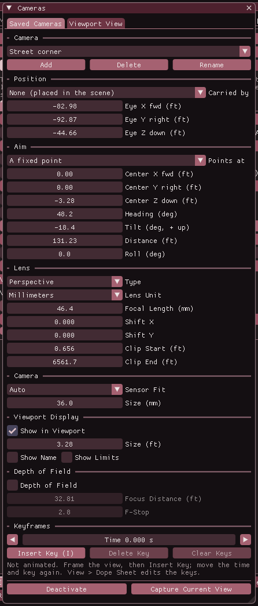

# Camera Setup Dialog Box

HVE's Camera Setup dialog uses a camera metaphor to determine how a scene is viewed: viewing a scene is much like looking through a camera. It also saves and deletes named views, so several views can be defined and re-used.

In HVE Studio the same job is done by the **Cameras** window: **Tools › Cameras...**. It has two tabs, **Saved Cameras** (named cameras stored with the case) and **Viewport View** (the live view of the Viewport). A saved camera can also be chosen from the camera list on the playback bar under the Viewport, and **C** / **Shift+C** cycle through the saved cameras without opening the window. Lengths are shown in the units set in Preferences.

## Saved Cameras tab

### Camera
A drop-down list of the saved cameras; *(active)* marks the one driving the Viewport and *(modified)* one that has been re-framed in the Viewport without being saved. **Add** creates a new camera from the current view, **Delete** deletes the selected camera, and **Rename** renames it.

When the active camera has been re-framed in the Viewport, the window shows it as *Current -- re-framed from "<name>", not saved*, with **Save as New**, **Overwrite "<name>"** and **Revert** buttons.

### Position
**Carried by**
**None (placed in the scene)**, or the vehicle the camera rides on (Blender's *parent*). A vehicle carries the camera through playback, and holds it at its start layout before a run.

**Inherit** (shown when a vehicle carries the camera)
**Position only** — the camera travels with the vehicle and its offset stays in world axes (a tracking shot); **Position and heading** — the offset turns with the vehicle's heading, so *behind* stays behind through a turn, and the horizon stays level (a chase shot); **Position, heading, pitch and roll** — bolted to the vehicle, the picture banking with it.

**Eye X fwd**, **Eye Y right**, **Eye Z up** (placed in the scene): where the camera stands — HVE's *Camera Coordinates*.

**Offset X fwd**, **Offset Y right**, **Offset Z down** (carried): where the camera sits, from the vehicle's CG, in its own frame (+X forward, +Y right, +Z down, SAE), or in world axes for **Position only**. For example, 0, 0, 0 views the scene from the vehicle's CG, wherever the vehicle is.

A camera carried by a vehicle is a **vehicle camera**: the Vehicle editor's Outliner lists it under the vehicle (**Vehicle Cameras**), and right-clicking that group adds one at the driver's eye (**Add Driver's-Eye Camera**). Before a run, a vehicle the active event does not place is taken at the origin heading forward, where the Vehicle editor draws it.

### Aim
**Points at**
What the camera looks at (Blender's *Track To* target): **Its own direction**, a vehicle, or **A fixed point**. Position and Aim are independent: the camera can ride one vehicle while aimed at another.

- **Its own direction**: **Heading (deg)** — from the vehicle's nose for a carried camera, in the scene for one placed there — and **Tilt (deg, + up)**. It turns with whatever carries it. With its own direction the eye is fixed, so the mouse wheel dollies along the view axis by editing the Offset rows.
- A vehicle: **Aim X fwd**, **Aim Y right**, **Aim Z down** — the point looked at, from that vehicle's CG in its own frame, so a point ahead stays ahead through a turn. **Look ahead** and **Aim at the vehicle** set typical values.
- **A fixed point**: **Center X fwd**, **Center Y right**, **Center Z up** — HVE's *Picture Center*.

For a camera placed in the scene the dialog shows the aim both ways, kept in step: with its own direction, the point it is **Looking at**; with a fixed point, the **Heading**, **Tilt** and **Distance** from the eye. Editing either leaves the eye where it is.

Changing Carried by, Inherit or Points at keeps the camera where it is and looking where it looks at the playback time, as far as the new setting allows.

An orange note reminds that only the **active** camera drives the Viewport.

### Roll (deg)
Rotates the camera about its viewing axis, tilting (banking) the picture. 0 keeps the horizon level. HVE's *Camera Tilt Angle*.

### Lens
**Type**: **Perspective** or **Orthographic**. For a perspective camera, **Lens Unit** chooses between **Millimeters** (enter a **Focal Length (mm)**) and **Field of View** (enter a **Field of View (deg)**); 50 mm is a normal view, shorter focal lengths are wide-angle and longer ones telephoto. For an orthographic camera, **Orthographic Scale** sets how much of the scene the frame spans across its longer side. **Shift X** and **Shift Y** shift the picture. **Clip Start** and **Clip End** are the near and far clipping distances: anything closer than Clip Start or farther than Clip End is not drawn.

### Camera
**Sensor Fit** (Auto, Horizontal or Vertical) and the sensor size, which only change how a field of view reads as a focal length.

### Viewport Display
**Show in Viewport** draws the camera in the 3-D view, at the given **Size**; **Show Name** labels it and **Show Limits** draws its clip range.

### Keyframes
Animates the camera over the playback time: step to the previous or next key, set the time, **Insert Key (I)**, **Delete Key** and **Clear Keys**, and choose each key's interpolation and easing and the camera's extrapolation and cycling.

### Activate / Deactivate, Capture Current View
**Activate** makes the selected camera drive the Viewport (**Deactivate** releases it). **Capture Current View** copies the Viewport's current view into the selected camera.

## Viewport View tab

Controls for the live Viewport camera, without saving it: **View Controls** (**Orbit** or **Free (Euler)**), **View Preset** buttons (**Top**, **Front**, **Rear**, **Left**, **Right**, **Persp**), the orbit azimuth, elevation, distance and target (or, in Free mode, the eye position and pitch, yaw and roll), **Projection** (**Perspective** or **Orthographic**, with a focal length or field of view), and **Reset Camera**.

In Orbit mode, **Eye / Orientation** (linked) shows, read-only, the eye position and the pitch and yaw that the orbit settings give, as the Free mode would show them.

!!! warning "Not in HVE Studio"
    - **A human or the environment** as what carries a camera or what it points at: a camera is carried by, and points at, a vehicle or the scene.
    - **Use Vehicle's Vertical** and **Make Glass Clear**.
    - **OK / Cancel / Apply**: changes take effect as they are made.

!!! tip "New in HVE Studio"
    Cameras set up as Blender's are — a parent (Carried by, Inherit) and a target (Points at) — orthographic cameras, lens shift and sensor fit, camera keyframe animation, drawing cameras in the Viewport, and the quick camera list on the playback bar.

<!-- NAV -->

---

← Previous: [3-D Editor Menu](3dEditor.md)  |  [Index](README.md)  |  Next: [Key Results Dialog Box](KeyResDlg.md) →

<!-- /NAV -->
