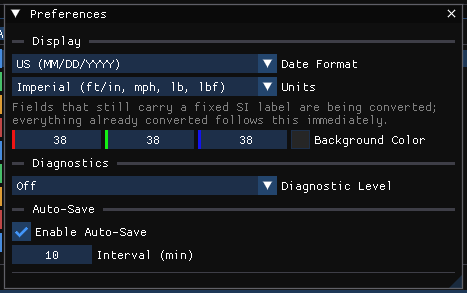

# User Preferences Dialog Box

Choosing **Tools › Preferences...** displays the **Preferences** window. Settings take effect as they are changed; close the window with its close button.



## Display

### Date Format
**US (MM/DD/YYYY)** or **ISO (YYYY-MM-DD)**.

### Coordinates
**SAE** or **Conventional**. This is how x, y, z and headings are shown and typed; the case, its files and the engines always store SAE, so changing it never changes a result.

- **SAE**: x forward, y right, z down, heading clockwise from above.
- **Conventional**: the SAE frame turned 180 degrees about x. X is the same; y is positive to the left, z is positive up, and a heading is counter-clockwise from +x.

A field that states a direction in its label shows the direction the current setting uses; heights (Z Height, elevations) stay positive up.

Some fields keep a fixed frame and say so beside the field: an occupant segment's own axes (ellipsoid axes, joint positions, belt anchors on the occupant), the vehicle belt anchors (SAE axes about the CG), an airbag's yaw and roll, and a camera's keyframes in the Dope Sheet (the camera's own frame: x forward, y right, z up). See [Coordinate Systems](../hve-users/11-appendices/appendix-03-coordinate-systems.md).

### Units
**Metric (m, km/h, kg, N)** or **Imperial (ft/in, mph, lb, lbf)**. Every dialog and output that shows a converted value follows this setting at once; see [Units Dialog Box](UnitsDlg.md). A note says that fields still carrying a fixed SI label are being converted.

### Background Color
The color behind the 3-D scene. Click the swatch for a color picker, or type the values.

## Language

### Language
The language the windows are shown in: **English (as written)**, each language pack found, and **Pseudo (coverage check)**. It changes at once and is saved between sessions.

Only what is shown changes. Every label keeps its place, a case file, a report and the physics never see a translation, and your own wording for a label (**Tools › Output Settings... › Terms**) is kept over a language's. A pack that brings its own font (for a script the default font lacks) uses it from the next start.

**Pseudo (coverage check)** is not a language: every label is shown with accents and in brackets. Text that stays plain is text a translation does not reach, and a label whose closing bracket is cut off is one a longer translation would cut off too.

### Import Language Pack...
Reads a language pack and copies it into your languages folder (the note under these buttons names it); choose it in **Language** afterwards. A pack is a JSON file:

```json
{ "language": "Español", "code": "es", "font": "NotoSans-Regular.ttf",
  "strings": [ { "key": "Brake", "text": "Freno" } ] }
```

`key` is the label as the window shows it in English; `font` is optional, a TTF file beside the pack. A pack in which every `text` is empty is refused. Packs are also read from a `languages` folder beside the program.

### Export Translation Template..., Collect labels for a template, Rescan
To make a pack: tick **Collect labels for a template**, open the windows to be translated, then **Export Translation Template...**. The file lists every label collected (and every label the Terms tab lists) with an empty `text` to fill in, or with the current language's text when one is chosen, to revise a pack. The count beside the checkbox is how many labels have been collected. **Rescan** looks for packs again after a file is dropped into a languages folder.

## Diagnostics

### Diagnostic Level
**Off**, **Level 1** or **Level 2**.

## Auto-Save

### Enable Auto-Save, Interval (min)
A switch and an interval in minutes (at least 1).

!!! note "HVE Studio"
    - **Date Format** sets how dates are shown in the Audit Log, the file browser and the run report.
    - **Enable Auto-Save** (on by default) and **Interval (min)** write a recovery copy of the case, `<case>.autosave.hvex` beside it, while there are unsaved changes; the case file itself is never written. Saving the case removes the copy, and opening a case whose recovery copy is newer offers to open the copy.
    - These settings are saved between sessions.
    - **Language**: HVE's wording comes from its `Language.rsc` and `language_overrides.rsc` files. HVE Studio's language packs translate every window at once, and the Terms tab can read HVE's two files as well.

!!! warning "Not in HVE Studio"
    - **Diagnostic Level** is grayed: it has nothing to control in HVE Studio, where what a run assumed or repaired is always in its run status.
    - **Hide Date/Time From Printed Reports**, **Key Results** (Use Default / Use Previous / Use Custom, Copy to Variable Output), **Vehicle Dimensions Basis** (the Vehicles panel and the Inertia / Mass dialog show the sprung and total bases side by side instead; in HVE it changes no result, because every engine that reads it overwrites it with the total-mass basis), **Skidmark Height**, **Font Size**, **Physical Monitor Width**, **Long Velocity Vectors**, **Cycle Vehicle Colors**, **Resolution Setting** and **Reload language.rsc file on dialog exit**.
    - **Store Vehicle Geometries in case file**: not a preference in HVE Studio. **File › Embed vehicle meshes in the case** (off by default) stores each vehicle's own mesh inside the case at the next save; EDC's licensed meshes are never stored. A saved case also carries the site's geometry and photograph inside it (**File › Embed the environment in the case**, on by default), and **File › Publish Bundle...** writes the case, the meshes it names and its results into one folder.

!!! tip "New in HVE Studio"
    Related settings live elsewhere: **Tools › Style Editor...** sets the look of the interface; **View › Show Guidance Text** shows or hides the long explanatory notes in the dialogs (off by default; a message about a problem with the open case is always shown); **View › Panels Outside the Main Window** lets panels float as separate windows.

<!-- NAV -->

---

← Previous: [Playback Controls (Toolbar)](PlayBackControls.md)  |  [Index](README.md)  |  Next: [Report Window Dialog Box](PrevWnd.md) →

<!-- /NAV -->
