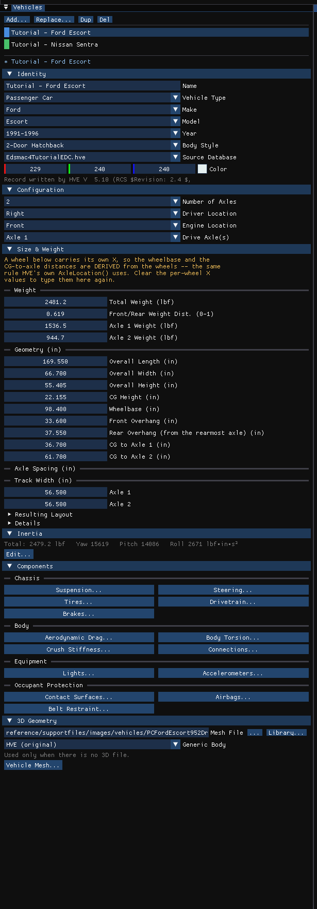

# CG To Front

**CG To Front (Exterior Dimensions)**

HVE edits the vehicle's exterior dimensions in six Vehicle Dimensions dialogs, one per face (CG to Front, Back, Top, Left, Right and Bottom), each with a Stiffness button. HVE Studio has no per-face dialogs. The exterior dimensions are entered in the Vehicle Editor (**Vehicle (F3)**), in the **Vehicles** panel under **Size & Weight › Geometry**, where six fields below **Overall Height** give the distance from the CG to each face that the engines receive: **CG to Front**, **CG to Rear**, **CG to Right**, **CG to Left**, **CG to Top** and **CG to Bottom**. All values are in the units set in Preferences.

## x Coord
Vehicle-fixed distance from the CG to the front of the vehicle. In HVE Studio this is the **CG to Front** field under **Geometry**, and it is editable. It is **CG to Front Axle** plus **Front Overhang**: typing it sets **Front Overhang** (to the value less CG to Front Axle, never below zero) and keeps **Overall Length** in step. When the wheels carry their own X positions (the **Wheel Positions** table), CG to Front is grayed, showing the wheels' value, along with the overhangs and the wheelbase. When the vehicle has a 3-D geometry and **Dimensions from geometry** is on, CG to Front is grayed too: the front of the vehicle is the geometry's.

On a **trailer or dolly**, typing **CG to Front** keeps **Overall Length**: the rear overhang takes the difference, so the front and the length can be typed in either order.

### Front Overhang
Distance from the front axle to the front of the vehicle. In HVE Studio it is stored as an **input** (under **Geometry**); **CG to Front** is CG to Front Axle plus it, and typing **CG to Front** sets it. Moving the front axle (CG to Front Axle, the wheelbase or the weight distribution) changes it, since the body stays with the CG. With a 3-D geometry and **Dimensions from geometry** on, it is grayed: it runs from the axle to the geometry's front.

On a **trailer or dolly**, which has no front axle, **Front Overhang** is HVE's trailer front overhang: from the front of the trailer to **axle 1** (its frontmost axle). The Generic Class 4 Trailer reads 442.25 in (252 in CG to front plus 190.25 in CG to axle 1). Typing it moves the front of the trailer and keeps **Overall Length**; the axles and the CG stay where they are.

### Overall Length
Shown under **Geometry**; the length the solver uses is **CG to Front** plus **CG to Rear**. If the entered Overall Length disagrees with the length the axle distances and overhangs describe, an orange note says so; the solver uses the derived figure. Typing or dragging **Overall Length** moves each overhang by half the change. On a **trailer or dolly** it moves the rear only: the front (CG to Front, Front Overhang) stays where it was typed, and the rear overhang takes the change. A length shorter than the front to the last axle leaves no rear overhang, and the panel says so. An overhang cannot go below zero: a shortfall one overhang cannot take goes to the other, so the shortest length is the axle span, with no overhang at either end, and the panel says so. With a 3-D geometry and **Dimensions from geometry** on, Overall Length is grayed: the geometry sets it. When the geometry's front or rear does not match the declared extents, **Fit to geometry** under the warning sets the overhangs and Overall Length from the geometry; the axles and the CG stay where they are.

## Stiffness...
The front face's A, B and Kv stiffness is edited in **Vehicle › Editors › Crush Stiffness...** (Vehicle editor, F3), the **Front** column's **2-D** rows. Its 3-D node stiffness is the same column's **3-D** rows (DyMESH's Front zone). See [Stiffness Coefficient Dialog](StiffCoeffDlg.md).

!!! warning "Not in HVE Studio"
    - A separate CG To Front dialog, and its Apply / OK / Cancel buttons. Edits in the Vehicles panel take effect as they are typed.
    - HVE displays the distance relative to the sprung-mass or total-mass CG according to the Vehicle Dimensions Basis preference; HVE Studio has no such preference. HVE Studio shows it from the sprung-mass CG, which is how the vehicle is stored. The preference never changes a result: EDCRASH, EDSMAC, EDSMAC4, EDSVS and EDVTS overwrite it with the total-mass basis when they read their input, in HVE's own source as well.

!!! tip "New in HVE Studio"
    When a 3-D geometry file is loaded and the mesh does not reach the declared front and rear extents, Size & Weight says so, directly under the **Wheel Positions** table (EDSMAC4 lists the difference in its Messages report and runs on the declared extents; DyMESH contacts the mesh itself). The note is shown only when it applies. **Fit to geometry** beside it sets the overhangs and the length from the geometry's front and rear. **Dimensions from geometry**, under **Geometry**, keeps them so.

!!! note "HVE Studio"
    In HVE, the dimensions are always typed and never change the geometry; its shape is changed in the separate Transform Vehicle Geometry dialog. HVE Studio does the same by default. **Dimensions from geometry** is an HVE Studio option that ties the length and overhangs to the geometry instead.

<!-- NAV -->

---

← Previous: [B Stiffness Coefficient Dialog](BStiffDlg.md)  |  [Index](README.md)  |  Next: [CG To Back](CGsToAll1.md) →

<!-- /NAV -->
