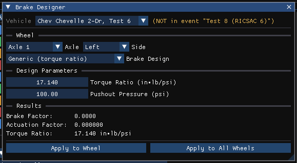

# Disk Brake Dialog Box

HVE has one Brake Designer dialog per brake type. HVE Studio has a single **Brake Designer** dialog for all of them: open it in the Vehicle Editor (**Vehicle (F3)**) with **Vehicle › Editors › Brakes › Brake Designer...** and choose **Disc** in its **Brake Design** list. This page describes the parts of the Brake Designer every type shares, then the disc brake's own fields. The **Vehicle** list at the top selects the vehicle. Lengths, areas and pressures are shown in the units set in Preferences; angles are in degrees.

## Wheel

### Axle, Side
Select the wheel whose brake design is shown (any axle of the vehicle). Each wheel keeps its own design.

### Brake Design
The brake type: **Generic (torque ratio)**, **Disc**, **Duo-Servo Drum**, **Duplex Drum**, **Single-Piston Drum**, **Dual-Piston Drum**, **S-Cam (Air Drum)**, **Single-Wedge (Air)**, **Dual-Wedge (Air)** or **Air Disc**. The **Design Parameters** below change with the type. **Generic** shows only a **Torque Ratio** and a **Pushout Pressure**, entered directly.

## Disc design parameters

**Number of Pistons**
Drop-down list selecting the number of caliper pistons (1 to 4).

**Piston Diameter**
Diameter of each caliper piston.

**Rotor Outer Diameter**
Outside diameter of the rotor.

**Rotor Inner Diameter**
Inside diameter of the rotor swept (friction) surface.

**Mechanical Efficiency**
Fraction of the actuation force actually delivered to the pads after mechanical losses.

**Pushout Pressure**
Pressure required to overcome the caliper seal/return force and begin developing brake torque.

## Lining Friction Properties

A collapsible section (every type but Generic), HVE's **Friction ...** dialog:

- **Friction vs. Temperature (µ)**: a table of lining temperature (°C) against friction coefficient, with a plot of the curve. **x** deletes a row; **Add Row** adds one (up to six).
- **Friction Multiplier vs. Sliding Speed**: a table of sliding speed (in the units set in Preferences) against a friction multiplier, edited the same way.

## Results

Recomputed continuously from the current parameters (there is no Apply button), with the lining at 20 °C:

**Brake Factor** *(read-only)*
Calculated ratio of total rotor or drum drag force to actuation force for the brake.

**Actuation Factor** *(read-only)*
Calculated actuation force per unit of system pressure (shown in m²).

**Torque Ratio** *(read-only)*
Calculated wheel brake torque per unit of system pressure, in N·m/kPa (SI) or in·lb/psi (US).

## Apply to Wheel / Apply to All Wheels

**Apply to Wheel** writes the designed Torque Ratio and Pushout Pressure into the selected wheel's [Brake Assembly](BrkAsmblyDlg.md) data and sets its drum-or-disc Temperature Model to match the design (Generic leaves it as it was). **Apply to All Wheels** copies this design to every wheel and applies it to each. Choosing a design in Brake Assembly's **Brake Type** applies it the same way; edits made here afterwards reach the engines when you press Apply.

**Design...** in Brake Assembly opens this window on that wheel, on any axle of the vehicle.

!!! note "HVE Studio"
    A wheel whose design is not **Generic** has its brake torque recomputed at every step of a simulation from this design: the brake factor at the simulated lining temperature and sliding speed, the actuation factor, and for S-cam, wedge and air disc brakes the stroke factor (see [Chapter 29](../hve-users/10-brake-designer/29-brake-designer.md)). A **Generic** wheel runs on the Brake Assembly's **Torque Ratio** and **Pushout**.

!!! note "Removed in HVE Studio 2026-10-21"
    The **Drum data slots** / **Disc data slots** section, the old S-Cam Brake and Disc Brake tables' values for the selected wheel, is gone. Nothing read those values; the engine's brake data comes from the design above. A case saved before then loads normally and the old values are dropped.

!!! warning "Not in HVE Studio"
    - The schematic preview drawing of the brake.
    - A separate **Friction ...** dialog (it is a collapsible section here).
    - A separate **Material ...** dialog: it is the **Material Properties** section here (see [Brake Designer Material Properties](BrkMatPropDlg.md)).

<!-- NAV -->

---

← Previous: [Differential Data Dialog Box](DiffDataDlg.md)  |  [Index](README.md)  |  Next: [Drive Train Dialog Box](DriveTraDlg.md) →

<!-- /NAV -->
