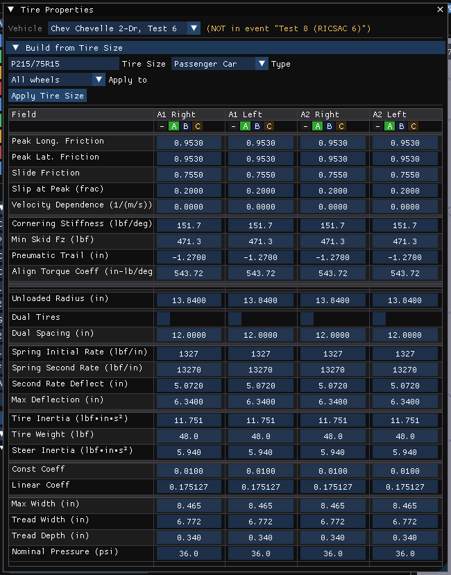

# Tire Information Dialog

In HVE the Tire Information dialog selects a tire for one wheel position from
the tire databases (Type, Manufacturer, Model, Size, Source Database) and opens
the tire's physical-data and table dialogs. In HVE Studio every tire parameter of
every wheel is edited directly in one table, the **Tire Properties** window,
and a tire is picked from HVE's databases in its **Tire Database** section.

!!! note "HVE Studio"
    Open it in the Vehicle editor (F3) with **Vehicle › Editors › Tires...**.
    The window shows the current vehicle (chosen in the **Vehicle** list at the
    top) with one column per wheel: **A1 Left**, **A1 Right**, **A2 Left**,
    **A2 Left**, and so on. All values are shown in the units set in
    Options › Preferences. The same window holds the fields of HVE's
    [Tire Physical Data dialog](TirePhyDataDlg.md) and the scalar friction and
    cornering values; the load/speed tables are in the **Load & Speed Tables**
    panel under the grid (see [Tire Friction Data](TireFrictDataDlg.md)).

While a solved run is on screen the window is read-only; reset the run to edit
it. A note at the top says when the vehicle shown is not in the active event.

## Build from Tire Size

HVE Studio's counterpart of choosing a tire by size. Type a size designation in
**Tire Size** (for example P215/65R15, 8R19.5 or 31x10.50R15LT), choose the tire
**Type** (Passenger Car, Light Truck, Heavy Truck, Mobile Home) and the wheels to
change in **Apply to** (All wheels, one axle, or one wheel: A1 Left, A1 Right, ...), then press **Apply Tire Size**.
The size string is parsed to fill the outer (unloaded) radius, maximum width,
tread width, tread depth and nominal pressure. Friction, cornering stiffness and
spring rates are left unchanged. An unrecognized string, or an obsolete
designation, is reported in the section and the button stays disabled.

**Opening a case repairs the old default.** HVE's tire databases store a size and no width (0), and a vehicle or tire
loaded from one before November 2026 kept HVE Studio's starting value, 215 mm (tread 180 mm). When a case opens, every
tire whose maximum width is exactly 215 mm and whose size gives a different width takes the size's maximum width, and
its tread width too while that is still 180 mm. A width typed to any other value is kept, a 215-wide size is left alone,
and the Audit Log lists what changed. Save the case to keep the repair.

A tire is drawn, and SIMON and DyMESH solve it, at its **stored** maximum width; its size
is only a label until **Apply Tire Size**. When a wheel's stored width is more than 5% off
the width its size gives (for example a 295/75R22.5 stored at 215 mm, which a case saved
before the database loads filled the width from the size can still carry), an orange line
above **Build from Tire Size** names the axle, the side, the size and both widths, and
**Use the sizes' widths** sets the maximum and tread width of each listed tire from its
size. The radius, pressure and rates are left as they are. On a dual set the gap between
the two tires is the dual spacing less the width, so a narrow stored width shows as a wide
gap.

The section starts from the size and type already stored on the vehicle's
first wheel.

## Tire Database

HVE Studio's counterpart of choosing a tire by Type, Manufacturer, Model, Size and
Source Database. The collapsed **Tire Database** section lists the tires in the
HVE vehicle databases HVE Studio finds (the same folders the vehicle database
picker reads) in a table laid out like the vehicle database picker's:
**Manufacturer**, **Model**, **Size**, **Type** and **Database** columns, an
**All** filter under each heading (each offers what the other filters leave), a
click on a heading to sort by it, **Search** across manufacturer, model, size and
database, and **Clear filters**. While the list is narrowed, a line under it reads
*Showing N of M*. Selecting a tire shows its radius and the size of its tables (a
tire kept inside EDCVehicles.hvedb is read from the database for this line).
**Apply Tire** replaces the tire data and all four tables of the wheels chosen in
**Apply to** (All wheels, one axle, or one wheel) with the database tire's; each
wheel keeps its own dual setup.

## Used by

In the Vehicle Designer, **Used by** (on the line under the stage name, see
[Vehicle Designer](../hve-users/04-vehicle-editor/12-vehicle-designer.md#used-by))
picks a calculation method, and the rows it does not read are dimmed and stay
editable; this window, opened on its own, is not dimmed. **All programs** dims nothing. A method
marked **(in an event)** is one this vehicle's events run. Hover a row's name
for what the chosen method does with it, and the source line that reads it. An
amber **\*** marks a row the method reads only part of — for a table, which
row and speed it takes. A row printed in the method's report but not read by
its simulation is dimmed too, and says so.

Some rows count only under an option of the run, and their note says which:
pneumatic trail and steer inertia need the steer degree of freedom, tread
width, tread depth and nominal pressure feed the hydroplaning model, and the
TMeasy rows are read by SIMON's tire model 3 only.

!!! note "HVE Studio"
    New in HVE Studio. Each claim is checked against the engine source by the
    test suite, so the filter cannot drift from what the programs read.

## Tire Group

The row of group buttons at the top of every column, numbered **T1**, **T2**, ... up
to the number of wheels (a drop-down when there are more than four). Columns in the same
group are edited together: changing a value in one changes it in all
the others of that group, and moving a column into a group copies that group's
current values into it, its four **Load & Speed Tables** included. A wheel
alone in its group edits alone. The groups start from the tires themselves: wheels
carrying the same tire (the same name, size, type, dual setting, physical values and
friction table) share a group, numbered in wheel order, so a vehicle imported with
one tire in front and another at the rear starts with the front pair in **T1** and
the rear pair in **T2**, and a value typed for the front tires does not change the
rear ones. Applying a size or a database tire to only some wheels puts them in a
group of their own the same way. The groups are set again from the tires when a
wheel's **Dual Tires** or the number of axles changes; a group you choose stays until then. The groups
are saved with the case, and **Undo** reverses a group change. The
tables panel below the grid follows the same groups.

!!! note "HVE Studio"
    The tire groups replace HVE's **Copy to Other Side** and **Copy to Other
    Axles** check boxes.

**Layout...**, beside the group row's name, sets the usual arrangements in one step: **Same both sides** (each axle's left and right wheels in a group of their own), **Same on every wheel** (one group), and **Each wheel its own** (every wheel in a group of its own, so an edit changes only that wheel). The arrangement the wheels are in now is checked; none is when the groups are a mix of them. A new group takes the values of its first wheel, A1 Left first. Under **Copy once** it does what HVE's *Copy to Other Side* and *Copy to Other Axles* do: pick a wheel under **From**, then **To the other side**, **To the other axles** (the same side of every other axle) or **To every wheel**. The copy changes no group, and a wheel copied to takes its group mates with it. Pointing at a column outlines it and tints the wheels in its group, the ones an edit there will change; they stay marked while the field is being edited.

## Tire and Size

The two rows under the group row say which tire each wheel carries. **Tire** is
its manufacturer and model (point at it for the tire's name). **Size** is a
drop-down of the sizes the Tire Database has for that same manufacturer, model and
type, so changing only the size is one choice, as in HVE's Tire Information
dialog; a tire whose manufacturer and model the database does not have lists the
**Generic** tires of its type instead. Choosing a size applies that database tire
to the wheel and to the other wheels of its group, and **Undo** takes it back.

## Size Designation and Tire Type

Shown read-only in the Physical part of the table. They are set by **Build
from Tire Size** or the **Tire Database**, not typed. The physics
re-parses the size itself: DyMESH builds a wheel's contact mesh from it, and
the soft-soil and radial-spring tire–terrain models take the tire width from
it. A wheel with no size is flagged "(none: P225/75R16)", the size the engine
falls back to.

## Dual Tires

Check box indicating that this wheel position uses dual tires.

## Dual Spacing

Lateral distance between the centerlines of the two tires of a dual pair.
Grayed for a wheel whose Dual Tires box is unchecked.

## Tire Name, Manufacturer, Model

Text rows of the table's **Identity (report only)** section, with **HVE
Version**. They are filled when a vehicle is imported or a tire is applied from
the Tire Database; every engine's tire report prints them, and nothing else
reads them.

## Fields that moved

The remaining rows of the table — friction, cornering stiffness, pneumatic trail,
spring rates, inertias, rolling resistance and dimensions — are described on the
[Tire Physical Data](TirePhyDataDlg.md) page.

Where every wheel has a friction table, the friction rows (peak longitudinal
and lateral friction, slide friction, slip at peak, velocity dependence) are
not shown: those values are entered in the tables, even when a table has one
load and one speed, and the Friction section says so in one line. The same goes
for **Cornering Stiffness** when every wheel has a cornering table. When only
some wheels have a table, the row stays, grayed on those wheels.

The HVE buttons **Friction...**, **Fy vs Slip Angle...**, **Fy vs Inclination
Angle...** and **Slip vs Roll-Off...** are the **Friction Table**, **Cornering
Table**, **Camber Table** and **Fy Roll-off** rows of the table's **Load &
Speed Dependence** section: each wheel's button shows the size of its table
(hover it for the contents) and selects that wheel and that table's tab in the
**Load & Speed Tables** panel below the grid; the button for the table on
screen is highlighted. In the Vehicle Designer's Tires stage the button scrolls
the page down to that panel rather than opening the Tire Properties window. A drag bar between the grid and the panel resizes them.
**Physical Data...** has no counterpart: the physical data are in the same
table.

!!! warning "Not in HVE Studio"
    - **Mass**: the table shows the tire's **Tire Weight** instead.
    - **Save As...** and **Delete**: a tire cannot be saved to, or deleted from,
      a database on its own (see [Tire Save As](TireSaveAsDlg.md)).
    - **OK / Cancel**: edits apply as you make them; **Edit › Undo** (Ctrl+Z) or
      **Edit › Undo History...** takes one back.

<!-- NAV -->

---

← Previous: [Tire Friction Data Dialog](TireFrictDataDlg.md)  |  [Index](README.md)  |  Next: [Tire Physical Data Dialog](TirePhyDataDlg.md) →

<!-- /NAV -->
