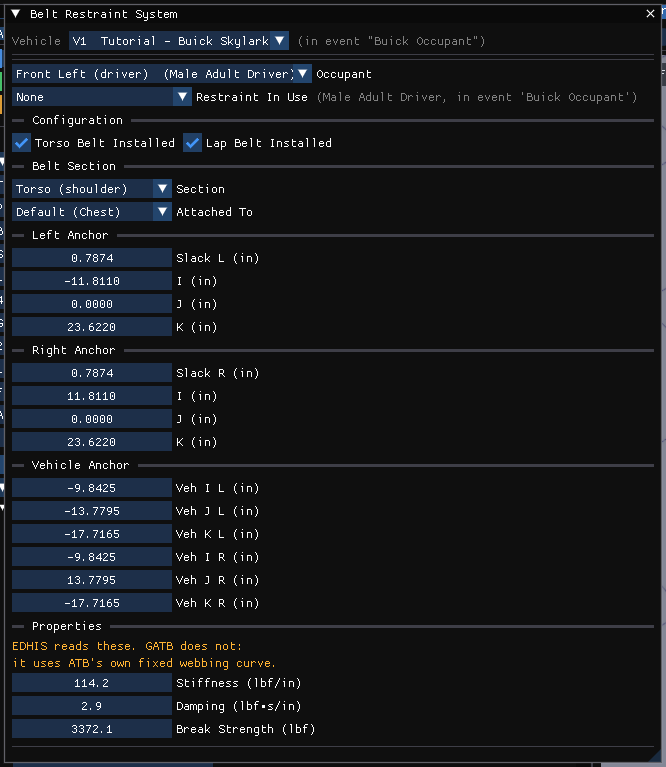

# Belt Restraint System Dialog Box

In HVE the Belt Restraint System dialog places installed torso and lap belts in
use for an occupant in the event and sets where each belt end attaches to the
body and how much slack it has. The belt hardware (anchors and webbing) is
installed in the vehicle editor's Belt Restraints dialog.

!!! note "HVE Studio"
    Open the **Belt Restraint System** window from **Vehicle › Editors › Belt
    Restraint...** in the Vehicle editor (F3), or **Event › Restraints... › Belt
    Restraint...** in the Event editor (F5; EDHIS and GATB events). HVE Studio
    puts HVE's vehicle-side belt hardware and event-side belt use in this one
    window. The belt geometry is stored with the vehicle, one set per SEAT, as
    HVE keeps it, so it applies to every event the vehicle appears in and to
    whoever sits in that seat; the window warns when the vehicle shown is not
    in the active event. What the occupant wears is stated per event. Lengths,
    stretch rates, damping and force follow the units set in Options ›
    Preferences. While a solved run is on screen the window is read-only.

Each belt section is modeled as two belt segments (left and right). One end of
each is attached to a body segment; the other end is attached to an anchor
point on the vehicle.

## Seat

HVE's *Belt Restraints For* / *Seat Position*. The list names the vehicle's
nine seats, each with the occupants seated there in the active event and the
belts it has (torso + lap, torso only, lap only, no belts). The window opens on
the seat of the human selected in the Humans panel; choosing a seat with one
occupant selects them in the Humans panel.

## Worn in the Active Event

What each occupant at this seat wears **in the active event**, as three
independent switches, as in HVE: **Torso Belt**, **Lap Belt** and **Airbag**.
These place the belts and the airbag in use for the run: each belt is used only
if it is installed below (a belt ticked where none is installed is left off,
and the window says so); the airbag deploys with or without belts, and needs a
bag installed at the seat (**Vehicle › Editors › Airbags...**), or the run is
refused. The same three switches are beside the human in Event Information. If
nobody sits at the seat in the active event a note says so; seat the occupant in
Event Information first.

!!! note "HVE Studio"
    These are HVE's per-belt **Device In Use** check boxes and its airbag's
    in-use switch. Before v3.0.211 HVE Studio offered one combo instead (None,
    Lap Belt, 3-Point Belt, Airbag + Belt), which could not state an airbag
    without belts or a torso belt alone; an older case's choice is read as the
    switches it meant.

## Configuration

**Torso Belt Installed** / **Lap Belt Installed** — whether each belt section is
fitted at this seat.

## Belt Section

Choose **Torso (shoulder)** or **Lap**; the anchor, slack and webbing fields
below then apply to that section. HVE's *Belt Segment* list.

## Attached To

The body segment the selected section's belt segments are attached to — HVE's
*Belt Attached To*. **Default (Chest)** for the torso belt and **Default
(Pelvis)** for the lap belt are HVE's own defaults; the list also offers every
body segment. EDHIS accepts Pelvis, Abdomen or Chest for a torso belt and
Pelvis or Abdomen for a lap belt; GATB accepts only Chest and Pelvis. For any
other choice the run is refused with the engine's own message, as in HVE.

## Left Anchor / Right Anchor

For the left and right belt segments:

- **Slack L** / **Slack R** — the displacement allowed between the ends of the
  belt before it carries tension (a negative value implies pre-load).
- **I**, **J**, **K** — the belt attachment point on the body segment, in the
  segment's coordinate system. HVE's *Segment Coordinates*.

**Place on the Body's Sides** — sets the two body points of the selected
section on the sides of the segment of the occupant who sits in this seat in
the active event (seat one first; the button is unavailable otherwise). The
torso belt goes on the sides of the chest, high on the D-ring's side and low
on the buckle's, so it crosses the chest diagonally; the lap belt goes on the
sides of the pelvis at its center height, so it wraps the hips. The D-ring is
the torso section's higher vehicle anchor.

!!! note "HVE Studio"
    A new belt's body points are a placeholder that is on the body's
    centerline. When a section still has those points, a note under the
    section says so, and a GATB run uses the same placement as **Place on
    the Body's Sides** on that occupant instead. An EDHIS run uses the points
    as stored. The run status
    then says *belt at seat N meets the sides of the occupant's chest and
    pelvis*. Before November 2026 the run used the placeholder, which put the
    shoulder belt straight down the middle of the chest. Points stated by the
    case, such as those imported from an HVE file or edited here, are used as
    stated.

## Vehicle Anchor

**Left end: forward of CG**, **Left end: right of CG**, **Left end: below CG**,
**Right end: forward of CG**, **Right end: right of CG**, **Right end: below CG** (called Veh I L to Veh K R before) —
the vehicle end of the left and right webbing, relative to the vehicle CG, forward, right and
down positive (a point above the CG has a negative below); HVE's anchor locations from the vehicle Belt Restraints dialog. A vehicle
from the database carries HVE's own anchors for every seat: for a 3-point belt
the torso section runs from the shoulder D-ring (outboard, above the seat) to
the buckle (inboard, at the seat), and the lap section from the outboard lap
anchor to the same buckle -- three points, drawn in the 3-D view when the
section is installed.

## Webbing Properties

The webbing force law of the selected section, HVE's six rows, each with a
**Right** and a **Left** value:

- **Linear Stretch Rate**, **Quadratic Stretch Rate**, **Cubic Stretch Rate** —
  the tension is linear × stretch + quadratic × stretch² + cubic × stretch³.
- **Damping Constant** — adds damping × stretch rate.
- **Breaking Strength** — the tension at which the webbing saturates.
- **Unloading Slope** — the slope the tension unloads along once the Breaking
  Strength is reached. At 0 the webbing never saturates, whatever the Breaking
  Strength says (EDHIS's unloading model needs both above 0).

!!! note "HVE Studio"
    EDHIS reads all six rows, side by side. GATB reads none of them: it uses
    ATB's own fixed webbing curve, as HVE's GATB does, so changing them leaves a
    GATB result unchanged. The window says so above the table. Before v3.0.211
    there was one material per section, with only the linear rate, damping and
    breaking strength: the quadratic and cubic rates reached EDHIS as 0, and the
    unloading slope had no control.

<!-- NAV -->

---

← Previous: [Airbag Restraint System Dialog Box](AirBagSysDlg.md)  |  [Index](README.md)

<!-- /NAV -->
