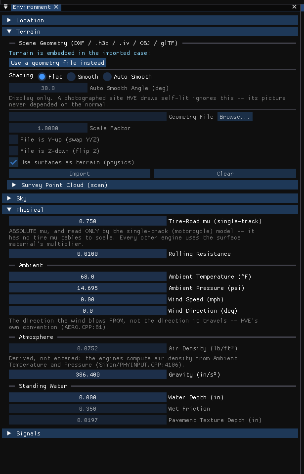

# Environment Information Dialog

The environment holds the scene a case runs in: its name, date and location, the
terrain geometry the vehicles drive on, the sky, the physical constants of the
site, and its friction zones.

!!! note "HVE Studio"
    In the Environment editor (F4) choose **Environment › Environment...**. The
    **Environment** window has six collapsible sections in place of HVE's
    tabs: **Location**, **Terrain**, **Sky**, **Lights**, **Physical** and **Friction
    Zones**. Terrain and Physical — what the solver reads — open by default,
    and Friction Zones when the case has any. All five are always present;
    there is no 2-D/3-D distinction. Lengths, speeds, temperature and pressure
    follow the units set in Tools › Preferences. While a solved run is on
    screen, Terrain, Physical and Friction Zones are read-only; Location and
    Sky are description and stay editable.

## Location

**Name** — The name of the scene. HVE's *Environment Name*.

**Date** — The date of the crash or test. HVE's *Date of Crash*. Typed as text
(mm/dd/yyyy, as HVE writes it, or yyyy-mm-dd), or picked: **Calendar**, beside
the field, opens a month grid. The arrow buttons step a month or a year, a click
on a day fills the field in as mm/dd/yyyy, and **Today** picks today's date.
The same button sits beside the date in the Shader Editor's Sun & Sky panel.

**Time** — The local standard time of day. HVE's *Time of Crash (24 Hr)*.
Typed as 14:30, 1430 or 7:05:30 and kept as hh:mm (or hh:mm:ss); an entry that
is not a time of day (such as 3221:30) is refused with the reason and the
previous time kept.

Either may be left empty. When the sun is placed from the location, an empty
**Date** is taken as March 20 (the equinox, which lights a site the same in
either hemisphere) and an empty **Time** as noon. Only the sun uses these
stand-ins: the case keeps the fields empty, so no report shows a date or time
that was never stated.

**Latitude (°)** / **Longitude (°)** — The site's latitude and longitude in
decimal degrees, north and east positive (HVE enters them as dd.mm.ss with
N/S, E/W). They are stored to full double precision (about a millimeter on the
ground); older versions kept them to roughly half a meter, and a case saved
that way reads back with the same numbers it showed. Typing in either field
marks the case as georeferenced.

**Elevation** — The site's elevation.

**North offset (°)** — How far the case's axes are turned from the default. At
**0**, +X points east and north is up the screen in a top view (+X to the right,
+Y down under SAE, so north is -Y; under Conventional it is +Y), the way an
aerial photograph or an online map is drawn, so an aerial image or terrain
downloaded for the place lines up with the screen the same way. A positive offset
turns +X clockwise, toward south. It turns the North arrow, the sun and where
downloaded images and terrain are placed; positions already in the case are not
moved. HVE's *Angle of X-Axis* (the bearing of +X from true north, 0 = north) is
this offset plus 90, so an opened HVE case whose X axis points north shows
**-90**, and the same Shader Editor setting, **North**, is the same number.

### Coordinate system

**Optional.** Fill this in only when you will bring in survey points, LiDAR or a
georeferenced picture by their own coordinates; the section says so at its top.
Downloads from the map (aerial image, terrain, lidar) need only the Latitude and
Longitude above. If unsure, leave both codes at 0.

A case is either georeferenced (it has a place on the Earth) or not. **Not
georeferenced** is an ordinary state: the case has no geographic coordinates,
and nothing in HVE Studio needs them. A case saved before this was recorded is
georeferenced when its latitude or longitude is not zero. A latitude and
longitude of exactly 0, 0 is a valid place and is kept when it is set.

**Treat as not georeferenced** — At the end of the section. Marks the case as
having no geographic coordinates. The latitude and longitude stay as typed (the
sun still uses them) and nothing is moved.

**Horizontal CRS (EPSG)** — The EPSG code of the coordinate system the site's
own data are in, for example 26917 for NAD83 / UTM zone 17N; 0 means not
stated (the panel says "Horizontal: not stated (0)").
**UTM, WGS 84** and **UTM, NAD83** fill in the UTM zone the location falls in,
which is shown beside them. For a UTM system the panel shows the origin's easting and northing,
how far grid north is from true north there, the grid bearing of the case's +X
axis, and the point scale. The code is a record: nothing already in the case is
moved or converted on its account. Codes this version can convert are WGS 84,
Web Mercator, UTM on WGS 84, NAD83 (zones 1–23) and ETRS89 (zones 28–38); any
other code is recorded and the panel says it cannot convert it.

NAD83 and ETRS89 are treated as the same as WGS 84. They are not: NAD83 differs
from WGS 84 by about 1–2 m across the contiguous US. No shift is applied, and
the panel says so whenever one of those systems is chosen.

**Vertical CRS (EPSG)** / **Vertical datum** — The datum the site's elevations
are in (5703 NAVD88, 5702 NGVD29, 4979 WGS 84 ellipsoidal, or a name such as
local). **NAVD88**, **NGVD29** and **WGS 84 ellipsoid** fill in both. NAVD88 is
what USGS terrain and lidar in the US are in. Elevations are recorded in that
datum and never converted between datums: this version has no geoid model. The
code is checked against a downloaded terrain's own datum; the name is a record
only.

!!! tip "New in HVE Studio"
    The coordinate system section.

**Set from a pasted coordinate** — Paste a coordinate in decimal degrees, in
degrees-minutes-seconds, or a map link; the box shows how it reads, and
**Apply** sets Latitude and Longitude. A pair given longitude-first is
reordered, and the box says so.

**Search an address** — Type an address or place and press **Search**; pick a
result to set Latitude and Longitude. **Set UTC offset from location** looks up
the time zone of the coordinate. Both send what you type, or the coordinate, to
online services (OpenStreetMap's Nominatim and timeapi.io).

The results are a numbered list beside numbered pins on the **Map** below it.
Choosing a result shows it on the map; **Use this place** (or a double-click on
the result) sets the case's Latitude and Longitude to it and looks up its time
zone. **Clear results** empties the list. On the map, drag (or middle-drag) to pan, use the
wheel to zoom, and double-click anywhere to put the case's location there.

Under the map, choose the tile source. When it is an aerial source, choose the
area to download and press **Download aerial image**: the yellow rectangle on
the map, aligned to the case's axes, is downloaded and laid on the ground as the
case's aerial site image (**Environment › Aerial Image...**), or, with **Add as
a new layer** on, as a layer above it. It is placed
assuming the case origin is at this location and +X points along its North
angle. The button needs the case's location to be set first.

The area is a square about the map's center (50 to 800 m), or, with **Select
area** on, a rectangle you drag on the map; dragging then draws the area
instead of panning (middle-drag still pans, and the wheel still zooms), and
**Clear area** returns to the square. When the case
has no location yet, drawing the area also sets it, at the area's center, so
the download buttons work at once; a case that already has a location is never
moved by drawing. The orange
rectangle is what you dragged; the yellow one is what is downloaded, the
smallest rectangle aligned to the case's axes that covers it, so it is larger
than the selection whenever the North offset turns the case away from the
screen. The panel states
the area's size, the image size and the resolution in meters per pixel; a very
large area gives a coarse image, and the panel says when it is too coarse for a
scene. **Cancel** stops a download under way and writes nothing to the case.

Imagery is kept in the case only from sources whose terms allow it. The USGS
source (US government imagery, published without restriction) can be
downloaded. The street map, Mapbox and Esri sources are for looking at only:
their terms do not let a case keep a copy, so **Download aerial image** is
unavailable for them and the panel says why. To use other imagery, import your
own image (**Environment › Aerial Image...**).

For the USGS source, **Download aerial image** asks USGS's orthoimagery image
service first: the finest imagery The National Map holds at the place (NAIP and
the high-resolution orthoimagery), drawn at the flight's own pixel size, 0.3 or
0.6 m in the places checked. That is much sharper than the map tiles, where cars,
sidewalks and lane lines can be read. The service names the flight and its
resolution, and states its acquisition date: the status line and the record show
the flight's name, its date and its native pixel. A date is kept only when it
agrees with the date in the flight's own name; if the catalog cannot be read, or
the two disagree, the record says "not stated" rather than guess. If the service
cannot be reached the download falls back to the map tiles below, and the status
says so. The dataset in the record names which one the picture came from. The
service holds one flight per place, the latest. An earlier date comes from the
next control.

**Find older flights** — Appears under the USGS source. It asks Microsoft's
Planetary Computer (`planetarycomputer.microsoft.com`), which holds every NAIP
flight since 2009, which flights cover the center of the area, and lists them
newest first with their dates and pixel sizes. The area's coordinates are sent
there, and the panel says so. Choose one in the list that appears (the first
entry, **Latest available (USGS image service)**, is the default) and press
**Download aerial image**: the picture is cropped from that flight's own raster
at its own pixel size and placed in the case frame exactly as the USGS picture
is, and the case's record names the flight, its date and the Planetary
Computer. A flight's date is kept only when the date in its own name agrees, as
for the USGS service; otherwise the list says "date not stated" and the year.
A flight that covers only part of the area leaves the rest of the picture
transparent. If an older flight cannot be drawn, the download stops with the
reason and writes nothing: it never substitutes a picture of another date.
NAIP imagery is US Department of Agriculture imagery published without
restriction, so the case keeps it like the USGS picture.

A provider does not have imagery at every level of detail everywhere: USGS
map-tile imagery, for example, stops at level 16 (about 1.8 m per pixel) over much of the
US. Where a level is missing the map shows the coarser tiles that exist and says
"no imagery this deep here: a coarser level is shown", and a download is
enlarged from the coarsest level it had to use. The download status says so,
with the source's real resolution against the resolution written, so a sharp
looking file is never taken for sharp imagery.

A downloaded image carries its source with it: the provider, dataset, credit
line, the coarsest level of detail any of its pixels was taken at, the UTC date and time of the
download, and the geographic edges of the area. The panel shows them under the
download, and they are saved and reopened with the case. An image you picked
yourself carries none of this.

The location is recorded with the case; it does not position or scale the
scene geometry. It places the sun (see **Sky**).

!!! tip "New in HVE Studio"
    The coordinate paste box and the address search, the area selection and
    the source record on a downloaded aerial image.

!!! warning "Not in HVE Studio"
    HVE's location database (**Current Location**, **New Location**, **Add New
    Location**). The **GMT** offset is the **UTC offset** in the Shader Editor's
    Sun & Sky panel.

## Terrain

### Embedded terrain

When the case was opened from an HVE case file (`.hve`) that stores its site in
the case itself, the section says the terrain is embedded and names its source.
There is then no file, scale or axis option to set; the polygon count and
extents are shown. **Use a geometry file instead** discards the embedded
terrain so a file can be chosen.

### Shading

**Flat**, **Smooth** or **Auto Smooth**, with **Auto Smooth Angle (deg)**
(enabled for Auto Smooth). Flat uses one normal per face; Smooth averages the
normals where faces meet, so a graded road stops showing its triangles; Auto
Smooth averages only between faces within the angle, so curbs and building
edges stay sharp. Display only.

!!! tip "New in HVE Studio"
    The shading modes.

### Geometry File

The terrain geometry file, typed or chosen with **Browse...**: DXF, HVE geometry
(`.h3d`), Inventor (`.iv`), VRML (`.wrl`), OBJ or glTF (`.gltf`, `.glb`).

**Scale Factor** — scale applied to the imported geometry, to meters. For an
`.h3d` the field is **Extra Scale**, since an `.h3d` states its own units
(inches) and frame, which are applied automatically.

**File is Y-up (rotate to Z-up)** — for a file whose vertical axis is Y.

**File is Z-down (Flip About X-Axis)** — for a file whose vertical axis points
down. For an `.h3d` it reads **Flip About X-Axis (file's vertical sense is
reversed)** and only
corrects a file that is not what it claims. For DXF, OBJ and glTF nothing in
the geometry can tell a valley from a hill, so check the elevation range in the
summary against the site.

**Use surfaces as terrain (physics)** — the imported surfaces are what the
vehicles drive on. Unchecked, the geometry is drawn only.

**Import** reads the file; **Clear** removes the geometry. After an import the
section shows the number of surfaces and lines and the X, Y and Z extents, or an
error.

**Outside the site** — what a tire finds where there is no site surface: past
the edge of the mesh, or in a hole in it.

- **As HVE** (the default): a point-contact tire rides a flat ground at
  elevation 0; a radial-spring tire finds nothing, so the vehicle falls.
- **Flat ground**: every tire model drives on a flat ground at **Ground
  elevation** (up is positive, in the site's own frame), friction multiplier 1.
- **Nothing (vehicles fall)**: no tire model finds ground.

Whichever is chosen, a tire off the site no longer searches every surface of
the site on every step, so a run no longer slows to a crawl once a vehicle
leaves the mesh. A large site also solves faster with radial-spring tires.
Results are unchanged by the speed-up (ctest `site_bounds_ab` compares every
step).

A **zero-area triangle** in the site (its corners on one line, or at one point)
is not ground. HVE reads a flat one as ground along its line, or under the whole
scene; here it is ignored, and the run status says how many the site has.

!!! warning "Not in HVE Studio"
    - The **Type** choice (None / Terrain Map / Aerial Photo). An aerial photo is
      set separately with **Environment › Aerial Image...** (the **Aerial Image
      Options** window: **Image File**, **Visible**, **Opacity** and the
      image's upper-left and lower-right world coordinates).
    - **Save As...** of the environment geometry to `.h3d`. (A saved case keeps
      its site inside it while **File › Embed the environment in the case** is
      ticked, as it is by default.)
    - **Use As Default**, and the **Default Type** given to imported polygons:
      an imported polygon with no type is a road. Change a surface's type on its
      material (below).
    - DWG files.

### Geographic terrain (USGS 3DEP)

!!! tip "New in HVE Studio"
    Terrain from the US Geological Survey's 3D Elevation Program (3DEP), placed
    against the case's location.

The section needs the case to be **georeferenced** (see *Coordinate system*
under *Location*): the terrain is placed against the case origin, with the
case's North offset. A case with no location says so and offers nothing. The
section also says what it does with the network: it sends the area's
coordinates to USGS (`tnmaccess.nationalmap.gov` and
`elevation.nationalmap.gov`) and nothing else leaves the machine.

**In the web version** the section works too, with three differences. There is no
map there (its tiles and the address search need background threads a browser tab
does not have), so set the location by pasting a coordinate, and the area is the
square about that location at the size chosen in **Area** at the top of the
section; a dragged rectangle is not available. While USGS answers, the window
pauses (the message says so, and it can take up to about half a minute). And the
download is allowed only because USGS's services let a web page read them; if
the network is blocked the section says the browser could not fetch it. The
aerial image works there too: with a location set, the same panel offers **Area**,
**Find older flights** and **Download aerial image**, for the USGS source only
(the map tiles need background threads), and the page pauses while the picture
comes in, up to about a minute. LiDAR tiles are a desktop feature: USGS's
lidar server does not let a web page read its files, so there the section says to
download the tile yourself and load it under **Survey Point Cloud (scan)** in the Environment dialog's Terrain section.

The section sits on the **Site** stage, under the **Map**, because it takes the
same area as **Download aerial image**: the rectangle dragged under **Select
area** on the map, or the square of the size chosen beside it (turned by the
North offset like the case itself). There is no second area to choose here.
The size lists show round numbers in the units you work in (feet or meters).

**Cell size** — The grid the terrain is resampled to: 1 to 100 ft, or 0.5 to
30 m. Under the choices the section states the area, the number of cells and the
number of road polygons the solver would search (two per quad). Over 200,000
quads it says the site is heavy for the solver; over 500,000 it refuses.

**Find elevation data** — Lists the elevation surveys USGS has under the area
(under the heading **Surveys under the area**), finest first, each with its resolution, its vertical datum (NAVD 88 for USGS
data) and its publication date. Nothing is downloaded. Each survey has a
selection button: **Best available** (the default) takes the terrain from
USGS's blend of every survey, which is the finest one wherever it reaches;
choosing a survey asks for the terrain from that survey alone, and the record
then names only it. USGS's own "acquisition
date" in its catalog is a build date, not a survey date, so it is never shown:
the section says the acquisition date is not stated and the survey's record
(linked once a terrain is downloaded) has it.

**Lidar point cloud (USGS 3DEP)** — Below the terrain controls, in the desktop
version. **Find lidar tiles** asks USGS's catalog (`tnmaccess.nationalmap.gov`)
for the point-cloud tiles under the same area and lists them newest publication
first, each with its survey project, its publication date and its size
(3 to 30 MB or more); nothing is downloaded. **Use** beside a tile downloads it
from `rockyweb.usgs.gov`, keeps it (beside the case in a `usgs-lidar` folder once
the case is saved, otherwise in the program's cache) and makes it the case's
survey point cloud, replacing any there. The window stays usable while it
downloads; a tile already on disk at the catalog's size is not fetched twice. The
case's survey point cloud holds one file, so on a site that spans several tiles
the tile you choose is the one drawn; the others can be fetched and chosen in
turn. A point cloud is a picture and changes no result: turn it into a drivable
surface with **Drivable Surface from Scan** in the Environment dialog's **Survey Point Cloud (scan)** section.

**Download and add to the site** — Downloads the terrain and adds it to the
site as one more surface. The site keeps everything it had (surface types,
materials, layers and moves); the terrain's surface is named
`USGS_terrain_` and the download's time, so it can be given a type or hidden or
deleted on its own in the Outliner, and a second download is a second surface.
Each download is put on a layer of its own automatically, named `USGS terrain`
and the day it was downloaded, so the terrain can be hidden, switched off for
the solver or moved as one thing; the layer can be renamed in the Outliner.
Where it overlaps a drivable surface already in the site, the engines use their
own rule (the first surface in the list). On a site that came from an HVE
case, the **Add Geometry...** button for files stays unavailable, but the
terrain can still be added here: the case then stops naming its `.hve` and
carries the merged site itself, the HVE site's surfaces keep their names, types
and friction, and the added terrain is still there after the case is saved and
reopened. With no site at all, the terrain simply becomes the site.

**Download and replace the site** — Downloads the terrain and makes it the
site. When the site has content a confirmation asks first (**Replace the
site?** with **Replace the site** and **Cancel**): the site's surfaces and the
edits made to them are replaced, and the new terrain is put on its own layer. **Edit › Undo** restores them.

Unless one survey is chosen, the terrain is USGS's seamless blend of the surveys
listed, resampled to the cell size, so it is one interpretation of several
surveys. Its heights are made
**relative to the elevation at the case origin** (z = 0 there), because the
engines and Auto Position work on a site whose ground is at 0; the offset is
stated. A site with a download in progress, or with results on screen, is
locked like the rest of the geometry: the download finishes and waits for the
results to be discarded.

**Where the site came from** — One entry per download, kept in the case: the
surface's name, whether it was added or replaced the site, the provider and
dataset, the surveys, the vertical datum, the height offset, the grid, the
finest survey's resolution, the publication date, the acquisition date ("not
stated" unless known), the download's time, the coordinate system, and the link
to the survey's record. An entry whose surface is no longer in the site says
so. **Remove this record** deletes the note only; the surface stays until it is
deleted in the Outliner.

Accuracy is as the survey states it: nothing here labels the data
"approximate", and nothing improves it. NAD83 and WGS 84 are treated as the same
(see *Coordinate system*), and no vertical datum is converted.

### Survey Point Cloud (scan)

!!! tip "New in HVE Studio"
    A collapsed section that loads a survey scan (LAS, LAZ, PLY, E57, XYZ, PTS, TXT or
    CSV) as a picture of the scene.
    A point cloud is **display only**: vehicles cannot drive on it, settle onto
    it or collide with it. Import a site surface for that, or build one from
    the scan with **Drivable Surface from Scan**. The section has the
    file, **Scale (source -> m)**, **Source is Y-up**, **Source is Z-down**,
    **Points loaded (for the surface)**, **Points drawn per frame**, **More detail
    near the camera**, **Shown (%)**, **Color** (Auto, File color,
    Intensity, Elevation, Flat gray), **Point size (px)**, **Visible**, a
    **Placement** offset and rotation (to level a scan), and **Import** /
    **Clear**.

### Selected Surface

Shown once geometry is loaded. The scene's surfaces, grouped by layer, are
listed in the **Outliner** (View › Outliner; **Open Outliner** here opens it):
the eye switch draws a surface, the road switch sends it to the solver;
clearing both removes it from the picture and the solver. Click a surface in
the 3-D view, or pick its row in the Outliner, to select it.

For the selected surface this section shows its name, type and friction, with
**Edit in Shader Editor** and **Deselect**, and its **Placement** (move, turn
and scale it on its own). A surface's **type, friction,
stiffness and soil properties** are edited on its material in the Shader
Editor, on the **HVE Surface** node — see
[Environment Material Properties](EnvrMatPropDlg.md).

When the surface clicked is stored twice by the case — once as the drivable
surface and once as the drawn one — the section shows both, each with its own
switch; the material belongs to the drivable half.

**Default material** (a button here, or the *Default material* row in the
Outliner) edits here the material applied to any drivable polygon that has
none of its own.

## Sky

A summary of the sun's direction and strength and the ambient light, and
**Edit the sun and sky...**, which opens the Shader Editor's world, where the
sun and sky are set.

**Sky Preset** makes the world one of the skies that ship with HVE Studio:
**Clear sky (HDR)** and **Overcast sky (HDR)** — two CC0 high-dynamic-range
skies from Poly Haven — or one of HVE's own backdrop images (blue sky, the
cloud and sky photographs, the hillsides). The world becomes an
**Environment Texture** on that image, through a **Background**, to the
**World Output**; the Shader Editor edits it from there. HVE's backdrops are
flat photographs rather than panoramas, so they wrap around the view. Display
only, like the rest of the world.

!!! note "HVE Studio"
    The sun is placed from the location, date, time and UTC offset (or set by
    hand), by NOAA's method or HVE's own. The **North** angle there is HVE's
    *Angle of X Axis* (the compass bearing of the case's +X axis).

!!! warning "Not in HVE Studio"
    The sky dome's own rotation, fog (type and visibility). HVE's sky image is
    the world's **Environment Texture** (Sky Preset, or any image in the
    Shader Editor).

## Lights

Lights of the site itself — street lights, work lights, a floodlight on a
pole — not attached to any vehicle. **Add Light** places one 8 m above the
ground at the middle of the view; **Duplicate** and **Delete** manage the list.

For the selected light: **Name**; **On**; **On in daylight too**; **Type**
(**Point (every way)** or **Spot (a cone)**); **X (forward)** and **Y (right)**
in the site's plan; **Height above the ground** (the ground beneath it is found
where the light stands, so it stays on its pole when moved; with no ground under
it the field reads **Height (no ground under it)**); for a spot, **Aim (deg,
right of forward)**, **Tilt down (deg, 90 = straight down)**, **Cone (deg,
half-angle)** and **Edge softness**; **Color** and **Intensity (1 = a
headlamp)**. A light in the list that is switched off reads "(off)".

The lights belong to the site: when the site is moved, turned or scaled (its
placement), they move with it, and a spot's aim turns with it.

A site light comes on as the sky darkens, as a vehicle's lamps do; tick
**On in daylight too** for one that should also light the scene by day. In
the 3-D view each light is marked by a star with a dotted line to the ground
(and, for a spot, a line along its aim) while the Environment is selected.

The 3-D view lights the scene with up to 32 lamps at once, site lights and
vehicle lamps together. Site lights take at most sixteen of them, the ones
nearest the middle of the view, so the vehicles' lamps always have the rest.
The ray-traced render, the glTF export (as KHR_lights_punctual lights) and the
Blender live link (as lights named HVE_Site_<name>) carry every one. Site
lights are display only: no engine reads them.

!!! note "HVE Studio"
    HVE made site lights with the 3-D Editor's Light tool; HVE Studio has no 3-D
    Editor, so they are made here and stored in the case (JSON
    `environment.lights`).

## Physical

There is no friction on this page: for every engine, the single-track model
included, friction is each tire's own times the Friction Multiplier of the
surface (Selected Surface) or friction zone it is on.

Rolling resistance is not on this page either: it is each tire's own
(**Vehicle › Editors › Tires...**, Rolling Resistance), as in HVE.

**Ambient Temperature** — The ambient temperature. Feeds the air density used by
the aerodynamic model.

**Ambient Pressure** — The ambient barometric pressure.

**Wind Speed** — The ambient wind speed.

**Wind Direction (deg)** — The direction the wind blows **from**, measured from
the earth-fixed X axis (HVE's convention).

**Air Density** — Derived from Ambient Temperature and Pressure, as the engines
compute it; display only.

**Gravity** — The local acceleration of gravity (m/s² or in/s²).

Standing water is not on this page: it is set per surface, on each surface's
HVE Surface node in the Shader Editor, and on the **Default surface material**
for ground with no surface of its own — see
[Environment Material Properties](EnvrMatPropDlg.md). Rolling resistance is
each tire's own (**Vehicle › Editors › Tires...**).

!!! note "HVE Studio"
    The *Angle of X Axis* is in the Shader Editor's Sun & Sky panel as
    **North** (see Sky).

## Surface Generator

The Surface Generator draws a surface over the site in plan: a road, a
friction zone, standing water or another surface. Each lies on the ground
beneath its outline, draped over a bank or a ramp exactly as that ground lies.
Its **Type** decides what it does in a run:

| Type | In the run |
|---|---|
| **Road** | Replaces the ground beneath its outline. A tire there drives on the surface's own material, under every road-surface search. |
| **Other** | The same as **Road**. HVE's engines treat an Other surface as road; only the label differs. |
| **Friction Zone** | A patch of different grip (spilled oil, loose gravel, a wet strip) laid on the ground. It keeps the ground's material with only the friction replaced, or uses its own material. |
| **Water** | Water standing on the ground. The ground keeps its own material; the hydroplaning models of SIMON and EDSMAC4 read the depth and the wet friction. |

The list shows each surface's **On** switch, name, **Type**, **Layer** and
status. Pick a type and click **Add Surface** to make one; **Duplicate** and
**Delete** manage the list. For the selected surface:

While results are on screen the site's physical properties (these surfaces and
each surface's type, friction, stiffness and soil) are locked. Every event reads
the site, so the note there carries **Reset Run to Edit** -- or **Reset *N* Runs
to Edit** when several events hold results -- which clears the results of every
event that has them (hover it for the list). The case itself is untouched.

- **Name**, **Type**, **Applied to the run** and **Show**. Show only draws it:
  a hidden surface still acts in the run while it is applied.
- **Layer**: the layer it is drawn on, as an imported surface's is. Hiding the
  layer hides it. A layer takes nothing out of the run. Create layers in the
  [Outliner](../01-user-interface/OverLayDlg.md).
- **Material**, for a road or other surface: the material library, **Condition
  preset**, **Friction Multiplier**, the force terms, the soil terms and
  standing water, as for any surface. A new road starts as the default
  material (**Terrain**) at a multiplier of 1.
- **Material**, for a friction zone: **Ground's material, friction replaced**
  (with its **Friction Multiplier**) or **Its own material** (the full
  material rows).
- **Water**, for water: **Water Depth** and **Wet Friction**.
- **Appearance**: **Own color**, the color the 3-D view draws it. Display only.
- A **Rectangle** (**Center X**, **Center Y**, **Length**, **Width**,
  **Heading (deg)**, and **Set Outline to Rectangle**, which replaces the
  outline with that rectangle; length runs along the heading, 0 = +x) and its
  **Corners** (up to 16): **Click corners in the 3-D view**, **Clear Corners**,
  the corners' X and Y, and **Add Corner**.

A surface the run cannot apply says why. The 3-D view draws each surface where
the run put it; one switched off for the run is drawn faint.

Under HVE's default road surface search, which tracks each tire's previous
polygon, a friction zone lying on the road is mostly stepped over. The section
names each event that searches that way, with a button that switches it to
friction zones first (see
[Event Information](../09-events-driver-controls/EventInfo.md#road-surface-search)).
A road, other or water surface is met under every search.

Each generated surface is also a row of the
[Outliner](../01-user-interface/OverLayDlg.md), under its layer or under
**Generated surfaces**.

!!! note "HVE Studio"
    HVE draws its surfaces as polygons of their own in its geometry editor;
    HVE Studio draws them here, in plan. A case saved before the Surface
    Generator existed opens with its friction zones as Friction Zone surfaces.

## Signals

!!! warning "Not in HVE Studio"
    HVE's traffic signals — its list of individual signals in the environment,
    with their type, layout, repeating cycle and Start Time / Follow / Overlap
    timing. HVE Studio has no traffic signals; no physics program models a
    traffic light.

## OK / Cancel

There are none: edits apply immediately, and **Edit › Undo** (Ctrl+Z) takes one
back.

<!-- NAV -->

---

← Previous: [Environment Material Properties Dialog](EnvrMatPropDlg.md)  |  [Index](README.md)  |  Next: [Lining Friction Properties Dialog](LinFriPropDlg.md) →

<!-- /NAV -->
