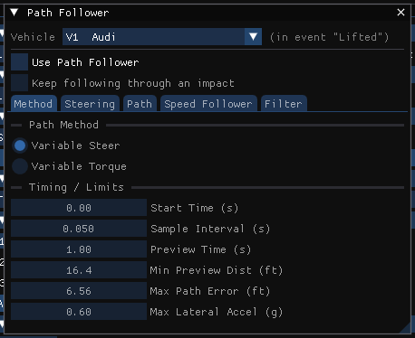

# Driver Controls Path Follower

The HVE Driver model lets the simulation determine the steering, throttle and
braking inputs required to follow a user-defined path (and, optionally,
user-defined speeds along it).

In HVE Studio this is the **Path Follower** tab of **Driver Controls** (Event
editor, F5; **Event › Path Follower...** opens Driver Controls on it). It is
stored per event per vehicle; the vehicle header at the top picks one of the
event's vehicles. Inputs are locked while the event's results are on screen.

The speeds are shown only when they are used: the **Speed (…)** column of the
waypoint table and the **Speed Follower** section's settings appear once **Use
Speed Follower** is ticked (EDGEN, which has no driver, always shows the speeds, as it
takes them as path data).

!!! note "HVE Studio"
    As in HVE, this is a page of the Driver Controls dialog. A line at
    the top of the tab says what the active event's method does
    with it:

    - **SIMON**, **EDSMAC4** — run the HVE Driver model for each vehicle.
    - **EDVSM** — one vehicle, so this page is that vehicle's.
    - **EDVDS** — reads only the **tow unit's** page and steers the tow unit; a
      trailer's page reaches no engine (and is grayed).
    - **EDGEN** — generates its path through the waypoints but does not run the
      driver model; the gains, limits and filter have no effect.
    - Every other method does not read the path follower, so the tab is not shown for it (nor for a trailer under EDVDS).

## Use Path Follower

When checked, the HVE Driver model is enabled for this vehicle and the
sections below become available. When unchecked, the driver inputs come from the Steer, Brake
and Throttle tables.

## Keep following through an impact

!!! tip "New in HVE Studio"
    Off (the default, and HVE's behavior), the path and speed follower stop at
    this vehicle's first collision and never resume; steering reverts to the
    driver steer table. On, the follower keeps steering and pedalling toward its
    path through and after the impact. This is a deliberate departure from HVE —
    a driver model is not validated during a collision — so use it only when the
    post-impact path is something you are asserting rather than solving. It
    applies only to SIMON and EDSMAC4 (the methods with a vehicle-to-vehicle
    collision model), and only to this vehicle.

## One page

The parts of the path follower are sections of one page, top to bottom:
**Timing / Limits**, **Steering**, **Path**, **Speed Follower** and **Filter**.
Each starts open; click a section's header to collapse it.

!!! note "HVE Studio"
    HVE splits these across tabs. There is no **Path Method** choice: the
    driver always corrects the path by steering (HVE's Variable Steer). See
    [Driver Controls Path Follower Method](DriverControls1.md) for why
    Variable Torque is not offered.

## Timing / Limits

HVE's Driver tab:

- **Driver Start Time (s)** — time at which the driver model begins acting.
- **Driver Sample Interval (s)** — interval at which the driver model samples
  the vehicle's position relative to the path.
- **Driver Preview Time (s)** — how far ahead of the vehicle (in time) the
  driver looks when computing the path correction.
- **Min Preview Distance** — lower limit on the preview distance, used at low
  speeds (units set in Preferences).
- **Path Error Null Distance** — maximum allowable lateral path error; the
  driver steers to null path errors within this distance (units set in
  Preferences).
- **Driver Comfort Level (g)** — the maximum lateral acceleration the driver
  will tolerate.

## Steering

The steering correction's parameters — see
[Driver Controls Path Follower Method](DriverControls1.md).

## Path

The target path (HVE's *Path Source*). The vehicle's initial position is the
first path node; up to **7** further waypoints follow, each with **Use**,
**X**, **Y**, **Z** (units set in Preferences), **Yaw**, **Roll** and **Pitch**
(deg), **Speed** and **Slip** (deg; sideslip, read by EDGEN only). The Yaw of a node is the direction of the path's tangent
there, so editing it bends the path; each segment is a cubic curve whose handle
length the engine fixes.

The path is three-dimensional: **Z** is the height of the vehicle's CG at the
node above the datum, and **Pitch** the climb of the path there (nose up is
positive). Both shape the path the driver follows. **Roll** is read by EDGEN
only; the path follower of the other programs ignores it, as HVE's does.

- With the vehicle's **Auto Position** on (Event panel), the program settles
  the vehicle on the ground at each node when it runs, so Z, Roll and Pitch are
  shown grayed. With it off, they are what you enter.
- A node that states no pose (a case saved by an earlier version) takes the
  initial position's.
- **Add positions by clicking the 3-D viewport** — each click on the site's
  ground appends the next waypoint, with yaw set from the segment direction and
  the vehicle settled on the ground there (Z, Roll and Pitch).
- **Clear all positions** — removes every waypoint.
- **Ghost vehicle at each node** — draws this vehicle's footprint at each
  waypoint, at the node's height and tilt, so you can see whether the path
  fits (display only).
- **X** at the end of a row deletes that waypoint and closes the gap. A selected
  waypoint can also be deleted in the viewport with the Delete key.

The **Speed** column is the attempted speed at each node, used by the
[speed follower](DriverControls8.md).

!!! warning "Not in HVE Studio"
    - The **Model** choice (Ver. 1 / Ver. 2).
    - Taking the path from the Position/Velocity dialog: the path is the
      waypoint table in this section.
    - **Max Speed Error** is not in this section; it is **Max Velocity Error**
      in the Speed Follower section.

## Speed Follower

See [Driver Controls Speed Follower](DriverControls8.md).

## Filter

See [Driver Controls Filter](DriverControls6.md).

<!-- NAV -->

---

← Previous: [Driver Controls Filter](DriverControls6.md)  |  [Index](README.md)  |  Next: [Driver Controls Speed Follower](DriverControls8.md) →

<!-- /NAV -->
