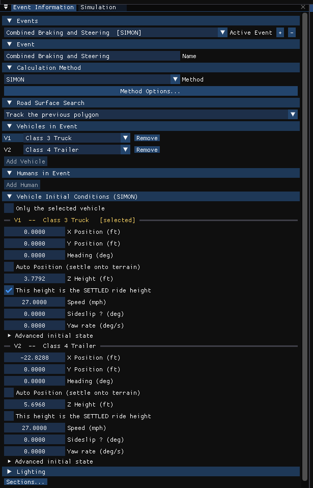
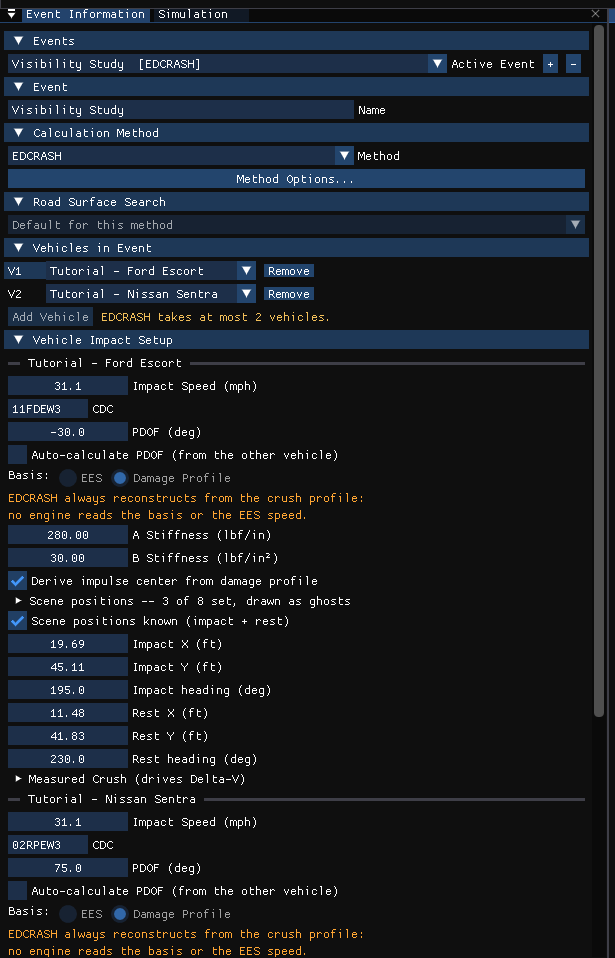

# Event Information Dialog Box

The **Event Information** panel creates and edits events: it names the event,
chooses the calculation method, assigns the vehicles and humans that take part,
and holds each vehicle's initial conditions (or, for EDCRASH, its impact
reconstruction setup).

Open it from **Event › Event Information...** in the Event editor (F5). It is a
dockable panel, also hosted on the Event Designer's **Event** stage. Its
body is a list of collapsible sections; drag a section header onto another to
reorder them. Right-click a section header for **Move up**, **Move down**,
**Hide this section**, **Show all sections** and **Reset order**. Use
**Sections...** at the bottom to tick which sections are shown (the only way
back once every section is hidden), or for **Show all** and **Reset order**.

!!! note "HVE Studio"
    HVE's Event Information was a modal dialog used when creating an event,
    with separate Humans and Vehicles lists and a list of selected objects. In
    HVE Studio it is a panel that stays open, edits the active event directly,
    and also carries the initial conditions that HVE kept in the
    Position/Velocity dialog. While the active event's results are on screen
    its inputs are locked (a banner says so); **Reset** the run to edit them.
    Choosing a different event, adding an event and collapsing sections stay
    available while locked.

## Events

**Active Event** — a drop-down listing every event in the case as
*name [method]*. Choosing one makes it the active event; every Event-menu
dialog edits the active event.

**Add** adds a new event (named *Event n*, with the active event's calculation
method, or in a case with no events the method you used last) and makes it
active. **Delete** deletes the active event; the remaining
events are renumbered. An event cannot be deleted while results for it are on
screen.

## Event (Event Name)

**Name** — the event's name. HVE Studio does not generate a name from the
selected objects; a new event is named *Event n*.

**Start time (s)** — the time shown at the event's start, for example −5 so
that the impact reads near 0. The results, the graphs, exported output, the
event's playback bar and the Results HUD read the event's clock, and a new
Playback track is placed at it. The run itself is unchanged: the engine still
integrates from 0. *(New in HVE Studio.)*

## Calculation Method

**Method** — a drop-down list of the calculation methods: EDCRASH, EDSMAC, EDGEN,
EDHIS, SIMON, EDSMAC4, GATB, EDSVS, EDVDS, EDVTS, SINGLETRACK, EDVSM,
READDATAFILE and GBF. The calculation method selects the physics engine that
runs the event.

- A method whose output has not yet been validated end to end in HVE Studio is
  marked *(unvalidated)*, and a line under the list says so for the active
  event.
- A method that cannot run the event's current vehicles (wrong number of
  vehicles, axles or connections) stays selectable but is marked
  *— N/A for these vehicles*; hover it for the reason. If the active event's
  method cannot run, a red *Cannot run:* line gives the reason.
- An event imported from an HVE case that uses a program HVE Studio does not have
  shows that method grayed and marked *— not ported*; it can be opened and
  saved but not run.

Unlike HVE, the method of an existing event can be changed at any time.

**Physics** — which physics runs the event:

- **HVE** — the physics as it now stands (the default).
- **HVE-reference** — the same engines frozen as they were validated against
  original HVE, run by their own solver program (`hve-solver-reference.exe`
  beside the program). Where that program is not present, or in the browser
  version, a red *Cannot run:* line says why.
- **HVE (imported)** — solves nothing: **Run** plays original HVE's own saved
  run of this event. Only a `.hve` saved after the event was executed carries
  one, and only while the case is open from that file; otherwise a red *Cannot
  play:* line says why.

Results solved by one are not the other's. **Output › Compare Runs...** runs
the event with two of them and compares the runs (see
[Compare Runs](../hve-users/02-menu-reference/04d-output-menu.md#compare-runs)).
*(New in HVE Studio.)*

**Method Options...** opens the active method's calculation options window
(see [Calculation Options](../10-calculation-options/README.md)). EDSVS, EDVDS,
EDVTS, READDATAFILE and GBF have no options window; the button is grayed for them.

**GBF's inputs.** For a GBF event, the panel shows GBF's own inputs under the
method (see the [GBF manual](../programs/GBF/README.md)):

- **Chamber pressure**: the air pressure at every brake chamber, in psi or kPa.
  A value outside 0–110 psi is refused.
- **Antilock (simple ABS)**, with its **Pressure drop**: each brake is held
  that far below the pressure that would lock its wheel.
- **Find the initial speed**, with its **Stopping distance**: GBF finds the
  initial speed that stops the truck in that distance.

HVE read the pressure and the antilock drop from the brake pedal table.
*(New in HVE Studio.)*

!!! warning "Not in HVE Studio"
    HVE located the calculation-method programs in its calcMethods directory.
    HVE Studio has all the engines built in; there is nothing to install or
    browse for.

## Road Surface Search

How the engine searches the terrain polygons under each tire (HVE's Get Surface
Information options, which HVE Studio keeps per event):

- **Default for this method** — tracks the previous polygon (HVE's own default
  for the simulation engines).
- **All triangles - first hit in file order** — HVE's *From First Polygon*. On a
  site with stacked or adjacent surfaces the first hit is arbitrary.
- **Track the previous polygon** — HVE's *From Previous Polygon*.
- **Track the previous polygon, friction zones first** — HVE's *From Previous
  Polygon, Sorted*.

The control is disabled for EDCRASH, EDGEN, EDHIS, GATB and SINGLETRACK, which
do not drive on the road surface through this search.

!!! warning "Not in HVE Studio"
    HVE's *By Elevation* method and its search **Direction** settings (All
    Directions / Upward Facing Only / Z Component Greater Than) are not offered.

## Vehicles in Event

One row per vehicle **slot** (V1, V2, ...). The slot order is the object
numbering the engine uses; for EDVTS and EDVDS slot V1 is the tow vehicle.

- Click **V***n* to select that vehicle (the viewport selection and the gizmo
  follow).
- The drop-down in each row chooses which case vehicle occupies the slot.
  Changing it **keeps** every input on the slot (position, speed, crush, tire
  blowout, wheel damage, tire-terrain settings) — use it for a what-if swap.
- **Remove** drops the slot after a confirmation; its inputs are discarded.
- **Add Vehicle** adds a case vehicle to a new slot. It is disabled once the
  method's maximum number of vehicles is reached. Below the method's minimum
  the event can be edited but not run, and a red line says how many more are
  needed.

## Humans in Event

Shown for EDHIS, GATB, EDGEN and SIMON events (for SIMON the occupants are
bookkeeping only; SIMON does not solve occupant motion). One row per human
slot (H1, H2, ...):

- The drop-down chooses the human; pedestrians are marked *(pedestrian)*. A
  human with no seeded body model is flagged *no body*.
- **Remove** drops the slot; **Pose** opens the Body Pose dialog for that human.
- **Occupies** — the vehicle the human rides in for **this event**, or
  *Pedestrian (no vehicle)*.
- **Seat X / Y / Z from CG** (an occupant), **Scene X / Y / Z** (an EDHIS or
  EDGEN pedestrian) or **X / Y / Z from vehicle CG** (a GATB pedestrian) — the
  human's position, in the units set in Preferences. A position measured from
  a vehicle's CG is a vehicle dimension (in, or m in metric); a **Scene**
  position is a site length (ft, or m), the same unit as the vehicle positions
  and the EDGEN path rows. Z is SAE (+ down).
- **Restraints (this event)** — **Torso Belt**, **Lap Belt** and **Airbag**,
  three independent switches, as in HVE: an airbag can be worn without belts
  and a torso belt without a lap belt. Shown for occupants in EDHIS and GATB
  events.
- On an EDGEN event, the human's **Scene path**: HVE's eight named positions,
  each ticked to use it, with **X**, **Y**, **Z, + down**, **Yaw (deg)**,
  **Pitch**, **Roll**, **Sideslip (deg)** (read only under EDGEN's 3-D Spline
  path model) and **Speed stated** / **Speed**. EDGEN moves the human through
  the ticked positions at the speed stated at each.
- A read-only note lists any armed self-contact pairs.

**Add Human** adds a case human. If no human is listed, the event takes every
human that has a seeded body; a note names them.

For EDHIS and GATB events a **Combined Contact Materials** header lists, and
lets you edit, the combined occupant/surface material for each interior contact
surface of vehicle slot 1 (force constant, linear, quadratic and cubic
stiffness, damping, friction, maximum force and deflection, unloading
stiffness, maximum penetration and edge constant).

## Vehicle Initial Conditions

For every method except EDCRASH this section is titled **Vehicle Initial
Conditions (*method*)** and replaces HVE's Initial path location in the
Position/Velocity dialog. The Event Designer's **Positions** stage shows this
section (or, for EDCRASH, Vehicle Impact Setup) by itself; the Event stage's
Event Information does not show it. One block per vehicle slot, headed *V*n* --
name*:

- **X Position**, **Y Position** (units set in Preferences) and **Heading (deg)**.
  Moving a tow vehicle carries its trailer; a trailer is kept on its hitch.
- **Auto Position (settle onto terrain)** — 3-D methods only. On, the engine
  settles the vehicle onto the terrain, and a line reports the resulting
  height, roll and pitch (or why it fell back to flat ground). Off, **Z Height**
  is entered directly. Planar methods always settle. For SIMON (HVE
  physics), the run also starts 2 s early and settles the vehicle in place on
  its suspension and tires before the event begins (see
  [SIMON Program Input](../programs/SIMON/02-program-input.md)).
- **This height is the SETTLED ride height** — SIMON only, with Auto Position
  off. Off (the default), SIMON applies its static tire deflection once; on, the
  entered height is already the settled elevation.
- **Speed**, **Sideslip β (deg)** and **Yaw rate (deg/s)**.
- **Advanced initial state** — **Vertical vel w**, **Roll angle (deg)**,
  **Pitch angle (deg)**, **Roll rate (deg/s)**, **Pitch rate (deg/s)**. Roll and
  pitch take HVE's own range, ±1800°, so a vehicle can start on its roof (roll
  180°). A pitch within about 1° of ±90° is flagged: SIMON's and EDVSM's
  Euler-angle equations are singular there and the run may stop.
- **Named Positions** — the vehicle's named positions (see
  [Named Positions](#named-positions) below).

For an EDVTS trailer the X and Y positions are shown grayed (EDVTS derives them
from the hitch) and **Articulation (deg)** relative to the tow vehicle replaces
the heading.

**Only the selected vehicle** collapses the other vehicles' blocks and limits
the 3-D view's named-position outlines to the selected vehicle (a view setting,
not saved with the case).

!!! tip "New in HVE Studio"
    **Seed from a previous run** chains events: it takes where the vehicles
    were in a solved event — at the end of the run or at a **Handoff time** you
    choose — and writes that as this event's starting position, heading and
    speed (**Seed Initial Conditions**). Vehicles are matched by vehicle, not by
    slot. Nothing else is copied.

## Vehicle Impact Setup (EDCRASH)

For EDCRASH the section is titled **Vehicle Impact Setup**, with one block per
vehicle. It carries the damage data that HVE entered in its Damage Data dialog
and the scene positions from its Position/Velocity dialog. In the
[Event Designer](../hve-users/06-event-editor/16a-event-designer.md) the two
halves are separate stages, one vehicle at a time: the scene on **Positions**,
the damage on **Damage Profiles**.

- **Time shown before impact (s)** (for the event) — how much of the approach the
  drawn playback shows before the impact, the same for every vehicle. 0 reads
  *automatic*: from the first surveyed position before the impact, or 2 s when
  there is none. Display only; it takes effect on the next run.
- **Drawn approach speed** — only for a vehicle with no rest position (a
  damage-only study). EDCRASH does not read an impact speed: with a scene it
  solves the impact speed from the positions, and this sets only how fast the
  playback approaches when there is no scene to solve it from.
- **CDC**, **PDOF (deg)** and **Auto-calculate PDOF (from the other vehicle)**.
  Only one vehicle may auto-calculate; if both do, EDCRASH refuses the event
  (stop code −5443).
- **Basis** (EES / Damage Profile) shown grayed, with the EES value: EDCRASH
  always reconstructs from the crush profile, and no engine reads the basis or
  the EES speed.
- **A Stiffness**, **B Stiffness**, and **Derive impulse center from damage
  profile** (uncheck to enter **Impulse Center X / Y**). These are EDCRASH's
  own, per event, and they are the pair EDCRASH reads: a case that states A and B
  per zone (an imported HVE case does) shows the zones' pair here, and zones that
  differ are edited under **Per-zone A/B**. As in HVE, entering a CDC that names
  a damaged face (its 3rd character F, B, L or R) copies the vehicle's own
  stiffness for that face (the Vehicle editor's Stiffness) into every zone. A
  note under the fields says whether they are the vehicle's; when they are not,
  it shows the vehicle's values and **Use the vehicle's ... stiffness** copies
  them.
- **Named Positions** — the vehicle's named positions (see
  [Named Positions](#named-positions) below). EDCRASH reads Impact and
  Final/Rest together: ticking either sets both, and with neither set the run is
  a damage-only reconstruction (delta-V from crush alone).
- **Impact sideslip (deg)** and **Velocity at rest** — below the list, shown
  when Impact and Final/Rest are set.
- **Measured Crush** — **# crush depths** (typed, or stepped with - and +),
  **C1**...**Cn**, **Damage width**, **Damage offset**, and per-zone A/B
  stiffness.
- **Damage Profile Drawing** — see below.

### The damage profile (EDCRASH)

**Damage Profile Drawing** draws the vehicle from above, front up, with the
profile as EDCRASH reads it (the engine's own geometry, so a mistake in the
measurement shows):

- the crush depths, each drawn in from the damaged face, and the crushed line
  through them, with **C1** and **Cn** named. EDCRASH puts **C1 at the left end**
  of front and back damage and **at the rear end** of side damage, centered on
  the damage offset; a reversed order or a wrong offset shows as a profile on the
  wrong side;
- the force: the PDOF drawn as an arrow into the impulse center (the derived one,
  or the entered one), and its **moment arm** from the CG, dashed;
- in words under it: which end C1 is, the PDOF and the impulse center, and which
  way the force turns the vehicle (clockwise or counterclockwise seen from above).

When the vehicle has a surveyed Impact and End of Rotation (or Final/Rest), the
drawing compares that turn with the scene's. If the force turns the vehicle one
way and the scene has it turning the other, a note says so and names the inputs
to check: the PDOF, the damage offset and the order of the crush depths. A turn
of more than half a revolution, or one the tires made after separation, can set
it off when nothing is wrong. With no measured profile (fewer than 2 crush
depths) it says EDCRASH takes the CDC's default profile.

See [Damage Data](../11-reports-output/DamageData.md) for how these map to
HVE's Damage Data dialog, and [Position/Velocity](PosVelDlg.md) for what each
scene position does in EDCRASH.

## Named Positions

A list in each vehicle's block, one collapsible node per HVE named position in
HVE's order: Initial, Begin Perception, Begin Braking, Impact, Separation, Point
On Curve, End of Rotation, Final/Rest. A line above the list counts how many are
set. The nodes start collapsed; each header reads *name*: *X*, *Y* *unit*,
*heading* deg when the position is set, or *name*: not set. Open a node to edit
it:

- **Set** — ticked, the position is set.
- **X**, **Y** (units set in Preferences) and **Heading (deg)**.
- **Auto Position (on the ground)** — on (the default), the vehicle stands on
  the ground at that position. Off, the entered **Z Height** (the CG's height
  above ground), **Roll (deg)** and **Pitch (deg)** are used, so a position can
  be rolled, pitched or airborne. Turning it off starts the three from where
  the ground puts the vehicle; with it on they are grayed.
- **Read by:** — a note saying what reads that position under the event's
  calculation method:
    - EDCRASH: **Begin Braking** (the speed before braking), **Impact** and
      **Final/Rest** (the reconstruction; set together, and without them
      EDCRASH runs a damage-only reconstruction), **Separation** (the
      separation velocity), **Point On Curve** (the post-impact path becomes an
      arc through it) and **End of Rotation** (the spinout ends there and a
      rollout follows). **Initial** and **Begin Perception** are drawn only.
    - EDSMAC4: **Final/Rest**; unset, EDSMAC4 defaults a rest position and says
      so.
    - Every simulation method: **Initial** is the start of the run (below). The
      other positions are drawn only, to compare with the run. This includes
      EDGEN, whose path comes from the Path Follower waypoints, not from the
      named positions.

A named position's elevation and attitude (Auto Position, Z Height, Roll and
Pitch) are drawn only — they place its outline in the 3-D view, and no program
reads them — except a simulation's Initial. For EDCRASH, the Impact node's
elevation and attitude are the event's own impact fields.

**Initial is the start of a simulation.** For every method except EDCRASH, the
Initial node is the vehicle's initial conditions: it has no **Set** check box
(it is always set; its note reads *The start of the run: the initial conditions
above.*), and its X, Y, Heading, Auto Position, Z Height, Roll and Pitch are the
same values as the **X Position**, **Y Position**, **Heading (deg)**, **Auto
Position**, **Z Height** and Advanced initial state's **Roll angle** and **Pitch
angle** fields of [Vehicle Initial Conditions](#vehicle-initial-conditions).
Editing one edits the other, and moving a tow vehicle there carries its trailer.
For a planar method the node shows *Auto Position: always on (method is a
planar engine)* in place of the check box and **Z Height** is grayed; roll and
pitch stay editable, as in Advanced initial state. No outline is drawn at a
simulation's Initial: the vehicle itself stands there. For EDCRASH, Initial is
an ordinary named position.

Every other set position is outlined in the 3-D view (**View › Scene Display ›
Scene Ghosts**), on the ground or at its entered height and attitude, and can be
dragged there. The outline is the vehicle's footprint, a chevron at its nose and
**each tire's footprint** (its diameter by its width, where the vehicle's wheels
are), so a position can be laid on the tire marks the vehicle left. The
**Translucent vehicle** style draws the whole vehicle there instead.

## Lighting

A summary of the sun and sky used to light the 3-D view, with a link to where it
is edited. Display only; it stays editable while results are on screen.

<!-- NAV -->

---

← Previous: [Driver Controls Speed Follower](DriverControls8.md)  |  [Index](README.md)  |  Next: [Event Setup Menu](EventSetup.md) →

<!-- /NAV -->
