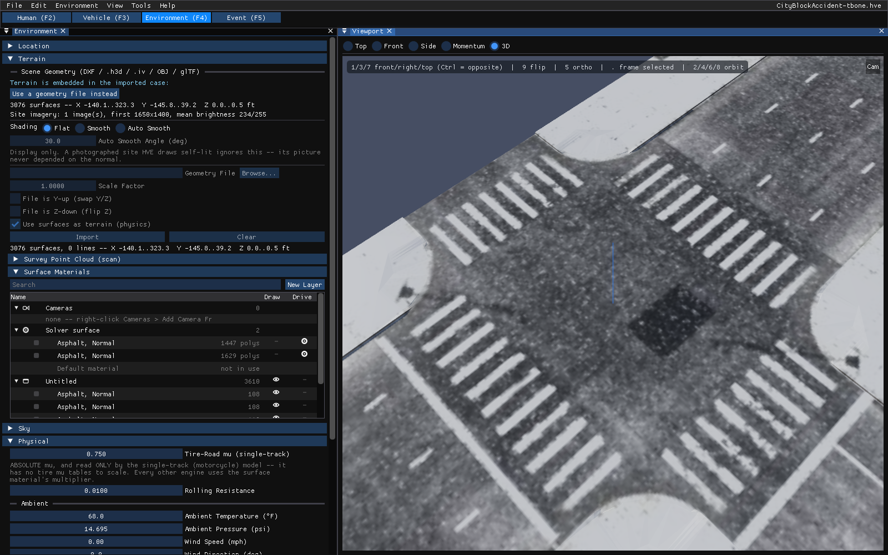

# Interface Tour

HVE Studio has one main window. Across the top are the **menu bar** and the
**editor tabs**; below them, **panels** are docked side by side. The largest
panel is the **Viewport**, which carries the **playback bar** along its bottom
edge in the Event editor.

*The main window in the Event editor (F5) with a two-vehicle SIMON/DyMESH case
open. Left: the Event Information panel. Right: the Viewport, in its 3D view,
with the playback bar along its bottom edge. The open file's name is at the right end of the menu bar.*

## Menu bar

The menu bar always carries **File**, **Edit**, **View**, **Tools** and
**Help**. The other menus depend on the editor tab that is active:

| Editor | Extra menus |
| --- | --- |
| Human (F2) | **Human** |
| Vehicle (F3) | **Vehicle** |
| Environment (F4) | **Environment** |
| Event (F5) | **Event** and **Output** |
| Playback (F6) | **Playback** |

The main entries:

- **File** — New Case, Open Case, Open Recent, Save Case, Save Case As, Save
  Case As JSON, Embed vehicle meshes in the case, Embed the environment in the
  case, Publish Bundle, Seal Case for Handoff (one read-only `.hves` file for
  an outside party), Export Scene for Blender, Blender Live Link, Record Animation (writes the 3-D playback
  to an AVI video) and Play Video, Exit. See
  [Cases and Files](04-cases-and-files.md).
- **Edit** — Undo, Redo and Undo History (below).
- **Vehicle** — Save Vehicle As, Save to My Vehicles, Edit Mode (materials
  per part), and the vehicle's data dialogs: Suspension Data, Steering System,
  Tires (with its Load & Speed Tables panel), Drivetrain, the **Brakes**
  submenu (Brake Assembly, Brake Designer, Brake System Pressure, ABS / Brake
  Design), Aerodynamic Drag, Body Torsion, Crush Stiffness, Vehicle Mesh,
  Vehicle Lights, Accelerometers, Contact Surfaces, Airbags, Belt Restraint.
  The vehicle's identity, configuration, size and weight are edited in the
  Vehicles panel itself.
- **Environment** — Environment, Aerial Image, Edit Mode (materials per
  face).
- **Event** — Event Information, Position / Velocity, Driver Controls, Damage
  Profiles, Collision Pulse, Vehicle Mesh, DyMESH Options, Path Follower,
  Payload, Lights, Wheels, Accelerometers, Contacts, Restraints (Airbags / Belt
  Restraint), Notes, and items that appear only for the event's program
  (EDCRASH: Crush Profile; EDSMAC and EDSMAC4: Handling Parameters, Move CG,
  Crush Profile). An item the event's program does not use is grayed rather
  than hidden.
- **Output** — Key Results, Output Graph, Variable
  Selection, HVE Reports, Compare Runs, Playback Options, Run Simulation, Damage Studio Options, Damage Studio Report, Export
  Variables.
- **Playback** — Playback Sequence, Playback Options, Run All Events.
- **Human** — Human Information.
- **View** — which panels are shown, in three groups: the scene (Viewport,
  **Outliner**, **Scene Display**, Shader Editor, Dope Sheet), the run and its
  results (Key Results, **Results HUD**, Output Graph, Timestep
  Table), and the
  app's two preferences (**Panels Outside the Main Window**, **Show Guidance
  Text**). What the viewport draws — paths, North Arrow, Skidmarks, occupant
  equipment, Vectors, Rendering, Scene Ghosts, Light & Shadow, Vehicle
  Extents and the rest — is switched in the dockable **Scene Display** panel,
  not in the menu. **Results HUD** sets up boxes of solved numbers drawn over
  the viewport and into recorded videos (see
  [Results HUD](../new-features/11-results-hud.md)).
- **Tools** — Quick Case (Text), Vehicle Package, Case Intake, Provenance,
  EDR Import, Monte Carlo Analysis, Motorcycle Analysis, Preferences, Style
  Editor, Cameras, Audit Log, Limits Editor.
- **Help** — License (this computer's license), Check for Vehicle Data
  Updates, About HVE Studio.

The name of the open case file is shown at the right end of the menu bar,
with a `*` in front of it when the case has unsaved changes. Hover over it to
see the full path.

!!! note "HVE Studio"
    The shortcuts printed in the menus work from the keyboard: **Ctrl+N**,
    **Ctrl+O** and **Ctrl+S** (New, Open, Save), **Ctrl+R** (Run Simulation)
    and the Event-menu shortcuts **Ctrl+P**, **Ctrl+D**, **Ctrl+M**,
    **Ctrl+U**, **Ctrl+W**, **Ctrl+T**. An Event-menu shortcut works only in
    the Event editor and only when its menu item is offered for the event's
    calculation method. Shortcuts are ignored while you are typing in a text
    field or a popup menu is open.

## Editor tabs

The five buttons under the menu bar replace HVE's separate editors:

| Tab | Key | Left-hand panel it opens | Works on |
| --- | --- | --- | --- |
| Human | **F2** | Occupants | The humans in the case: GEBOD body, segments, joints, pose |
| Vehicle | **F3** | Vehicles | The vehicles in the case and all their data |
| Environment | **F4** | Environment | The site: terrain, surfaces and materials, sky, physical data |
| Event | **F5** | Event Information | The events: which vehicles and humans, the calculation method, positions, driver controls, running and playback |
| Playback | **F6** | Playback Sequence | Several solved events on one timeline (see [Video and Playback Sequences](../new-features/07-video-and-playback-sequences.md)) |

*The Vehicle editor (F3). The Vehicles panel lists every vehicle in the case
with **Add...** (search the vehicle databases or pick a generic vehicle),
**Replace...** (replace the selected vehicle's data from a database),
**Dup** and **Del**, and below it the selected vehicle's editor (Identity,
Configuration, Size & Weight, Inertia, Components and 3D Geometry). The
viewport shows only the selected vehicle. Note the banner at the bottom of the
viewport: the vehicle shown is not in the active event.*

*The Environment editor (F4) with an imported HVE case whose site carries
terrain and an aerial photograph.*

## Panels and docking

Every panel and dialog is a window that can be docked or float:

- Drag a panel by its tab or title bar to move it. Drop it on one of the
  docking targets that appear to dock it beside, above or below another panel,
  or in its center to make it a tab of that panel.
- Drag it away from the dock to make it float. Floating windows have rounded
  corners and a drop shadow; docked ones are square.
- The window layout is saved when the program closes and restored when it
  starts. Deleting `imgui.ini` (in `%APPDATA%\EDC\HVE Studio`; see
  [Where the program keeps its settings](02-installing-and-running.md#where-the-program-keeps-its-settings))
  restores the default layout.

**View › Panels Outside the Main Window** lets a panel be dragged out of the
main window to become a window of its own — for example the Shader Editor on a
second monitor. A panel outside stays in front of the main window, as a tool
window does: clicking the main window no longer hides it, and it is minimized
with the main window. The setting takes effect the next time the program starts
(the menu item says "restart to apply" until then). It is not available in the
browser build.

## The Viewport

The Viewport shows the rendered 3-D scene. A short key reminder is drawn in
its top-left corner.

The **view cube** sits in the top-right corner and turns with the camera. Click
a face (Top, Bottom, Front, Back, Left, Right) to go to that view, in
orthographic projection -- the Top face gives a plan of the scene. Drag the cube
to orbit. Under the cube is a column of buttons:

| Button | Does |
| --- | --- |
| Zoom (magnifier) | Drag up or down to zoom |
| Pan (four-way arrow) | Drag to pan |
| Camera | Look through the scene camera; click again to go back to the free view. Right-click for **Camera Properties**. With no saved camera, it opens Camera Properties |
| Perspective / Orthographic (grid) | Switch between perspective and orthographic, as key **5** does |

A right-click on the view without moving the mouse offers **Camera
Properties...** and **Reset Camera**.

### Moving the view (3D)

| Action | Does |
| --- | --- |
| Left-drag on empty space | Orbit |
| Right-drag | Pan |
| Mouse wheel | Zoom |
| Middle-drag / Shift+middle-drag / Ctrl+middle-drag | Orbit / pan / zoom |
| Double-click | Return to the default view |
| **1**, **3**, **7** (top row or keypad) | Front, right, top view; with **Ctrl**, rear, left, bottom |
| **9** | The opposite view |
| **5** | Switch between perspective and orthographic |
| **.** | Frame the selected object (in the Human editor, the selected body segment, else the whole figure) |
| **2**, **4**, **6**, **8** | Orbit in 15° steps |
| **C** / **Shift+C** | Look through the next / previous saved camera |
| **I** | Insert a keyframe on the camera you are looking through, at the current playback time |

### Hiding a vehicle in the view

In the Event and Playback editors a vehicle can be taken out of the 3-D view,
for example to see one vehicle's damage where another stands. With the pointer
over the view, **H** hides the selected vehicle, **Shift+H** hides every other
vehicle and **Alt+H** shows them all. The same can be done from **View › Scene
Display › Vehicles Shown**, the **Shown** checkbox in the Event editor's
Vehicles in Event list, the Playback Sequence window's **Shown in the view:**
strip, and the eyes in the Outliner's **Vehicles** group. A hidden vehicle's
ghosts and tire marks are hidden with it, and an amber note at the top left of
the view names the hidden vehicles, with a **Show all** button. This is a view
setting only: nothing is saved, no result changes, and opening another case
shows every vehicle again.

### Moving objects (the gizmo)

Click a vehicle (or a surveyed position "ghost") to select it; a gizmo appears
on it. Drag the gizmo's handles to move or turn it, or use the keyboard with the
pointer over the viewport:

| Key | Does |
| --- | --- |
| **G** | Move (grab) the selected object; it follows the pointer |
| **R** | Rotate it about the vertical axis |
| **X**, **Y**, **Z** (during G or R) | Lock the move to that axis; press the same key again for the object's own (local) axis, and a third time to release the lock. **Z** applies only to a vehicle that can leave the ground |
| A number (during G or R) | Move by exactly that many **meters** along the locked axis (whatever the unit setting), or rotate by exactly that many degrees. **-** changes the sign, **Backspace** deletes a digit |
| **Enter** or left-click | Accept |
| **Esc** or right-click | Cancel and put the object back |
| Hold **Ctrl** | Snap: positions to 0.5 m (1 ft in imperial units), heading to 15° |
| **Delete** or **X** (no move in progress) | Delete the selected path waypoint |
| **Esc** (no move in progress) | Clear the selection |
| **Tab** (Vehicle editor) | Toggle Edit Mode — click a part of the vehicle to give it a material |
| **Tab** (Environment editor) | Toggle Edit Mode — click a face of the site to give it a material or move it; **Esc** also leaves |
| **A**, **L**, **B**, **Alt+A** (Vehicle editor, Edit Mode, *Faces*) | Select every face of the clicked face's part; grow the selection across flat edges; drag a box; select none |
| **A**, **L**, **B**, **Alt+A** (Environment editor, Edit Mode) | Select every face of the clicked face's surface; grow the selection across flat edges; drag a box; select none |
| **H**, **Shift+H**, **Alt+H** (Environment editor, Edit Mode) | Hide the selected faces; hide every other face; show all (while editing only, not saved) |

In the **Vehicle editor**, **G**, **R** and **S** move, rotate and scale the
vehicle's **mesh** rather than the vehicle: they edit the Translate, Rotate and
Scale rows of the Vehicle Mesh window's File & Placement tab (see
[Manipulators](../hve-users/08-3d-editor/21-manipulators.md#hve-manipulators)).
In the **Environment editor**, **G**, **R** and **S** move, turn and scale the
site, or the selected surface or surfaces; **Ctrl** steps a scale by 0.1. In
the Environment editor's Edit Mode they move, turn and scale the selected
faces (see
[Edit Mode: faces of the site](../hve-users/05-environment-editor/12-creating-editing-environments.md#edit-mode-faces-of-the-site)).

Typing into a text field never triggers these keys.

!!! note "HVE Studio"
    Moving a vehicle in the viewport edits the same position and heading as
    **Event › Position / Velocity**. While an event's results are on screen the
    gizmo is not offered: press **Reset** first (see below).

## Playback bar and the Run stage

In the Event editor the bottom of the Viewport carries the playback bar:

- **Run** solves the active event with its Calculation Method; while it runs
  the button becomes **Cancel** (and, where the solver supports it,
  **Pause**/**Resume**).
- **Reset** clears the results and returns the vehicles to their starting
  layout.
- **|<**, **<<**, **Play**/**Pause**, **>>**, **>|** — jump to start, step
  back, play, step forward, jump to end. A step is one output interval of the
  run.
- The **camera** list switches between saved cameras.
- The time slider, with **<** and **>** buttons either side that step one
  frame. The mouse wheel over the slider also steps frames. The box to its
  right takes a time in seconds: type it and press Enter to jump there.
- At the right, the duration, the program that solved the event and its
  headline result — or, if the run was refused or failed, the reason in red.

The **Run** stage of the **Event Designer** (Event › Event Designer..., or
**Output › Run Simulation...**) carries the same controls plus the simulation
controls, a status line and a progress bar.

!!! note "HVE Studio"
    **The results lock the inputs.** While a solved event's results are on
    screen, the inputs they were computed from — the event's data, the vehicles
    and humans it used and the site — are read-only, and Undo is disabled, so a
    result can never be shown beside inputs it was not computed from. Display
    settings (materials, cameras, what is drawn) stay editable. Press **Reset**
    to edit the inputs again. **Run** is grayed for an event that is already
    solved.

## Outliner

**View › Outliner** lists the scene the way Blender's Outliner does: the
environment's layers (HVE's overlays) as collections, the surfaces and objects
on each layer as rows, plus the solver's drivable surface, a loaded point
cloud (its file name, point count and an eye to show or hide it; no Drive
switch) and the saved cameras. The Environment panel's **Selected Surface**
section edits the material and placement of the surface selected here, and its
**Open Outliner** button opens this panel.

*The Outliner for an imported HVE site: the drivable "Solver surface" (two
asphalt surfaces) and the drawn layer "Untitled" with its objects. The eye
column switches drawing on and off; the Drive column says which surfaces the
programs drive on.*

- Click an eye to show or hide a layer or object; drag down the column to set
  several. **Ctrl**-click an eye to show only that one; **Shift**-click a
  layer's eye to set the layer and everything in it.
- Click, **Ctrl**-click or **Shift**-click rows to select; the active row is
  highlighted in the 3-D view. A click on a layer's row selects every object
  in it, and **Shift**-click in the 3-D view adds a surface to the selection.
  **G**, **R** and **S** in the Environment editor's 3-D view move several
  selected surfaces together. Drag rows onto a layer to move them there.
  **New Layer** creates a layer.
- **H** hides the selection; **Alt+H** shows everything.
- The same keys work in the Environment editor's 3-D view: click a surface,
  press **H** and it stops drawing (its row's eye closes; what the programs
  drive on is unchanged), and **Alt+H** shows every hidden surface and layer
  again. In Edit Mode (**Tab**), where a click selects a face rather than a
  surface, **H** hides the selected faces instead, and **Alt+H** shows them.
- Right-click a row or layer for its menu (for example, **Add Camera From
  View** on Cameras).
- The **Vehicles** group lists the case's vehicles. Click a name to select the
  vehicle; its eye shows or hides it in the 3-D view (**Ctrl**-click to show
  only that one). This is a view setting only and is not saved -- see
  [Hiding a vehicle in the view](#hiding-a-vehicle-in-the-view).

A layer has no Drive switch: in HVE the drivable polygons come from the
physics element of the site, which is on no layer.

## Undo History

**Edit › Undo** (**Ctrl+Z**) and **Edit › Redo** (**Ctrl+Y** or
**Ctrl+Shift+Z**) step through the case's edits. **Edit › Undo History** shows
them as a list, newest at the top. Each entry names the dialog the edit was
made in and what it changed: the first field with its old and new value, and
how many more there were -- for example *Environment: point cloud offset x 0 ->
1.5* or *Environment: geometry file 'site.h3d' -> (none) (+1 more)*. Hover an
entry for every change by its full name. One drag of a slider, or one edit of
a text field, is one entry. Click any entry to go straight to that state. An
edit made after stepping back discards the entries above it. Undo restores the
whole case, so while results are on screen it only steps over changes to the
view -- the sun and sky, the location, cameras -- which no program
reads; a step that changes an input of the solved run is grayed (hover it for
why) until you press **Reset**.

Undo also restores what is LOADED from the case, not only the case itself: a
site geometry or point cloud that was cleared comes back (it is imported again
from its file), one that was imported goes away, an undone surface-property
edit is undone in the friction and other values the programs use, and a vehicle
whose mesh setting is undone reloads its mesh.

Inside a text field, Ctrl+Z undoes typing in that field only.

## Status and messages

HVE Studio reports in three places:

- the **playback bar** and the Event Designer's **Run** stage: the state of the
  run, and the reason when a program refuses or stops a run;
- **dialogs** that show notes about the open case (for example, a value an HVE
  import could not represent, or an input the event's program does not read).
  Notes that read the same on every case are hidden unless **View › Show
  Guidance Text** is ticked; a note about a problem with the open case is
  always shown;
- **Tools › Audit Log**, a running record of actions taken in the session
  (for example undo and redo, exports, waypoints deleted in the viewport).

When a case names geometry that cannot be found, a **Geometry Not Found**
message appears as the case opens; see
[Cases and Files](04-cases-and-files.md#geometry).

## Preferences, units and style

**Tools › Preferences**:

- **Units** — *Imperial (ft/in, mph, lb, lbf)* (the default) or *Metric (m,
  km/h, kg, N)*. This changes what every converted field shows and accepts; the
  case itself is always stored in SI units, so switching never changes the
  data. A few fields still carry a fixed SI label, as the dialog notes.
- **Background Color** — the color behind the viewport.

- **Date Format** — how dates are shown in the file browser, the Audit Log
  and the run report.
- **Auto-Save** — while the case has unsaved changes, a recovery copy
  (`<case>.autosave.hvex`) is written every **Interval (min)** minutes. It
  never overwrites the case; opening a case with a newer recovery copy offers
  to open the copy, and saving the case removes it.

**Diagnostic Level** is grayed: what a run assumed or repaired is always in
its run status.

**Tools › Style Editor** chooses the base color theme (**HVE**, the default —
the HVE cube's maroons on a dark ground, with window, panel, field and button
each a step lighter than the one it sits on — **Dark**, **Light** or
**Classic**; remembered between sessions) and gives live control over colors,
sizes, rounding and spacing. The whole style is remembered. When a release
changes the HVE theme's colors, a remembered style made under the older
theme takes the new colors on the next start and keeps its sizes, rounding
and font scale; choose another theme to keep your own colors.

**Tools › Cameras** keeps the saved cameras (with a **Viewport View** tab for
the live view); **Tools › Limits Editor** edits the allowed input ranges.

For HVE's own Preferences and Units dialogs, compare
[User Preferences](../01-user-interface/PrefDlg.md) and
[Units](../01-user-interface/UnitsDlg.md).
