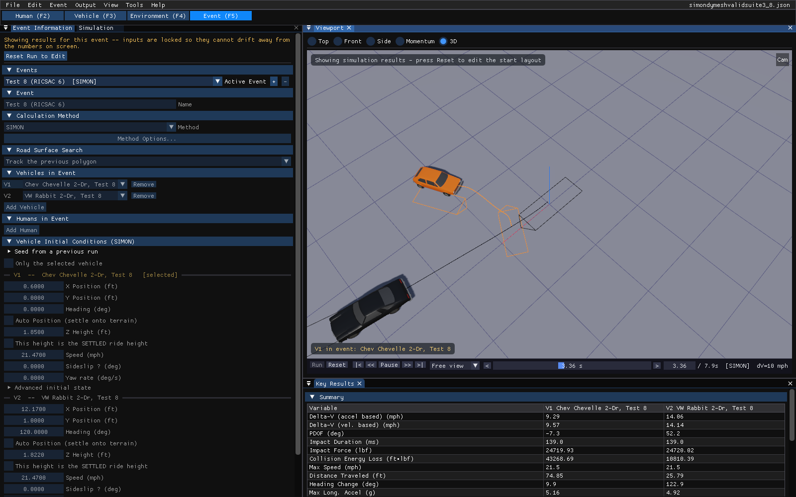
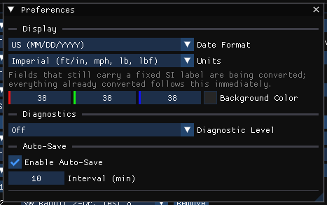
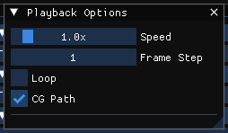
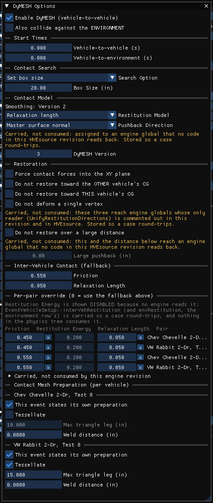
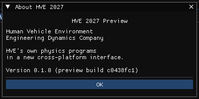

# Chapter 2: How To Use HVE — Part C

*The HVE Studio edition of the HVE User's Manual, Seventh Edition (Jan 2006),
printed pages 2-70 through 2-104.*

*Part A: [Basic concepts through executing events](02-how-to-use-hve.md) •
Part B: [Reports, Playback, Case Files, Databases, Printing, View](02b-how-to-use-hve.md)*

## Contents (Part C)

- [Selecting User Options](#selecting-user-options)
- [Getting Help](#getting-help)
- [Video Interface](#video-interface)

---

## Selecting User Options

HVE's user options were on its Options menu. In HVE Studio the display options are
switches on the **View** menu, units and preferences are in **Tools ›
Preferences**, and the calculation settings are with the event they belong to.
The complete map is in
[Where HVE's Options menu went](../02-menu-reference/06-options-menu.md).

### Key Results Windows

The **Key Results** panel (View › Key Results, or Output › Key Results...) shows
the active event's key results, one column per vehicle, for reconstructions and
simulations alike. It is docked below the viewport in the Event editor and fills
in when the event has been run. With **Follow playback time** ticked,
time-dependent values follow the playback position.

*Figure 2-58: Key Results for a SIMON simulation, below the viewport.*

#### Selecting Key Results

Choose **Select Variables...** in the Key Results panel to choose what it lists.
**Group columns by** arranges the columns, **Vehicle name in column titles**
labels them, and **Sections...** hides and shows the panel's sections. **Export
CSV...** and **Copy CSV** take the table out.

### Coordinate Axes

**View › Scene Display › Axes** (on by default) draws the environment's axes at
the origin and each vehicle's own axes at its CG, turning with the vehicle. The
coordinate systems are described in
[Appendix III](../11-appendices/appendix-03-coordinate-systems.md).

!!! note "HVE Studio"
    Axes are not drawn on humans.

### Contact Surfaces

**View › Scene Display › Occupant Equipment** draws the active vehicle's contact surfaces,
airbags, belt anchors and webbing, in the Event editor as well as the Vehicle
editor. **View › Scene Display › Occupant Equipment Through Bodywork** draws them over the
vehicle so they can be seen from outside; **View › Scene Display › Humans Through Bodywork** does
the same for the occupant.

### Velocity Vectors

**View › Scene Display › Vectors › Velocity** draws each vehicle's velocity vector. It is
formed from the vehicle's forward and lateral velocity, so a vehicle in a
sideslip shows an arrow off its heading. The Vectors table also offers
**Acceleration**, the **Collision force** and **Collision moments** while the
vehicles are in contact, and the tire forces at each contact patch. Each type of
arrow has one fixed scale, set in the table, so lengths compare between vehicles
and between runs.

### Skidmarks

**View › Scene Display › Skidmarks** draws the tire contact-patch paths where the tire was
marking. SIMON grades a mark's darkness with how hard the tire was sliding;
EDSMAC4, EDVSM, EDSVS and EDVDS report a tire only as skidding or not, so their
marks are all-or-nothing. **View › Scene Display › Tire Contact Patch Paths** draws the whole path
of each tire.

!!! note "HVE Studio"
    HVE's Skidmark Height preference is not offered.

### Target Positions

**View › Scene Display › Scene Ghosts** chooses how the vehicles are drawn at their measured
scene positions — **Outline**, **Translucent vehicle**, **Both** or **None**.
The positions themselves are entered in Event Information (see
[Part A](02-how-to-use-hve.md#target-positions)).

### Grid

!!! warning "Not in HVE Studio"
    The viewport draws a ground grid, but there is no Grid dialog to set its
    spacing, color or extent.

### Selecting Units

**Tools › Preferences › Units** chooses **Metric (m, km/h, kg, N)** or **Imperial
(ft/in, mph, lb, lbf)**. Dialogs and reports follow the setting (the Preferences
dialog notes that a few fields still carry a fixed SI label); the case is stored
in SI units either way, so changing units does not change a stored value. HVE's
per-quantity unit selection is not reproduced.

*Figure 2-66: Tools › Preferences, with the Units setting.*

### Render Options

**View › Scene Display › Rendering** replaces HVE's Rendering Options dialog.

#### Show As

**Wireframe** draws edges only (with hidden lines removed); the other choices
draw solid surfaces.

#### Shading

**Phong** (smooth, the default) or **Flat** (one normal per face, which shows the
real tessellation of a mesh). **Light Sources On** turns the sun's contribution
on and off. A vehicle's own shading is chosen on the Display tab of its Vehicle Mesh window, and the
site's in the Environment panel. Shadows are set with **View › Scene Display › Light & Shadow**.

#### Complexity

!!! warning "Not in HVE Studio"

    Not offered.

#### Show Only + Faces

!!! warning "Not in HVE Studio"

    Not offered.

#### Render Quality

!!! warning "Not in HVE Studio"

    Not offered.

#### Anti-aliasing Level

!!! warning "Not in HVE Studio"

    Not offered.

!!! tip "New in HVE Studio"
    **View › Shader Editor** gives vehicles, road surfaces and the sky node
    materials, and sets the sun and sky. It changes only how the scene looks.

### Simulation Controls

The simulation controls are at the top of the **Simulation** panel (View ›
Simulation, docked beside Event Information), and belong to the active event.

*Figure 2-68: The Simulation panel.*

#### Integration Timesteps

**Duration (s)**, **Trajectory Timestep (s)**, **Collision Timestep (s)**,
**Separation Timestep (s)**, **Curb Impact Timestep (s)** (EDVSM), **Human
Collision Timestep (s)** (EDHIS and EDGEN) and **Output Timestep (s)**. A
timestep the active method does not use is not shown. **Integrator Convergence** holds **Maximum
Bisections** and **Velocity Convergence** (and, for EDHIS, the velocity and
acceleration change limits) for the methods that read them.

#### Termination Conditions

**Termination** ends the run once every vehicle is below both armed limits — a
linear and an angular speed, each with an **On** switch. With both off the run
always integrates to the full duration. **Stopped Vehicle** sets the speeds below
which a vehicle is reported at rest.

### Playback Options

**Output › Playback Options...**: **Speed** (0.1× to 10×), **Frame Step**,
**Loop** and **CG Path**.

*Figure 2-69: The Playback Options dialog.*

### Calculation Options

Each calculation method's options are opened with **Method Options...** in
Event Information's Calculation Method section. For EDSVS, EDVDS and EDVTS there
is no options dialog in HVE Studio.

*Figure 2-70: SIMON Options, opened with Method Options....*

*See also: [Calculation Options](../../10-calculation-options/README.md).*

### DyMESH Options

**Event › DyMESH Options...** sets the DyMESH contact options of the active
event: start times, contact search, contact model, restoration, inter-vehicle
contact with a per-pair override, and each vehicle's contact mesh preparation
for this event (tessellate, maximum triangle leg, weld distance), which
outranks the vehicle's own defaults. An option the engine stores but does not read
is labeled so in the dialog.

*Figure 2-71: The DyMESH Options dialog.*

### Get Surface Information

!!! warning "Not in HVE Studio"
    There is no Get Surface Information tool. In the Environment editor, click a
    surface in the viewport to select it; the Environment panel's Surface
    Materials section shows its material.

### User Preferences

**Tools › Preferences...** holds the date format, the units, the background
color, the diagnostic level and auto-save; **Tools › Style Editor...** holds the
interface's theme and style, including text size.

!!! note "HVE Studio"
    Diagnostic Level is grayed (it has nothing to control). Date Format sets how
    dates are shown, and Auto-Save writes a recovery copy beside the case while
    there are unsaved changes, without touching the case file.

---

## Getting Help

!!! warning "Not in HVE Studio"
    HVE Studio has no help browser and no Help Topics, User Manuals or Technical
    Support items. Help is given in place: hover over a control for its tooltip,
    and turn on **View › Show Guidance Text** for the longer explanations in the
    dialogs. This manual set is the reference.

### Help Topics

Not in HVE Studio; see above.

### Technical Support

HVE Studio's Help menu has no Tech Support item. Questions and problem
reports about the preview go to EDC (see
[Problem Determination](00-using-hve.md#problem-determination) for what to
include).

### About

**Help › About HVE Studio...** opens the **About HVE Studio** box. It shows
**HVE Studio**, Human Vehicle Environment and Engineering Dynamics
Company, a short description (HVE's own physics programs in a new
cross-platform interface) and the version, with the
preview build's identifier in brackets. **OK** closes it.

*Figure 2-76: The About HVE Studio box.*

---

## Video Interface

!!! note "HVE Studio"
    **File › Record Animation...** records the 3-D playback of a solved event
    to a Motion-JPEG AVI file, frame by frame at the size and frame rate you
    choose, and **File › Play Video...** plays such a file. HVE's Video Device
    Set-up, its choice of compressors and recording to a video device have no
    equivalent.

For a rendered animation, export the solved event to Blender with **File ›
Export Scene for Blender** (glTF) or **File › Blender Live Link...**, and render
it there.

<!-- NAV -->

---

← Previous: [Chapter 2: How To Use HVE — Part B](02b-how-to-use-hve.md)  |  [Index](README.md)  |  Next: [Section Two: Menu Reference](../02-menu-reference/README.md) →

<!-- /NAV -->
