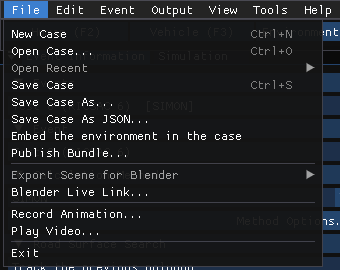
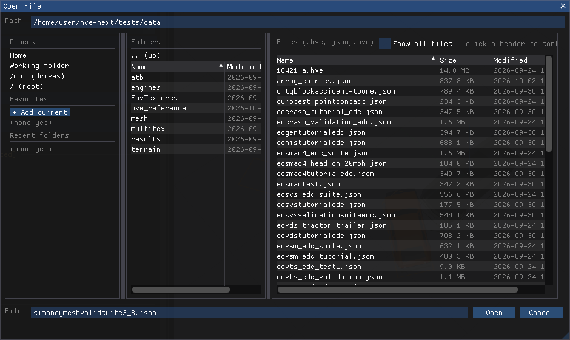

# Chapter 3: File Menu

*HVE User's Manual — Section Two: Menu Reference, HVE Studio edition. Replaces
HVE's Chapter 3, File Menu.*

The File menu opens, saves and publishes cases, and exports a solved scene to
Blender. It is on the menu bar in every editor.

*The HVE Studio File menu.*

| HVE Studio item | Shortcut | What it does |
|---|---|---|
| **New Case** | Ctrl+N | Starts a new, empty case |
| **Open Case...** | Ctrl+O | Opens an HVE Studio case (`.hvex` or `.json`), a sealed case (`.hves`) or an HVE case (`.hve`) |
| **Open Recent** › | — | The most recently opened and saved cases; **Clear Recent** empties the list |
| **Save Case** | Ctrl+S | Saves the case to its current file (asks for a name the first time) |
| **Save Case As...** | — | Saves the case under a new name (binary `.hvex` unless the name ends in `.json`) |
| **Save Case As JSON...** | — | Saves the case under a new name as a `.json` text file |
| **Embed vehicle meshes in the case** | — | A switch, off by default: when ticked, the next save stores each vehicle's own mesh inside the case (never EDC's licensed meshes) |
| **Embed the environment in the case** | — | A switch: when ticked, the next save stores the site geometry and photograph inside the case |
| **Publish Bundle...** | — | Writes the case, its geometry and its results into one folder for the viewer product |
| **Seal Case for Handoff...** | — | Writes the solved case as one sealed file (`.hves`) for an outside party to view; it opens read only and can never be re-run (see [SEAL CASE FOR HANDOFF](#seal-case-for-handoff)) |
| **Export Scene for Blender** › | — | Writes the solved scene as glTF (`.glb` or `.gltf`) for Blender |
| **Blender Live Link...** | — | Lets Blender read the case directly while HVE Studio runs |
| **Record Animation...** | — | Records the 3-D playback of a solved event or sequence to a Motion-JPEG `.avi` video (see [VIDEO CREATOR](#video-creator)) |
| **Render Image (Ray Traced)...** | — | Traces the 3-D view as it is now into a still picture |
| **Play Video...** | — | Plays a Motion-JPEG `.avi` video (see [VIDEO CREATOR](#video-creator)) |
| **Exit** | — | Closes HVE Studio |

The HVE File menu items map as follows:

| HVE item | HVE Studio |
|---|---|
| New | File › **New Case** |
| Open | File › **Open Case...** |
| Save | File › **Save Case** |
| Save As | File › **Save Case As...** / **Save Case As JSON...** |
| Export Preview Case | File › **Publish Bundle...** (for HVE Studio's own viewer, not for HVE Preview) |
| Print, Print All | Not in HVE Studio — see [PRINT](#print) |
| Video Creator | File › **Record Animation...** and **Play Video...** — see [VIDEO CREATOR](#video-creator) |
| Export | **Output › Export Variables...** (Event editor) — see [Chapter 4D](04d-output-menu.md#export-variables) |
| FBX Export | Not in HVE Studio; File › **Export Scene for Blender** writes glTF instead |
| Recent file list | File › **Open Recent** |
| Exit | File › **Exit** |

---

## NEW

**Menu Option:** File › New Case (Ctrl+N)

**Purpose:** Start a new case.

**Description:** Clears the current case and starts an empty one. If the open
case has unsaved changes, HVE Studio first asks **Discard changes?** — choose
**Save** to save it, **Discard** to throw the changes away, or **Cancel** to
keep working on it.

---

## OPEN

**Menu Option:** File › Open Case... (Ctrl+O)

**Purpose:** Open an existing case.

**Description:** Displays HVE Studio's file browser. Choose a file and open it.
HVE Studio reads four kinds of case file:

- **`.hvex`** — HVE Studio's binary case file
- **`.json`** — HVE Studio's text case file (see [Cases and files](../../getting-started/04-cases-and-files.md))
- **`.hves`** — a sealed case, opened read only (see
  [SEAL CASE FOR HANDOFF](#seal-case-for-handoff))
- **`.hve`** — an HVE case file, read directly: its humans, vehicles, events
  and the site geometry stored in it are imported. HVE Studio does not write
  `.hve` (see the note under [SAVE](#save)). What the import reads, and what
  it cannot, is described in [Cases and files](../../getting-started/04-cases-and-files.md).

If the file is not a case, HVE Studio says so in a **Cannot Open File** message
and leaves the current case unchanged. If the case names geometry files that
cannot be found, the case still opens: a missing site draws as flat ground and a
missing vehicle mesh draws as a box, and a **Geometry Not Found** message lists
what is missing. Files are named relative to the case, so keep geometry beside
the case when you move it.

When a case was saved together with its results, those results are restored on
opening — but only if the case's inputs have not changed since they were
solved. Otherwise they are discarded and the panel says so. Opening a case never
re-runs it.

*Open Case uses HVE Studio's own two-pane file browser.*

The browser's left column lists **Places** (Home, HVE Studio Cases, your **Documents**,
**Desktop** and **Downloads**, and on Windows each drive), your **Favorites** and the
**Recent folders**; **+ Add current** puts the folder you are in among the favorites.
A Windows shortcut (`.lnk`) to a folder, or a symbolic link to one, is listed with the folders
and opens the folder it points at.

---

## OPEN RECENT

**Menu Option:** File › Open Recent

**Purpose:** Re-open a recently used case.

**Description:** Lists recent cases by file name (hover over one to see its full
path). **Clear Recent** empties the list. The item is grayed when the list is
empty. This replaces HVE's recent-file list at the bottom of the File menu.

---

## SAVE

**Menu Option:** File › Save Case (Ctrl+S)

**Purpose:** Save the current case to its file.

**Description:** Saves to the file the case was opened from or last saved to.
A case that has never been saved asks for a name, defaulting to `case.hvex`.
A file whose name ends in `.json` is written as JSON; any other name is written
in HVE Studio's binary format.

!!! note "A case opened from an HVE `.hve` file"
    HVE Studio does not write HVE's format, so it never saves over a `.hve`.
    **Save Case** (Ctrl+S) on a case opened from a `.hve` opens the save
    dialog with the same name ending `.hvex`; after that, Save Case writes the
    `.hvex`. The original `.hve` is left untouched. HVE Studio also refuses to
    save a case over any existing file that is not an HVE Studio case.

When the case has been run, a results file with the same name and the
extension `.hver` is written beside it. It holds the results of every event
that has been run, each tied to the inputs it was solved from (see
[OPEN](#open)); an event edited since its run is left out, and the save
message says so.

---

## SAVE AS

**Menu Option:** File › Save Case As... · File › Save Case As JSON...

**Purpose:** Save the case under a new name.

**Description:** **Save Case As...** suggests the current name (or `case.hvex`)
and writes the binary format unless the name you give ends in `.json`. **Save
Case As JSON...** suggests the current name with a `.json` extension and writes
the case as text, which is readable and comparable with a text tool; it opens
again exactly like a `.hvex`. The saved file becomes the case's current file and
is added to Open Recent.

---

## EMBED VEHICLE MESHES IN THE CASE

**Menu Option:** File › Embed vehicle meshes in the case

**Purpose:** Make a case carry its vehicle bodies.

**Description:** A check item, unticked by default and remembered between
sessions. When ticked, each save stores every vehicle's own mesh inside the case
file, so the case opens with its vehicle bodies on a computer that does not have
those files. EDC's licensed meshes are never stored: they stay references to the
vehicle database, and draw where the license is. Hovering shows how many meshes
the case carries and their size. Untick it and save again to remove the stored
meshes; the case then names the mesh files again.

---

## EMBED THE ENVIRONMENT IN THE CASE

**Menu Option:** File › Embed the environment in the case

**Purpose:** Make a case self-contained.

**Description:** A check item, ticked by default. When ticked, each save stores
the site's geometry and photograph inside the case file, so the case opens with
its ground on a computer that has neither the original `.hve` nor the geometry
file.
Hovering shows how many triangles and image pixels the site has; the photograph
is the larger part of the cost. When the case already carries a site, the menu
shows its size. Untick it and save again to remove the embedded site.

!!! note "HVE Studio"
    An HVE `.hve` case always carries its site inside the case, and an HVE
    2027 case does the same while this is ticked. Unticking it, which HVE has
    no equivalent for, makes a save name the geometry file instead: a smaller
    case for one that never leaves this computer.

---

## PUBLISH BUNDLE

**Menu Option:** File › Publish Bundle...

**Purpose:** Package a case so someone without your files can watch it.

**Description:** A bundle is one folder holding the case, the geometry it names
and the solved results. It opens in HVE Studio's viewer product, which plays a
case back but cannot run one. The **Publish Bundle** box offers:

- **Publish...** — publish with the solved run that is in memory
- **Run, then publish** — when the case has no results yet
- **Publish inputs only** — for a recipient who has the full workstation and
  will run it
- **Include the per-channel output capture** — also carry the full output
  channels, not just the trajectories

The item is grayed while a simulation is running.

!!! note "HVE Studio"
    This takes the place of HVE's **Export Preview Case**, which wrote a case
    for the HVE Preview program. A bundle is for HVE Studio's viewer only.

---

## SEAL CASE FOR HANDOFF

**Menu Option:** File › Seal Case for Handoff...

**Purpose:** Hand a solved case to an outside party who may view it but not
change it.

**Description:** A sealed case is one file, ending `.hves`, that carries the
case, every event's results and report pages, the site and the vehicle
meshes. It opens read only and can never be re-run.

The **Seal Case for Handoff** box says this before anything is written, and
that licensed vehicle data stays out: each vehicle keeps only what it takes to
draw it, and the meshes are encrypted. It also says who will vouch for the
file: either that it will be signed by the configured signer, or, in amber,
that no signing key is configured on this computer and the case will be
**UNSIGNED** -- a recipient will see it marked *NOT AUTHENTICATED* and its
results will not load. It then lists every event of the case
with its program, as *solved* or *NOT SOLVED -- run it or delete it first*.
**Seal...** is grayed until every event is solved; it then asks for a file
name, suggesting the case's own name ending `.hves`. **Cancel** closes the
box.

Sealing refuses, and writes nothing, unless every event is solved with results
that still match its inputs, every file the case names (a vehicle mesh, a
texture, the point cloud, the aerial photograph) can be read, and no
simulation is running. A **Could Not Seal** message says why. When it
succeeds, **Case Sealed** names the file and says how many solved events,
encrypted mesh files and site files it carries, and its size, with any note
about what was not carried (for example a file a mesh names outside its own
folder). The audit log records the seal.

What a sealed case keeps of each vehicle is what drawing it needs: its name,
make and model, dimensions, axles and wheels, connections, mesh options and
lights. Its weights, inertias, suspension, steering, tires, brakes,
drivetrain, crush and other engine data are not included. The values the run
used are on the engine's report pages, which the sealed case carries.

What the recipient can do, after opening the `.hves` with **File › Open
Case...**:

- view and play back every event, and look at the viewport, graphs, tables
  and **Output › HVE Reports**;
- save images, videos, channel CSV files and report pages.

What the recipient cannot do:

- edit the case: every editor is read only, and a vehicle's dialogs say that
  the values shown are placeholders and that the data the run used is on
  **Output › HVE Reports**;
- run, re-run or reset any event;
- save the case (**Save Case**, **Save Case As...**, **Save Case As
  JSON...**), publish a bundle, save a vehicle, export the scene for Blender
  or start the Blender live link;
- seal it again.

A band along the bottom of the window, the title bar and the case name in the
menu bar say whether anyone vouches for the case. Only a signature by a signer
this copy of HVE trusts does, and the three states never read alike:

- **Green** -- *Sealed case -- read only, cannot be re-run. Authenticated:
  signed by (the signer), sealed (when).* The signature verifies and every
  part of the file still matches it. The title shows *[Sealed - authenticated]*.
- **Amber** -- *NOT AUTHENTICATED sealed case*, with the reason: the file
  carries no signature (every `.hves` made before signing existed, and every
  one made on a computer with no signing key), or it is signed by a signer
  this copy of HVE does not trust. The case opens so that it can be
  inspected, but its **results are not loaded** (the run status says so):
  nothing in the file shows they are the run's. The title shows
  *[SEALED - NOT AUTHENTICATED]*.
- **Red** -- *THIS SEALED CASE HAS BEEN MODIFIED, OR ITS SIGNATURE IS INVALID*,
  with what did not match. It still opens so that the change can be seen, and
  its results are not loaded. The title shows *[SEALED - MODIFIED OR
  INVALID]*.

Recomputing the file's hashes after an edit does not turn a case green: only
the signer can sign. Opening any other case, or a new one, leaves sealed mode.

The item is grayed while a simulation is running, and in a case that is
already sealed. The viewer product has no Seal item.

!!! note "HVE Studio"
    Until EDC provides a signing key or service, sealed cases are written
    unsigned. That is deliberate: a key built into the program could be
    extracted by anyone, and a file signed with it would prove nothing. See
    `docs/SEALED_CASE_SIGNING.md` in the HVE-Next repository for what is
    needed.

!!! note "HVE Studio"
    The mesh encryption keeps a recipient from copying a vehicle's geometry
    out of the file with a file manager or a zip tool. Its key is built into
    the program, so it is not copy protection against someone who takes the
    program apart.

!!! tip "New in HVE Studio"
    HVE has no sealed case.

---

## EXPORT SCENE FOR BLENDER

**Menu Option:** File › Export Scene for Blender › glTF Binary (.glb) — recommended · glTF Text (.gltf)

**Purpose:** Export the solved scene, with its motion, for rendering.

**Description:** Writes the environment, the vehicles and their animated motion
as a glTF file that Blender (and other 3-D programs) can import. It is grayed
until the event has been run, because the export carries the motion.

!!! note "HVE Studio"
    This replaces HVE's **FBX Export**. HVE Studio writes glTF, not FBX.

---

## BLENDER LIVE LINK

**Menu Option:** File › Blender Live Link...

**Purpose:** Let Blender read the case directly.

**Description:** Instead of exporting a file, HVE Studio listens on a local port
(on this computer only) and a Blender add-on reads the case from it. When the
case is run again, the add-on updates the motion of the objects it already made,
so materials, cameras and lights set up in Blender are kept. Choose a **Port**
and **Start Link**; while running, the dialog shows the address, whether Blender
is connected and how many requests it has served. The link is read-only:
Blender cannot change the case. A tick beside the menu item shows the link is
running.

!!! tip "New in HVE Studio"
    The live link has no counterpart in HVE's menus.

---

## PRINT

**HVE menu options:** File › Print, File › Print All

!!! warning "Not in HVE Studio"
    HVE Studio does not print. Reports and tables are saved to files and printed
    from another program: **Output › Export Variables...** writes the
    selected variables to a file, HVE Reports (which holds the Accident
    History) has **Save This Page** and
    **Save All Pages** for text, **Save Page as HTML** and **Save All Pages as
    HTML** for a page a browser can print or save as PDF, and **Export Run
    Report (HTML)** for HVE Studio's own printable run summary, and Key
    Results exports CSV. See
    [Chapter 4D](04d-output-menu.md). The Damage Studio Report has **Save...**
    (text). The **Print...** button in the Audit Log does nothing in HVE Studio
    Preview.

---

## VIDEO CREATOR

**HVE menu option:** File › Video Creator · **HVE Studio:** File › Record Animation..., File › Play Video...

!!! note "HVE Studio"
    **Record Animation...** writes the 3-D playback of the solved event (or of
    the active playback sequence) to a Motion-JPEG AVI file, at the width,
    height, frame rate and JPEG quality set in its window, through the camera
    chosen there (the view you are looking through, or any saved camera),
    between a start and an end time, in real time or slow motion, optionally
    ray traced or motion-blurred, and with the case's
    [Results HUD](../../new-features/11-results-hud.md) burned in when
    **Burn in key results (Results HUD)** is ticked. It is unavailable, with
    the reason shown, until an event has been run. See
    [Recording a video](../../new-features/07-video-and-playback-sequences.md#recording-a-video). **Play Video...** plays a Motion-JPEG AVI with
    play/pause, frame steps and a frame slider. There is no Video Creator
    window: several events are combined in the **Playback (F6)** editor and
    recorded the same way, from that editor. For a rendered movie, export the solved scene
    to Blender ([EXPORT SCENE FOR BLENDER](#export-scene-for-blender) or
    [BLENDER LIVE LINK](#blender-live-link)) and render it there.

---

## EXPORT

**HVE menu option:** File › Export

In HVE Studio, exporting output variables is **Output › Export Variables...**, in
the Event editor. See [Chapter 4D](04d-output-menu.md#export-variables).

---

## EXIT

**Menu Option:** File › Exit

**Purpose:** Close HVE Studio.

**Description:** If the case has unsaved changes, HVE Studio asks **Quit without
saving?** with **Save**, **Discard** and **Cancel**. Closing the main window
does the same.

<!-- NAV -->

---

← Previous: [HVE User's Manual — Section Two: Menu Reference](README.md)  |  [Index](README.md)  |  Next: [Chapter 3B: Edit Menu](03b-edit-menu.md) →

<!-- /NAV -->
