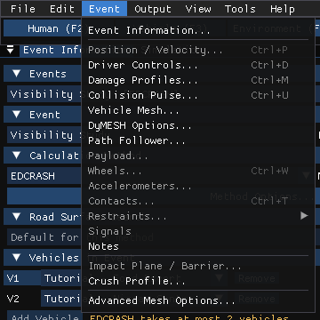
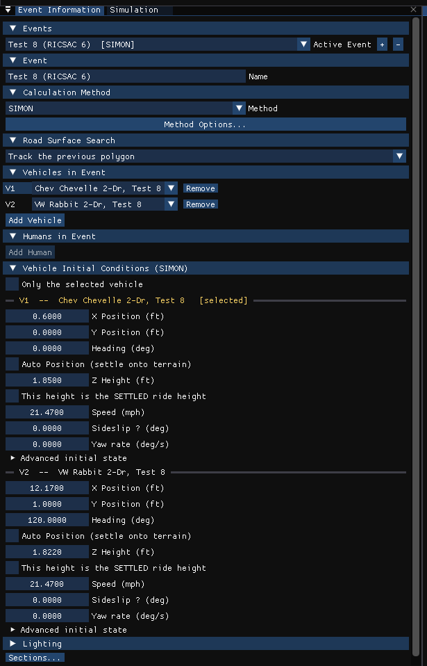
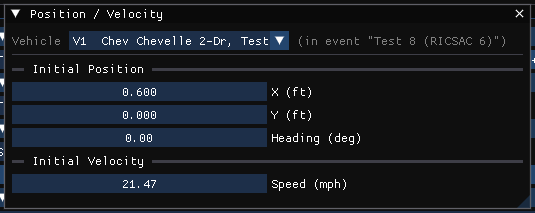
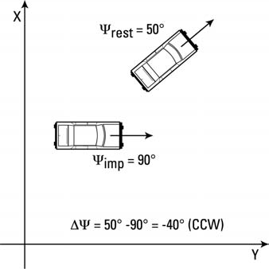

# Chapter 4: Event Menu (Part A — Event Information, Position/Velocity, Driver Controls, Path Follower)

*HVE User's Manual — Section Two: Menu Reference, HVE Studio edition. Replaces
HVE's Chapter 4, Set-up Menu. This chapter is split into two files: Part A
covers the event itself, positions and driver inputs; [Part B](04b-setup-menu.md)
covers the remaining event set-up items.*

HVE's **Set-up** menu is HVE Studio's **Event** menu. It appears on the menu bar
only in the Event editor (F5), and acts on the **active event** — the one chosen
in the Event Information panel's *Active Event* list.

*The Event menu for a SIMON event. Items the event's calculation method does not
use are grayed.*

## Which items apply to which method

Unlike HVE's Set-up menu, the Event menu grays out the items the active event's
**Calculation Method** (Event Information) does not use, and changes its lower
part by method:

| Item | Available for |
|---|---|
| Event Designer... | every event: the staged Event Designer beside the 3-D view (see [Chapter 16a](../06-event-editor/16a-event-designer.md)) |
| Event Information... | every event |
| Position / Velocity... | every method that starts from initial conditions — all except EDCRASH and READDATAFILE |
| Driver Controls... | EDSMAC, EDSMAC4, SIMON, EDSVS, EDVDS, EDVTS, EDVSM, SINGLETRACK; and EDCRASH, where it shows the Wheel Data page |
| Damage Profiles... | EDCRASH (it opens Event Information's Vehicle Impact Setup) |
| Collision Pulse... | EDCRASH, SIMON, EDHIS, GATB |
| Vehicle Mesh..., DyMESH Options..., Path Follower..., Notes | every event |
| Payload... | SIMON, EDSMAC4, EDSVS, EDVDS, EDVTS |
| Wheels... | the methods that use driver controls (not EDCRASH, EDGEN, EDHIS, GATB or READDATAFILE) |
| Accelerometers... | SIMON, EDSMAC4, EDVDS, EDVSM (the methods that compute accelerometer output) |
| Restraints › | EDHIS, GATB |
| Contacts... | EDSMAC4 (the contact surfaces); EDHIS, GATB (Human Contacts) |
| Lights... | SIMON, EDSMAC4 |
| Impact Plane / Barrier... | shown for EDCRASH, always grayed — not in HVE Studio |
| Handling Parameters..., Move CG... | EDSMAC, EDSMAC4 |

*The Event menu for an EDCRASH event: Position/Velocity, Payload, Wheels and the
other simulation inputs are grayed, and Impact Plane / Barrier is added. EDCRASH's
crush profile is Damage Profiles (Ctrl+M).*

!!! note "HVE Studio"
    The shortcuts printed beside Position / Velocity (Ctrl+P), Driver Controls
    (Ctrl+D), Damage Profiles (Ctrl+M), Collision Pulse (Ctrl+U), Wheels (Ctrl+W)
    and Contacts (Ctrl+T) work, but only while that item is offered for the
    event's calculation method. HVE's Restraints shortcuts (Ctrl+G, Ctrl+B) do not exist.

**Selecting the vehicle.** Most Event menu dialogs edit one vehicle of the event.
They act on the selected vehicle: click it in the viewport, or pick it in the
vehicle list at the top of the dialog, where each vehicle of the event is shown
with its slot number (V1, V2, …) as in HVE. A dialog opened for a vehicle that is
not in the active event says so.

**Results lock the inputs.** Once the active event has been run, its inputs are
locked so they cannot drift away from the results on screen; the dialogs show
a banner and their fields are grayed. Press **Reset** on the playback bar (or
**Reset Run to Edit** in Event Information) to edit again.

---

## EVENT INFORMATION

**Menu Option:** Event › Event Information...

**Purpose:** Create, select and define events.

**Description:** Event Information is a panel docked on the left of the Event
editor; it opens automatically when you switch to the Event editor. It holds what
HVE split between its Event Editor and its Event Information dialog:

- **Events** — the *Active Event* list, **+** to add an event and **−** to
  delete the active one
- **Event** — the event's name
- **Calculation Method** — the engine that runs the event, and **Method
  Options...** for that method's calculation options (HVE's Options ›
  Calculation Options)
- **Road Surface Search** — how the engine searches the terrain for the surface
  under each tire
- **Vehicles in Event** — the vehicle in each slot, **Add Vehicle** and **Remove**
- **Humans in Event** — the humans, for the methods that solve an occupant
- **Vehicle Initial Conditions** (simulations) or **Vehicle Impact Setup**
  (EDCRASH) — the starting state, or the measured impact, rest and crush, of each
  vehicle, and its **Named Positions** list (see [Target Positions](#target-positions))
- **Lighting** — the sun for the 3-D view (display only)

**Sections...** at the bottom hides, shows and re-orders these sections;
right-click a section header to move or hide it.

*The Event Information panel for a SIMON event.*

The **Calculation Method** list shows every method HVE Studio can run. A method
whose output has not yet been checked against HVE is marked *(unvalidated)*; a
method the event's vehicles cannot use is marked *N/A for these vehicles*, with
the reason on hover; and an HVE event whose method HVE Studio does not recognize
keeps its name and is marked *not ported* — it opens and displays but cannot be
run.

!!! note "HVE Studio"
    Method Options... opens an options dialog for EDCRASH, EDSMAC and EDSMAC4
    (one shared dialog), EDGEN, EDHIS, SIMON, EDVSM, GATB and SINGLETRACK. For
    EDSVS, EDVDS, EDVTS and ReadDataFile it is grayed. Simulation time and timesteps are
    on the Event Designer's Run stage (see [Chapter 6](06-options-menu.md#simulation-controls)).

See the dialog reference: [Event Information](../../09-events-driver-controls/EventInfo.md)
and the per-method [Calculation Options](../../10-calculation-options/README.md).

---

## POSITION/VELOCITY

**Menu Option:** Event › Position / Velocity... (not for EDCRASH)

**Purpose:** Set the selected vehicle's initial position and velocity.

**Description:** A small dialog with the vehicle's **Initial Position** (X, Y,
Heading) and **Initial Velocity** (Speed). These are the same values as the
vehicle's block in Event Information's **Vehicle Initial Conditions** section,
which carries the rest of the starting state: Z height, **Auto Position**
(settle onto the terrain), sideslip, yaw rate and, under *Advanced initial
state*, the remaining components.

*The Position / Velocity dialog.*

HVE's Position/Velocity dialog chose a *Path Location* (Initial, Begin
Perception, Begin Braking, Impact, Separation, Point-on-curve, End-of-rotation,
Final/rest) and edited that position. In HVE Studio:

- the **Initial** position and velocity are edited here and in Vehicle Initial
  Conditions;
- for EDCRASH, the **Impact** and **Final/rest** positions, impact speed, CDC,
  PDOF and crush are entered in Event Information's **Vehicle Impact Setup**;
- the other positions are ticked and entered in Event Information's **Scene
  positions** list for the vehicle (see [Target Positions](#target-positions)).

Which positions a method actually uses depends on the method; see the program
manual for that method.

### Coordinate System

Positions and velocities are entered according to SAE Recommended Practice
SAE J670e. In this coordinate system, the Z axis points down (in the direction of
the gravity vector). See [Appendix III](../11-appendices/appendix-03-coordinate-systems.md)
for details. Lengths and speeds are shown in the units chosen in Tools ›
Preferences.

### Rotation Direction

According to the SAE coordinate system, rotation direction is defined using the
right-hand rule. Thus, positive rotation is clockwise about a given axis. For
example, looking down on the X-Y plane from above, a vehicle turning right will
have a positive rotation direction.

It follows that the coordinate system convention has implications when entering
a sequence of positions (e.g., Impact, Separation, Rest). When two successive
positions are entered, the direction of rotation is defined by the difference in
the heading angles. For example, if the heading angle at impact, Ψimp, is 35
degrees and the heading angle at rest, Ψrest, is 80 degrees, then the difference
from impact to rest is Ψrest − Ψimp = 80 − 35 = +45 degrees. The positive sign
indicates the direction of rotation from impact to rest is positive (i.e.,
clockwise). In general, any rotation direction is defined as follows:

> ΔΨ = Ψn − Ψn−1

where:

- *n* = a position in a sequence of positions (e.g., rest)
- *n−1* = the previous position in a sequence of positions (e.g., impact)

If ΔΨ is positive, the direction is clockwise; if ΔΨ is negative, the direction
is counter-clockwise. The above applies to roll and pitch rotations as well as yaw
(heading angle) rotations.

*Figure 4-1: Examples of rotation direction for various position sequences.*

### Direct Manipulation

A vehicle can also be placed in the viewport. Click the vehicle to select it; a
gizmo is drawn on it. Drag the vehicle to move it on the ground, drag one of the
gizmo's arrows to move along that axis, or drag its rotation handle to turn it;
for the 3-D methods the gizmo also has handles that lift, pitch and roll the
vehicle. From the keyboard, **G** moves
and **R** rotates; then **X**, **Y** or **Z** locks an axis (press it again for
the vehicle's own axis), or type a number and press **Enter**. Hold **Ctrl** to
snap (0.5 m steps, or 1 ft in imperial units; 15° steps). The hint across the top of the viewport repeats
these keys.

HVE's separate human and vehicle manipulators (its Figures 4-3 and 4-4) are
replaced by this one gizmo.

### Target Positions

Each vehicle of an event has HVE's eight named positions — Initial, Begin
Perception, Begin Braking, Impact, Separation, Point On Curve, End of Rotation
and Rest. In Event Information (the Event Designer's Positions stage), open a
position in the vehicle's **Named Positions** list and tick **Set** to enter its
X, Y and heading; with **Auto Position (on the ground)** turned off, its **Z
Height**, **Roll (deg)** and **Pitch (deg)** are entered too, so the ghost can
be rolled, pitched or airborne. A note in each says what reads it under the
event's method. A simulation's **Initial** is the vehicle's initial conditions
themselves (editing either edits both). Every other position that is set is
drawn in the viewport as a ghost of the vehicle (HVE's *targets*), so a
simulated path can be compared with the measured one.
In a simulation event (SIMON and the other programs that run forward from a
start) **Impact** is where the vehicle is entered to be when it crashes; the run
does not read it, and it is drawn as a ghost and offered as a target in EDR
Import. In an EDCRASH event the impact is the reconstruction's own and is
entered in **Vehicle Impact Setup**.
**View › Scene Display › Scene Ghosts** chooses how the ghosts are drawn — outline, translucent
vehicle, both, or none (see [Chapter 5](05-view-menu.md#scene-ghosts)).

To remove a position, clear its **Set** check box.

### Positioning Humans in Vehicles

A human is placed in a vehicle in Event Information's **Humans in Event**
section, which says which vehicle the occupant rides in and where. The human's
body (anthropometry, segments, joints, posture) is edited in the Human editor
(F2). **View › Scene Display › Humans Through Bodywork** draws the occupant over the vehicle so
it can be seen from outside.

!!! warning "Not in HVE Studio"
    HVE's *NoBody.h3d* trick for hiding the vehicle body while positioning an
    occupant is not needed; use View › Scene Display › Humans Through Bodywork instead.

See the dialog reference: [Position/Velocity Dialog](../../09-events-driver-controls/PosVelDlg.md).

---

## DRIVER CONTROLS

**Menu Option:** Event › Driver Controls...

**Purpose:** Enter the driver's inputs for the selected vehicle as tables against
time.

**Description:** The Driver Controls dialog has one page per input:

| Page | Table | HVE's options and their HVE Studio equivalent |
|---|---|---|
| **Throttle** | throttle vs time | *Percent Wide-Open Throttle* → input method **At Driver** (through the engine curve); *Percent Available Friction* → **% of Friction**. *Tractive Effort* is not offered |
| **Brake** | brake vs time | *Pedal Force* → **At Driver**; *Wheel Force* → **Wheel Force**; *Percent Available Friction* → **% of Friction** |
| **Steer** | steering-wheel angle vs time | *At Steering Wheel* is the table here. A table *At Axle* (road-wheel angles) that came with an imported case is shown, and overrides the steering-wheel table |
| **Gear** | gear vs time (0 = neutral, 1 = reverse, 2 = first, …) | as HVE |
| **Lean** | the rider's lean command vs time | motorcycles (single-track vehicles) only; read while the machine rides the single-track model in a SIMON event; new in HVE Studio |

For an **EDCRASH** event the dialog has a single **Wheel Data** page instead (see
[Wheel Data](#wheel-data)).

*The Driver Controls dialog for a SIMON vehicle.*

!!! note "HVE Studio"
    For a SINGLETRACK (motorcycle) event the Gear page is not shown, and the
    Throttle page only for the Nonlinear model: that engine has no drivetrain
    model. A motorcycle's Steer page, in SINGLETRACK or SIMON, is a steering-torque
    or commanded-lean table, chosen by **Table means** on the page itself.

!!! note "HVE Studio"
    HVE's Driver Controls dialog also had a **Lights** page. In HVE Studio it is
    its own Event menu item, **Event › Lights...** (SIMON and EDSMAC4); the
    lamps themselves are defined in the Vehicle editor (Vehicle › Editors › Vehicle
    Lights...).

See the dialog reference: [Driver Controls](../../09-events-driver-controls/DriverControls.md).

---

## HVE PATH FOLLOWER

**Menu Option:** Event › Path Follower...

**Purpose:** Have the HVE Driver Model steer the selected vehicle along a path.

**Description:** As in HVE, the Path Follower is a page of Driver Controls: this
item opens **Driver Controls** on its **Path Follower** tab. Tick **Use Path
Follower**; the tab's pages are **Method** (path method, timing and limits), **Steering** (variable
steer and torque), **Path** (the waypoints), **Speed Follower** and **Filter**
(the neuromuscular filter). The **Speed** column and the Speed Follower
settings show only while **Use Speed Follower** is ticked (EDGEN always shows the
speeds). Waypoints can be picked and moved in the viewport
while the tab is open; select a waypoint and press **Delete** to remove it.

The dialog says how the active method uses it:

- SIMON and EDSMAC4 run the driver model for each vehicle, and offer **Keep
  following through an impact** (new in HVE Studio; HVE stops following at impact);
- EDVSM solves one vehicle, so the page is that vehicle's;
- EDVDS has one driver, on the tow unit, so only the tow unit's page is used;
- EDGEN builds its path through the waypoints but does not run the driver model;
- other methods do not read the path follower.

*The Path Follower dialog.*

See the dialog reference: [Driver Controls — Path Follower](../../09-events-driver-controls/DriverControls.md).

---

## WHEEL DATA

**Menu Option:** Event › Driver Controls... (EDCRASH events)

**Purpose:** Enter the wheel conditions EDCRASH uses on the post-impact path.

**Description:** For an EDCRASH event Driver Controls shows only the **Wheel
Data** page: **Pre-Impact** total lock-up; **Post-Impact** rotating/lateral
skidding; and for each axle the right and left lock-up and the steer angle. The
page notes where EDCRASH overrides an entered value or does not use it.

*Driver Controls for an EDCRASH event: the Wheel Data page.*

See the dialog reference: [Driver Controls](../../09-events-driver-controls/DriverControls.md).

<!-- NAV -->

---

← Previous: [Chapter 3B: Edit Menu](03b-edit-menu.md)  |  [Index](README.md)  |  Next: [Chapter 4: Event Menu (Part B)](04b-setup-menu.md) →

<!-- /NAV -->
