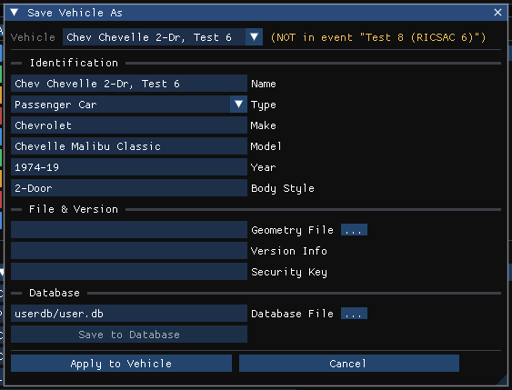
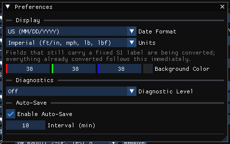
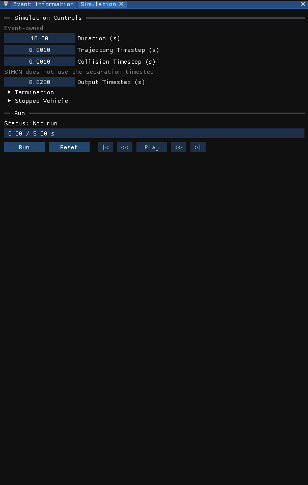
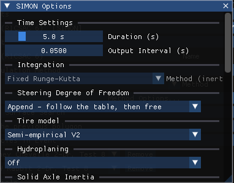

# Chapter 6: Options Menu

*HVE User's Manual — Section Two: Menu Reference, HVE Studio edition. Replaces
HVE's Chapter 6, Options Menu.*

HVE Studio's Options menu holds the settings for how the program looks and
behaves for you. None of them is kept in the case:

| Item | What it does |
|---|---|
| **Preferences...** | Units, date format, background color, diagnostics, auto-save (the **General** tab), and the keyboard shortcuts (the **Keymap** tab) |
| **Keymap...** | Change any keyboard shortcut: opens **Preferences** on its **Keymap** tab ([details](#keymap)) |
| **Output Settings...** | Your own labels and decimals for the output variables, the field limits and the terms, with presets |
| **Style Editor...** | The look of the interface: the UI size, the **Interface Font**, the base theme and live style settings |

HVE's Options menu mixed display switches, units, calculation settings and
preferences; in HVE Studio the rest of them live next to what they affect. The
table below takes HVE's Options menu item by item.

| HVE Options item | HVE Studio |
|---|---|
| Create DB | **Vehicle › Save Vehicle As...** › Save to Database ([details](#create-db)) |
| Show Key Results | **Output › Key Results...** or **View › Key Results** |
| Show Axes | **View › Scene Display › Axes** ([details](#show-axes)) |
| Show Contacts | **View › Scene Display › Occupant Equipment** |
| Show Belt Anchors | **View › Scene Display › Occupant Equipment** |
| Show Velocity Vectors | **View › Scene Display › Vectors › Velocity** |
| Show Skidmarks | **View › Scene Display › Skidmarks** |
| Show Tracks | **View › Scene Display › Tire Contact Patch Paths** |
| Show CGs / Show CG Paths | **View › Scene Display › CG Path** (no separate CG marker) |
| Show Accelerometers / Show Accelerometer Paths | **View › Scene Display › Accelerometer Path** |
| Show Position Sequences | Not in HVE Studio |
| Show Targets | **View › Scene Display › Scene Ghosts** |
| Show Connections | Not in HVE Studio as a display switch; connections are edited with **Connections...** in the Vehicles panel's Components section |
| Distance Tool | Not in HVE Studio |
| Show Path | The path follower's path is drawn while **Event › Path Follower...** is open |
| AutoPosition | **Auto Position (settle onto terrain)**, per vehicle, in Event Information's Vehicle Initial Conditions |
| Grid | Not in HVE Studio ([details](#grid)) |
| Units | **Options › Preferences** › Units ([details](#units)) |
| Shadows | **View › Scene Display › Light & Shadow** (**Shadow cascades**); the sun is set in the Shader Editor's Sun & Sky panel and Event Information › Lighting |
| Render | **View › Scene Display › Rendering** ([details](#render)) |
| Playback | **Output › Playback Options...** |
| Simulation Controls | the **Run** stage of the **Event Designer** (Event › Event Designer...) ([details](#simulation-controls)) |
| Calculation Options | **Method Options...** in Event Information › Calculation Method ([details](#calculation-options)) |
| DyMESH | **Event › DyMESH Options...** ([details](#dymesh)) |
| Get Surface Information | Not in HVE Studio as a probe ([details](#get-surface-information)) |
| Preferences | **Options › Preferences...** ([details](#preferences)) |
| *(not in HVE: keyboard shortcuts)* | **Options › Keymap...** ([details](#keymap)) |
| Add Playback Window (legacy) | the **Playback (F6)** editor's **Playback Sequence** panel |

---

## CREATE DB

**HVE:** Options › Create DB · **HVE Studio:** Vehicle › Save Vehicle As...

The Save Vehicle As dialog sets the identification fields under which the vehicle
is saved (name, type, make, model, year, body style), its geometry file, version
information and security key, and the **Database File**, and **Save to Database**
writes the vehicle into it. The dialog notes that a database write needs the
vehicle's make, model, year and body style to match a loaded database record.
**Apply to Vehicle** copies the identification back to the vehicle.

*Vehicle › Save Vehicle As...*

---

## SHOW AXES

**HVE:** Options › Show Axes · **HVE Studio:** View › Scene Display › Axes

Draws the environment's axes at the origin and each vehicle's own axes at its
CG, turning with the vehicle; on by default. The coordinate system is described
in [Appendix III](../11-appendices/appendix-03-coordinate-systems.md).

!!! note "HVE Studio"
    Axes are not drawn on humans.

---

## GRID

!!! warning "Not in HVE Studio"
    The viewport draws a ground grid, but there is no Grid dialog for its
    spacing, color or extent. (The Output Graph has its own
    gridline settings under **Format...**.)

---

## UNITS

**HVE:** Options › Units · **HVE Studio:** Options › Preferences › Units

HVE Studio offers two unit systems: **Metric (m, km/h, kg, N)** and **Imperial
(ft/in, mph, lb, lbf)**. Fields that follow the setting change immediately;
the case itself is stored in SI units either way. HVE's Units dialog, which set
the unit of each quantity separately, is not reproduced.

*Options › Preferences.*

!!! note "HVE Studio"
    The Preferences dialog notes that some fields still carry a fixed SI label
    while they are being converted.

---

## RENDER

**HVE:** Options › Render (Rendering Options dialog) · **HVE Studio:** View › Scene Display › Rendering

| HVE Rendering Options | HVE Studio |
|---|---|
| Show As, Render Method (shading) | **Phong**, **Flat** or **Wireframe** (Wireframe is HVE's Hidden Line) |
| Light sources | **Light Sources On** |
| Complexity, Show Only + Faces, Render Quality, Anti-aliasing Level | Not in HVE Studio |

A vehicle's own shading (as loaded, flat, smooth, auto smooth) is set in its
Vehicle Mesh window (Display tab), and the site's in the Environment panel's Terrain section.

---

## SIMULATION CONTROLS

**HVE:** Options › Simulation Controls · **HVE Studio:** the Event Designer's Run stage
(Event › Event Designer..., stage **Run**)

The **Simulation Controls** at the top of the Run stage belong to the
active event:

- **Duration (s)**, **Trajectory Timestep (s)**, **Collision Timestep (s)**,
  **Separation Timestep (s)**, **Curb Impact Timestep (s)** (EDVSM), **Human
  Collision Timestep (s)** (EDHIS and EDGEN) and **Output Timestep (s)** —
  HVE's integration timesteps. A timestep the active method does not use is not shown, and the
  stage says so.
- **Termination** — linear and angular speed limits, each with an **On** switch;
  the run ends once every vehicle is below both armed limits. With both off the
  run integrates to the full duration.
- **Stopped Vehicle** — the linear and angular speeds below which a vehicle is
  reported at rest.
- **Integrator Convergence** — **Maximum Bisections** and **Velocity
  Convergence**, and for EDHIS the **Velocity Change Limit** and **Acceleration
  Change Limit**, shown only for the methods that read them.

Below them are the **Run** controls (status, progress, Run / Reset / Close and the
playback slider) and the **Last Result**.

*The simulation controls and the Run controls.*

!!! note "HVE Studio"
    Some methods' option dialogs (for example SIMON Options) also carry the
    event's duration and output interval; they edit the same values.

See the dialog reference: [Simulation Controls](../../09-events-driver-controls/SimuCtrlDlg.md).

---

## CALCULATION OPTIONS

**HVE:** Options › Calculation Options · **HVE Studio:** Event Information ›
Calculation Method › **Method Options...**

Opens the options dialog of the active event's method: EDCRASH Options, EDSMAC
Options (also used for EDSMAC4), EDGEN Options, EDHIS Options, SIMON Options,
EDVSM Options, GATB Options or SINGLETRACK Options. EDSVS, EDVDS and EDVTS have
no options dialog in HVE Studio.

*Method Options... for a SIMON event.*

!!! note "HVE Studio"
    Some HVE options are offered with a note that the engine refuses them — for
    example SIMON's ABS Algorithms 3, 5 and 6 — and the dialog says the run will
    stop. SIMON's Blythe-Day hydroplaning model, which HVE's own SIMON does not
    implement either, is not offered; an imported case that states it is told so. The program manuals describe the
    options themselves.

See the dialog reference: [Calculation Options](../../10-calculation-options/README.md).

---

## DYMESH

**HVE:** Options › DyMESH · **HVE Studio:** Event › DyMESH Options...

HVE's DyMESH dialog had General and Advanced pages (search, pushback,
restitution, timesteps, debug output). HVE Studio's DyMESH Options dialog is one
page with **Start Times**, **Contact Search**, **Contact Model**,
**Restoration**, **Inter-Vehicle Contact (fallback)**, a **Per-pair
override** and **Contact Mesh Preparation (per vehicle)** (the event's own
tessellate, maximum triangle leg and weld distance for each vehicle, which in
HVE are set per event and vehicle with the mesh). The collision timestep is on the Event Designer's Run stage. Where the engine
stores an option but does not read it, the dialog says so beside the control.

!!! warning "Not in HVE Studio"
    DyMESH's debug output options are not offered.

---

## GET SURFACE INFORMATION

!!! warning "Not in HVE Studio"
    There is no tool that reports the surface under a picked point. In the
    Environment editor, clicking a surface in the viewport selects it, and the
    Environment panel's Selected Surface section shows its material.

---

## PREFERENCES

**HVE:** Options › Preferences · **HVE Studio:** Options › Preferences...

Preferences has two tabs: **General**, the settings below, and **Keymap**, the keyboard shortcuts
([KEYMAP](#keymap)).

| HVE preference | HVE Studio |
|---|---|
| Diagnostic Level | **Diagnostic Level** — grayed: nothing to control (a run's status always says what it assumed) |
| Auto Backup | **Enable Auto-Save** and **Interval (min)** — a recovery copy, `<case>.autosave.hvex`, written beside the case while there are unsaved changes |
| Date Style | **Date Format** — how dates are shown in the Audit Log, the file browser and the run report |
| Background Color | **Background Color** — the color of the main window behind the panels |
| Skidmark Height | Not in HVE Studio |
| Font Size | **Options › Style Editor**: **UI Size**, and the **Interface Font** (ImGui's built-in font, or a font found on this computer: Segoe UI, Tahoma, Verdana, Arial or Calibri on Windows; Helvetica Neue, Helvetica, Arial or Verdana on macOS; DejaVu Sans, Noto Sans, Liberation Sans, Ubuntu or Cantarell on Linux). The font changes at once and is kept for every session. |
| *(units)* | **Units** — see [UNITS](#units) |

!!! note "HVE Studio"
    Auto-Save never writes the case file itself: **Enable Auto-Save** (on by default) and **Interval (min)** write a recovery copy of the case, `<case>.autosave.hvex` beside it, while there are unsaved changes; the case file itself is never written. Saving the case removes the copy, and opening a case whose recovery copy is newer offers to open the copy.

## KEYMAP

**HVE:** not in HVE · **HVE Studio:** Options › Keymap... (Options › Preferences, **Keymap** tab)

Every keyboard shortcut in HVE Studio can be changed, as in Blender's keymap. Each shortcut is a named
action with up to two keys, listed by category with where it works:

- **Anywhere**: anywhere in the window, except while you are typing in a field.
- **3-D view**: with the pointer over a 3-D view.
- **Edit Mode**: in the 3-D view's Edit Mode.
- **Designer**: the stage bar of the designer on screen.

To change a key, click it in the **Key** or **Second key** column and press the new key, holding any
of Ctrl, Shift and Alt you want with it; **Esc** cancels. The **x** beside a key removes it. **Reset**
puts one action back to its defaults, and **Reset All** puts every action back. **Search actions or
keys** filters the list by name or by key.

A key belongs to one action at a time. If you give the same key to two actions, it is shown in red on
both, with the other action named when you point at it. Both keep the key, and whichever the program
reads first wins, so change one of them. Modifiers must match exactly: **Ctrl+1** is not **1**, and
**Shift+H** is not **H**.

The menus, the editor buttons, the 3-D view's hint line and the tooltips that name a key all show
your keys, so they always agree with what the keys do. Your changes are saved for this installation
in `hve_prefs.ini`, beside your other preferences. Only the changed actions are written, so deleting
that file, or **Reset All**, restores every default.

The **Designer** actions move along the stage bar of the designer on screen (Vehicle, Event,
Environment or Human). **Next stage** and **Previous stage** step through the stages the bar offers,
and **Stage 1** to **Stage 9** open the first nine, counting the stages the bar shows. If two designers
are on screen, the keys go to the one under the pointer or with focus.

Some keys are fixed and are not listed:

- typing in a field;
- **Enter** and **Esc** to confirm or cancel;
- the keys used during a running move, turn or scale: **X**, **Y**, **Z** for an axis, digits for a
  typed amount, and **Backspace**;
- a table's own editing keys: the arrows, **Tab**, **Ctrl+C** and **Ctrl+V**;
- the Shader Editor's and the Dope Sheet's own keys.

The defaults:

| Category | Action | Where | Default key(s) |
|---|---|---|---|
| File | New Case | Anywhere | **Ctrl+N** |
| File | Open Case... | Anywhere | **Ctrl+O** |
| File | Save Case | Anywhere | **Ctrl+S** |
| Edit | Undo | Anywhere | **Ctrl+Z** |
| Edit | Redo | Anywhere | **Ctrl+Y** or **Ctrl+Shift+Z** |
| View | UI Size: Larger | Anywhere | **Ctrl+=** or **Ctrl+Numpad +** |
| View | UI Size: Smaller | Anywhere | **Ctrl+-** or **Ctrl+Numpad -** |
| View | UI Size: Reset to 100% | Anywhere | **Ctrl+0** or **Ctrl+Numpad 0** |
| Event | Position / Velocity... | Anywhere | **Ctrl+P** |
| Event | Driver Controls... | Anywhere | **Ctrl+D** |
| Event | Damage Profiles... | Anywhere | **Ctrl+M** |
| Event | Collision Pulse... | Anywhere | **Ctrl+U** |
| Event | Wheels... | Anywhere | **Ctrl+W** |
| Event | Contacts... | Anywhere | **Ctrl+T** |
| Event | Run Simulation... | Anywhere | **Ctrl+R** |
| Editors | Human editor | Anywhere | **F2** |
| Editors | Vehicle editor | Anywhere | **F3** |
| Editors | Environment editor | Anywhere | **F4** |
| Editors | Event editor | Anywhere | **F5** |
| Editors | Playback editor | Anywhere | **F6** |
| Designer stages | Previous stage | Designer | **Ctrl+Page Up** |
| Designer stages | Next stage | Designer | **Ctrl+Page Down** |
| Designer stages | Stage 1 (the first in the bar) | Designer | **Alt+1** |
| Designer stages | Stage 2 | Designer | **Alt+2** |
| Designer stages | Stage 3 | Designer | **Alt+3** |
| Designer stages | Stage 4 | Designer | **Alt+4** |
| Designer stages | Stage 5 | Designer | **Alt+5** |
| Designer stages | Stage 6 | Designer | **Alt+6** |
| Designer stages | Stage 7 | Designer | **Alt+7** |
| Designer stages | Stage 8 | Designer | **Alt+8** |
| Designer stages | Stage 9 | Designer | **Alt+9** |
| Cameras | Next camera (look through it) | Anywhere | **C** |
| Cameras | Previous camera | Anywhere | **Shift+C** |
| Cameras | Insert a key on the active camera | Anywhere | **I** |
| Event | Delete the selected path point or target; in the Environment editor, the selected surfaces (asks first) | Anywhere | **Delete** or **X** |
| 3-D view | Front view | 3-D view | **1** or **Numpad 1** |
| 3-D view | Rear view | 3-D view | **Ctrl+1** or **Ctrl+Numpad 1** |
| 3-D view | Right view | 3-D view | **3** or **Numpad 3** |
| 3-D view | Left view | 3-D view | **Ctrl+3** or **Ctrl+Numpad 3** |
| 3-D view | Top view | 3-D view | **7** or **Numpad 7** |
| 3-D view | Bottom view | 3-D view | **Ctrl+7** or **Ctrl+Numpad 7** |
| 3-D view | View from the other side | 3-D view | **9** or **Numpad 9** |
| 3-D view | Perspective / orthographic | 3-D view | **5** or **Numpad 5** |
| 3-D view | Frame selected | 3-D view | **.** or **Numpad .** |
| 3-D view | Home (the home camera, else fit everything) | 3-D view | **Home** |
| 3-D view | Orbit left (15 deg) | 3-D view | **4** or **Numpad 4** |
| 3-D view | Orbit right (15 deg) | 3-D view | **6** or **Numpad 6** |
| 3-D view | Orbit up (15 deg) | 3-D view | **2** or **Numpad 2** |
| 3-D view | Orbit down (15 deg) | 3-D view | **8** or **Numpad 8** |
| 3-D view | Move the selection | 3-D view | **G** or **M** |
| 3-D view | Rotate the selection | 3-D view | **R** |
| 3-D view | Scale the selection | 3-D view | **S** |
| 3-D view | Edit Mode on / off (Vehicle and Environment editors) | 3-D view | **Tab** |
| 3-D view | Hide the selected | 3-D view | **H** |
| 3-D view | Hide everything else | 3-D view | **Shift+H** |
| 3-D view | Show everything hidden | 3-D view | **Alt+H** |
| Edit Mode | Select every face of the part or surface | Edit Mode | **A** |
| Edit Mode | Add every face of the part or surface | Edit Mode | **Shift+A** |
| Edit Mode | Select no faces | Edit Mode | **Alt+A** |
| Edit Mode | Box select | Edit Mode | **B** |
| Edit Mode | Select linked (faces sharing a vertex) | Edit Mode | **L** |

<!-- NAV -->

---

← Previous: [Chapter 5: View Menu](05-view-menu.md)  |  [Index](README.md)  |  Next: [Chapter 6B: Tools Menu](06b-tools-menu.md) →

<!-- /NAV -->
