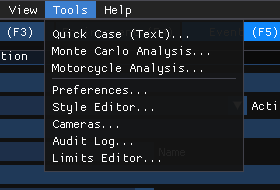
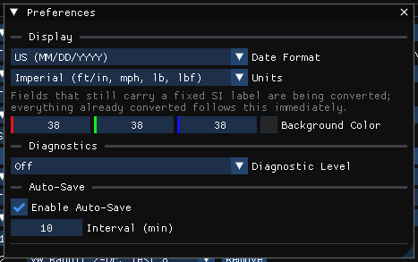
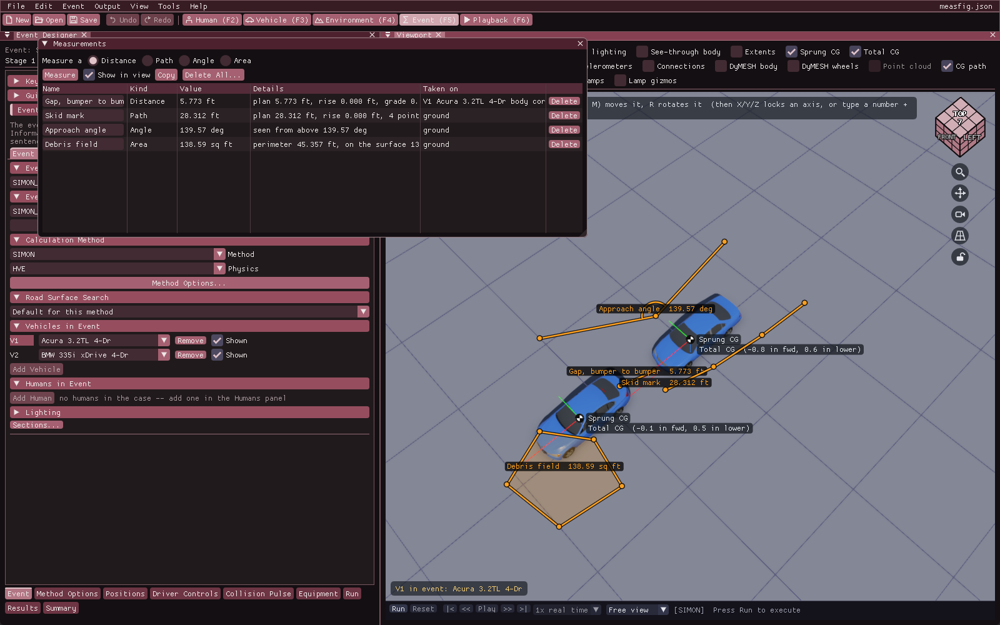
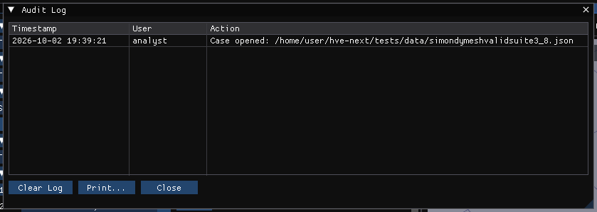

# Chapter 6B: Tools Menu

*HVE User's Manual — Section Two: Menu Reference, HVE Studio edition. A new
chapter: the Tools menu gathers HVE Studio's preferences and utilities, some of
which were on HVE's Options and View menus.*

The Tools menu is on the menu bar in every editor.

*The Tools menu.*

| Item | What it does | HVE equivalent |
|---|---|---|
| **Automatic Tools ›** | The tools that fill a case from a source, in one submenu (below) | *(new)* |
| **Monte Carlo Analysis...** | Uncertainty analysis by repeated runs with sampled inputs | *(new)* |
| **Motorcycle Analysis...** | Cornering and slide-to-stop calculations for a motorcycle | *(new)* |
| **Preferences...** | Units, date format, background color, diagnostics, auto-save | Options › Units, Options › Preferences |
| **Report Text...** | Your own wording for any string of the programs' report pages, kept with your settings — see [Report Text](../../11-reports-output/ReportText.md) | *(new; HVE kept these strings in each program's `.rsc` file)* |
| **Style Editor...** | The look of the interface: base theme and live style settings | *(new; Options › Preferences › Font Size)* |
| **Cameras...** | The case's named cameras | View › Set Camera |
| **Measure...** | Distances, path lengths, angles and areas clicked in the 3-D view, kept in the case | *(new)* |
| **Audit Log...** | A time-stamped record of what was done in this session | *(new; HVE's Audit Trail is a different thing — see [Audit Trail](../01-overview/02b-how-to-use-hve.md#audit-trail))* |
| **Limits Editor...** | The minimum and maximum accepted by input fields | *(new)* |

**Automatic Tools** holds the tools that fill a case from a source, together
with the record of where each value came from. The submenu groups them under
**Case** (Case Intake, Quick Case) and **Vehicle** (the rest), with Provenance
last:

| Item | What it does |
|---|---|
| **Case Intake...** | Builds an event from the case documents, typed in with where each value is stated |
| **Quick Case (Text)...** | Builds or edits a case from a typed sentence (map coordinates, +Y north) |
| **Vehicle Package...** | Builds a case vehicle from its VIN or year, make and model, its stated specifications, and who and what it carried |
| **Crush Stiffness from Crash Tests...** | CRASH3 A, B and G for the active vehicle from staged barrier tests, typed in, read from an NHTSA test file, or found with **Search NHTSA (online)** or fetched by test number from NHTSA's database; shows the side's stiffness now beside the tests' before you apply it. Also opened by **From crash tests...** in Crush Stiffness |
| **Crush Profile from Scan...** | The crush depths C1..Cn, damage width and damage offset of a vehicle of the active event (chosen with the vehicle picker at the top), measured off a scan of the damaged vehicle against the vehicle's own 3-D body (the default), an exemplar scan, a string line across the face's undamaged ends, or a plane at the vehicle's exterior extent. Enabled only while the active event is EDCRASH, the one method that reads a crush profile. Also opened by **Measure from a scan...** under Measured Crush in the Event editor, which selects its own vehicle |
| **EDR Import...** | An event data recorder's pre-crash record (a CDR report PDF, its tables as CSV or text, pasted, or typed in by hand) into a vehicle of the active event; for SIMON, a driver solved so the run follows the recorded speed; and the recorded yaw rate, accelerations and delta-V against the run's |
| **Provenance...** | Where each value set by those tools came from |

Automatic Tools, Monte Carlo Analysis and Motorcycle Analysis are not in the
viewer product.

---

## QUICK CASE (TEXT)

**Menu Option:** Tools › Automatic Tools › Quick Case (Text)...

**Description:** Type a description of a case — for example *SIMON event,
vehicle 1 at (0,0) heading 0 speed 50 mph, vehicle 2 at (12,-3) heading 180
speed 30 mph* — and the dialog shows, as you type, what it will build. **Build**
adds the described event and newly built vehicles to the case and makes the
event active; existing events and vehicles are kept.

!!! tip "New in HVE Studio"
    This tool has no counterpart in HVE's menus.

---

## VEHICLE PACKAGE

**Menu Option:** Tools › Automatic Tools › Vehicle Package...

**Description:** Identify a vehicle by its VIN (checked offline; **Decode with
NHTSA (online)** asks NHTSA's decoder) or its year, make and model; choose the
matching vehicle database record or HVE's generic of its type; enter its
measured specifications, which scale a generic; list its occupants (GEBOD
bodies) and cargo; and **Add to Case**. The occupants are seated, and the cargo
loaded, in a chosen event, or put on the vehicle's Aboard list. Every value set
is listed with where it came from. See
[Vehicle Package](../../new-features/12-case-intake-and-vehicle-data.md#vehicle-package).

---

## CASE INTAKE

**Menu Option:** Tools › Automatic Tools › Case Intake...

**Description:** Type in what the case documents state (the engine, the
road, each vehicle), with where each value is stated; choose each vehicle's
data, then **Build** adds one new event with those vehicles and their starting
conditions. HVE Studio sends nothing anywhere. See
[Case Intake](../../new-features/12-case-intake-and-vehicle-data.md#case-intake).

---

## PROVENANCE

**Menu Option:** Tools › Automatic Tools › Provenance...

**Description:** Every value set by Vehicle Package, Case Intake, EDR Import
and Crush Stiffness from Crash Tests: what it was set to, whether it was
stated, looked up, estimated, a generic's default or unknown, its source, the
tool and the time, and, where the record is about a single field, whether that
field has been changed by hand since. The records are saved with the case. See
[Provenance](../../new-features/12-case-intake-and-vehicle-data.md#provenance).

---

## EDR IMPORT

**Menu Option:** Tools › Automatic Tools › EDR Import...

**Description:** Read an EDR report's pre-crash record (open the report's PDF,
or its tables as CSV or text; paste its tables; or
enter it by hand) for the vehicle chosen at the top of the window, in the
active event, and set its initial speed and its throttle, brake and steering
tables from it, with the recorder time the simulation starts at. For a SIMON
event, **Solve from the record** finds the throttle and brake that make the
run follow the recorded speed, and the start can be moved so the vehicle is at
a given pose later. After a run, the recorded yaw rate and accelerations are
compared with the run's, and the recorded delta-V is plotted against the
run's. See
[EDR Import](../../new-features/12-case-intake-and-vehicle-data.md#edr-import).

!!! tip "New in HVE Studio"
    Vehicle Package, Case Intake, Provenance and EDR Import have no
    counterpart in HVE's menus.

---

## MONTE CARLO ANALYSIS

**Menu Option:** Tools › Monte Carlo Analysis...

**Description:** Choose the number of runs, a random seed and a sampling method,
and a table of uncertain inputs, each bound to a field of the case with a
distribution. **Run** solves the case that many times, starting from the case's
own values, and shows a confidence-interval table, a tornado chart of the inputs'
influence and a convergence reading. **Export** writes the per-run results as CSV
and a self-contained HTML report.

!!! note "HVE Studio"
    Every run is solved by the active event's own engine. If the case has no
    event, no vehicles, or an event whose method has no engine, **Run Analysis**
    is disabled and the dialog says why.

!!! tip "New in HVE Studio"
    This tool has no counterpart in HVE's menus.

---

## MOTORCYCLE ANALYSIS

**Menu Option:** Tools › Motorcycle Analysis...

**Description:** The two hand calculations a motorcycle case usually needs:

- **Cornering** — could the machine have negotiated a curve at a given speed,
  from the friction available and the lean angle it would have to hold;
- **Slide** — the speed at which the machine went down, worked backwards from
  the rest positions.

For simulating the motorcycle itself, use the SINGLETRACK calculation method.

!!! tip "New in HVE Studio"
    The SINGLETRACK motorcycle model and these calculations are not part of
    HVE; they have no counterpart in HVE's menus.

---

## PREFERENCES

**Menu Option:** Tools › Preferences... · *HVE: Options › Units, Options ›
Preferences*

**Description:**

- **Display** — **Date Format**; **Units**: *Metric (m, km/h, kg, N)* or
  *Imperial (ft/in, mph, lb, lbf)*; **Background Color**
- **Diagnostics** — **Diagnostic Level**
- **Auto-Save** — **Enable Auto-Save** and **Interval (min)**

!!! note "HVE Studio"
    **Diagnostic Level** is grayed (it has nothing to control). **Date Format**
    sets how dates are shown. **Enable Auto-Save** (on by default) and **Interval (min)** write a recovery copy of the case, `<case>.autosave.hvex` beside it, while there are unsaved changes; the case file itself is never written. Saving the case removes the copy, and opening a case whose recovery copy is newer offers to open the copy.

*Tools › Preferences.*

See [Chapter 6](06-options-menu.md#preferences) for the mapping from HVE's User
Preferences dialog.

---

## STYLE EDITOR

**Menu Option:** Tools › Style Editor...

**Description:** **Base Theme** (a preset, kept between sessions) and **Live
Style** — the interface's colors, sizes, spacing and fonts, which apply at once
but are not saved.

---

## CAMERAS

**Menu Option:** Tools › Cameras... · right-click the viewport › Camera
Properties... · *HVE: View › Set Camera*

See [Chapter 5, Set Camera](05-view-menu.md#set-camera).

---

## MEASURE

**Menu Option:** Tools › Measure...

**Description:** Measures in the 3-D view and keeps each measurement in the
case, so whoever the case is sent to sees the same measurements on the same
points. **Measure a** picks what the clicks measure:

| Kind | Points | What it gives |
|---|---|---|
| **Distance** | 2 (finishes at the second click) | The straight-line distance; its plan distance, rise and grade |
| **Path** | 2 or more (Enter or **Finish** ends it) | The length along the points in order, e.g. a skid or yaw mark; its plan length and rise |
| **Angle** | 3 (finishes at the third click): an end, the corner, the other end | The angle at the corner; also as seen from above |
| **Area** | 3 or more (Enter or **Finish** closes it) | The area inside the outline seen from above; its perimeter, and its area on the surface the points lie on |

The **Measurements** window lists them; each one is also drawn in the 3-D view
in orange with its name and value (the selected one in yellow): a distance or a
path as a line through its points, an angle as its two legs with an arc at the
corner, an area as its closed outline over a light fill.

Press **Measure**, then click points in the 3-D view. The one being taken is
drawn in blue, with a dashed line to the cursor and its running value. A
distance and an angle finish by themselves; a path and an area end with
**Enter** or **Finish**. **Backspace** takes back the last point, **Esc** drops
the one being taken, and **Esc** again stops measuring. The tool stays armed for
the next one until **Measuring... (click to stop)** is pressed. Changing the
kind drops a half-taken measurement. Closing the window stops measuring too;
the measurements stay on screen while **Show in view** is ticked.

**Where a click lands.** On the nearest thing the cursor visibly touches:

- the site's surfaces (the road, curbs, an imported drawing or model);
- a vehicle's body, where it is drawn at that moment — during playback, where
  it is at the time on screen;
- the survey point cloud, on the front surface of the points under the cursor;
- the ground plane, only where the cursor touches none of these.

On a site surface or a body the click **snaps to a corner** of the surface
(a mesh vertex) within about 10 pixels, so the corner of a curb or a bumper is
taken exactly. A square on the cursor says a corner will be taken, a ring that
the point under the cursor will be.

**The list.** One row a measurement, in the display units:

| Column | What it is |
|---|---|
| **Name** | Edit it in place (M1, M2, ... by default) |
| **Kind** | Distance, Path, Angle or Area |
| **Value** | The length, the angle (deg) or the area (sq ft or m^2) |
| **Details** | A distance's plan distance, rise (the last point's height above the first) and grade; a path's plan length, rise and point count; an angle seen from above; an area's perimeter, its area on the surface and its point count |
| **Taken on** | What the points were taken on: *site*, *V2 ... body*, *point cloud* or *ground*, with *corner* when one snapped. Hover it for each point, and for the run time when one was on a vehicle |

**Delete** removes one measurement and **Delete All...** every one, after a
confirmation. **Copy** puts the whole list on the clipboard as tab-separated
text, with each measurement's points (x forward, y right, z down), for a
spreadsheet or a report. Measuring is a display tool: no
calculation reads a measurement, so it is available while results are on
screen, and Edit › Undo takes back an added, renamed or deleted one.

A measurement on a vehicle is taken where the body was drawn when you clicked
and does not follow the vehicle afterward.

---

## AUDIT LOG

**Menu Option:** Tools › Audit Log...

**Description:** A table of the session's actions — for example cases opened
and saved, undo and redo, and exports — each with its time and user. **Clear Log** empties it.

*The Audit Log.*

!!! note "HVE Studio"
    The Audit Log's **Print...** button does nothing in HVE Studio.

---

## LIMITS EDITOR

**Menu Option:** Tools › Limits Editor...

**Description:** A searchable table of input fields with the **Min** and **Max**
value each accepts, for the fields that use it. **Save to File** keeps the edited
limits; **Reset Defaults** restores HVE Studio's.

!!! tip "New in HVE Studio"
    This tool has no counterpart in HVE's menus.

<!-- NAV -->

---

← Previous: [Chapter 6: Where HVE's Options Menu Went](06-options-menu.md)  |  [Index](README.md)  |  Next: [Chapter 7: Help Menu](07-help-menu.md) →

<!-- /NAV -->
