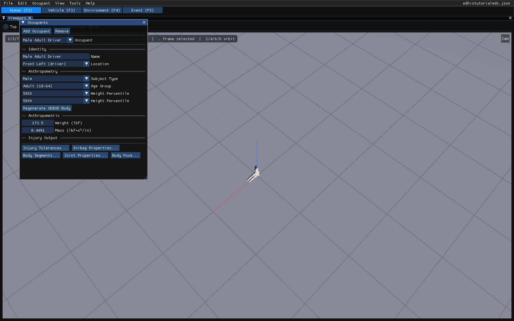

# Chapter 8 — Creating and Editing Humans

*Adapted for HVE Studio from the HVE User's Manual (HVE Version 5, Seventh
Edition, January 2006), Chapter 8.*

The Human Editor is used for creating and editing the humans of the current
case. This chapter describes how to use it, beginning with its components.

> **NOTE:** Refer to the next chapter, [Human Model
> Definition](09-human-model-definition.md), for a detailed description of
> each human model parameter.

## Human Editor Components

To use the Human Editor, select the **Human (F2)** tab under the menu bar, or
press **F2**. The Human Editor has two components:

- **Human Designer** — A staged panel docked on the left: the Humans panel on
  its first stage, then the human's segments, joints, pose and injury
  tolerances, each on a stage of its own (see [Chapter 8a — Human
  Designer](08a-human-designer.md)). It opens when you switch to the Human
  editor; **Human › Human Designer...** reopens it.
- **Humans panel** — Used for adding humans to the case, removing them,
  selecting the current human and editing its basic attributes. It takes the
  place of HVE's Human Editor dialog and its GEBOD Human Information dialog.
  It is the Human Designer's **Human** stage; **Human › Human Information**
  also opens it as a window of its own.
- **Viewport** — Displays the current human. Clicking a body segment in the
  viewport selects that segment in the Body Segments dialog (see Selecting
  and Editing Humans, below).

*Figure 8-1: HVE Studio Human Editor — the Humans panel over the viewport.*

!!! note "HVE Studio"
    The Humans panel floats over the viewport when the Human editor is
    first opened. Like every HVE Studio panel it can be docked by dragging its
    title bar onto the dock area.

### Occupants Panel

The Humans panel manages all the humans in the current case. It contains:

- **Add Human** — Adds a new human to the case and generates its body with
  GEBOD (see Adding New Humans, below).
- **Delete** — Deletes the current human from the case.
- **Human** — A list of the names of all the humans in the case. Select a
  different name to make it the current human.
- **Identity** — Name and Location (see below).
- **Size (GEBOD)** — The GEBOD inputs: Subject Type, Age Group, **Basis**
  (**Percentiles**, or **Weight and height**), then the Weight Percentile and
  Height Percentile, or a **Weight** and **Standing Height**; the
  **Regenerate GEBOD Body** button, and the body's own weight beside it.
- **Body Segments…, Joint Properties…, Body Pose…, Injury Tolerances…** —
  When the panel is open as its own window, buttons that open the Human
  Designer on that stage. On the designer's Human stage they are not shown:
  the stage bar is right there.

> **NOTE:** Removing a human removes it only from the current case. Events
> that used it are updated so that their remaining humans keep their
> assignments.

!!! note "HVE Studio"
    HVE does not allow a human that is used in an event to be deleted;
    HVE Studio does, and removes it from those events. While the results of a
    simulation are on screen, Remove waits for **Reset**, and so does Add
    Human when the new human would join a solved occupant event. The human
    data the run used stays editable; an edit marks the run's results out of
    date until it is run again.

> **NOTE:** Although every human's properties are defined using the Human
> Editor, humans are not positioned using the Human Editor. The position of a
> human in any event is an event-related issue, and is performed using the
> Event Editor. Think of it this way: At this point, we don't care what the
> human is doing. All we care about is that the human is a male, weighs 180
> pounds and has other properties of our choosing.

!!! note "HVE Studio"
    Which vehicle a human rides in is set in the Event Editor, in Event
    Information's **Humans in Event** section. That section's **Pose** button
    opens the Body Pose dialog for the event; the same dialog is the Human
    Designer's **Body Pose** stage, which edits the pose in the active event. A human's pose and the restraint it wears are stored per event.
    A human also has **a pose of its own**, given on the Body Pose stage before any
    event holds it: an event the human is added to starts from that pose, and keeps
    its own from then on.

## Adding New Humans

To add a new human, press **Add Human** in the Humans panel. HVE Studio
adds a human named "Human *n*" and immediately generates its 15-segment
body with GEBOD from the current Anthropometry settings. Then edit its
attributes in the panel:

- **Name** — A user-editable field for the human's name. The name identifies
  the human in each event as well as in all output reports.
- **Location** — The seat position the human occupies: Front Right, Front
  Center, Front Left (driver), Rear Right, Rear Center, Rear Left, Back Right,
  Back Center, Back Left, or Pedestrian. A human added to an event starts at
  this seat of the event's vehicle (HVE's default seat positions) in HVE's
  seated posture. Changing the Location moves the human to the new seat in
  every event where it is still at the old one; a seat that was moved by hand
  in an event stays where it was put, and the panel says how many events
  moved.

  > **NOTE:** If a seat position is selected, the human is a vehicle occupant
  > and its motion is defined relative to the vehicle. If Pedestrian is
  > selected, the human's motion is defined relative to the earth. Occupants
  > are drawn and solved seated, pedestrians standing.

  > **NOTE:** The Location also selects which seat's airbag the human uses:
  > the bag at that seat of the event's vehicle, edited in the Vehicle editor
  > (Vehicle › Editors › Airbags...). A pedestrian has no seat and no airbag.

- **Subject Type** — Male or Female.
- **Age Group** — Child (0-12), Teen (13-17), Adult (18-64) or Senior (65+).
- **Weight Percentile** — 5th, 25th, 50th, 75th or 95th.
- **Height Percentile** — 5th, 25th, 50th, 75th or 95th.

> **NOTE:** Regarding Weight and Height Percentiles: 50 percentile is
> average; 5 percentile means that only 5 percent of the population is
> smaller; 95 percentile means that only 5 percent of the population is
> larger.

Changing Subject Type, Age Group, the Basis or any size regenerates the body
at once, as HVE's GEBOD Human Information does at OK, so the segments,
inertias, ellipsoids and joints always correspond to the size shown. With
**Weight and height**, a typed **Weight** or **Standing Height** takes effect
when you press Enter or leave the field; a height left at 0 takes the Height
Percentile. **Regenerate GEBOD Body** regenerates it on demand, which discards
any edits made to the segment and joint data; the segment colors are kept. The
text beside the button gives the body's weight (the sum of its 15 segments).
Body Segments has the same **Regenerate GEBOD Body** and says what the body was
built from; the size itself is set only here. Only if GEBOD cannot run does it
fall back to a simplified body from standard segment mass fractions, and it
says so.

!!! warning "Not in HVE Studio"
    HVE's GEBOD Human Information dialog also takes the age in months or years
    and a User-defined subject file. HVE Studio's age is the Age Group, and the
    percentiles offered are the five listed above.

!!! note "HVE Studio"
    How the four Anthropometry settings reach GEBOD:

    - **Adult** and **Senior** generate a male or female adult from the weight
      and height percentiles. Senior generates the same body as Adult.
    - **Child** and **Teen** generate GEBOD's child subject on the age basis,
      as a 6-year-old and a 12-year-old respectively. The Subject Type and the
      percentiles are not used for a child.
    - A body imported with a case and posed in an event is not regenerated
      when these settings change, so its imported segment data is kept.
      Regenerate GEBOD Body replaces it explicitly.

- **Weight** and **Standing Height** (Basis: Weight and height) — the stated
  weight and height GEBOD builds the body at, in the units set in Preferences.
  The Weight and Mass fields that were here went on 2026-11-10: a typed weight
  is this basis, which builds the body at it.

The tables below are HVE's human database keys, kept for reference when
reading an older HVE case.

**Table 8-1: Human Dummy Data, Child**

| Age (years) | Height (in) | Weight (lb) |
|---|---|---|
| 3 | 38.94 | 23.08 |
| 6 | 45.26 | 46.93 |
| 9 | 51.58 | 70.78 |
| 12 | 57.91 | 94.63 |

**Table 8-2: Human Dummy Data, Adult**

| Size (%-ile) | Female Height (in) | Female Weight (lb) | Male Height (in) | Male Weight (lb) |
|---|---|---|---|---|
| 2.5 | 51.19&dagger; | 94.75 | 65.04 | 131.50 |
| 5.0 | 59.94 | — | 65.81 | — |
| 50.0 | 63.82 | 127.24 | 69.82 | 173.50 |
| 95.0 | 67.70 | — | 73.83 | — |
| 97.5 | 68.45 | 159.70 | 74.60 | 215.50 |

*&dagger; Value as printed in the original manual; it is inconsistent with
the 5.0 percentile value (59.94 in) and appears to be a misprint in the
original edition.*

### Human Database

In HVE, Sex, Age, Weight Percentile and Height Percentile were keys used to
select a human from the Human Database; the keys provide inputs to the GEBOD
program [3.10] that calculates anthropomorphic data for the 15-segment,
14-joint human model described in the next chapter. HVE Studio runs GEBOD
directly from the Anthropometry settings, using HVE's own GEBOD regression
data, which is built into the program.

The properties of the generated human may be edited. Each human belongs to
the case; editing it does not affect any other case.

## Adding Humans From Previous Cases

!!! warning "Not in HVE Studio"
    HVE Studio has no Previous Human Selection dialog (HVE's Add › Previous).
    To reuse a human from another case, open that case with **File › Open Case...**
    (an HVE `.hve` case or an HVE Studio `.hvex`/`.json` case) and work from it.

## Selecting and Editing Humans

The last human added becomes the current human. To select and edit any
human:

1. Choose its name in the **Human** list of the Humans panel. The
   selected human becomes the current human and is displayed in the
   viewport.
2. If desired, change its Identity and Anthropometry in the panel, as
   described above.
3. If desired, edit the human's properties on the Human Designer's stages.
   These replace HVE's segment pop-up menu (see the [Human CG Dialog
   reference page](../../07-humans/HumCGDlg.md)):
   - **Body Segments** — Inertial properties, segment color, contact
     ellipsoids and joint locations of each segment. Select the segment in
     the stage's **Segment** list, or click the segment in the viewport.
   - **Joint Properties** — The physical properties of each of the 14
     joints.
   - **Body Pose** — The human's posture: an angle for each segment.
     **Whole body pitch (deg)** pitches the whole body about the pelvis, every
     segment at once (+ leans it back): each segment's angles are relative to
     its parent, so the posture is kept.

     *Which pose.* With the human in the active event, **Pose of:** chooses
     between **This human** — the human's own pose — and **Event:** — the pose
     that event runs with, together with its initial velocity (a pedestrian's
     walking speed). With no event holding the human, the stage edits the
     human's own pose, so a human can be posed before any event exists. Tick
     **This human has a pose of its own** to state one; an event the human is
     added to then starts from it. The human's own pose is read by no run, so
     it can be edited with results on screen. Nothing is copied behind your
     back: **Copy to its events** gives the human's own pose to every event
     that holds it (an event with results on screen keeps its pose until it is
     reset), and on an event's pose **Take the human's own pose** and
     **Make this the human's own pose** copy one way or the other. The pelvis
     stays where each event has it.

     *The pose library.* **Pose library** lists the built-in poses —
     Standing (feet flat and the arms clear of the body; **Zero all angles**
     is not this: at zero the feet point down the legs and the arms hang
     through the hips), Seated (HVE's passenger), Driving with the hands on the wheel,
     and Walking (the measured gait at right heel strike when the human has a
     body; a plain stride, named as not measured, otherwise) — followed by the
     poses you have saved. **Apply** gives the chosen pose to the body.
     **Save pose as...** saves the pose on screen under a name, and
     **Delete** removes a saved one. **Mirror left / right** swaps the right
     and left limbs. A saved pose is a small text file (`.hvepose`: one line
     per segment, roll, pitch and yaw in degrees relative to the parent) in
     the `poses` folder of your user folder, so poses can be copied between
     computers; a file that does not state all 15 segments is left out of the
     list and named with the reason. A pose holds the posture only — no
     position, velocity or body size — so it applies to any human.
   - **Injury Tolerances** — The injury tolerances of the current human.

Each of these data categories is described in detail in the following
chapter, [Human Model Definition](09-human-model-definition.md).

!!! tip "New in HVE Studio"
    In the Human editor a click on a body segment in the viewport selects it,
    both on the Body Segments stage and in the **Shader Editor** (View ›
    Shader Editor), where each of the 15 segments can be given its own
    display material.

<!-- NAV -->

---

← Previous: [Section Three: Human Editor](README.md)  |  [Index](README.md)  |  Next: [Chapter 8a — Human Designer](08a-human-designer.md) →

<!-- /NAV -->
