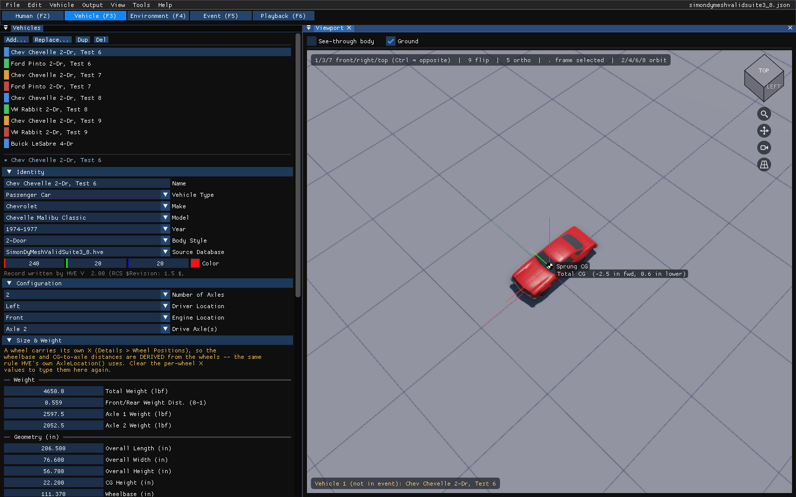
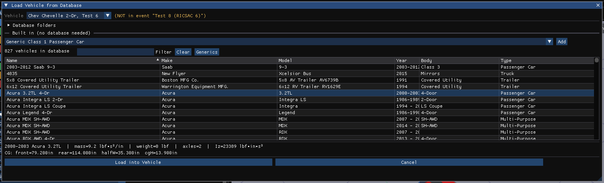
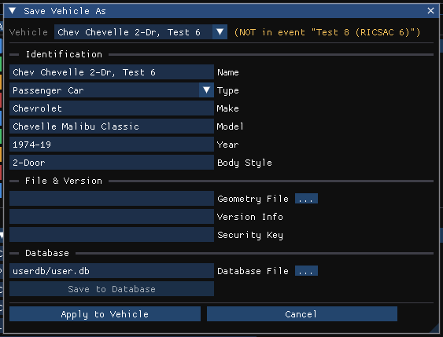

# Chapter 10 — Creating & Editing Vehicles

*Adapted for HVE Studio from the HVE User's Manual (Version 5, Seventh
Edition, Jan 2006), Chapter 10.*

The Vehicle Editor is used for creating and editing the vehicles of the
current case. This chapter describes how to use it, beginning with its
components.

> **NOTE:** Refer to the next chapter, [Vehicle Model Definition](11a-sprung-mass.md),
> for a detailed description of each Vehicle Model parameter.

## Vehicle Editor Components

To use the Vehicle Editor, select the **Vehicle (F3)** tab under the menu
bar, or press **F3**. HVE Studio opens in the Vehicle editor. Its components
are:

- **Vehicles panel** — Docked at the left. Used for adding vehicles to the
  case, selecting the current vehicle and editing its basic attributes,
  dimensions and weights. It takes the place of HVE's Vehicle Editor dialog.
- **Viewport** — Displays the current vehicle.
- **Vehicle menu** — Present on the menu bar only in the Vehicle editor. It
  opens every vehicle data dialog (see
  [Selecting and Editing Vehicles](#selecting-and-editing-vehicles)).

*Figure 10-1: HVE Studio Vehicle Editor — the Vehicles panel, the Vehicle menu and the viewport.*

### Vehicles Panel

The Vehicles panel is the heart of the Vehicle Editor. Its toolbar and list
manage all the vehicles in the case:

- **Add…** — Adds a vehicle to the case from a vehicle database or from
  HVE Studio's built-in generic vehicles (see Adding New Vehicles, below).
- **Replace…** — Replaces the current vehicle's data with a database record,
  keeping its place in the case and in its events.
- **Dup** — Adds a copy of the current vehicle with every setting, named
  "*name* (copy)". The copy is not added to any event.
- **Del** — Removes the current vehicle from the case.
- **Vehicle list** — The names of all the vehicles in the case, each with
  its color swatch. Click a name to make it the current vehicle. Drag a name
  to reorder the list.

Below the list, the panel is the current vehicle's editor, in collapsible
sections. Each input has one place in it:

- **Identity** — **Name** (a warning appears if another vehicle in the case
  has the same name), **Vehicle Type**, **Make**, **Model**, **Year**, **Body
  Style** and **Source Database** (see
  [Adding New Vehicles](#adding-new-vehicles)), **Color**, and the HVE version
  of the vehicle's database record (read-only, when it is known). For a
  vehicle whose record is in one of your own, writable databases (for example
  *My Vehicles*), **Delete from database...** removes that record from the
  database file; the vehicle in the case is kept.
- **Configuration** — **Number of Axles**, **Driver Location**, **Engine
  Location** and **Drive Axle(s)**, with HVE's rules (see
  [Adding New Vehicles](#adding-new-vehicles)).
- **Size & Weight** — HVE's Vehicle Wizard, applied as you type: the
  **Weight** and **CG Height** rows, each with a **Total** and a **Sprung**
  column (type in either: the other follows), the front/rear distribution and
  axle weights, the overall length, width and height, wheelbase, overhangs,
  CG to axle distances, axle spacings and the track of each axle. Below
  **Overall Height**, six
  fields give the CG-to-exterior distances the solver receives: **CG to
  Front** (typing it sets the front overhang), **CG to Rear** (sets the rear
  overhang), **CG to Right** and **CG to Left** (the stored CG-to-side
  distances), **CG to Top** (sets the Overall Height) and **CG to Bottom**
  (grayed: it equals the CG Height). The axle count is not set here
  but under Configuration.

  **Which value moves when you type one.** The fields are tied together, and
  each edit keeps the values an analyst usually has and moves the rest:

  - **CG to Front** and **CG to Rear** are inputs: the overhang on that end
    takes the difference. **CG to Front Axle** and **CG to Rear Axle** (in
    the Weight table, Total and Sprung) move the CG, as Move CG does: the body,
    wheels and overhangs stay where they are, so the wheelbase is unchanged.
  - **Front Overhang**, **Rear Overhang**, **Wheelbase** and the weight
    distribution set the CG position: the wheelbase keeps both overhangs and
    the weight split, and the overall length follows; the weight distribution
    moves the CG (as Move CG does), not the body or the wheels.
  - **CG Height** moves the CG up or down, as Move CG does: the body and the
    wheels stay where they are.
  - **Overall Width** sets CG to Right and CG to Left, keeping the CG's
    offset from the centerline; typing CG to Right or CG to Left sets the
    width.
  - **Overall Length** changes the overhangs, split between front and rear.

  **Wheel Positions (from CG)** follows: the per-wheel x, y, z table, each
  axle left then right, where a value typed overrides the derived one. The
  **Linked L/R** row has a box per axle, ticked by default when that axle's
  two wheels are a mirrored pair: while it is ticked the axle's left and
  right wheels move together (the same X and Z, opposite Y), and the
  wheelbase, overhangs, axle distances and track width stay editable and
  move the wheels. Untick it to place one wheel on its own; ticking it again
  mirrors the right wheel onto the left. With an axle unlinked and its wheels
  carrying their own X positions, CG to Front and CG to Rear are grayed with
  the overhangs and the wheelbase.
  Under the table, a warning appears when a loaded 3-D model does not reach
  the declared front and rear extents.
- **Inertia** — One line of totals (weight, and yaw, pitch and roll inertia)
  and **Edit...**, which opens the **Inertia / Mass** dialog: weight and
  inertias on both the total and the sprung basis, the CG location, the XZ
  product of inertia, and the occupants and cargo aboard (see
  [Inertias](11a-sprung-mass.md#inertial-properties)).
- **Components** — A button for every vehicle data dialog, in four groups:
  **Chassis** (**Suspension...**, **Steering...**, **Tires...**,
  **Drivetrain...**, and **Brakes...**, which opens a short list: Brake
  Assembly..., Brake Designer..., Brake System Pressure..., ABS / Brake
  Design...), **Body** (**Aerodynamic Drag...**, **Body Torsion...**, **Crush
  Stiffness...**, **Connections...**), **Equipment** (**Lights...**,
  **Accelerometers...**) and **Occupant Protection** (**Contact
  Surfaces...**, **Airbags...**, **Belt Restraint...**). Each opens the same
  dialog as the Vehicle menu.
- **3D Geometry** — The vehicle's 3-D file: **Mesh File** with **...**
  (browse) and **Library...**; when the case named a file that was not found,
  a notice says so, with **Locate...**. **Generic Body** (*HVE (original)*,
  *Modern (traced profile)* or *Modern (Kiln model)*) is the body a vehicle
  without a 3-D file is drawn and collided as. A vehicle you add gets
  *Modern (Kiln model)*: for a passenger car or a multipurpose vehicle, one of
  the three openly licensed (CC0) Kiln vehicles built into HVE Studio -- a
  sedan, a hatchback or an SUV -- resized to the vehicle's own length, width
  and height, with its wheel openings moved to the vehicle's own axles. A
  passenger car is the sedan or the hatchback: the one its **Body Style** names
  (for example *Hatchback*, *Wagon*, *Sedan*, *Coupe*), or otherwise whichever
  fits its dimensions with less stretch. The resize has limits (each overhang
  about 70% to 135% of the model's, the zone between the wheels 80% to 135%,
  width and height 88% to 115%, and a tire no more than 5% bigger than the
  model's); a vehicle outside them, one that does not have two axles, a pickup,
  van or truck, gets the traced profile instead. The line under the combo says
  which model was used and how far it was stretched, or why none fits, and a
  run says so in its status when DyMESH collides the traced profile in place of
  a model. *Modern (traced profile)* is the lofted body drawn from each vehicle
  class's side elevation; vehicles in hve-next cases saved before the Kiln
  models existed keep it. A vehicle from a native HVE case (`.hve`) keeps
  *HVE (original)* so an imported crash collides the shape HVE solved it with;
  vehicles in hve-next cases saved before this choice existed open as
  *Modern (traced profile)*. Switch one back here to reproduce an older run.
  **Vehicle Mesh...** opens the Vehicle Mesh window, which holds everything
  else about the model: import options, placement, what DyMESH collides, the
  display mesh, shading, damage display and the wheel images (see
  [Geometry File](11a-sprung-mass.md#geometry-file)).

*Figure 10-2: The Vehicles panel, with the selected vehicle's Identity, Configuration, Size & Weight, Inertia, Components and 3D Geometry sections.*

> **NOTE:** Deleting a vehicle deletes it only from the current case, NOT
> from the database! Events that used it are updated.

!!! note "HVE Studio"
    - A case always holds at least one vehicle, so **Del** is disabled when
      only one is left. HVE's rule that a vehicle used in an event cannot be
      deleted does not apply: HVE Studio removes it from those events.
    - While the results of a simulation are on screen, the data of the
      vehicles that run used is read-only, and Add, Replace, Dup, Del and
      reordering are disabled as they would change it. Reset the run to edit.
    - Edit › Undo (Ctrl+Z) undoes vehicle edits.
    - Many vehicle dialogs carry explanatory notes — which simulation reads a
      field, what convention a number is in. They are shown with **View ›
      Show Guidance Text** (off by default). Notes that say a field reaches
      no simulation, or that HVE Studio differs from HVE, are always shown.

### Viewport

The viewport displays the current vehicle. The view controls are described
in the user-interface section of this manual (the view cube and its buttons
in the top-right corner; the hints along the top of the viewport list the keys).

!!! warning "Not in HVE Studio"
    HVE's Vehicle Viewer offers pickable components — the CG sphere, the
    wheels, the exterior spheres, the brake master cylinder, the steering
    wheel and the engine — each opening that component's dialogs. HVE Studio
    has no pickable components: every vehicle dialog is opened from the
    **Vehicle** menu or from the Vehicles panel (see
    [Selecting and Editing Vehicles](#selecting-and-editing-vehicles) for the
    map). Clicking a part of the vehicle in **Edit Mode** selects it for a
    display material (see [Edit Mode](#edit-mode-materials-per-part)).

> **NOTE:** Although every vehicle's properties are defined using the Vehicle
> Editor, vehicles are not positioned using the Vehicle Editor. The position
> of a vehicle in an event is an event-related issue, and is performed using
> the Event Editor. Think of it this way: At this point, we don't care if the
> Buick crashes, rolls over or simply slows to a stop. All we care about is
> that the Buick weighs 2970 pounds and has other properties of our choosing.

## Adding New Vehicles

To add a new vehicle, press **Add…** in the Vehicles panel. The Add Vehicle
dialog is displayed (Figure 10-3). It lists every vehicle in the vehicle
databases HVE Studio has found — HVE's classic `.db` files and HVE Studio's own
`.hvedb` databases — and contains:

- **Database folders** — The database files found, each with its vehicle
  count (*[writable]* marks one of your own; *[not licensed]* one the license
  does not cover). The databases installed with HVE Studio and EDC's vehicle
  data are found without any setup. To use other databases, type or
  **Browse…** to a folder and press **Add**; the folder is remembered for
  later sessions. **Remove** removes a folder you added. **Import database…**
  copies a database file someone else gave you (a classic HVE `.db`, or an
  HVE Studio `.db` or `.hvedb`) into your own vehicle folder, where it is listed
  from then on. A copy whose name is that of a shipped database is renamed
  *(imported)*, and a second copy of the same name is numbered.
- **Built in (no database needed)** — HVE Studio's generic vehicles, grouped by
  type and class, with their own **Add** button. These are available even
  when no database is installed.
- **Filter** — Shows only the vehicles whose make, model, year or name
  contains the text typed. **Clear** clears it; **Generics** shows the
  generic vehicles (`Generic.hvedb`: HVE's one per class of car,
  sport-utility, pickup, truck, van and trailer, and HVE Studio's generic
  motorcycle). The filter is empty each time the dialog opens,
  and when a case is opened or a new one started; so is the Vehicle Geometry
  Library's.
- **Database** — Shows the vehicles of one database file only (*All
  databases*, or a file with its vehicle count). While the filter or a
  database is set, a line reads *Showing N of M*.
- **Vehicle table** — Name, Make, Model, Year, Body, Type and Database. Click
  a column heading to sort by it; click again to reverse; Shift-click a second
  heading to add a tie-break. Drag a column's edge to resize it, drag a
  heading to move the column, and right-click the headings to hide or show
  columns. The line under the table summarizes the selected vehicle (mass,
  weight, axles, yaw inertia, CG location). For a vehicle in one of your own
  databases, the dialog also shows its mesh and its private note (see
  [Save to My Vehicles](#save-to-my-vehicles)).
- **Add Vehicle** / **Cancel**.

If the license keeps a database, or some of its vehicles, out of the list, a
line above the folders says which and why.

*Figure 10-3: The vehicle database dialog. Opened with Add… it is titled Add Vehicle; opened with Replace… (shown) it is titled Load Vehicle from Database and replaces the current vehicle's data.*

Select a vehicle and press **Add Vehicle**. The vehicle is added to the case
and becomes the current vehicle. It is **not** added to any event: to use it in
an event, press **Add Vehicle** in the **Vehicles in Event** section of the
Event Information panel (Event editor).

> **NOTE:** EDC's databases are licensed. The databases HVE Studio can read are
> the ones present on your computer.

> **NOTE:** Without the EDC vehicle-data license, EDC's vehicle geometry is not
> drawn, solved or exported — the original files, and copies of them that the
> program recognizes by their shape (re-saved, moved, turned, resized, mirrored,
> converted to OBJ or glTF, or with part cut away). Such a vehicle uses the
> generic body instead, and the status says why.

> **NOTE:** The same vehicle Make, Model, Year and Body Style may be
> contained in more than one database.

After adding the vehicle, set the remaining attributes in the Identity and
Configuration sections of the Vehicles panel:

- **Name** — A user-editable name for the vehicle. A warning appears if
  another vehicle in the case already uses the name.
- **Type** — Passenger Car, Pickup, Multi-Purpose, Van, Truck, Trailer,
  Dolly, Fixed Barrier, Movable Barrier, Other or Motorcycle.
- **Make, Model, Year, Body Style, Source Database** — With a database
  loaded these are HVE's drill-down: each list is filtered by the selection
  above it, and choosing a different leaf replaces the vehicle's data with
  that database record. Without a database they are plain text, and the
  source database is shown read-only.
- **Number of Axles** — None, One, Two, Three or Four, as the vehicle type
  allows. For a Fixed Barrier the only selection is None.
- **Driver Location** — None, Left, Center or Right.
- **Engine Location** — None, Front, Mid or Rear.
- **Drive Axle(s)** — Axle 1, Axle 2, Axle 3, Axle 1 & 2, Axle 2 & 3 or
  Axle 1,2 & 3, as the number of axles allows. Engine Location and Drive
  Axle(s) are disabled for a vehicle with no driver, with no axles, or with
  no powertrain of its own (a Trailer, Dolly or Movable Barrier).

!!! tip "New in HVE Studio"
    **Motorcycle** is a vehicle type. Choosing it seeds a generic machine
    and rider; **Seed Generic Motorcycle**, under Vehicle Type in the
    Identity section, re-seeds it. A motorcycle is a narrow-track
    approximation (see the motorcycle chapter of this manual set).

!!! note "HVE Studio"
    HVE Studio has no separate Vehicle Information dialog: the Vehicles panel
    is the vehicle's editor. To search the databases (for example "honda
    accord"), use the **Filter** of the dialog opened by **Add…** or
    **Replace…**. HVE's Vehicle Wizard is the panel's **Size & Weight**
    section, applied as you type.

### Vehicle Database

The vehicle *Type, Make, Model, Year* and *Body Style* are keys used to
select a vehicle from the Vehicle Database. These keys provide the basic
vehicle definition, while the *Number of Axles, Driver Location, Engine
Location* and *Drive Axle(s)* provide the exact configuration.

The Vehicle Editor creates a copy of the selected vehicle for use in the
current case. The properties of this vehicle may be edited. Changes made to
the current vehicle do not affect the Vehicle Database.

### Save to My Vehicles

**Vehicle › Save to My Vehicles...** keeps the current vehicle — its data as
edited in the case and its lamp table — in one of your own vehicle databases,
where **Add…** lists it. The dialog contains:

- **Database** — **MyVehicles.hvedb**, one of your own databases made
  earlier, or **New database...** with a **New name** (for example *Buses*).
  The line under it gives the file's full path.
- **Mesh** — how the vehicle's own 3-D file is kept: **Linked to its file**
  (the file is read, so an edit made to it in another program shows up; a
  copy is saved too, for a computer where the file is not found) or **Stored
  in the database** (frozen into the database as it is now). EDC's licensed
  geometry is never copied: it is referenced, and draws where the license is
  (the generic body elsewhere).
- **Name** — A vehicle already saved under this name is replaced.
- **Private note** — Kept only in your database and shown where you browse
  it; never in a case, a report or an export.
- **Save** / **Close**.

A vehicle that came from EDC's data stays licensed: if you give it your own
mesh, it keeps its EDC data tag, is listed and opened only where the EDC data
license is present, and its original is also named in its private note. A
vehicle you built yourself carries no tag and opens everywhere. The tag is a
gate, not secrecy: a printed vehicle report still shows the vehicle's values.

The EDC databases themselves are never written. When a vehicle from one of
your own databases is selected in the Add Vehicle dialog, its mesh is shown
under the table, with **Edit externally...** (for a stored mesh: write it to a
*Meshes* folder beside your databases and link it), **Update saved copy** (for
a linked file that changed since it was saved), **Store in database** (for a
linked mesh), and its private note with **Save private note**.

Your own databases, and the databases brought in with **Import database…**, are
kept in your `userdb` folder (see
[Vehicle databases](../../getting-started/04-cases-and-files.md#vehicle-databases)).

### Save-As New Vehicle

To add the current vehicle to a database, choose **Vehicle › Save Vehicle
As**. The Save Vehicle As dialog (Figure 10-5) contains:

- **Identification** — Name, Type, Make, Model, Year and Body Style for the
  new record.
- **File & Version** — Geometry File, Version Info and Security Key.
- **Database** — **Database File**: the `.db` file to write. It defaults to
  `user.db` in a folder HVE Studio may write to, never to an installed
  database.
- **Save to Database** — Writes the record.
- **Apply to Vehicle** — Copies the identification back onto the vehicle in
  the case, without writing a database.

*Figure 10-5: Save Vehicle As dialog.*

!!! warning "Not in HVE Studio"
    **Save to Database writes the database record the vehicle was loaded
    from, not the edited vehicle.** It copies that record and replaces only
    its identification (name, type, make, model, year, body style), its
    configuration (number of axles, driver location, engine location, drive
    axles) and its color. Edits to inertias, dimensions, suspension, tires,
    brakes and every other property are not written. The Geometry File,
    Version Info and Security Key fields are not written either. Save to
    Database is available only when the vehicle's Make, Model, Year and Body
    Style match a loaded database record. To keep an edited vehicle, save the
    case (File › Save Case).

A vehicle in a writable user database can be removed from it with
**Delete from database...** in the Identity section of the Vehicles panel.
The vehicle in the case is kept.

## Adding Vehicles from Previous Cases

!!! warning "Not in HVE Studio"
    HVE Studio has no Previous Vehicle Selection dialog (HVE's Mode › Vehicle ›
    Add › Previous). To reuse a vehicle from another case, open that case
    with File › Open Case... (an HVE `.hve` case or an HVE Studio case); to vary a
    vehicle within a case, use **Dup**.

## Selecting and Editing Vehicles

The last vehicle added becomes the current vehicle. To select and edit any
vehicle:

1. Click its name in the Vehicles panel's list. The selected vehicle becomes
   the current vehicle and is displayed in the viewport. Every vehicle dialog
   also has a vehicle selector at its top.
2. If desired, edit its basic attributes in the Vehicles panel's Identity,
   Configuration and Size & Weight sections.
3. If desired, edit the vehicle's properties with the dialogs listed below,
   from the **Vehicle** menu or the panel's **Components** section.

The vehicle data that HVE reaches by clicking the vehicle's components is
reached in HVE Studio as follows:

| HVE component and data | HVE Studio |
|---|---|
| CG: Inertias | Vehicles panel › Inertia › **Edit…** (the Inertia / Mass dialog) |
| CG: Move CG | **Vehicle › Editors › Vehicle Mesh** (File & Placement tab, Move CG); for EDSMAC/EDSMAC4 events also **Event › Move CG** |
| CG: Color | Vehicles panel › Identity › **Color** |
| CG: Geometry File | Vehicles panel › **3D Geometry**; **Vehicle › Editors › Vehicle Mesh** |
| CG: Contact Surfaces | **Vehicle › Editors › Contact Surfaces** |
| CG: Belt / Airbag Restraints | **Vehicle › Editors › Belt Restraint**, **Vehicle › Editors › Airbags** (one bag per seat) |
| CG: Connections | Vehicles panel › Components › **Connections…** |
| CG: Aerodynamic Drag | **Vehicle › Editors › Aerodynamic Drag** |
| CG: Body Torsion | **Vehicle › Editors › Body Torsion** |
| CG: Lights | **Vehicle › Editors › Vehicle Lights** |
| Wheel: Suspension | **Vehicle › Editors › Suspension Data** (all its tabs) |
| Wheel: Tire | **Vehicle › Editors › Tires** (grid and Load & Speed Tables panel) |
| Wheel: Brake | **Vehicle › Editors › Brakes › Brake Assembly**, **Vehicle › Editors › Brakes › Brake Designer** |
| Wheel: Location | Vehicles panel › Size & Weight › **Wheel Positions (from CG)** |
| Exterior: dimensions | Vehicles panel › Size & Weight (**CG to Front** ... **CG to Bottom** under Geometry) |
| Exterior: stiffness | **Vehicle › Editors › Crush Stiffness** |
| Brake master cylinder | **Vehicle › Editors › Brakes › Brake System Pressure**, **Vehicle › Editors › Brakes › ABS / Brake Design** |
| Steering wheel | **Vehicle › Editors › Steering System** |
| Engine | **Vehicle › Editors › Drivetrain** |

The Vehicle menu also offers **Accelerometers**, **Save to My Vehicles** and
**Edit Mode**. Every data dialog in the table, and Accelerometers, is also a
button in the Vehicles panel's **Components** section.
Each of these data categories is described in the following chapter,
[Vehicle Model Definition](11a-sprung-mass.md).

### Edit Mode (materials per part)

!!! tip "New in HVE Studio"
    **Vehicle › Edit Mode (materials per part)**, or **Tab** in the Vehicle
    editor, switches the vehicle on screen into Edit Mode. Click a part of
    the vehicle — the body, the glass, a lamp lens — to select it; a panel
    in the corner of the viewport names the part and offers a **Material**
    list, **+ New** (a new material for that part alone) and **Edit in Shader
    Editor**. Press Tab again to leave. Parts come from the material names in
    the 3-D model file: an OBJ's `usemtl` names, a glTF's material names
    (an unnamed one becomes *material_N*), an Inventor file's material
    names. A model that names none (an OBJ without `usemtl`, the generic
    body) starts with only the whole-vehicle material; parts can then be
    made from its faces (below).

    **Faces** (the panel's *Parts / Faces* switch) selects single faces
    instead: click a face (Shift adds or removes it), **A** selects every face
    of that face's part, **L** grows the selection across flat edges, **B**
    drags a box, **Alt+A** clears. **Make Part** gives the selected faces a
    part of their own under the name typed beside it, and Edit Mode switches
    back to Parts with the new part selected, ready for a material.
    **Add to Part** puts the selected faces into a part the vehicle already
    has, either one the model names or one made from faces, so they wear that
    part's material. **Back to File Part** returns the selected faces to the
    model's own part. Selected faces are tinted orange as well as outlined;
    the tint is light, so the material underneath still shows.

    **Hiding while editing:** **H** hides the selected faces (in *Parts*, the
    selected part), **Shift+H** hides everything else, and **Alt+H** shows
    everything again, selected. A hidden face cannot be clicked or
    box-selected, so this is how a face behind another is reached. Hiding
    lasts only while Edit Mode is on and is not saved.
    Made parts are saved with the case. If the model file changes (a different
    number of triangles), they are not applied, and the log says so. A
    textured OBJ's faces cannot be picked. Materials are display only and
    change no result. A part changes a result only if it is unticked under
    **Collides** on the Vehicle Mesh window's Collision tab, which leaves it out of what
    DyMESH collides (see [Geometry File](11a-sprung-mass.md#geometry-file)).

<!-- NAV -->

---

← Previous: [Section Four: Vehicle Editor](README.md)  |  [Index](README.md)  |  Next: [Chapter 11 — Vehicle Model Definition (Part A: Sprung Mass)](11a-sprung-mass.md) →

<!-- /NAV -->
