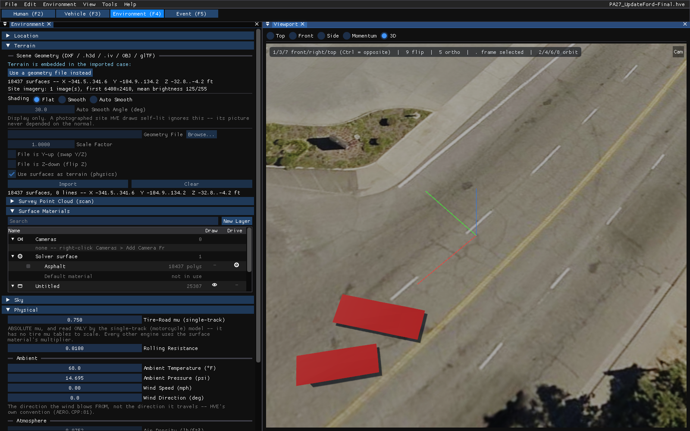
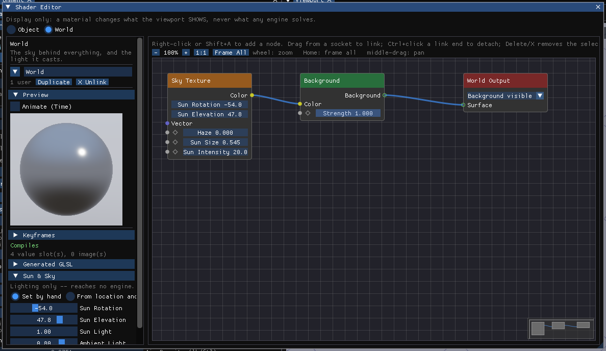
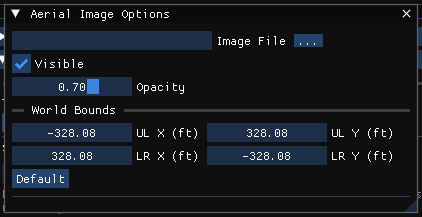
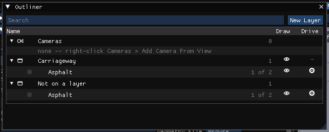

# Chapter 12 — Creating & Editing Environments

The Environment Editor is used for creating and editing the environment of
the current case: the site the humans and vehicles move on, the atmosphere,
the sun and the site's appearance. This chapter describes how to do that in
HVE Studio, beginning with the Environment Editor's components.

> **NOTE:** The environment is optional. If no site geometry is imported,
> the engines run on flat, level ground, using the friction of each
> vehicle's own tires (see the Vehicle Editor for the tires' frictional
> properties).

> **NOTE:** Refer to the next chapter, [Environment Model Definition](13-environment-model-definition.md),
> for a detailed description of each Environment Model parameter.

!!! note "HVE Studio"
    In HVE an environment is added to a case (New or Previous) and then
    edited. In HVE Studio every case always has exactly one environment, so
    there is nothing to add: you edit the one the case already has. A new
    case (File › New Case) starts with a default environment — no site
    geometry, standard atmosphere and gravity.

## Environment Editor Components

To use the Environment Editor, click the **Environment (F4)** tab under the
menu bar, or press F4. This puts HVE Studio in Environment mode and shows the
Environment Editor's components:

- **Environment panel** — a docked panel (normally on the left) holding all
  the environment's parameters in collapsing sections: **Location**,
  **Terrain**, **Sky**, **Lights**, **Physical** and **Surface Generator**. It replaces HVE's
  Environment Information property sheet. Terrain and Physical — the
  sections the engines read — are open by default.
- **Viewport** — the 3-D view of the current environment, with a view cube
  in its top-right corner for the preset views.
- **Environment menu** — **Environment Designer...** (the Environment panel's
  sections, as stages; the aerial pictures are its Import stage's **Aerial Pictures**
  section, described later in this chapter), and **Edit Mode (materials per face)** (**Tab**), which switches
  the Viewport to selecting single faces of the site (see
  [Edit Mode: faces of the site](#edit-mode-faces-of-the-site)).

*Figure 12-1: The Environment Editor — the Environment panel and the Viewport, showing the site embedded in HVE's PA27_UpdateFord-Final case.*

### Selecting surfaces in the Viewport

Unlike HVE's Environment Viewer, which had no pickable objects, the
HVE Studio Viewport lets you click a surface of the site in Environment mode.
The clicked surface is selected: it is highlighted in the view and in
**View › Outliner**, and the panel's **Selected Surface** section (see Road
Surfaces and Their Materials, below) shows it, where its contact material
can be edited. **Shift**-click adds a surface to the selection.

> **NOTE:** If a site stores the road twice — once as the surface the
> engines drive on and once as the surface that is drawn, as a native HVE
> case does — clicking the road names both halves together, each with its
> own Drive and Draw switch.

### Edit Mode: faces of the site

Press **Tab** with the pointer over the Viewport, or choose **Environment ›
Edit Mode (materials per face)**, to select single **faces** of the site
instead of whole surfaces. A panel at the bottom left of the Viewport, headed
**EDIT MODE faces**, shows what is selected. Press **Tab** again, or **Esc**,
to leave Edit Mode. (While a box select is armed, **Esc** first cancels the
box.)

Selecting faces:

| Key or click | Does |
| --- | --- |
| Click | Selects one face |
| **Shift**+click | Adds a face to the selection, or removes it |
| **A** | Selects every face of the clicked face's surface that is not hidden (**Shift+A** adds them to the selection) |
| **Alt+A** | Selects no face |
| **B** | Drag a box in the Viewport: every face whose center is inside it is added (**Ctrl**+drag removes). The box sees through the site, so hidden faces are taken too |
| **L** | Grows the selection across edges to faces of the same surface that lie flat with it (within 1 degree): the polygon the importer split into triangles, or a flat run of road up to its curb |
| **H** | Hides the selected faces |
| **Shift+H** | Hides every other face |
| **Alt+H** | Shows every hidden face again |

The panel repeats the selection keys as buttons: **All of surface (A)**,
**Linked (L)** (every face joined to the selection through shared vertices, as Blender's L), **Box (B)** and **None (Alt+A)**; with no face selected
and some hidden, it shows how many are hidden and a **Show All** button. A
hidden face cannot be clicked or selected, which is how a face under another
is reached. Hiding lasts only while Edit Mode is on, is not saved, and changes
nothing the programs see. Outside Edit Mode, **H** and **Alt+H** hide and show
whole surfaces instead.

With faces selected, the panel names how many and of which surface, and gives
them a material of their own:

- **Material** — the material the selected faces wear, *(mixed)* when they
  wear several, or their surface's. Choose another from the list.
- **+ New** — a new material for the selected faces alone, drawing them as
  they are now.
- **Edit in Shader Editor** — opens the material the faces wear. Grayed until
  they wear one of their own.
- **Clear** — the selected faces wear their surface's material again.

A face material is display only: it changes what the site looks like. The
surface type and friction — what the programs drive on — stay the surface's.
If the case holds face materials picked on a different geometry of this site,
the panel lists them as not applied and offers **Forget the stale ones**.
Materials are described in
[Materials and the Shader Editor](../../new-features/01-materials-and-shader-editor.md#faces-of-a-surface-the-environment-edit-mode).

**G**, **R** and **S** move, turn and scale the selected faces, the same way
they move a surface (see
[Moving the site, or one of its surfaces](#moving-the-site-or-one-of-its-surfaces)).
With no face selected, the keys do nothing in Edit Mode.

## Editing the Environment

!!! note "HVE Studio"
    Every field of HVE's Environment Information dialog that HVE Studio has is
    on the Environment panel, in the section named below. There is no OK
    button: an edit takes effect when you leave the field, and Edit › Undo
    (Ctrl+Z) steps it back. While the results of a run are on screen,
    the fields the engines read (Terrain, Physical) are locked; press
    **Reset** on the playback bar or on the Event Designer's Run stage to edit them.

### Location

The **Location** section records where and when the accident happened:

- **Name** — a name for the environment (the site).
- **Date** and **Time** — the date and the local time of the crash or test.
  An empty field shows its form as a placeholder, **mm/dd/yyyy** and
  **hh:mm**. A date also reads as mm/dd/yy or yyyy-mm-dd, and a time as 14:30,
  1430 or 7:05:30.
- **Latitude** and **Longitude** — the site's coordinates in decimal
  degrees. North latitude and east longitude are positive; a west
  longitude is negative.
- **Elevation** — the site's elevation, in the length units set in
  Options › Preferences.
- **North offset** — the compass bearing the case's +X axis points along
  (0 = north, 90 = east), HVE's *Angle of X-Axis*. It turns the North arrow
  and the sun; nothing on the site moves. The same value is **North** in the
  Shader Editor's Sun & Sky panel.

Two helpers fill in the coordinates:

- **Set from a pasted coordinate** — paste a coordinate in decimal degrees,
  in degrees/minutes/seconds (for example `40°26'45"N 79°58'56"W`) or a map
  link, check how it reads, and click **Apply**.
- **Search an address** — type an address or place name and click
  **Search**, then pick the match.

!!! warning "Online service"
    The address search sends what you type to OpenStreetMap
    (nominatim.openstreetmap.org), and the chosen coordinate to timeapi.io
    to look up its time zone. The panel says so beside the button. The
    pasted-coordinate box needs no network.

!!! note "HVE Studio"
    HVE's user-extendible Location Database (City/State/Country with stored
    latitude, longitude and GMT) is not in HVE Studio; the address search and
    the coordinate paste replace it. The location places the sun and is
    printed in reports. The engines do not drive on it: a coordinate here
    does not position or scale the site.

The time-zone offset (HVE's *GMT*) and HVE's *Angle of X-Axis* are set with
the sun, in the Shader Editor's **Sun & Sky** panel (see Sun and Sky, below).

### Physical

The **Physical** section holds the environment's physical properties:

- **Ambient Temperature** and **Ambient Pressure** — the air temperature
  and barometric pressure (defaults 68 °F and 14.695 psi, HVE's own).
- **Wind Speed** and **Wind Direction** — the ambient wind. The direction
  is the direction the wind blows *from*, HVE's convention.
- **Air Density** — shown, not entered: it is computed from the ambient
  temperature and pressure exactly as the engines compute it.
- **Gravity** — the local acceleration of gravity, in in/s² or m/s²
  depending on the units preference.
- **Standing Water** — no longer here: **Water Depth**, **Wet Friction**
  and **Texture Depth** are each surface's own, under its **Surface Type and
  Friction** (Environment Designer › Surfaces), and the **Default surface material**'s for ground
  with no surface of its own (including the flat ground of a case with no
  site). They are read only by SIMON's hydroplaning models; a depth of 0
  means no water on that surface.

> **NOTE:** If you're simulating a lunar excursion module, you had better
> change the gravity!

!!! note "HVE Studio"
    There is no road friction on the Physical section. Every engine, the
    single-track model included, uses each tire's own friction times the
    surface material's friction multiplier. The Road Surface preset (Dry /
    Wet / Snow / Ice) that sets a friction multiplier is a **Condition
    preset** on the selected surface material (see Road Surfaces and Their
    Materials, below).

### Sky

The **Sky** section summarizes how the scene is lit — the sun's direction
and elevation, whether they come from the location and time or were set by
hand, and the sun and ambient light levels — and has an **Edit the sun and
sky...** button that opens the Shader Editor on the world's **Sun & Sky**
panel.

### Lights

The **Lights** section holds the site's own lights — street lights, work
lights, a floodlight on a pole — that are not attached to any vehicle (HVE
made these with the 3-D Editor's Light tool). **Add Light** puts one 8 m above
the ground at the middle of the view; **Copy** and **Delete** manage the
list. For the selected light set its **Name**, **On**, **On in daylight too**,
**Type** (**Point** or **Spot**), its position — **X (forward)**, **Y
(right)** and **Height above the ground**, which keeps it on its pole when you
move it — and, for a spot, its **Aim**, **Tilt down**, **Cone** and **Edge
softness**; then its **Color** and **Intensity** (1 is about a headlamp).

A site light comes on as the sky darkens, as a vehicle's lamps do, unless **On
in daylight too** is ticked. While the Environment is selected, the Viewport
marks each light with a yellow sphere (gray when switched off, orange when
selected), a dotted line down to the ground and, for a spot, a short line along
its aim. Click a sphere to select its light; **Shift**-click (in the view, the
Lights list or the Outliner) adds a light to the selection or takes it out, and
keeps any selected surfaces, so **G**, **R** and **S** move the lights and the
surfaces together about their common middle. R turns each selected light's aim
by the same angle. The 3-D view
lights the scene with up to 32 lamps at a time, shared with the vehicles; the
site takes at most 16 of them, the ones nearest the middle of the view. The
ray-traced render and the glTF export carry every light. The lights move with
the site when its placement is changed. They are display only: no engine reads
them, so they stay editable with results on screen. Full field list:
[Environment Information › Lights](../../08-environment/EnvtInfoDlg.md#lights).

## Sun and Sky

The sun and sky are part of the world's appearance and are edited in the
Shader Editor (View › Shader Editor, or **Edit the sun and sky...** in the
Environment panel's Sky section or the Event panel's Lighting section). The
**Sun & Sky** panel offers:

- **Set by hand** — **Sun Rotation** (the direction the sun lies in,
  measured like every heading in the case: 0 toward +X, 90 toward +Y) and
  **Sun Elevation** (degrees above the horizon).
- **From location and time** — the sun is placed from the case's location,
  date and time, as HVE placed it:
  - **Method** — *NOAA* (the solar position calculator Blender's Sun
    Position add-on uses) or *HVE's own* (the table method HVE drew its sun
    with). An imported HVE case uses HVE's own, so it is lit as it was in
    HVE.
  - the address search, **Latitude**, **Longitude**, **Date** (mm/dd/yyyy
    or yyyy-mm-dd) and **Time** — the same values as the Location section.
  - **UTC offset** — local clock time = UTC + this (HVE's *Hours from GMT*;
    for example −5 for the US Eastern time zone).
  - **Daylight saving** — HVE's time is always local standard time, so an
    imported case leaves this off.
  - **North** — the compass bearing the case's +X axis points along
    (0 = north, 90 = east). This is HVE's *Angle of X-Axis*.
  - **Refraction** — NOAA only: the apparent sun, raised by atmospheric
    refraction near the horizon.
- **Sun Intensity** — the world's Sky Texture's Sun Intensity (20 is the viewport's own): the sun's brightness and the light that casts the shadows.
- The light that fills the shadows (HVE's *Ambient Intensity*) is the
  world's: the **Sky Texture** node's **Ambient** (default 1.00) and **Night
  Light** fields. The panel says their values and offers **Make the world**
  for a case that has none.
- **Reset sun to default**.

*Figure 12-4: The Shader Editor's Sun & Sky panel, which replaces HVE's Sky attributes.*

> **NOTE:** The sun and sky are display only. They light the picture and
> reach no engine.

!!! warning "Not in HVE Studio"
    HVE's **Fog Type** (None, Fog, Haze, Smoke) and **Maximum Visibility**
    are not available. A value imported from an HVE case is kept with the
    case, but there is no control for it, so HVE Studio cannot be used for
    HVE's visibility studies. The viewport's **Distance Haze** (View › Scene
    Display › Sky & Reflections) fades far geometry toward the sky's horizon color by
    the **Haze** of the World material's Sky Texture node; it is a picture,
    not a visibility distance, and draws nothing while Haze is 0 (the
    default sky), with no World material, or with Scene Lighting off. HVE's
    **Sky Color** dialog is replaced by the world material in
    the Shader Editor; see
    [Materials and the Shader Editor](../../new-features/01-materials-and-shader-editor.md).

## Traffic Signals

!!! warning "Not in HVE Studio"
    HVE's Traffic Signals tab edits signals placed in the site with the 3-D
    Editor's Signal Tool, each with its own type, layout and cycle. HVE Studio
    has no traffic signals — no signal objects and no signal timing — because
    no engine here reads them.

## Site Geometry

The site geometry is the 3-D surface used for visualizing the environment
and — when *Use surfaces as terrain* is checked — the surface the engines
drive on: they ask it for the elevation, slope and friction beneath each
tire.

> **NOTE:** If no site geometry is supplied, the engines assume flat,
> level ground with uniform friction.

Site geometry is brought in from the **Imported files** list at the top of the
Environment panel's **Terrain** section (the Environment Designer's **Import**
stage), on its **3-D models** tab; a survey point cloud is brought in on the
**Point cloud** tab beside it. Its **Scene geometry** row names the file loaded (or says the
site is carried in the case) and has three buttons:

- **Import...** — choose the geometry file; the **Import Scene Geometry**
  window then asks how to read it, and **Import** replaces the site's
  geometry with it. **Import** always reads the file, even when the case
  carries a copy of the site (see *Embedding the environment*).
- **Add...** — the same, but **Add to site** reads the file into the site
  instead of replacing it. The site keeps everything it had (surface types,
  materials, layers and moves), the new file's surfaces are added to the
  Outliner, and its faces with no surface of their own become **Untyped
  surfaces**. A site put together from several files is carried in the case
  and names no file: the list says so, the site is kept in the case even with
  embedding switched off, and **Clear** removes it. A site taken from an HVE
  case cannot have files added to it. When adding, the window also has a
  **Drivable** checkbox: turn it off and the new file's surfaces arrive
  **display only** (drawn, never driven on), listed under **Display only** in
  the Outliner. Use it to show a detailed model over the surface the events
  drive on: add it with Drivable off, hide **Drivable** in the Outliner, and
  record. While results are on screen the site is locked, so add the file
  before running, or **Reset** first.
- **Clear** — remove the geometry.

The **Import Scene Geometry** window asks, for the file just chosen:

- **Scale Factor** — multiplies the file's coordinates to convert its units
  to meters (for example 0.3048 for a drawing in feet, 0.0254 for one in
  inches). For an `.h3d` file this is **Extra Scale**, applied on top of
  the file's own units.
- **File units** — buttons that set the Scale Factor for the unit the file
  was drawn in, in one click: **m**, **cm**, **mm**, **ft** (international
  feet, 0.3048), **US ft** (US survey feet, 0.3048006 — most US state-plane
  surveys and county GIS) and **in**. Not shown for an `.h3d`, which states
  its units.
- **File is Y-up (rotate to Z-up)** and **File is Z-down (Flip About
  X-Axis)** — corrections for a file whose vertical axis is not what the
  importer assumes; both are rotations about the file's x axis, as HVE's
  Flip About X-Axis is (for an `.h3d` file the second reads **Flip About
  X-Axis (file's vertical sense is reversed)**).

It starts from the last import's choices.

The page is in **sections**, each behind a double rule with a header that opens
and closes it: **Imported files** (the list above, with **Add Object...** under it) starts open, and
**Site Placement** starts closed until you open it. A section stays as you
leave it. There is no Scene Geometry section any more (2026-11-10): the
shading of the site is the Shader Editor's, its extent is in the Key figures,
and **Use surfaces as terrain (physics)** (send the imported surfaces to the
engines as the road; unchecked, the geometry is drawn only) and **Ground
beyond the site geometry** are on the Surfaces stage, under the tree whose
**Drive** switches they qualify. A site carried inside an imported HVE case
says so under the list, with **Use a geometry file instead** to drop it.

Under the Imported files list:

- **Add Object...** — a list of HVE's scene objects, which ship with HVE
  Studio: Jersey wall, F-shape barrier, 300 ft barrier, road median barrier,
  the movable barriers, walls (plain, angled and slanted), light and
  telephone poles, pole tops and bottoms, trees, a 12 in curb and a test bump
  plane. Choosing one adds it to the site exactly as **Add...** adds
  a file — at the site's origin, in its own units — so it is a surface of the
  site like any other: move it with the gizmo or the Outliner, and set its
  type and **Drive** switch in the Surfaces. With no site loaded the object
  becomes the site and is carried in the case. The same files are where HVE
  kept them (`vehicles/` beside the program), so a barrier vehicle naming one
  finds it.

After an import, a summary line gives the number of surfaces and lines and
the site's X, Y and Z extents.

**Table 12-1: Site geometry formats**

| Format | Extension | Notes |
|---|---|---|
| HVE Geometry | `.h3d` | HVE's own frame (inches, Z-down) is applied automatically |
| Inventor | `.iv` | |
| VRML | `.wrl` | |
| OBJ | `.obj` | |
| glTF | `.gltf`, `.glb` | New in HVE Studio |
| DXF | `.dxf` | |

!!! note "HVE Studio"
    HVE Studio imports DXF directly; it does not read DWG. HVE's Geometry File
    Options dialog (flip, scale, "use as default environment") is replaced by
    the Import Scene Geometry window's Scale Factor and two axis check boxes.
    Any folder may hold the file — there is no `images\environments`
    directory to copy it into. The geometry is re-read from the file each
    time the case is opened, so keep the file where the case can find it,
    or embed the environment (see below).

!!! warning "Not in HVE Studio"
    HVE's **Save / Save-As** of the environment to an `.h3d` file is not
    available: HVE Studio does not write geometry files.

To import site geometry:

1. Click the **Environment (F4)** tab.
2. In the **Imported files** list at the top of the Environment panel's **Terrain**
   section, click **Import...** on the *Scene geometry* row and choose the file.
3. In the **Import Scene Geometry** window, set the **Scale Factor** and the
   axis check boxes for the file's units and orientation, and click **Import**.
4. Leave **Use surfaces as terrain (physics)** checked if the vehicles are
   to drive on the site.
5. (Step 3 read the file.)
6. Check the summary line: the extents should be the size of the site, and
   the Z range should be right side up. Nothing in a DXF, OBJ or glTF file
   says which way is up, so a valley and a hill look the same to the
   importer.

### Sites imported with an HVE case

An HVE case (`.hve`) stores its site inside the case. When you open one,
the Terrain section says *Terrain is embedded in the imported case* and
names the file; there is no path to browse to and no scale to apply. Click
**Use a geometry file instead** to discard it and import a geometry file.

### Embedding the environment

**File › Embed the environment in the case**, on by default, saves the
site's geometry and its photograph inside the case file on every save, so
the case opens with its site anywhere — as an HVE `.hve` carries its site.
The menu tooltip gives the size of the current site; the photograph is the
bulk of the cost. With it unchecked, a save names the geometry file or the
source `.hve` instead: on another computer such a case opens with no ground
under the vehicles.

!!! note "HVE Studio"
    Embedding is a setting of the application, not of the case. Unchecking
    it, which HVE has no equivalent for, removes the embedded site at the
    next save.

### Moving the site, or one of its surfaces

The **Site Placement** section places the site in the world, and so sets the
world's coordinate system on the site: the origin (0, 0, 0) every vehicle and
event is positioned from, and which way is forward. It moves the whole site —
the ground the vehicles drive on and its picture together:

- **Move X (forward)**, **Move Y (right)** and **Move Z (up)** — how far the
  site is moved, in the length units of **Preferences**.
- **Yaw (deg)**, **Pitch (deg)** and **Roll (deg)** — how far it is turned
  about its center, signed as a vehicle's: a positive yaw turns it to the
  right, a positive pitch lifts its front end and a positive roll lowers its
  right side. They are applied roll, then pitch, then yaw.
- **Scale (x, y, z)** — a factor along each of the site's own axes, about
  the middle of its box (1 = as read). The scale is applied first, then the
  turn, then the move. A negative factor mirrors: **Flip X**, **Flip Y** and
  **Flip Z** beside it negate that axis in one click. A mirrored surface keeps
  facing up (its triangles are re-wound), so the solver still drives on it.
- **Reset** — back to where the file put it.

Once the site is moved, the section also says where the world origin lies in
the site file's own coordinates — the same placement seen from the other side:
instead of "the site moved this far", "the origin is here on the site". Pitch
and roll are typed here; **G** and **R** in the Viewport move and yaw the site.
A point cloud is not moved by the site's placement: its own **Placement**, in
the **Survey Point Cloud (scan)** section, lays the scan onto the site.

A selected surface has the same fields under **Placement** in the
**Selected Surface** section. A surface turns and scales about its own
center, and the site's placement then carries it with everything else.

In the Viewport, **G** moves, **R** turns and **S** scales the selected
surface, or the whole site when no surface is selected. **X**, **Y** or
**Z** locks the motion to an axis (with **S**, scales that axis alone), a
typed number gives an exact distance (meters), angle (degrees) or scale
factor, **Enter** or a left click keeps it, and **Esc** or a right click
puts it back. **Ctrl** steps by 0.5 m (1 ft in imperial units), 15 degrees or a factor of 0.1.

Several surfaces can be selected at once: **Ctrl**- or **Shift**-click rows
in **View › Outliner**, click a layer's row there (it selects every surface
in the layer), or **Shift**-click surfaces in the Viewport. **G**, **R** and
**S** then move, turn and scale them together as one body about their common
center; each keeps its own placement. If any of them moves only with the
whole site (see the note below), the move is refused and the Viewport says
how many to deselect.

In Edit Mode (see [Edit Mode: faces of the site](#edit-mode-faces-of-the-site)),
**G**, **R** and **S** move, turn and scale the selected **faces** instead,
about their middle, with the same axis keys, typed numbers and **Ctrl**
steps. The faces part from the faces around them. Where the site is a single
mesh (an imported DXF, OBJ or similar), the ground the solver drives on moves
with them. Faces of a surface that moves only with the whole site (see the
note below) cannot be moved, and the Viewport says so. A face move is kept in
the case and can be undone with **Ctrl+Z**. While the case holds face moves,
**Site Placement** says how many there are and how many faces they move, and
how many of them no longer match the site's faces or lie on a surface that
moves only with the whole site, and so are not applied. **Put All Faces Back**
removes every face move.

The placement is kept in the case; the geometry file is not changed.
Vehicles, friction zones and the point cloud keep their own
positions. Like every surface property the solver reads, the fields are
locked while results are on screen; pressing **G**, **R** or **S** then
says *The site is locked while results are on screen -- Reset the run to
move it*.

!!! note "HVE Studio"
    On a site taken from an HVE case the road is kept twice — the polygons
    the solver drives on and the picture drawn over them — so a road surface
    moves only with the whole site. Its scenery (surfaces of type *Other*)
    moves on its own.

### Shading

**Shading** sets how a surface is shaded in the Viewport, as Blender's Shade
Flat / Shade Smooth does. It is set per surface: select the surface and use the
**Shading** row in the Shader Editor, under the surface's physics line.

- **As the site** — the site's setting, which every surface without its own takes.

- **Flat** — one normal per face, as the file gives it.
- **Smooth** — the normals of all faces meeting at a point are averaged, so
  a graded road stops showing its triangles.
- **Auto Smooth** — averaged only between faces within the **Auto Smooth
  Angle** of each other, so curbs and building edges stay sharp.
- **Apply to all surfaces** — the selected surface's setting becomes the site's,
  and no surface keeps a setting of its own.

> **NOTE:** Shading is display only; no engine reads it. A photographed site
> drawn self-lit is not affected.

### Survey point clouds

!!! tip "New in HVE Studio"
    The **Survey Point Cloud (scan)** part of the Terrain section shows a
    laser scan or photogrammetry point cloud (LAS, PLY, E57, XYZ/PTS/TXT/CSV)
    behind the simulation, with its own scale, axis options, color mode,
    point size and placement (offset, yaw, pitch, roll). A point cloud is a
    picture, not a surface: vehicles cannot drive on it, settle onto it or
    collide with it. Import a site surface for what the vehicle drove on, or
    build one from the scan as described below.

#### Building a drivable surface from a scan

Under **Drivable Surface from Scan**, HVE drapes the loaded point cloud, as
placed, into a ground grid. It uses the same method as EDC Point Cloud
Toolkit's *Create Roadway Surface* in Blender:

| Setting | Meaning |
|---|---|
| **Cell size** | The grid spacing (default 0.305 m, one foot). |
| **Use the file's ground class** | Drape only the points the scan file classifies as ground (class 2). Survey processing software usually separates ground from cars, curbs and trees better than the percentile alone can. Offered only when the file has ground-classified points (LAS and PLY can carry classes; E57 and text files cannot). The settings below still apply to what is left. |
| **Ground percentile** | Each grid point takes this low percentile of the scan heights within half a cell of it, so the road under a parked car is kept and the car is not. |
| **Fill holes / Max fill** | Grid points with no scan data are filled from their neighbors, up to this distance from measured ground (0 = any distance), and smoothed to follow the slope of the ground around them. Ground further away is left as a hole. |
| **Below-grade reject** | A single return this far below *all* its neighbors is ignored. |
| **Spike reject above / Spike width max** | Anything rising this far above the local ground and no wider than this (a vehicle, a pole) is removed and filled. |

Click **Create Drivable Surface...** and choose where to save the surface (an
`.obj` file, suggested beside the scan). The file becomes the case's site
geometry, used as terrain, and the engines drive on it from the next run. It
is one surface, *Asphalt_scan_surface*, so set its friction like any other
surface's. The file's header records the scan, its placement and the
settings used.

**Texture the surface** (on by default) paints the surface. **Shows** picks
what with:

- **Scan color** -- the scan's own colors, or its intensity in gray if it
  has no color. Points more than **Color height tolerance** above or below
  the surface are left out, so a parked car does not color the road.
- **Coverage (measured / filled)** -- green where the height came from scan
  points, amber where it was filled in from the neighbors (under a car, in a
  scan shadow), red where points were removed as a spike and the gap filled.
- **Fit (distance from the scan)** -- how far the scan's ground points lie from
  the surface: green at 0, yellow at 5 cm, red at 10 cm and over; blue-gray
  where there is no ground point to check against. The result line gives the
  mean and the 95th percentile.

The two quality maps are for checking a surface before running on it; build it
again with **Scan color** for the finished site. **Texture size** sets the
image's resolution. The image is saved beside the surface as a `.png`, with a
`.mtl` file that names it.

To surface only part of the scan, use **Region to surface**: tick **Click
points in the 3-D view**, and the view turns to look straight down,
orthographically, so each point lands where you click it whatever the scan's
height there. Click points around the area; they make a polygon, drawn as a
thick bright green outline (the edge that closes it is dashed while you are
still clicking). **Undo point** removes the last point and **Clear region**
removes them all. With fewer than three points the whole scan is used, and the
area is given in the display units. Pressing the create or replace button turns
point clicking off, so looking around the result does not add points.

**Make a friction zone from the region** adds a friction zone with the same
outline (up to 16 points), for a patch of the scan that is gravel, a wet stain
or a painted area. Set its friction multiplier under **Surface Generator**.

If the case already has site geometry, the button reads **Replace Site with
Scan Surface...**. The new surface replaces the old site, along with the
surface edits made to the old site. Undo restores both, unless you saved the new
surface over the old site's own file. Saving over a file is allowed, but Undo
then re-reads that file and finds the new surface. To be able to go back, save
the new surface under a different name.

The surface is built from the points that were *loaded*, so **Points loaded
(for the surface)** limits how fine it can be. It defaults to 20 million, which
takes a typical scan whole. The viewport draws a separate, smaller number each
frame (**Points drawn per frame**), so loading more does not slow the view.

## Road Surfaces and Their Materials

When a site has been imported, its surfaces are listed in **View ›
Outliner**, in a tree of the site's layers with their surfaces under them.
Each surface row has two switches:

- **Draw** (the eye) — draw the surface in the Viewport.
- **Drive** (the road) — send the surface to the engines as road.

Clearing both removes a surface from the picture and from the solver. This
is reversible: the geometry is rebuilt from its source each time the case is
opened, and the switches are re-applied. A loaded point cloud is listed in
the Outliner too, with its file name, its point count and an eye that shows
or hides it; it has no Drive switch, because a point cloud is never a
surface.

The Environment panel's **Selected Surface** section shows the surface
selected in the Viewport or the Outliner: its name, type and friction, the
buttons **Edit in Shader Editor** and **Deselect**, its **Surface Type and
Friction** (open by default: the surface type, **Friction Multiplier**,
stiffness, soil and standing water -- the same rows as the Shader Editor's HVE
Surface node, so the two always agree) and its **Placement**.
**Open Outliner** opens the Outliner. **Default material** edits the material
used by any drivable polygon that has no material of its own. Those polygons
(every face of a DXF, a mesh file without materials, a vehicle `.h3d` loaded as
a site) are one surface in the Outliner, **Untyped surfaces**, whose type and
Drive switch are set like any other's.

A VRML (`.wrl`) or Inventor (`.iv`) site file that carries none of HVE's own
surface tags comes in **one surface per shape** -- each `Separator` with its
own material and face set -- named after the file and numbered in file order
(`US_12 1`, `US_12 2`, ...). Each can be selected, typed, hidden and given its
own friction. Each starts with the Default surface material's friction,
stiffness and water, so a run is unchanged until a part is edited. A file with
a single shape is still one **Untyped surfaces**; an HVE `.h3d` or a site
embedded in an HVE case keeps HVE's own surfaces.

To edit a surface's contact material:

1. Click the surface in the Viewport, or select its row in the Outliner.
2. Edit it in **Surface Type and Friction** under **Selected Surface**: the
   surface type and every physical property the engines read (see
   [Chapter 13](13-environment-model-definition.md)). **Edit in Shader
   Editor** edits only how the surface looks.
3. Optionally pick an HVE material file from the material list and click
   **Apply material**, or choose a **Condition preset** (Dry 1.00,
   Wet 0.70, Snow 0.30, Ice 0.15), to fill in the fields as a starting
   point. They stay editable.

   > **NOTE:** The material list is read from HVE's own environment
   > material files (`.matl`, shipped in HVE's
   > `supportfiles/materials/EnvMaterials` folder). If none are found, the
   > node says where it looked; the `HVE_MATERIAL_PATH` environment
   > variable points HVE Studio at that folder.
4. Edit the fields. **Reset to File Value** returns the surface to what its
   source file stated.

A surface's edits are saved with the case and re-applied each time the
geometry is re-imported. **Default material** edits the fallback material
in the panel itself; **Deselect** under it closes it.

!!! note "HVE Studio"
    HVE edits surface type and friction with the 3-D Editor's Object
    Attributes tool. HVE Studio has no 3-D Editor; the surface type and
    contact material are edited as above.

## Aerial Images

An aerial photograph (or any scaled site image) can be laid on the ground
under the site, and more pictures can be layered above it. Choose
the **Aerial Pictures** section of the Environment Designer's **Import** stage
(**Environment › Environment Designer...**):

- **Picture** — which picture the dialog edits: the **Base image**, or one of
  the layers above it, listed in drawing order (the last draws on top).
  **New layer** adds an empty layer above the others (up to sixteen) and
  selects it, so the file, download or placement that follows goes into it;
  **Delete layer** removes the selected layer.
- **Name** — how the Outliner and the Picture list name it; empty, the file's
  name is used.
- **Image File** — the image (PNG, JPEG, BMP or TGA). A file chosen here is
  laid as ground at once (see *The picture is ground*, below).
- **In the ground** — how many surface materials the photograph is in, and
  **Lay as ground** (or **Lay as ground again**) to do it now.
- **World Bounds** — the X and Y coordinates of the image's upper-left
  (**UL X**, **UL Y**) and lower-right (**LR X**, **LR Y**) corners, which
  fix its position and scale. **Default** restores ±100 m.
- **Record** — whose picture it is and what it is, written by a download from
  the Location map or by a placement below and never by hand: the source and
  its dataset, the credit line, the acquisition date the source confirmed
  (or "not stated"), the pixel as stored and the source's own pixel, the
  coordinate system it was placed from (an EPSG code, or "control points or
  the file's own frame"), the terms it is kept under in words, and when it
  was written. A picture chosen by file carries no record: it is your own.

The Location map's **Download aerial image** has an **Add as a new layer**
switch: on, the download becomes a new layer above the base image (an older
flight under a newer one, for instance) instead of replacing it.

Beside it, a choice sets how a picture is laid: **Onto the 3-D surfaces** (the
default: the photograph goes into the material of every surface under the
picture, with flat drivable ground where there is no site), **As a flat surface**
(one flat surface covers the whole picture with the photograph in its own
material, and the site's surfaces are not changed; over a site it is display only,
at the site's mean height, and drivable when there is no site), or **Both**. The
flat surface is an ordinary surface in the Outliner (named *Aerial flat* and the
picture's name), so it can be hidden, moved or deleted, and its opacity is the
Opacity node in its material. **Place a picture on the ground** has the same
choice.

### Place a picture on the ground

!!! tip "New in HVE Studio"
    The **Place a picture on the ground** section -- in this dialog, and under
    **Your own picture** on the Site and Import stages' **Aerial image** tab,
    where it goes into the base image or, when the case has one, a new layer --
    places a
    picture of your own by what it knows about where it is, or by points you
    give, and writes it as the case's aerial image. It is resampled to the
    case's axes, so a picture that is north-up in a map projection lands
    correctly on a case whose +X points elsewhere.

Type or choose the **Picture** (PNG, JPEG, BMP, TGA, or an 8-bit RGB or RGBA
GeoTIFF) and press **Open**. The dialog says how big it is and whether it found
a georeference: the GeoTIFF's own tags, or a world file beside it (`.pgw` for a
PNG, `.jgw` for a JPEG, `.tfw` for a TIFF, `.bpw` for a BMP, or `.wld`).

**By its georeference.** A world file states no coordinate system, so give its
EPSG code in **EPSG**; **Location's** fills in the one set under Coordinate
system. **Place by georeference** needs the case's Location (a place on the
Earth) because the picture is placed relative to it. Rotated world files are
read. Systems this build carries: WGS 84, Web Mercator, and UTM on WGS 84, NAD83
or ETRS89. No datum shift is applied (NAD83 is treated as WGS 84).

**By control points.** Use this when the picture has no georeference. The
picture is shown above the point rows. **Click** it to mark a point: the click
fills in that point's **col** and **row** (to a tenth of a pixel) and a numbered
cross shows where it is. The radio button beside a row picks which point the
next click moves; with none picked, a click adds a new point. **View** zooms the
picture (**Fit**, **2x**, **4x**) so a corner can be picked to the pixel; hover
to read the pixel under the pointer. Opening another picture clears the points.
**Add point** adds a row by hand: the point's pixel position in the picture (**col**, **row**
from its top-left corner) against its place on the ground in case coordinates
(**x**, **y**). **Remove** deletes a row and **Clear points** all of them. Two
points fix a **Similarity** fit (rotate, scale, move); three fix an **Affine**
fit, which also stretches and shears. With more points than that the dialog
shows the root-mean-square residual and each point's own residual in meters, so
a mistyped point stands out. With exactly the minimum the residuals are zero by
construction and the dialog says they tell you nothing. A fit that would lay the
picture down mirrored is refused: it means two points are swapped.
**Place by control points** applies the fit.

Either way the image is written as a PNG next to the case file (a temporary
folder for a case not yet saved) and the dialog reports where. The record shows
the file, how it was placed and, for control points, the residuals. A picture
you chose is yours: the record does not claim any provider's terms.

*Figure 12-6: The aerial picture's options (now the Aerial Pictures section; the figure shows its earlier window).*

### The picture is ground

!!! tip "New in HVE Studio"
    A picture is not an object of its own: it is laid as part of the ground the
    moment it is added -- downloaded from the Location map, chosen as a file
    here, or placed below -- and from then on it is the material of the surfaces
    under it.

**What is added.** Wherever no site surface already lies under the picture, the
site gains a surface named *Aerial ground <picture>*: a **Road** at friction
multiplier 1.00, flat at the ground height beyond the site (the **Ground beyond
the site geometry** elevation when that is flat ground, otherwise 0). Terrain
under the picture stays the ground, and the new surface meets its edge. It is a
surface like any other: it is listed in the Outliner, its type and friction are
set in the Surfaces stage, its Drive switch takes it out of the run, and
**Undo** takes it back. Ground is not added to a site that has been moved (its
**Placement**), which re-centers on its outline: reset the placement, then
**Lay as ground again**.

**Its material.** The photograph is put in the material of every surface under
it, the new ground's included: an **Image Texture** of the picture, an
**Opacity** node (a **Math** *Multiply* whose **B** is the opacity: 1 the
photograph as it is, 0 the surface's own color through it), and a **Mix Color**
into the **Principled BSDF**'s **Base Color**, so the surface keeps its own color
beyond the picture's corners. Select the surface in the 3-D view or the Outliner
and edit it in the Shader Editor like any material: put a
**Hue/Saturation/Value**, **Brightness/Contrast** or **Gamma** node after the
Image Texture, or change the Opacity node's **B**. In the 3-D view the
photograph follows the ground exactly, over terrain on the terrain's own
triangles.

**Older cases.** A case saved before this keeps its picture drawn on its own
over the site, as it was; the picture's row in the Outliner has **Lay as
Ground** on its right-click menu (beside **Edit Material...**, the picture's
own material until then), and this dialog has **Lay as ground**.

> **NOTE:** Confirm the image's scale against two landmarks a known
> distance apart before relying on it.

!!! warning "Not in HVE Studio"
    HVE's **Sky Image** — a scanned photograph fixed behind the scene as a
    backdrop, used with the Set Camera dialog to match the view of a site
    photograph — is not available.

## Layers (HVE's Overlays)

Each part of an imported site belongs to a layer (HVE calls these
overlays). **View › Outliner** lists the site's layers with their surfaces
under them; clear a layer's eye to stop drawing everything on it, or its
road switch to take it out of the solver. **New Layer** creates a layer,
and surfaces can be moved between layers. The Outliner also lists the
case's cameras.

*Figure 12-9: The Outliner, which replaces HVE's Display Overlays dialog.*

> **NOTE:** In HVE, hiding an overlay still left its surfaces in the
> calculation. In HVE Studio the two are separate switches: hiding a layer
> (Draw) leaves it in the solver unless its Drive switch is also cleared.

---

*See also (dialog references):*
[Environment Information Dialog](../../08-environment/EnvtInfoDlg.md) ·
[Environment Material Properties](../../08-environment/EnvrMatPropDlg.md) ·
[Surface Editor](../../08-environment/SurfEdDlg.md)

<!-- NAV -->

---

← Previous: [Section Five — Environment Editor](README.md)  |  [Index](README.md)  |  Next: [Chapter 13 — Environment Model Definition](13-environment-model-definition.md) →

<!-- /NAV -->
