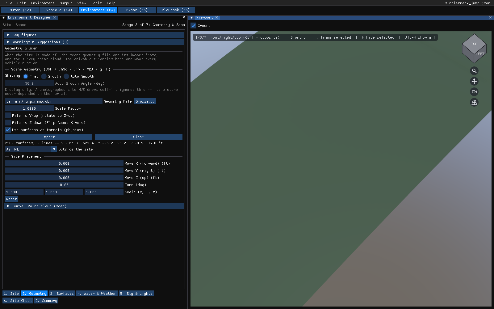
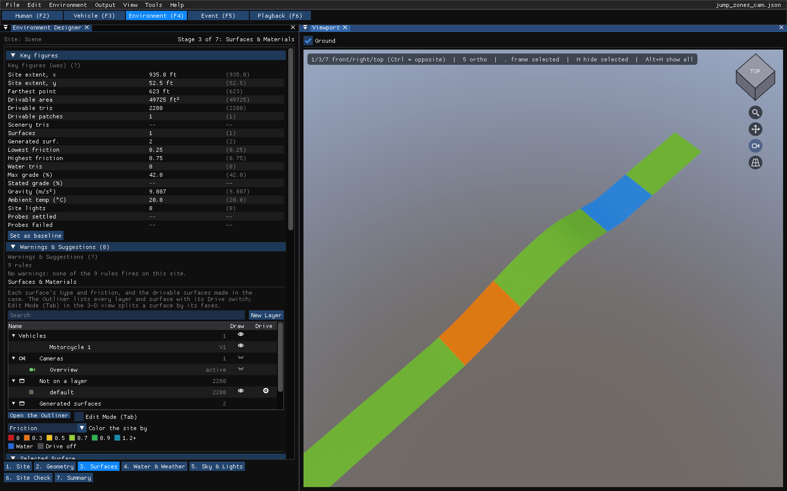
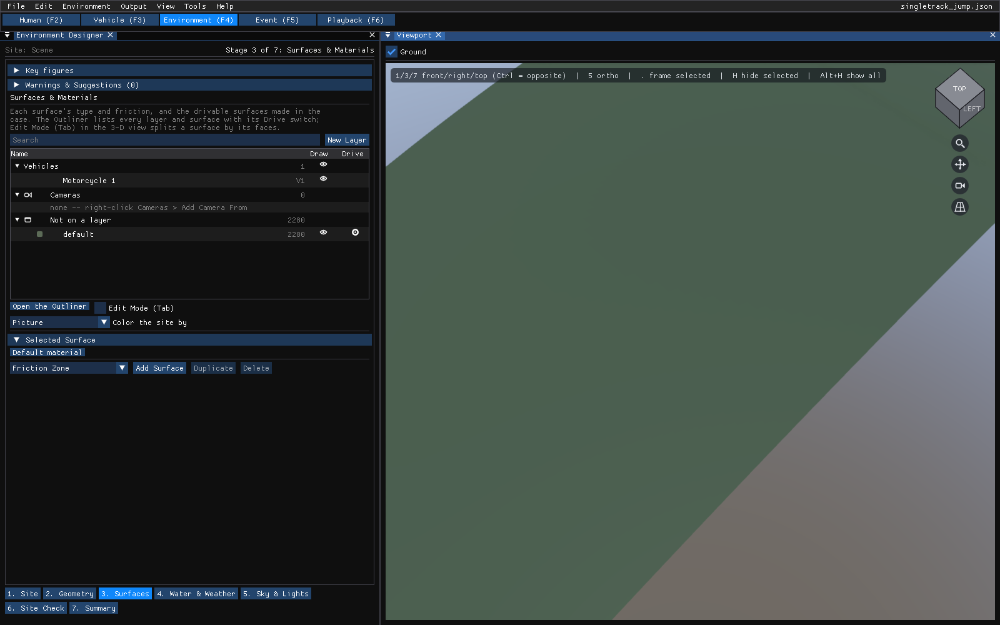
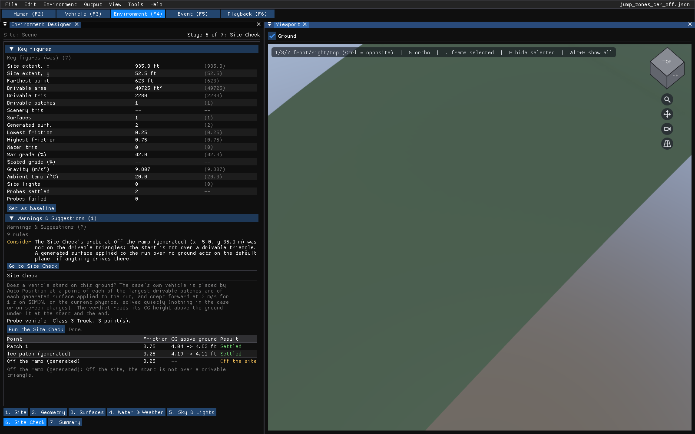

# Chapter 14 — Environment Designer

The Environment Designer is the Vehicle Designer's frame turned on the site:
a stage bar (along the bottom; **Bar position** moves it to the top, left or right; the
open stage is drawn as a selected tab, with the accent line along its top edge), a **Key figures** strip on the left that
remembers what each number was, the site's panels hosted on the stage that
asks their question (the stage's title on a band of the title-bar color, the site's
name at its right end), and a **Guidance** panel under Key figures whose
rows name the fix and the stage that owns it. Open it with **Environment ›
Environment Designer...** (the first item), and it is the Environment editor's
panel: switching to the Environment editor (F4) opens it where the Environment
window used to open. **Environment › Environment...** still opens that window.

It is an ordinary docked window, on the left with the 3-D view beside it by
default: drag its tab to move it, float it, or dock it anywhere, and the
arrangement is kept. The **Key figures** and **Guidance** are one summary row at the top of the stage: a **Key figures** button and a **Guidance** button that reads how many items there are to fix and to consider. Each opens its panel under the row. While Guidance is closed, the first item to fix is shown on one line after it, with its **Go to** button; point at the line for the whole text. Where they go is yours to choose: **Bar position** (on the stage line) also has **Key figures and Guidance** › **Automatic (beside when wide)**, **Beside the stage** (always the column) or **Above the stage, folded (default)** (always the summary row, closed until you open it; the default since 2026-11-09, so they stay at the top however wide the designer is). One choice for all four designers, kept between sessions. **Standard** | **Extended**, beside **Bar position**, chooses how many stages the bar offers: Extended (the default) shows them all, Standard the ones most analyses change, keeping the stage on screen and any stage with something to fix (see the Vehicle Designer, *Standard and Extended*, for each designer's stages). With **Automatic**, wider than about 1000 pixels they
are columns on either side. Every panel it hosts is the same panel the **Environment** window draws,
so a field has one editor and nothing is reachable in one and not the other.

*Figure 14-1: The Environment Designer on its Import stage, filling the left of the work area with the 3-D view beside it.*

## The stages

What a stage covers is a tooltip on its title band (the colored bar naming it): hover over the band to read it.

1. **Site**: Location (placement, address, coordinates), the **Map**, and the data
   for the area you choose on it: **Download for this area**, three tabs right
   above the map — **Aerial image**, **Terrain (3DEP)** (Geographic terrain,
   USGS 3DEP) and **LiDAR** (the USGS lidar point cloud) — all take the same
   area, so you choose it once: the yellow rectangle on the map, a square about
   the case's location unless you draw one (**Select area**) or press **Area
   here**. Moving the map does not move it. Under **Download aerial image**,
   **Your own picture** places a picture of your own (by its georeference or by
   control points). Either way the picture is laid as ground at once: drivable
   flat ground where the site is not, and the photograph in the material of every
   surface under it (see *The picture is ground*). The terrain you download
   becomes drivable ground too.
2. **Import** (named *Site Files* before 2026-11-09): at the top, the environment as a file — **Save Environment
   As...** (the site — its geometry, surfaces, sky and lights — as a
   `.hveenv.json` file of its own, to use in another case) and **Load
   Environment...** (one saved that way; the page then says what was loaded
   and the view frames it; to bring in a site drawn elsewhere use Import >
   **Import...**), the
   Environment menu's commands (its **Open Example** opens one of HVE's example
   sites as a new case); then one tab for each way into the site:
   - **3-D models**: the **Imported files** list of the site's 3-D model files
     (DXF, `.h3d`, Inventor, VRML, OBJ, glTF), the scene geometry with
     **Import...** / **Add...** / **Clear** (a geometry file's scale and frame are
     asked in the **Import Scene Geometry** window when you choose it),
     **Add Object...** (HVE's barriers, walls, poles, trees and curb), and
     **Site Placement**.
   - **Point cloud**: the survey scan, drawn and measured on, never driven on.
     Its file is named at the top of the tab, with **Import...** and **Clear**;
     its scale, frame and drawing are in **Survey Point Cloud (scan)** below.
   - **Aerial image**, **Terrain (3DEP)** and **LiDAR**: the downloads for the
     map's area, each with the map under it (the same downloads and map as the
     Site stage's).

   The drivable triangles here are what every vehicle runs on. (This stage was
   called Geometry, then Site Files.)
3. **Surfaces**: the Outliner's tree hosted on the stage (layers, surfaces and
   objects with their eye and Drive switches and each surface's **Type**;
   **Open the Outliner** puts the
   same tree in its own window), the site-wide **Use surfaces as terrain
   (physics)** and **Ground beyond the site geometry** under it, the **Selected Surface** section for the
   surface picked in the tree or the 3-D view, **Edit Mode (Tab)** to pick
   faces in the viewport and give them a material or split a surface by them,
   and the Surface Generator. A click on an aerial picture in the 3-D view (or on
   its Outliner row) selects the picture instead, and the stage shows **Selected
   Aerial Picture** with its visibility, opacity and material; clicking the same
   spot again selects the surface under it. The Key figures strip's **Drivable patches** row
   counts the drivable surface's connected pieces: more than one means a wheel
   can run off an edge onto the default plane. **Color the site by** recolors
   the 3-D view while this stage is open: **Friction** runs from red at 0
   through orange, yellow and green to teal above 1.2, so a seam between two
   surfaces shows; **Drive and water** shows drivable ground green, a drivable
   surface at friction 0 red, water blue and surfaces with Drive off gray in
   both. **Picture** is the site as drawn. The colors are display only, and
   leaving the stage or closing the designer gives the picture back.

   **Deleting what you loaded.** Select one or more surfaces in the tree and
   press **Delete** beside **New Layer** (or right-click a surface and choose
   **Delete Surface**), or click an object in the 3-D view and press the
   **Delete** key on the keyboard. A window asks first, **Delete Surface** or
   **Cancel** (**Enter** deletes, **Escape** cancels); the
   surfaces' triangles are removed from what the solver drives on and from the
   3-D view, a downloaded terrain's source record goes with it, and **Edit ›
   Undo** brings them back. **Delete All**, beside **Delete**, asks the same question
   over every surface of the site at once (the aerial image and the point cloud are
   separate rows and stay). Deleting the last surface the site has clears the
   site, as **Clear** on the Import stage does: the vehicles then run on the
   ground outside the site. It is held, like Drive, while a run's results are on
   screen, because the site is a solver input. The aerial image and the point
   cloud have their own rows: right-click the row and choose
   **Delete Aerial Image** or **Delete Point Cloud**. Those are pictures only, so
   they stay available after a run.

   

   *Figure 14-3: Color the site by Friction: the road at 0.75, an ice patch
   at 0.25 and a pond, with the Key figures' friction range reading both.*

   

   *Figure 14-2: The Surfaces stage: the Outliner tree, Edit Mode, the
   Selected Surface section and the Surface Generator on one page.*

4. **Weather**: gravity, the ambient air and wind — the Physical section.
   Standing water and texture depth are each surface's own (Surfaces stage,
   under Surface Type and Friction), and rolling resistance is each tire's.
5. **Sky & Lights**: the sun, the sky (**Edit the sun and sky...** opens the
   Shader Editor's World, which has **Sky Preset**, a shipped sky as the world)
   and the site's lights. Display only, and the stage says so.
6. **Site Check**: does a vehicle stand on this ground? **Run the Site Check**
   places the case's own vehicle (the first one SIMON drives on its wheels: not a
   motorcycle, trailer, dolly or barrier) by Auto Position at a point of each of
   the six largest drivable patches and of each generated surface applied to the
   run, and creeps it forward at 2 m/s for 1 s on SIMON, on the current physics.
   The runs are solved quietly: nothing in the case or on screen changes. The
   table gives each point's friction, its CG height above the ground under it at
   the start and the end, and a result (the reason is under the table and on
   hover): **Settled**, **Fell through** (the CG
   ended at or below the ground, or sank more than 0.3 m), **Height changed**
   (its height above the ground changed by more than 0.1 m in the 1 s; nothing
   was moved by you), **Not driven on** (the CG started *below* the surface at
   the point, so the wheels stood on lower ground beside or under it: the top of
   a narrow object, a curb, or something over the road; that surface was not
   tested), **Off the site** (it left the
   drivable triangles), or **No answer** (the solver refused the run, with its
   reason). The Key figures show **Probes settled** and **Probes failed** once a
   check has run on this ground; a check made before the site changed is not
   read.

   

   *Figure 14-4: The Site Check with a truck: the ramp and an ice patch
   settle; a friction zone drawn beside the ramp has no ground under it.*
7. **Summary**: the site's name and file, **Set as baseline** (kept for this case
   across sessions), **Copy spec sheet** (tab-separated text on the clipboard),
   **Save Environment As...** (the environment as a file of its own, to load
   into another case), the spec sheet with its baseline and change, and every
   warning.

## Everything in one place

Every section of the **Environment** window and every item of the
**Environment** menu has a home in the designer:

| In the Environment window or menu | In the designer |
|---|---|
| Location | Site |
| Aerial Image... | Site (opens its own window) |
| Terrain: scene geometry, site placement, survey point cloud | Import |
| Geographic terrain (USGS 3DEP), the aerial download | Site |
| Terrain: Selected Surface | Surfaces |
| Surface Generator | Surfaces |
| Edit Mode (materials per face) | Surfaces |
| Physical | Weather |
| Sky, Lights | Sky & Lights |
| Load Environment..., Save Environment As... | Import (Save also on Summary); Open Example is on the Environment menu |

The Environment window stays available while the designer is new.

## Key figures

Site extent in x and y and the farthest point from the origin; the drivable
area, the drivable and scenery triangle counts, the surfaces and generated
surfaces; the drivable patches; the lowest and highest friction multiplier
among the drivable materials and the generated surfaces applied to the run;
the water triangles; the maximum grade read from the drivable
triangles and the stated grade of a graded terrain; gravity, ambient
temperature and site lights. **Set as baseline** under the strip
keeps the current values as the "was" column for this case.

## Guidance

| Grade | Stage | Rule |
|---|---|---|
| Fix | Surfaces | A drivable surface, or a generated surface applied to the run, has a friction multiplier of 0, which every tire reads as no friction. |
| Fix | Import | The site names a geometry file but no triangle is drivable, so vehicles run on the default plane. |
| Note | Site | The site reaches more than 2 km from the origin, where single precision coarsens. |
| Note | Weather | The stated gravity differs from 9.80665 m/s² by more than 1%. |
| Consider | Surfaces | The drivable surface is more than one patch and the smallest is under 2% of the area, so its edge drops a wheel onto the default plane. |
| Note | Surfaces | A palette entry owns no drawn or drivable triangle, so editing its friction changes nothing. |
| Fix | Site Check | The probe vehicle's CG ended at or below the ground, or sank more than 0.3 m: a hole or a seam there. |
| Consider | Site Check | The probe vehicle's CG height above the ground changed by more than 0.1 m in 1 s: a step, a ramp edge or a bump. |
| Consider | Site Check | The probe vehicle started off the drivable triangles or left them within its 2 m: a generated surface over no ground, or a patch too small to hold it. |
| Consider | Surfaces | A downloaded terrain lies over other drivable surfaces. A wheel there finds one of them by the engines' own search (the first polygon in the list, or the one last used), not the higher one and not the Outliner's order. The message gives the shared area and the vertical gap. |
| Note | Site Check | A note about where the site came from names a surface the site no longer has (removed, or the site was replaced). |
| Consider | Site Check | The site's sources state different vertical datums, or one that disagrees with the Location's. Heights are never converted between datums. |
| Note | Site Check | A downloaded terrain was resampled to a cell finer than the data's own spacing, so the surface is smoother than the survey. |

A rule that lacks its input stays silent, and the count beside the panel's
title lists what is checked on hover.
