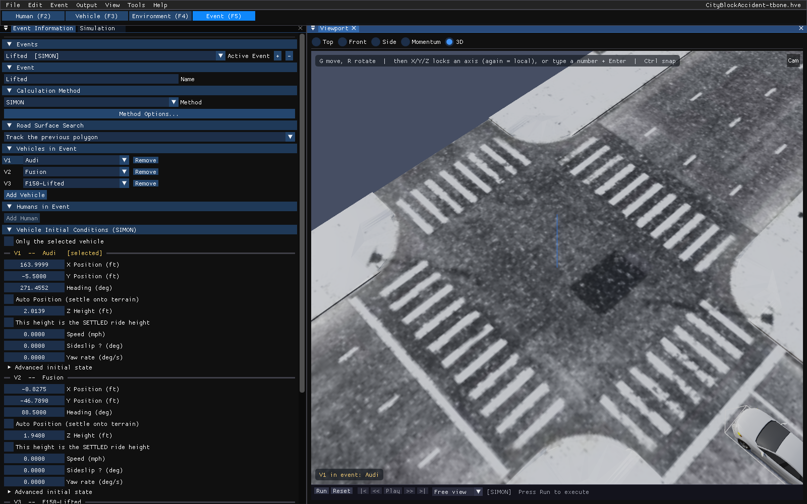
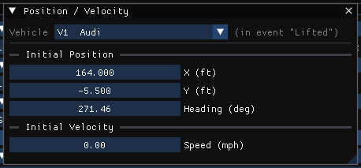
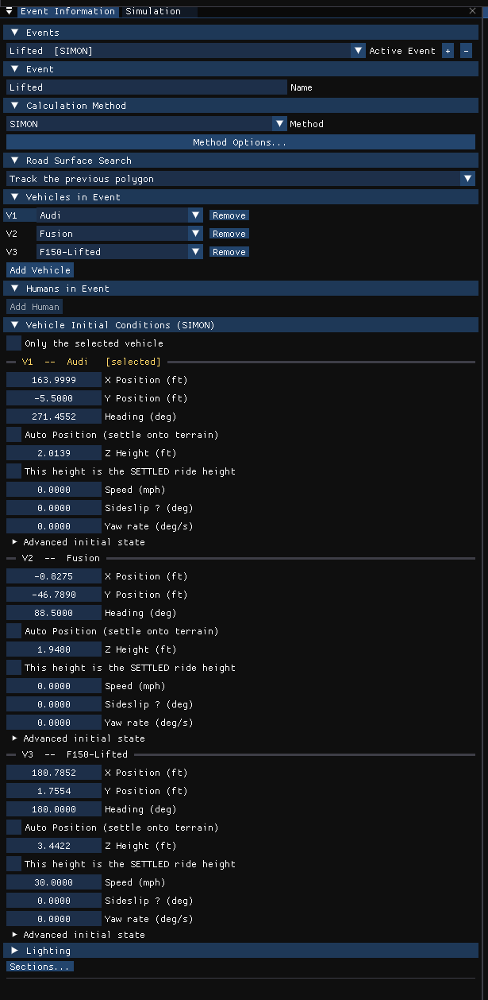

# Chapter 15 — Creating & Editing Events

The Event Editor is used for creating and editing the events of the current
case — each one a single analysis of the selected humans and vehicles in the
case's environment by one calculation method. In HVE Studio an event is also
played back, reported and graphed in the Event Editor; there is no separate
Playback Editor (see [Section Seven](../07-playback-editor/README.md)).

This chapter describes how to set up and execute events. This process is
central to the user's goals when using HVE Studio.

> **NOTE:** Refer to the next chapter, [Event Model Definition](16-event-model-definition.md),
> for a detailed description of the Event Model parameters.

## Event Editor Components

To use the Event Editor, click the **Event (F5)** tab under the menu bar, or
press F5. This puts HVE Studio in Event mode and displays the Event Editor's
components:

- **Event Information panel** — a docked panel used for adding events to the
  case, selecting the current event and setting up its humans, vehicles,
  calculation method and starting conditions. It replaces HVE's Event
  Editor dialog and Event Information dialog.
- **Viewport** — displays the environment and the current event's humans and
  vehicles, and is used for positioning them. The view cube in its top-right
  corner sets a preset view.
- **Playback bar** — the strip along the bottom of the Viewport. It runs,
  resets and plays back the current event, replacing HVE's Event Controller.
- **Event menu** — the event set-up dialogs (Position / Velocity, Driver
  Controls, Path Follower, Damage Profiles, Collision Pulse, ...); the items
  available depend on the event's calculation method.
- **Output menu** — Key Results, graphs, tables and reports for the solved
  event (see [Chapter 17](../07-playback-editor/17-report-playback-windows.md)).

*Figure 15-1: The Event Editor — the Event Information panel, the Viewport and its playback bar, on the CityBlockAccident-tbone case.*

### Event Information Panel

The Event Information panel is the heart of the Event Editor. Its sections
can be collapsed, and right-clicking a section header moves or hides it
(**Sections...** at the bottom of the panel brings a hidden one back). The
sections are:

- **Events** — the **Active Event** list, with the name and calculation
  method of every event in the case, and the **+** (add) and **−** (delete)
  buttons.
- **Event** — the current event's **Name**, and its **Start time (s)**: the
  time shown at the event's start (for example −5, so the impact reads near
  0), which the results, graphs, exports, the playback bar and the Results HUD
  read; the run itself still starts at 0.
- **Calculation Method** — the **Method** list, the **Physics** list (*HVE*,
  *HVE-reference* or *HVE (imported)*; see
  [Event Information](../../09-events-driver-controls/EventInfo.md#calculation-method))
  and the **Method Options...** button.
- **Road Surface Search** — how the engine finds the road polygon under each
  tire (see [Chapter 13](../05-environment-editor/13-environment-model-definition.md)).
- **Vehicles in Event** — the vehicles in the event, one per slot. Each row's
  **Shown** checkbox shows or hides that vehicle in the 3-D view. This is a
  view setting only: the event, its results and the run are unchanged, and
  nothing is saved.
- **Humans in Event** — the humans in the event (shown for the occupant
  methods, EDHIS and GATB, and for SIMON and EDGEN). The 3-D view draws the
  humans listed here and no others; an EDHIS or GATB event that lists none
  runs, and so draws, every human of the case.
- **Vehicle Initial Conditions** (simulations) or **Vehicle Impact Setup**
  (EDCRASH) — each vehicle's starting state or scene data.
- **Lighting** — a summary of the sun and sky, with a button to edit them.

!!! warning "Not in HVE Studio"
    HVE's **Copy Event** is not available. **+** adds a new, empty event
    that uses the current event's calculation method.

> **NOTE:** **−** deletes the current event. It is not available while the
> results of a run are on screen, because deleting an event renumbers the
> others; press **Reset** first.

### Viewport

The Viewport displays the current event: the environment, and each human and
vehicle in the event at its starting position. Use it to position the
vehicles directly:

- Click a vehicle to select it. Drag the gizmo's handles to move or rotate
  it, or press **G** (move) or **R** (rotate) with the pointer over the
  Viewport; X, Y or Z then locks the motion to an axis (pressed again, to
  the vehicle's own axis), a typed number and Enter sets the distance or
  angle exactly, and Ctrl snaps.
- A move in the Viewport edits the same starting position the Position /
  Velocity dialog and the Event Information panel show.
- Each named position that is set (Impact, Final/Rest, ...) is outlined as a
  ghost of the vehicle; dragging the outline moves that position. **Only the
  selected vehicle** in Event Information limits the outlines to the selected
  vehicle.
- To see one vehicle where another stands, hide a vehicle in the view: **H**
  hides the selected vehicle, **Shift+H** hides the others, and **Alt+H** shows
  them all (also **View › Scene Display › Vehicles Shown** and the **Shown**
  checkboxes above). A hidden vehicle's ghosts and tire marks are hidden with
  it, and an amber note at the top left of the view names the hidden vehicles,
  with a **Show all** button. Nothing is saved; opening another case shows
  every vehicle again.

### Position / Velocity Dialog

**Event › Position / Velocity...** (Ctrl+P) displays the selected vehicle's
starting position and speed in the current event:

- **Initial Position** — **X**, **Y** and **Heading**.
- **Initial Velocity** — **Speed**.

*Figure 15-2: Position / Velocity dialog.*

These are the same values as the vehicle's row in the Event Information
panel, which also holds the rest of the starting state:

- **Auto Position (settle onto terrain)** — settle the vehicle onto the
  site. The planar engines always do; for the 3-D engines it may be turned
  off to enter a **Z Height** above the ground.
- **Speed**, **Sideslip β** and **Yaw rate**.
- **Advanced initial state** — **Vertical vel w**, **Roll angle**, **Pitch
  angle**, **Roll rate** and **Pitch rate**.
- **Named Positions** — HVE's eight named positions (Initial, Begin
  Perception, Begin Braking, Impact, Separation, Point On Curve, End of
  Rotation, Final/Rest), each a collapsed node whose header shows where it is
  (or *not set*). Opened, a node has a **Set** checkbox, **X**, **Y**,
  **Heading (deg)**, **Auto Position (on the ground)** (turn it off to enter
  **Z Height**, **Roll (deg)** and **Pitch (deg)**), and a *Read by* note
  saying what reads it under the event's calculation method. For a
  simulation, **Initial** is the starting state above: the same values, so
  editing either edits both.

A trailer hitched to another vehicle is positioned by its **Articulation**
relative to the tow vehicle; its X and Y follow from the hitch.

!!! note "HVE Studio"
    HVE's single Position/Velocity dialog, with its Path Location list
    (Initial, Begin Perception, Begin Braking, Impact, Separation, Point on
    Curve, End of Rotation, Final/Rest), is divided in HVE Studio:

    - A simulation's **initial** state is in the Position / Velocity dialog
      and the Event Information panel, as above.
    - The eight path locations are the **Named Positions** list in each
      vehicle's block of the panel (for EDCRASH, in **Vehicle Impact
      Setup**), each set one outlined in the Viewport.
    - The path positions of the HVE Driver (path follower) are entered in
      the **Path Follower** dialog (see
      [Chapter 16](16-event-model-definition.md)).

    Velocities are entered as total speed and sideslip; HVE's editable U
    and V components are not shown.

Humans are positioned in the **Humans in Event** section: an occupant by its
seat position relative to the vehicle's CG (**Occupies** chooses the
vehicle), a pedestrian by its scene X and Y. **Pose** opens the human's
pose, and **Restraints (this event)** ticks the **Torso Belt**, **Lap Belt**
and **Airbag** the human wears in this event (occupant methods). A human
linked into a vehicle's **Aboard** list (Vehicle editor, **Inertia / Mass**)
is seated in that vehicle in every event that does not state its own seating,
and is drawn there.

### Key Results

The **Key Results** panel (Output › Key Results, or View › Key Results)
displays the important results of the current event for each vehicle —
for example impact and separation speeds, delta-V, PDOF, energy, and the
final position, heading change and peak accelerations — grouped in
sections that can be reordered or hidden like the Event Information
panel's.

See [Chapter 17](../07-playback-editor/17-report-playback-windows.md) for the
other output panels.

### Playback Bar

The current event is executed with the playback bar along the bottom of the
Viewport (the same controls are in the **Simulation** panel, View ›
Simulation):

- **Run** — execute the current event. It is not offered for an event that
  is already solved; press Reset first.
- **Pause** / **Resume** and **Cancel** — shown while the event is running.
  Cancel stops the solver and keeps what it has solved so far.
- **Reset** — discard the current event's results and return to editing.
- **Jump to start**, **step back**, **Play** / **Pause**, **step forward**
  and **Jump to end** — play back the results.
- the **camera** list, the **time slider** and a box to type a time and jump
  to it.

!!! note "HVE Studio"
    HVE's Reverse (play backwards) button is not available; use the time
    slider or the step-back button.

## Adding New Events

New events are added in the Event Information panel. To add a new event,
perform the following steps:

1. Click **+** in the **Events** section. A new event named *Event n* is
   added and becomes the current event.
2. Enter a **Name** in the **Event** section.
3. Choose the calculation method from the **Method** list in the
   **Calculation Method** section.

   > **NOTE:** A method that cannot run the event's vehicles is shown
   > grayed, with the reason in its tooltip. A method whose output has not
   > yet been checked against HVE is marked *(unvalidated)*.

4. In **Vehicles in Event**, click **Add Vehicle** once for each vehicle and
   choose the vehicle for each slot from the case's vehicles. **Remove**
   takes a vehicle out of the event (after confirmation).

   > **NOTE:** The order of the slots may be important. For example, for a
   > tractor-trailer simulation, the first vehicle is the tow vehicle and
   > the next is towed by it.

5. For an occupant or pedestrian study (EDHIS, GATB), click **Add Human** in
   **Humans in Event** and choose the human; for an occupant, choose the
   vehicle it **Occupies**.

*Figure 15-5: Event Information panel.*

!!! note "HVE Studio"
    There is no OK button: every method HVE Studio has an engine for can be
    chosen, and a change takes effect at once. Running the event needs a
    license that covers its method (Help › License...).

### Event Verify

HVE Studio checks that the event's vehicles and humans are compatible with the
selected method whenever the event is shown — for example the number of
vehicles, the vehicle types and axle counts the engine accepts, and
matching hitch connections for a vehicle-trailer combination. If they are
not, the Calculation Method section shows **Cannot run:** with the reason,
and the event cannot be executed until the vehicles, humans or method are
changed.

The method also decides which set-up items are available on the **Event**
menu, which sections the Event Information panel shows, and which outputs
the event produces. Refer to the following chapter, Event Model Definition,
for a complete description of all outputs.

### Method Options

**Method Options...** in the Calculation Method section opens the options
window of the selected method: *EDCRASH Options*, *EDSMAC Options* (shared by
EDSMAC and EDSMAC4), *EDGEN Options*, *EDHIS Options*, *SIMON Options*,
*EDVSM Options*, *GATB Options* or *SINGLETRACK Options*. EDSVS, EDVDS and
EDVTS have no options window. The button opens the window while a solved run's
results are on screen too, so you can see which options were run; its fields
are then read-only until **Reset**.

The integration and output timesteps, the duration and the termination
criteria are in the **Simulation** panel (View › Simulation), under
**Simulation Controls**. Only the timesteps the selected engine reads are
shown.

## Event Set-up

After selecting the humans, vehicles and calculation method, the next step
is to set up the event: positioning the humans and vehicles, providing
velocities, and entering other event-related parameters.

To set up the event, perform the following steps:

1. Select the vehicle to set up — click it in the Viewport or choose it in
   the dialog's vehicle list.
2. Choose the set-up item from the **Event** menu. Items the current
   method does not read are grayed:

   | Event menu item | Available for |
   |---|---|
   | Event Information... | all methods |
   | Position / Velocity... (Ctrl+P) | methods that start from initial conditions (all but EDCRASH and READDATAFILE) |
   | Driver Controls... (Ctrl+D) | simulations with driver controls, and EDCRASH (its Wheel Data page) |
   | Damage Profiles... (Ctrl+M) | EDCRASH |
   | Collision Pulse... (Ctrl+U) | EDCRASH, SIMON, EDHIS and GATB |
   | Vehicle Mesh... | all methods |
   | DyMESH Options... | all methods (read by SIMON) |
   | Path Follower... | all methods |
   | Payload... | SIMON, EDSMAC4, EDSVS, EDVDS and EDVTS |
   | Lights... | SIMON and EDSMAC4 |
   | Wheels... (Ctrl+W) | simulations with driver controls |
   | Accelerometers... | SIMON, EDSMAC4, EDVDS and EDVSM |
   | Contacts... (Ctrl+T) | EDSMAC4 (vehicle contacts), EDHIS and GATB (occupant contacts) |
   | Restraints... › Airbags..., Belt Restraint... | EDHIS and GATB |
   | Notes | all methods |
   | Handling Parameters..., Move CG... | EDSMAC, EDSMAC4 |

   > **NOTE:** Normally, the first thing you'll set is the vehicle's
   > position and velocity.

   > **NOTE:** Each of the event set-up options is described in detail in
   > the following chapter, [Event Model Definition](16-event-model-definition.md).

3. Enter or edit the data. There is no OK button: a change takes effect when
   you leave the field.
4. Choose and edit additional set-up items, as desired.
5. Repeat the above steps for each human and vehicle in the event.

!!! warning "Not in HVE Studio"
    **Event › Impact Plane / Barrier...** (EDCRASH) is shown grayed: HVE Studio
    does not have it. Model a barrier as a Fixed Barrier vehicle in Vehicle
    Information.

## Event Execution

After the event is set up, the next step is to execute it. To execute the
current event, perform the following steps:

1. Click **Run** on the playback bar (or Output › Run Simulation..., Ctrl+R).
   The Simulation panel shows the progress.

   > **NOTE:** If the current calculation model is a reconstruction, it
   > will finish almost instantly.

2. Click **Pause** to stop the run momentarily, and **Resume** to continue
   it. **Cancel** ends the run and keeps what was solved.

   > **NOTE:** If you do not intervene, the event will continue to
   > completion.

When the event has run, the results stay on screen and the playback bar
plays them back without recalculating. To replay the event, click **Jump to
start**, then **Play**, or drag the time slider.

While the results are on screen, the event's inputs are locked (the panels
say so), so that what is shown always matches what was solved. To change the
event and re-execute it:

1. Click **Reset**. The results are discarded and the inputs unlocked.
2. Select a human or vehicle and make the desired changes.
3. Click **Run** again.

!!! note "HVE Studio"
    The lock covers **every event that has results**, not only the one on
    screen, because a playback sequence plays them all. A vehicle, an occupant
    or the site that a solved event used stays locked while you look at
    another event; an event that has not been run stays editable. The banner
    names the events that hold the lock, and its button (**Reset Run to Edit**,
    or **Reset 2 Runs to Edit** and so on) discards exactly those events'
    results. An event run by a program that uses no occupant (EDSMAC4, for
    example) does not lock the occupants.

!!! note "HVE Studio"
    In HVE, Reset erased results that had to be kept for the Playback
    Editor. In HVE Studio the results of a run are saved with the case, in a
    results file (`.hver`) beside it — every solved event's, not only the one
    on screen — and are restored when the case is opened again, provided none
    of the inputs that event's run read has changed since; otherwise that event
    opens unsolved. Results for several events at once are produced by **Run
    All Events** in the Playback Sequence dialog, and a sequence saved with
    them plays as soon as the case is reopened (see
    [Chapter 18](../07-playback-editor/18-editing-event-sequence.md)).

## Selecting and Editing the Current Event

All events of the case are listed in the **Active Event** list of the Event
Information panel. The last event added becomes the current event; the
current event is the one displayed in the Viewport and edited.

To select and edit an event, perform the following steps:

1. Choose the event in the **Active Event** list. It becomes the current
   event and is displayed in the Viewport.
2. Change its name, humans, vehicles, calculation method or method options
   in the Event Information panel.
3. If desired, choose a human or vehicle and edit its set-up items.
4. Click **Run** to execute the event.

> **NOTE:** Choosing another event in the Active Event list is allowed
> while results are on screen; it changes which event is looked at, not
> the results.

## Copying an Event

!!! warning "Not in HVE Studio"
    HVE's Edit › Copy for events is not available. To study a change to one
    parameter, add a new event with **+**, select the same vehicles and set
    it up, or save the case under a new name (File › Save Case As...) and
    change the copy.

## Deleting an Event

To delete the current event, click **−** in the Events section of the Event
Information panel. If results are on screen, click **Reset** first.

## Deleting a Vehicle Position

A vehicle is removed from the current event with **Remove** on its row in
the **Vehicles in Event** section (after confirmation). For EDCRASH, a
surveyed scene position is removed by opening it in the vehicle's **Named
Positions** list and clearing its **Set** check box.

---

*See also (dialog references):*
[Event Information](../../09-events-driver-controls/EventInfo.md) ·
[Event Setup menu](../../09-events-driver-controls/EventSetup.md) ·
[Position/Velocity](../../09-events-driver-controls/PosVelDlg.md) ·
[Driver Controls](../../09-events-driver-controls/DriverControls.md)

<!-- NAV -->

---

← Previous: [Section Six — Event Editor](README.md)  |  [Index](README.md)  |  Next: [Chapter 16 — Event Model Definition](16-event-model-definition.md) →

<!-- /NAV -->
