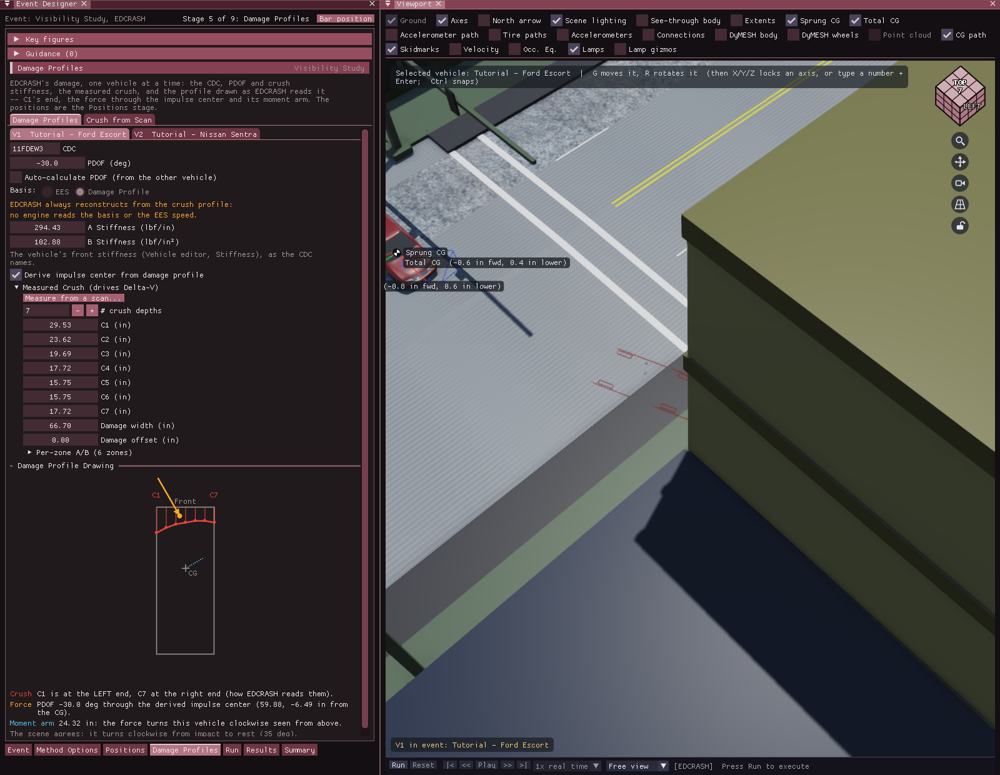

# Chapter 16a — Event Designer

The Event Designer is the Vehicle Designer's frame turned on the event: a stage
bar (along the bottom; **Bar position** moves it to the top, left or right; the open
stage is drawn as a selected tab, with the accent line along its top edge), a **Key figures** strip on the left that remembers what
each number was, the event's own dialogs hosted on the stage that asks their
question (the stage's title on a band of the title-bar color, the event's name at
its right end; the dialogs' own tabs carry the same accent line), and a **Guidance** panel under Key figures whose rows name the
fix and the stage that owns it. It is the Event editor's panel: switching to the
Event editor (F5) opens it where the Event Information panel used to open, and
**Event › Event Designer...** (the first item) opens it too. **Event › Event
Information...** still opens that panel.

Like the other designers it is an ordinary docked window, on the left with the 3-D
view beside it, where the vehicles stand: drag its tab to move it, float it, or dock
it anywhere, and the arrangement is kept. Docked narrow, the **Key figures** and
**Guidance** fold into the top of the stage. A dialog on a stage is the same
dialog the Event menu opens, drawn in the stage instead of its own window, so a
field has one editor and nothing is reachable in one and not the other.

*Figure 16a-1: The Event Designer on its Event stage, with Event Information
hosted and the 3-D view beside it.*

## The stages

1. **Event**: the **Event Information** panel: the events, the active event's
   name and start time, the calculation method, and the vehicles and
   humans in the event. The vehicles' initial conditions are on the
   Positions stage. **Copy this event**, above it, adds a copy of the event
   (vehicles, positions, driver inputs, options) at the end with no results and
   opens it, also while results are on screen. Beside it,
   **Start from documents** (Case Intake) and **Start from a sentence** (Quick
   Case) build the event from the case documents or a typed sentence.
2. **Method Options**: the options window of the event's calculation method
   (EDCRASH, EDSMAC and EDSMAC4, EDGEN, EDHIS, SIMON, EDVSM, GATB or the
   single-track model), the one **Method Options...** in Event Information opens.
   A method with no options says so. Pressing **Method Options...** on the Event
   stage brings you here. For SIMON, once **Enable DyMESH** is ticked, the stage
   has two tabs: **SIMON Options** and **DyMESH Options** (the same window as
   **Event › DyMESH Options...**).
3. **Positions**: Event Information's vehicle section by itself (no
   collapsing header): each vehicle's start state (position, velocity, Auto
   Position, advanced initial state) and its **Named Positions** list.
   **Only the selected vehicle** limits the list and the 3-D view's
   named-position outlines to the vehicle selected in the 3-D view. For EDCRASH
   the stage holds the scene only, **one vehicle at a time**: a tab per vehicle
   (the tab and the 3-D view's selection are one choice), its named positions,
   **Impact sideslip** and **Velocity at rest**, and for the event
   **Time shown before impact (s)**, how much of the approach the drawn playback
   shows (*automatic* by default: from the first surveyed position, or 2 s).
   The damage is the Damage Profiles stage. See
   [Event Information](../../09-events-driver-controls/EventInfo.md#vehicle-initial-conditions).
4. **Driver Controls**: **Driver Controls** (throttle, brake, steer and gear
   against time) for the chosen vehicle, and **From the EDR** (EDR Import): the
   vehicle's event data recorder record, and for SIMON a driver solved so the run
   follows the recorded speed. The solve keeps running while another stage or tab
   is shown. EDCRASH, a reconstruction, has no driver: the stage bar leaves it out.
5. **Collision Pulse**: a tab for each dialog the calculation method reads, as
   the Event menu grays the rest: **Collision Pulse** and **Contacts** (EDSMAC4's
   vehicle contacts, or EDHIS and GATB's occupant contacts). A method with
   nothing here (EDVDS, EDSVS, EDVSM, ...) has no Collision Pulse stage: the
   stage bar leaves it out. DyMESH's options are on the Method Options stage. The
   vehicle's mesh and crush stiffness are edited in the Vehicle Designer.

   For EDCRASH this stage is **Damage Profiles**, the damage it reconstructs from,
   one vehicle at a time (a tab per vehicle): the **CDC**, **PDOF** and
   **Auto-calculate PDOF**, the **A Stiffness** and **B Stiffness**, the impulse
   center, **Measured Crush** (**# crush depths** is typed, or stepped with its
   - and + buttons) and the **Damage Profile Drawing**; **Crush from Scan**
   (Crush Profile from Scan) beside it measures the crush depths off a scan.
   **Event › Damage Profiles...** (Ctrl+M) opens this stage. See
   [the damage profile](../../09-events-driver-controls/EventInfo.md#the-damage-profile-edcrash).

   

   *Figure 16a-2: EDCRASH's Damage Profiles stage on the EDCRASH tutorial: V1's
   front damage, its stiffness the vehicle's own front values, and the drawing --
   C1 at the left end, the PDOF into the impulse center, its moment arm, and the
   scene agreeing that the force turns the car clockwise.*
6. **Equipment**: the same for what each vehicle carries and does (a method
   none of them applies to, EDCRASH among them, has no Equipment stage): **Payload**,
   **Path Follower**, **Lights**, **Wheels**, **Accelerometers** (SIMON, EDSMAC4,
   EDVDS and EDVSM), and for EDSMAC and EDSMAC4 **Handling Parameters** and
   **Move CG**. Accelerometers belong to the vehicle: the tab edits the same
   devices as the Vehicle Designer's Accelerometers stage, so one placed in
   either is in every event the vehicle runs in. Airbags and belts are edited in
   the Vehicle Designer's Occupant Protection stage.
7. **Run**: the simulation controls and the run. Duration, the trajectory, collision,
   separation, curb-impact and human time steps the method reads, the **Output
   Timestep**, **Termination** and **Stopped Vehicle**, then **Run** with its
   progress, **Reset** and the **Last Result**. A solved event is locked until
   it is reset, and the stage says so. Fix warnings do not stop a run; the
   stage counts them. The run status lists, in brackets, every warning the run
   raised and every assumption HVE Studio made, each with its count. It is one
   line, so a run with many warnings can fill it: the line then ends with
   *[+N more: see the Messages report]*, and the **MESSAGES** tab of
   **Output › HVE Reports...** lists every one of them under *HVE STUDIO RUN
   NOTES*, after the engine's own messages. The list is kept with the event's
   results and saved with the case. Under the Last Result, **Messages** lists
   that page in full -- every message the engine raised and every run note --
   so a second warning is on this stage too, not only on the report.
8. **Results**: what the run gave, in three tabs -- **Key Results**, the
   **Output Graph** and the **Results HUD** (the boxes drawn over the event's
   run; see [Results HUD](../../new-features/11-results-hud.md)). Each is the
   window the View and Output menus open, hosted here.
9. **Summary**: the event's spec sheet with its was column, **Set as baseline**
   (kept for this case across sessions) and **Copy spec sheet**, the warnings,
   **Provenance** (where each value an automatic tool set came from) and the
   event's **Notes**.

The automatic tools on these stages are the same windows the **Automatic Tools**
menu opens, and like the menu they are not offered on a sealed case.

Every item of the Event menu has a place on a stage. The one exception is
**Impact Plane / Barrier...**, which this port does not implement (model a
barrier as a Fixed Barrier vehicle). Each tab is the dialog the Event menu
opens, drawn in the stage, for the vehicle chosen in its own **Vehicle** picker.

## Key figures

The vehicles and humans in the active event; its duration and output step (--
when the event leaves them to the Run stage); the first and second
vehicles' start speeds; the distance between their CGs at the start; their
closing speed (positive when the gap shrinks); and when their CGs would meet at
those speeds.

## Guidance

| Grade | Stage | Rule |
|---|---|---|
| Fix | Event | The case has no event. |
| Fix | Event | The active event has no vehicle and no human. |
| Fix | Positions | Two of the event's vehicles start with their CGs closer than 1.5 m, so their bodies overlap at t = 0 (not EDCRASH, which states impact positions). |
| Consider | Event | SIMON, EDSMAC or EDSMAC4: at their start speeds the first two vehicles touch (CG gap less 5 m for the two bodies) after the run has ended. |
| Note | Positions | SIMON, EDSMAC or EDSMAC4: the first two vehicles' gap is not shrinking at the start, so they meet only if a driver input turns one toward the other. |
| Consider | Event | SIMON, EDSMAC or EDSMAC4 with two vehicles: the output step is over 0.02 s, a few samples through an impact at most. |
| Note | Driver Controls | SIMON: every vehicle starts at rest with no throttle, so the stopped-vehicle rule ends the run at 0.1 s. |

A rule that lacks its input stays silent, and the count beside the panel's
title lists what is checked on hover.
