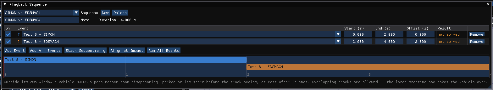

# Chapter 18 — Editing the Event Sequence

## Overview

Simulations from several events may be edited into a single, coherent sequence involving multiple humans and vehicles. For example, a multiple vehicle collision with several occupants and pedestrians may be built from several events. The purpose of this chapter is to explain how to edit multi-event sequences.

!!! note "HVE Studio"
    HVE does this with the Playback Window and its Playback Information
    dialog. In HVE Studio it is done in the **Playback** editor -- the
    **Playback (F6)** tab beside Event, as in HVE's Mode menu. Its **Playback
    Sequence** panel arranges the events, and the Viewport plays the chosen
    sequence through the same playback bar as a single event. A case can hold
    several sequences.

    **Which timeline is playing is the editor you are in.** The Event editor
    (F5) always plays its active event on its own, whatever sequence is
    chosen; the Playback editor always plays the chosen sequence. In the
    Playback editor a header at the top of the Viewport names the sequence,
    the time, and each event's state at that time -- **PLAYING**, waiting,
    done, off or **UNSOLVED** -- and the playback bar reads
    *[sequence: name]*.

Editing multi-event sequences involves two basic steps:

- Combining the desired events
- Editing the sequence

These steps are described below.

## Combining Events

The first step in creating an accident sequence that includes multiple events is to select the events. Each event contributes only once it has been run.

*Figure 18-1: The Playback Sequence dialog.*

To create a sequence and select its events, perform the following steps:

1. Click the **Playback (F6)** tab, or press **F6**. The **Playback Sequence** panel opens with the other editors' panels (**Playback › Playback Sequence...** reopens it if it was closed). While the case has no sequence the **Sequence** list reads *(none yet)*, and the Viewport and its header say there is nothing to play.
2. Click **New**. A sequence named *Sequence n* is created with every event of the case in it, laid end to end, and becomes the active sequence. **Delete** removes the active sequence.
3. Enter a **Name** for the sequence (optional). The **Duration** of the whole sequence is shown beside it.
4. In the table, check the **On** box of each event to include, and clear it for the others. **Add Event** adds a row and **Add All Events** adds every event not yet in the table; **Remove** takes a row out.
5. Click **Run All Events** (also **Run All** on the playback bar, and **Playback › Run All Events**) to solve every event the sequence uses, one after another. The **Result** column shows whether each event has been solved; an event with no result contributes nothing to the timeline.

   > **NOTE:** The window is busy until all the events have run. If a
   > sequence shows an event as not solved after the case has been
   > reopened, click Run All Events again.

The sequence includes all the humans and vehicles used in each of the selected events.

## Editing Events

After the events are selected, they normally must be edited so each event occurs at the proper time and sequence. While performing these operations, the user assumes a role much like a movie editor: the output tracks produced by each event are the film, and the sequence's table and timeline are the cutter and splicer.

### Timing The Sequence

Each row of the Playback Sequence table has three times, entered in seconds:

- **Start** and **End** — the times, on the sequence's own timeline, between which the event plays. Setting them shows only a portion of the event (HVE's Tstart and Tend).
- **Offset** — where the event's own time zero falls on the sequence's timeline (HVE's Tdelay).

!!! note "HVE Studio: Separate copy"
    The **Copy** box on a row draws that event's vehicles as their **own
    copies** — translucent, posed from that event — instead of taking over the
    case's vehicles. Use it to play two events that use the **same vehicles**
    at the same time, for example two reconstructions of one crash side by
    side. With it off, HVE's rule applies: a vehicle is one car across the
    sequence, and while two events overlap the later-starting one drives it (on
    an exact tie, the one listed first). The Playback header marks such a row
    **[separate copy]**. Copies are drawn in the 3-D view; lamp
    beams and trajectory trails show the vehicles' own runs only.

> **NOTE:** Start and End allow you to select a specific portion of the event. For example, an occupant simulation may contain 50 milliseconds of irrelevant motion while the human settles into the seat and reaches equilibrium. By starting the event 50 milliseconds after its output begins, you can remove this undesired motion.

!!! note "HVE Studio"
    As in HVE's dialog, Start and End are shown and entered on the
    sequence's timeline, while the case stores them relative to the event.

Below the table, each event is drawn as a bar on a **timeline**. Drag a bar to slide that event in time (Ctrl snaps); click elsewhere on the timeline to move the current time there. Two buttons set the timing for you:

- **Stack Sequentially** — lays every enabled event end to end, in table order. A new sequence starts this way.
- **Align at Impact** — slides every event so that its impact instant falls at the same time on the timeline, for comparing two reconstructions of the same collision. Events with no known impact time stay where they are.

To check the timing, use the playback bar: click **Jump to start**, then **Play**. Before its window, an event's vehicles hold their first position; after it, they hold their last.

### Object Precedence

It seems like a fairly simple task: put all the events in one timeline and start the playback running. However, there are some technical issues to be concerned with. For example:

- What if two events in the sequence have the same object?
- What if an object is changed (for example, suppose a vehicle is damaged in the middle of the sequence)?

The solution is based on a simple observation: the number of objects included in the sequence remains fixed. Cars and humans cannot disappear and/or reappear in the middle of an accident sequence.

### Rules

HVE Studio applies the following rules:

- **Rule 1:** The number of objects (humans and vehicles) in the sequence remains fixed.
- **Rule 2:** A vehicle is the same object in every event that uses it. Every event selects its vehicles from the case's one list of vehicles, so the same vehicle in two events is recognized exactly, whatever slot it occupies in each.
- **Rule 3:** Before an event's window a vehicle holds its first position; after it, its last. A vehicle between two events holds the earlier event's last position.
- **Rule 4:** If two events drive the same vehicle at the same time, the event that starts later wins. Thus, if *Ford F-150* appears in an event that starts at t=0 seconds and also in a second event that starts at t=2.1 seconds, the motion of the Ford will be driven by the first event from 0 to 2.1 seconds and by the second event thereafter. If the later event ends while the earlier one is still running, the earlier one resumes.
- **Rule 5:** A vehicle crushed in one event is shown crushed when it enters the next. This is display only: each event is still solved from the vehicle's undamaged mesh.
- **Rule 6:** Occupants and pedestrians follow Rules 3 and 4 over the events that carry their motion (the solved occupant events). Each body is posed from the event that holds it, at that event's time, and a seated occupant rides in its vehicle as the vehicle is drawn, even when another event is driving the vehicle at that moment. Before its event begins the body holds its first posture, and after it ends, its last.
- **Rule 7:** Each vehicle's trail (**Playback › Playback Options › CG Path**), and its accelerometer, contact-patch and skidmark paths, follow the vehicle through the sequence: one line for each stretch an event drives the vehicle. Where a later event takes the vehicle over, the line breaks rather than joining the two events' paths. A vehicle waiting for its event draws no trail yet.

!!! note "HVE Studio"
    HVE matches objects by name (so *Ford F-150* and *Ford F-150 (Damaged)*
    count as one vehicle, Rule 3 in HVE), gives vehicles carrying occupants
    the lowest precedence (Rule 5 in HVE), and lets the order of the events
    in the table decide some overlaps. HVE Studio does not need name matching,
    because a vehicle is one object in the case; two differently named
    vehicles are two objects. It does not carry an occupant's motion from
    one event into the next, and the order of the rows does not affect
    precedence. Force and velocity vectors are not drawn in Playback mode;
    they are one event's, in Event mode (F5).

### Playback Object Table (Audit Trail)

!!! warning "Not in HVE Studio"
    There is no Audit Trail dialog displaying the Playback Object Table. The
    table and the timeline of the Playback Sequence dialog show each event's
    window; which event drives a vehicle at a given moment follows from the
    rules above.

## Editing Non-calculated Results

!!! warning "Not in HVE Studio"
    HVE lets a simulation make some results editable — for example a 2-D
    simulation's sprung mass Z position, roll and pitch — through the
    Variable Output window's Edit button. HVE Studio has no way to edit a
    result: Key Results is read-only.
    The planar engines already settle the vehicle onto the site
    (AutoPosition), so the drawn Z, roll and pitch of a 2-D run follow the
    terrain.

---

<!-- NAV -->

---

← Previous: [Chapter 17 — Creating Report and Playback Windows](17-report-playback-windows.md)  |  [Index](README.md)

<!-- /NAV -->
