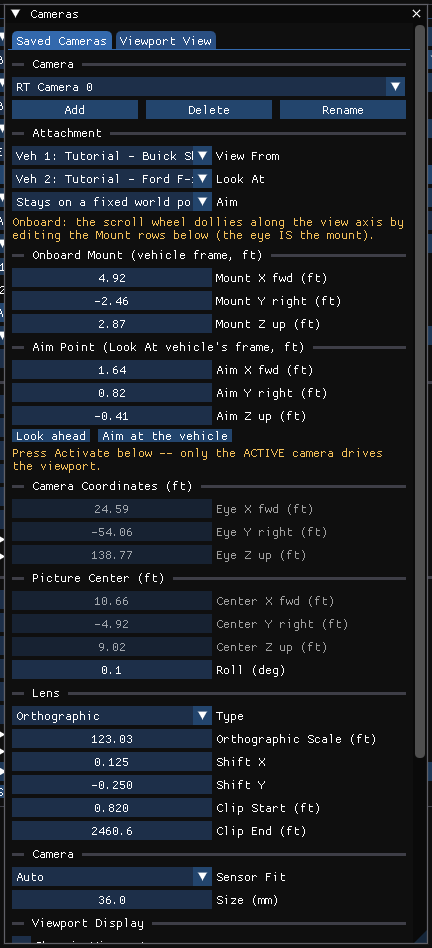

# Chapter 21 — Manipulators

## Overview

In HVE, an object selected in the 3-D Editor is positioned and sized with one of seven Open Inventor manipulators — Direct, Trackball, HandleBox, Jack, Centerball, TransformBox and TabBox — chosen from the 3-D Edit menu.

!!! note "HVE Studio"
    HVE Studio has no manipulator menu. It has **one gizmo**, used in the **Event editor (F5)** to place a vehicle's starting position (and the measured scene positions drawn as ghosts), plus Blender-style keyboard operators: **G** to move and **R** to rotate, and, in the Environment and Vehicle editors, **S** to scale (see the notes at the end of [HVE Manipulators](#hve-manipulators)). The camera has its own controls (see [Chapter 19](19-using-3d-editor.md#navigating-the-3-d-view) and [Cameras](#cameras) below).

    The gizmo is available only while the event's inputs are editable: once a run's results are on screen the start layout is locked until **Reset** on the playback bar.

## The Vehicle Gizmo

Click a vehicle in the 3-D view of the Event editor. The vehicle is selected and the gizmo is drawn on it:

- **Forward arrow** — drag to slide the vehicle along its own x axis (forward/back).
- **Lateral arrow** — drag to slide it along its own y axis (right/left).
- **Ring** — drag around the ring to change the heading. It lies flat and is blue, the color of the vertical axis it turns about.
- **Z-lift knob, pitch ring and roll ring** — only for a 3-D calculation method with **Auto Position** turned off for that vehicle. Drag the Z-lift knob above the roof up or down to raise or lower the vehicle (never below the ground). The **pitch ring** (green) stands along the vehicle and the **roll ring** (red) across it, both the heading ring's size and centered on the body; drag around either one to change the pitch or roll (limited to ±90°), as you drag the heading ring. Seen exactly edge-on, a ring follows an up or down drag instead.

A click on the body only selects it; a left drag that does not start on a handle orbits the view. The middle mouse button never moves a vehicle — it always moves the view.

Hold **Ctrl** while dragging to snap: 0.5 m steps for position (1 ft when Preferences shows imperial units), 0.25 m for Z lift (6 in), 15° for heading and 5° for pitch and roll.

A **scene ghost** (a measured position such as Impact or Rest, drawn when **View › Scene Display › Scene Ghosts** is on) can be clicked and moved the same way. The gizmo moves a ghost's x, y and heading only, so a ghost has no Z, pitch or roll knobs; a position's Z height, roll and pitch are entered in its node of the vehicle's **Named Positions** list in Event Information.

The fields of **Event › Position / Velocity** and the **Vehicle Initial Conditions** section of Event Information show the same values and change with the gizmo.

## Keyboard Operators (G and R)

With the mouse pointer over the 3-D view of the Event editor, press:

- **G** — move (grab) the selected vehicle; it follows the mouse over the ground.
- **R** — rotate it about its CG.

G and R work on the active vehicle even before it has been clicked, and on a selected ghost. While the operation runs, a line at the top of the view states what is armed (for example *Move: global X*), and:

| Key | Effect |
|---|---|
| X, Y | Lock the move to the global X or Y axis; press the same key again for the vehicle's **local** axis, a third time to release the lock |
| Z | Vertical (only meaningful for a vehicle that can leave the ground) |
| digits, `.` | Type an exact distance or angle — **G X 50** moves exactly 50 along X, **R 30** turns exactly 30°. Once a number is typed the mouse is ignored. A typed distance needs an X or Y axis lock; without one, G keeps following the mouse |
| `-` | Flip the sign of the typed number |
| Backspace | Delete the last typed character |
| Ctrl (held) | Snap: 0.5 m steps (1 ft in imperial) or 15° |
| Enter or left click | Apply |
| Esc or right click | Cancel and return the vehicle to where it was |

!!! note "HVE Studio"
    A typed distance is in **meters** whatever unit system is set in Preferences (the readout says *m*); a typed angle is in degrees.

## HVE Manipulators

The seven HVE manipulators and their HVE Studio counterparts:

| HVE manipulator | Purpose in HVE | HVE Studio |
|---|---|---|
| Direct | Drag the object in the plane of the screen | **G** (the vehicle follows the mouse over the ground) |
| Trackball | Free rotation about the object's center | **R** (heading); pitch and roll rings for 3-D methods |
| HandleBox | Translate and scale with box handles | Arrows for translation; a vehicle's start position is never scaled. **S** scales a site, a site surface or a vehicle's mesh |
| Jack | Translate along and rotate about each axis | Arrows and ring; **G**/**R** with **X**/**Y**/**Z** |
| Centerball | Rotate about each axis, move the center | Heading, pitch and roll rings; the rotation center is always the CG |
| TransformBox | Translate, rotate and scale | **G**, **R** and **S** on a site, a site surface or a vehicle's mesh |
| TabBox | Scale by tabs on the faces | Not available |

!!! note "HVE Studio"
    In the Environment Editor, **G**, **R** and **S** move, turn and scale the whole **site**, or the selected **surface**, with the same axis keys and typed numbers (with **S**, **X**, **Y** or **Z** scales that axis alone, a typed number is the factor, and **Ctrl** steps by 0.1); the Environment panel's **Site Placement** fields and the selected surface's **Placement** fields, including **Scale (x, y, z)**, hold the numbers. The solver drives on the moved ground. A surface turns and scales about its own center and the site about the middle of its box. Several surfaces selected together (Ctrl or Shift in the Outliner, a click on a layer's row, or Shift-clicks in the 3-D view) move, turn and scale as one about their common center; the move is refused if any of them moves only with the whole site. On a site taken from an HVE case the road moves only with the whole site; its scenery moves on its own.

!!! note "HVE Studio"
    In the **Vehicle Editor**, **G**, **R** and **S** move, rotate and scale the vehicle's **mesh** (its picture and the body DyMESH collides). **G** moves it (**X** or **Y** locks an axis, **Z** lifts it), **R** turns it about the vertical (with **X** or **Y**, rolls or pitches it as the mouse moves up or down), and **S** scales it (**X**, **Y** or **Z**: one axis). A typed number is exact (meters, degrees or a factor), **Enter** or a left click keeps it, and **Esc** or a right click puts it back. They edit the same **Translate**, **Rotate** and **Scale** rows as the Vehicle Mesh window (File & Placement tab), as one undo step, and are refused while results are on screen. With a display mesh set, they move the display mesh and the collision mesh stays.

## Cameras

!!! tip "New in HVE Studio"
    **Tools › Cameras…** (also a right-click on the **Camera** button under the view cube, or **Camera Properties…** on the view's right-click menu) has two tabs:

    - **Viewport View** — the live camera: **Orbit** or **Free (Euler)** control; view presets **Top**, **Front**, **Rear**, **Left**, **Right**, **Persp**; azimuth, elevation, distance and target point (orbit) or eye position and pitch/yaw/roll (free); **Perspective** or **Orthographic** projection with focal length or field of view; **Reset Camera**.
    - **Saved Cameras** — the case's named cameras (up to 16). **Add** captures the current view as a new camera; **Delete** and **Rename** act on the selected one; **Activate** looks through it (only the active camera drives the view); **Capture Current View** stores the current framing in it. Re-framing an active camera in the view makes it *Current*, with **Save as New**, **Overwrite** and **Revert**.

    A saved camera can be attached to the event's vehicles:

    - **View From** — mount the camera on a vehicle (an onboard camera: **Onboard Mount** x forward, y right, z up from the CG); it either **rides with the vehicle** or **stays on a fixed world point**.
    - **Look At** — aim at a vehicle, as **Fixed** (the camera does not move), **Follow** (the offset stays in world axes — a tracking shot) or **Chase** (the offset turns with the vehicle's heading — a riding-along shot).
    - **Aim Point** — an offset from the aimed-at vehicle's CG, so a camera can look ahead of a vehicle rather than at its CG (**Look ahead** and **Aim at the vehicle** set it).

    Attached cameras follow the solved trajectory during playback, or the start layout before a run. **Camera Coordinates** (the eye) and **Picture Center** (the target), with **Roll**, place a camera that is not attached; for an attached camera they show where it is. The **Lens** (perspective/orthographic, millimeters or field of view, shift), **Camera** (sensor fit and size) and **Viewport Display** (show the camera, its name and its clip limits in the view) sections complete the camera.

### Keyframed cameras

A saved camera can be animated over the playback time:

1. Activate the camera and set the playback time (the **Time** field in the **Keyframes** section, or the playback bar).
2. Frame the view and press **Insert Key (I)** — or press **I** with the pointer over the view.
3. Move to another time, re-frame, and key again.

Each key is listed with its time (click to go to it) and an interpolation to the next key: Linear, Constant, Ease, Sine, Quadratic, Cubic, Quartic, Quintic, Exponential, Circular, Back or Bounce, with an easing (Automatic, Ease In, Ease Out, Ease In and Out) for the curved ones. Extrapolation (before the first key and after the last) and Cycles (Off, Repeat, Repeat with Offset, Repeat Mirrored) apply to the whole camera. **Delete Key** removes the key at the current time and **Clear Keys** removes all of them; the arrow buttons step to the previous and next key. **View › Dope Sheet** edits the keys on a timeline.

> **NOTE:** If the view of a keyed camera is re-framed and not keyed, moving the playback time drops the change.

Cameras are display only — no engine reads them. They are carried into the glTF export and the Blender live link ([Chapter 27](../09-video-output/27-video-interface.md)).

*Figure 21-1 — Tools › Cameras, Saved Cameras tab, for a camera mounted on one vehicle and aimed at another (from a test case). The Keyframes section and the Activate and Capture Current View buttons are further down the window.*

---
*Converted and updated from the legacy HVE User's Manual (Seventh Edition, Jan 2006), Chapter 21; adapted for HVE Studio.*

<!-- NAV -->

---

← Previous: [Chapter 20 — 3-D Editor Object Tools](20-object-tools.md)  |  [Index](README.md)  |  Next: [Chapter 23 — Basic 3-D Editor Tutorial](23-tutorial.md) →

<!-- /NAV -->
