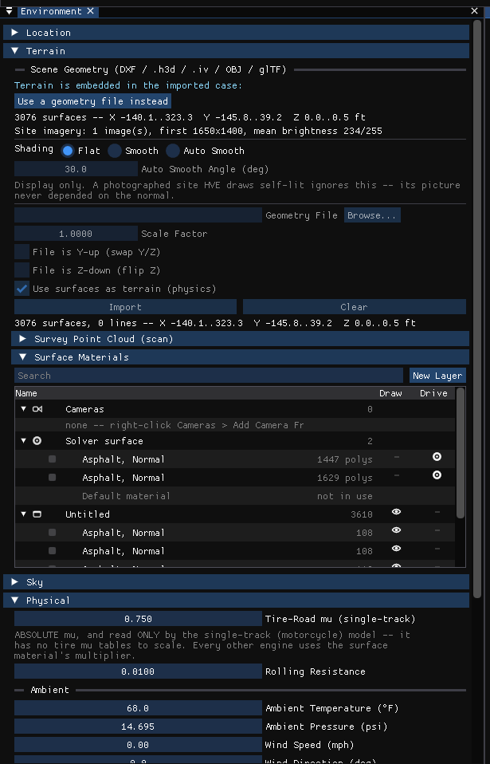

# Chapter 23 — Basic 3-D Editor Tutorial

## Overview

HVE's tutorial for its 3-D Editor has three lessons: creating a simple road surface (with object type, friction, material, texture and overlay), editing a surface (moving vertices, reversing normals, changing hierarchy), and using groups and the Highway Furnishings Library.

!!! note "HVE Studio"
    HVE Studio does not create or edit geometry, so HVE's lessons cannot be followed as written: there are no surface, vertex, normal, hierarchy or group tools ([Chapter 20](20-object-tools.md)). This chapter replaces them with the equivalent HVE Studio tasks — bringing a site into a case, giving its surfaces their physical properties, organizing them in layers, and placing a vehicle on the site. The same order is kept: Lesson 1 corresponds to HVE's Lesson 1; HVE's Lessons 2 and 3 have no counterpart and are summarized at the end.

## Lesson 1 — Bringing a Site into a Case

### Starting from an HVE case

If the site was built in HVE's 3-D Editor, open the case directly:

1. Choose **File › Open Case…** (Ctrl+O) and select the `.hve` file.
2. Select the **Environment (F4)** tab. The site is drawn in the Viewport, with HVE's own surface types, overlays and friction factors.

### Starting from a geometry file

1. Select the **Environment (F4)** tab and choose **Environment › Environment…**.
2. Open the **Terrain** section. Under **Scene Geometry (DXF / .h3d / .iv / OBJ / glTF)**, type the file name in **Geometry File** or press **Browse…**.
3. Set the **Scale Factor** (an **Extra Scale** for `.h3d`) and, if the file was modeled Y-up, tick **File is Y-up (rotate to Z-up)**.
4. Tick **Use surfaces as terrain (physics)** if vehicles are to drive on the site; leave it clear for geometry that is only a backdrop. (For DXF, OBJ and glTF files, check the elevation range in the summary against the site you expect: nothing in such a file says which way is up, and **File is Z-down (Flip About X-Axis)** corrects one that is inverted.)
5. Press **Import**. The panel reports the number of surfaces and the extents of the site, and the site is drawn in the Viewport.

*Figure 23-1 — The Environment panel's Terrain section, for a site read from an HVE case: Scene Geometry (here the site is embedded in the case, with **Use a geometry file instead** to replace it) and Surface Materials, which carried the same layer tree as the Outliner. That section is now **Selected Surface**, and the tree is only in View › Outliner.*

> **NOTE:** A saved case carries the site inside it, so it can be sent to someone else as it is. If **File › Embed the environment in the case** has been unticked, the case names the geometry file instead; tick it again before sending the case.

### Surface Friction

Each surface's physical properties take the place of HVE's Object Type and Friction Multiplier fields.

#### Object Type

1. In the 3-D view, click the surface (for example, the road). It is highlighted, and the **Selected Surface** section of the Environment panel shows *Selected: name — type, friction*.
2. Press **Edit in Shader Editor**. The Shader Editor opens on that surface; its Surface node is headed *PHYSICS — these change the result*.
3. Set **Surface Type** to **Road** (or Friction Zone, Curb, Water or Other).

#### Friction Multiplier

1. With the surface still selected, set **Friction Multiplier** — for example 0.70 for a wet road, or choose **Wet (0.70)** from **Condition preset**.
2. The value is stored with the case and used by the next run.

> **NOTE:** While a run's results are on screen, the physics rows are locked. Press **Reset** on the playback bar to edit them.

### Assigning Material and Texture Attributes

The Shader Editor's material graph controls only what the surface looks like. Leave the default *Object Color → Principled BSDF → Material Output* graph to keep the file's own colors, or add an **Image Texture** node to apply a photograph. Nothing in the material changes a result.

### Assigning an Overlay Name

1. Choose **View › Outliner**. The site's layers (HVE's overlays) are listed with their surfaces.
2. To create a new layer, press **New Layer**.
3. Drag the surface's row onto the layer.
4. Click the layer's eye in the **Draw** column to hide and show everything on it.

### Saving Your Work

Choose **File › Save Case** (Ctrl+S). The surface types, friction values, layers and visibility switches are saved with the case — they are edits on top of the imported file, which itself is not changed.

## Lesson 2 — Placing a Vehicle on the Site

This lesson has no counterpart in HVE's 3-D Editor tutorial; it uses the gizmo that replaces HVE's manipulators ([Chapter 21](21-manipulators.md)).

1. Select the **Event (F5)** tab and make sure the event has the vehicle (**Vehicles in Event** in Event Information).
2. Click the vehicle in the 3-D view. The gizmo appears on it.
3. Drag the **forward** or **lateral** arrow to slide it, or the **ring** to turn it. Hold **Ctrl** to snap to 0.5 m and 15°.
4. For an exact placement, press **G**, then **X**, type a distance (in meters) and press **Enter**; press **R**, type an angle in degrees and press **Enter**.
5. Check the result in the **Vehicle Initial Conditions** section of Event Information.

## Lessons from HVE Not Available in HVE Studio

!!! warning "Not in HVE Studio"
    - **Editing a surface** (HVE's Lesson 2): moving vertices, reversing surface normals and changing object hierarchy. Edit the geometry in HVE or a modeling program and import it again.
    - **Using groups** (HVE's Lesson 3): creating, ungrouping, saving and reusing grouped objects in the Highway Furnishings Library. There is no grouping or object library.

### Summary

In this tutorial you brought a site into a case, gave its surfaces a type and a friction multiplier, organized them in layers and positioned a vehicle on it. These are the HVE Studio counterparts of the parts of HVE's 3-D Editor that affect a reconstruction.

---
*Converted and updated from the legacy HVE User's Manual (Seventh Edition, Jan 2006), Chapter 23; adapted for HVE Studio.*

<!-- NAV -->

---

← Previous: [Chapter 21 — Manipulators](21-manipulators.md)  |  [Index](README.md)

<!-- /NAV -->
