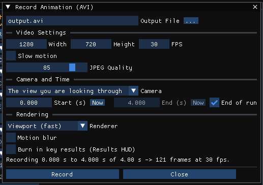
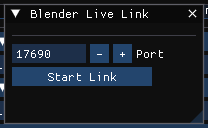

# Chapter 27 — Using The HVE Video Interface

HVE's video interface records a simulation as a movie: the Video Options (Video Set-up) dialog selects the format, size, frame rate and codec, and the Playback Window (Video Creator) records the playback to an AVI file or plays a saved one.

!!! note "HVE Studio"
    **File › Record Animation…** records the 3-D playback to a **Motion-JPEG AVI** file and **File › Play Video…** plays one. That is the one format HVE Studio writes, on every platform: each frame is a JPEG picture in an ordinary AVI file, which VLC, Windows Media Player, ffmpeg and common video editors open. HVE's codec choice, single-frame image output and recording devices are not offered.

    For a rendered movie — materials, lighting, a different codec — **export the solved scene to Blender** and render it there (see [Exporting to Blender](#exporting-to-blender)).

This chapter describes what HVE Studio does offer for each part of HVE's video interface.

## Video Setup Dialog

HVE's Video Options dialog sets the video format (movie and/or single frames), compressor, video size, recording frame rate and output directory.

**File › Record Animation…** opens the **Record Animation (AVI)** dialog, with:

- **Output File** (default `output.avi` in the open case's folder, or in
  `Documents\HVE Studio` when no case is open) and a **…** browse button. On Windows the
  program never offers its own install folder, which an uninstall removes.
- **Video Settings** — **Width** and **Height** in pixels (64 to 4096, rounded
  to even numbers; default 1280 × 720), **FPS** (1 to 1000; default 30), the
  **Slow motion** switch with its **Capture rate (frames per s of the run)**
  (1 to 10000; default 1000), and **JPEG Quality** (1 to 100; default 85).
- **Camera and Time** — the **Camera** (*The view you are looking through*, or
  any saved camera), **Start (s)** and **End (s)**, each with **Now** (the
  playback bar's current time), and **End of run**.
- **Rendering** — the **Renderer** (**Viewport (fast)** or **Ray traced**, with
  its **Samples**) and **Motion blur** (with **Steps** and **Shutter**).
- **Burn in key results (Results HUD)** — draws the case's
  [Results HUD](../../new-features/11-results-hud.md) boxes into every frame.
- A line giving the part of the playback recorded and the number of frames
  (with the slow-motion factor when the capture rate differs from the FPS), a
  warning when frames will fall between the run's saved states, or the reason
  Record is unavailable.
- **Record** and **Close**; while recording, a progress bar and **Cancel**.

*Figure 27-1 — The Record Animation (AVI) dialog.*

Each setting is described step by step in
[Recording a video](../../new-features/07-video-and-playback-sequences.md#recording-a-video).

!!! note "HVE Studio"
    The settings belong to the session, not to the case. There is no codec selection, no single-frame image output and no separate output directory: the output file names the directory. HVE's *Include UI Overlay* is not offered — the 3-D scene is recorded, with the Results HUD when it is burned in, and no panels or dialogs — and an existing output file is overwritten only after **Record** asks (**Overwrite** / **Keep**).

### Video Devices *(legacy)*

Not applicable — HVE Studio drives no external recording device.

### Video Compressor

Not available in HVE Studio. Every recording is Motion-JPEG, with its **JPEG Quality** set in the dialog; to use another codec, convert the AVI in a video editor or converter, or render in Blender and choose the codec there.

## Playback Controller

In HVE the Playback Controller selects a Video Source (the Playback Window or a saved movie) and a Video Destination (a video file or the Playback Window).

!!! note "HVE Studio"
    A solved event plays back in the **Viewport**, with the **playback bar** beneath it: **Run** and **Reset**, the transport buttons (go to start, step back, **Play**, step forward, go to end), and a camera menu that looks through **Free view** or any saved camera. **Output › Playback Options…** sets the playback **Speed** (0.1× to 10×, real time at 1×), a **Frame Step**, **Loop** and **CG Path**. There is no separate Playback Window, and the destination is always the screen.

### Video Source

The source is always the current solved event (or playback sequence) in the Viewport.

### Video Destination

The Viewport, or an AVI file with **File › Record Animation…** ([below](#recording-a-movie)), which can record through any saved camera rather than the one in the Viewport.

## Recording A Movie

1. Run the event, or for a playback sequence press **Run All Events**.
2. Choose **File › Record Animation…** and set the **Output File**, **Width**,
   **Height**, **FPS** and **JPEG Quality**. For slow motion, tick **Slow
   motion** and set the **Capture rate**: captured at 1000 frames per second
   of the run and played at 100 fps, one second of the crash lasts ten seconds.
3. Choose the **Camera**: *The view you are looking through* (the free view as
   framed, or the camera chosen on the playback bar), or a saved camera —
   fixed, attached to a vehicle, or keyframed.
4. Set **Start (s)** and **End (s)**, or leave **End of run** ticked to record
   to the end.
5. Optionally choose the **Ray traced** renderer or **Motion blur**, and tick
   **Burn in key results (Results HUD)** to carry the case's HUD boxes into
   the video.
6. Press **Record**.

HVE Studio steps through the playback from the start time to the end time at
intervals of 1/FPS of the run (1/capture rate under slow motion), the last
frame being the end time when it falls on that grid. Each step renders the 3-D
scene at the chosen size, so the recording's frame rate is exact however long a
frame takes to draw — the Viewport shows each frame as it is recorded and the
progress bar fills. **Cancel** stops and leaves no file. When the recording
finishes, the window reports the frame count, length and file size, and the
playback, and your own view if a saved camera was used, return to where they
were before.

!!! note "HVE Studio"
    Record is unavailable until there is a solved event to play, while a simulation is running, and when the start time is after the end time; the window says which. A recording stops with a message if the run is reset or re-solved underneath it, and refuses to grow past the roughly 1 GB an AVI file can hold — lower the size, frame rate or quality for a long run.

!!! warning "Frames faster than the run's output"
    The engine saves the vehicles' state once per output interval. Frames
    taken faster than that are drawn between saved states — the vehicles move
    in a straight line between two saved poses, and crush and occupant bodies
    change only at saved states — and the window warns when the chosen rate
    does this. For more detail, lower the event's output interval and run it
    again.

## Video File Selection

### Saving Compressed Video Files

Every recording is compressed: each frame is a JPEG at the **JPEG Quality** set in the dialog. To re-compress to another codec, open the AVI in a video editor or converter.

### Viewing Previously Saved Video Files

**File › Play Video…** opens a **Video Playback** window. Type or browse (**…**) to a file and press **Load**. The window shows the frame size, frame count and rate, and plays the video at the file's own frame rate, with **Play**/**Pause**, **<** and **>** to step one frame, **|<** and **>|** for the first and last frame, a frame slider, a speed control and **Loop**. After a recording, **Show in Play Video** in the Record Animation window opens the file just written.

!!! note "HVE Studio"
    Play Video plays Motion-JPEG AVI files. Other compressions (H.264 and so on) are not decoded; use a media player for those.

## Creating Multiple Video Sequences

HVE combines several simulations into one recording in its Video Creator, or by appending sequences to one movie file.

!!! note "HVE Studio"
    The **Playback (F6)** editor combines several solved events on one timeline in the Viewport — each with its own start offset and trim — which is HVE's Video Creator. To view the same sequence from several perspectives, save a camera for each view (**Tools › Cameras…**, [Chapter 21](../08-3d-editor/21-manipulators.md#cameras)) and switch between them with the camera menu on the playback bar or the **C** key. The active sequence is what **File › Record Animation…** records. To produce one movie of several sequences, record (or render in Blender) each and join them in Blender's Video Sequencer or another editing package.

## Exporting to Blender

!!! tip "New in HVE Studio"
    HVE Studio sends a solved scene to Blender, the free 3-D program, which renders it to a movie or still images. Two routes carry the same content: the vehicle bodies (with their real meshes, or the generated box), the motion, the wheels with steer, spin and camber, the occupants and pedestrians, the environment, the materials, and every saved camera — keyed per frame when it rides a vehicle.

### glTF export

**File › Export Scene for Blender** writes the scene as a glTF 2.0 file:

- **glTF Binary (.glb) — recommended** — one binary file, about 25% smaller;
- **glTF Text (.gltf)** — one self-contained text file.

The command is available after a run (it carries the motion) and is grayed before one. The motion is sampled at 30 frames per second. In Blender, choose **File › Import › glTF 2.0**, pick the file, and press play.

> **NOTE:** An import is one-shot. Re-exporting after a re-run and importing again creates new objects, so materials, cameras and modifiers set up on the previous import are left behind. If you will re-run the case, use the live link.

### Blender live link

**File › Blender Live Link…** opens the **Blender Live Link** window. Press **Start Link** (the **Port** defaults to 17690); the window then shows *Listening on …*, whether Blender is connected, and the requests served. **Stop Link** ends it. The link listens on this computer only (127.0.0.1) and is read-only: Blender cannot change the case.

In Blender:

1. **Edit › Preferences › Add-ons › Install…**, pick the add-on `hve_live_link.py` supplied with HVE Studio (in its `tools/blender` folder), and enable it.
2. In the 3-D viewport press **N**, open the **HVE** tab and press **Connect**.
3. Press **Fetch Everything**, or the individual **Geometry**, **Motion**, **Damage**, **Materials** and **Cameras** buttons.

The add-on keeps the objects it made and rewrites only their data and keyframes, so work done in Blender — lights, materials, cameras, render settings — survives each re-run in HVE Studio.

*Figure 27-2 — The Blender Live Link window before the link is started.*

## Step-by-step Examples

### Example 1: Rendering the current simulation in Blender

1. Run the event (**Output › Run Simulation…** or **Run** on the playback bar).
2. Optionally set up and save cameras in **Tools › Cameras…** — fixed, following, onboard or keyframed.
3. Choose **File › Export Scene for Blender › glTF Binary (.glb)** and save the file.
4. In Blender, **File › Import › glTF 2.0** and select the file.
5. Choose the camera to render through, set the output format, resolution and frame rate in Blender's output properties, and render the animation.

### Example 2: Re-rendering after a change to the case

1. Start the live link in HVE Studio (**File › Blender Live Link… › Start Link**) and **Connect** from Blender's HVE tab.
2. **Fetch Everything** and set up the render in Blender.
3. Change the case in HVE Studio and run it again.
4. In Blender, fetch again (**Motion**, or **Fetch Everything**) and render. The Blender objects and their settings are kept; only the motion and data are replaced.

### Example 3: Play a previously saved video file

1. Choose **File › Play Video…**.
2. Browse to the `.avi` file and press **Load**.
3. Press **Play**, or drag the frame slider.

### Example 4: Record the current compressed video file to tape *(legacy)*

Not applicable.

## Problem Determination

- **Export Scene for Blender is grayed** — there is no solved run. Run the event first.
- **Blender does not connect** — make sure **Start Link** was pressed in HVE Studio and that the port in the add-on matches the one shown in the Blender Live Link window. If another program uses the port, choose another before starting the link.
- **A vehicle appears as a box in Blender** — the vehicle has no mesh file, or its named mesh did not load; the export then uses the same generated box the Viewport draws.
- **Record is grayed** — there is no solved event to play, a simulation is running, or the start time is after the end time; the window states which. Run the event first, or correct the times.
- **Record Animation produced no file** — the recording was canceled or stopped; the window states why (a reset or re-run during the recording, a full disk, or the 1 GB limit).
- **Play Video says the file is not Motion-JPEG** — the file uses another codec; open it in a media player.

---
*Converted and updated from the legacy HVE User's Manual (Seventh Edition, Jan 2006), Chapter 27; adapted for HVE Studio.*

<!-- NAV -->

---

← Previous: [Chapter 26 — Video Basics](26-video-basics.md)  |  [Index](README.md)

<!-- /NAV -->
