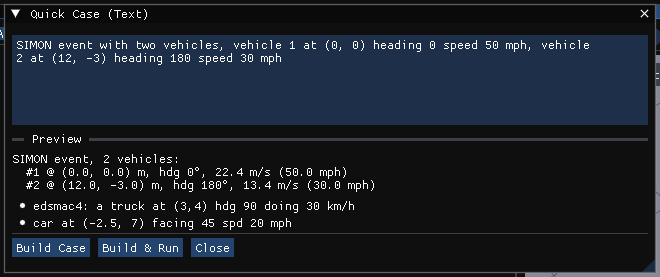
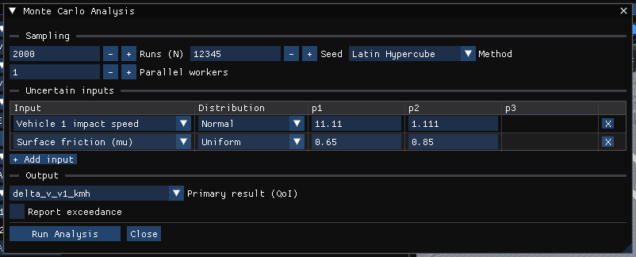
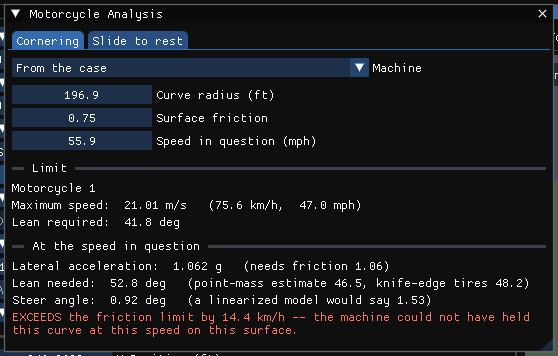
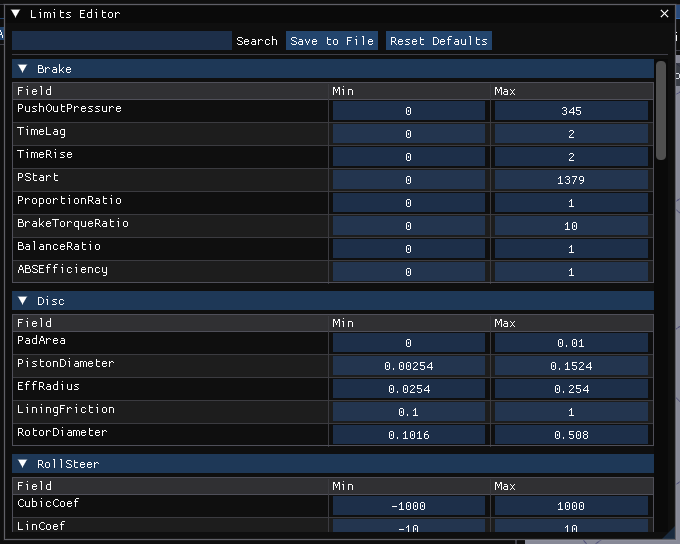

# Analysis Tools

!!! tip "New in HVE Studio"
    The first seven tools on the **Tools** menu are HVE Studio's own: **Quick
    Case (Text)**, **Vehicle Package**, **Case Intake**, **Provenance**, **EDR
    Import**, **Monte Carlo Analysis** and **Motorcycle Analysis**. This
    chapter describes Quick Case, Monte Carlo Analysis and Motorcycle Analysis;
    the other four are in
    [Case Intake and Vehicle Data](12-case-intake-and-vehicle-data.md). **Audit
    Log** and **Limits Editor** take the place of similar HVE facilities.

The Tools menu also holds **Preferences**, **Style Editor** and **Cameras**;
see [User Preferences](../01-user-interface/PrefDlg.md) and
[Cameras](05-cameras.md).

## Quick Case (Text)

**Tools › Automatic Tools › Quick Case (Text)...** builds an event from a sentence.

### Describe in words

The top of the window reads ordinary English, with no model and nothing sent anywhere.
Positions are **map coordinates**: +X is **east** and +Y is **north**, and a direction is a
compass word or bearing (north, west, north-east, "bearing 90"). The case itself stays SAE;
the sentence is converted at one place, and the review shows both.

*Create a case with a 2020 Honda Accord and a 2016 Ford F-150. Put the Accord at X = 200,
Y = 0, facing west at 50 mph. Put the F-150 at X = 0, Y = 200, facing south at 45 mph.
Use SIMON.*

1. Write or edit the sentence. The list under it shows each change in both frames (map X, Y
   and bearing, and the case's x, y and heading), with the words each value came from.
   Anything the sentence did not say is listed as **Not stated**, an ambiguity appears as a
   **Question**, and a value with no unit or an impossible one is **Rejected**: nothing is guessed.
2. A sentence that creates a case: under the changes, the list says which vehicle data is on offer
   for each vehicle it names (or replaces): how many records in the vehicle databases installed here
   match its make, model and year and the best few, or that it will be the generic vehicle, scaled to
   the values stated. Nothing is picked for you. **Review in Case Intake** opens Case Intake with the
   vehicles filled in, where you choose each vehicle's data and press Build.
3. A sentence that changes the vehicles already in the active event ("move the Accord 20 feet
   north", "face the F-150 east", "use EDSMAC4"): the list shows **Before -> after** for each value
   it would change, in both frames (map X east, Y north and the compass bearing, and the case's x, y
   and heading), taken from the same numbers that are then written. **Apply to the active event**
   writes it as one undo step, and each value written is recorded in **Tools › Provenance** as
   stated, with the words it came from.
4. A sentence that says to run it only shows **Run the active event**: a sentence never
   starts a run, and never changes the case because it asked for one.

### Fixed-grammar entry

1. Type a description in the text box, for example:

    *SIMON event with two vehicles, vehicle 1 at (0, 0) heading 0 speed 50 mph,
    vehicle 2 at (12, -3) heading 180 speed 30 mph*

2. Read the **Preview**, which shows how the sentence was understood: the
   method, and for each vehicle its position (meters), heading (degrees) and
   speed. If the sentence cannot be read, the preview says why.
3. Press **Build Case**, or **Build & Run** to build and solve it at once.

What it recognizes:

| Item | How to write it |
| --- | --- |
| Method | One of the words `SIMON`, `EDSMAC`, `EDSMAC4`, `EDCRASH`, `EDGEN`, `EDHIS`, `GATB`. With none, SIMON. |
| A vehicle | A pair of numbers, its **x y** position in **meters** — `(12, -3)` or `12 -3` — one pair per vehicle, up to 20 |
| Vehicle type | A word before the position: `car`, `sedan`, `pickup`, `van`, `suv`, `truck`, `semi`, `bus`, `trailer`, `barrier`, ... (default passenger car) |
| Heading | After the position: `heading`, `hdg`, `facing`, `yaw`, `bearing`, `direction` followed by degrees |
| Speed | After the position: a number with a unit — `mph`, `km/h` (or `kph`), `m/s` — or `speed`, `spd`, `doing`, `going`, `moving`, ... followed by a number, which is taken as **mph** |

Each vehicle described is a new vehicle seeded from a generic vehicle of its
type (the sentence says where it is and how fast, never which car it is), and
the event is a **new** event added to the case and made active; existing events
and vehicles are kept. Building is disabled while results are on screen.

!!! note "HVE Studio"
    Quick Case only sets method, position, heading, speed and vehicle type.
    Replace the generic vehicles' data with real data, and check the event's
    other inputs, before treating the result as a reconstruction.

## Vehicle Package, Case Intake, Provenance, EDR Import

**Tools › Automatic Tools › Vehicle Package...**, **Tools › Automatic Tools › Case Intake...**, **Tools › Automatic Tools ›
Provenance...** and **Tools › Automatic Tools › EDR Import...** put what is known about a crash
into the case, and record where each value came from. They are described,
with the vehicle's **Aboard** list and **Crush Stiffness from Crash Tests**, in
[Case Intake and Vehicle Data](12-case-intake-and-vehicle-data.md).

## Monte Carlo Analysis

**Tools › Monte Carlo Analysis...** propagates the uncertainty in a few inputs
through the **active event**, solving it many times, to put bounds on a result.

### Setting it up

**Sampling**

| Field | Meaning |
| --- | --- |
| **Runs (N)** | How many solves (1–100 000; default 2000) |
| **Seed** | The random seed (default 12345). The same seed and settings give the same batch, run for run. |
| **Method** | **Random** sampling, or **Latin Hypercube** (default), which covers each input's range more evenly for the same N |
| **Parallel workers** | How many solves run at the same time (1–64; default 1) |

**Uncertain inputs** — one row per input, with **+ Add input** and **X** to
remove a row:

| Input | Is applied to |
| --- | --- |
| Vehicle 1 impact speed, Vehicle 2 impact speed (m/s) | The speed of the event's first and second vehicles |
| Surface friction (mu) | Every tire's friction, scaled by the sampled value over the case's own |
| Vehicle 1 mass, Vehicle 2 mass (kg) | The mass of the event's first and second vehicles |

Each row has a **Distribution** — Normal (mean, std), Uniform (min, max),
Triangular (min, mode, max) or Lognormal (mu, sigma) — and its parameters.
The first time the window opens, it offers impact speed (Normal, centered on the
case's own value) and friction (Uniform, ±0.1 around the case's own value).

**Output**

- **Primary result (QoI)** — the result to summarize: delta-V of vehicle 1 or
  2 (km/h), final speed of vehicle 1 or 2 (km/h), rest X or Y of vehicle 1 (m),
  or heading change of vehicle 1 (degrees).
- **Report exceedance** — also report the probability that the result exceeds
  a threshold **t**.

Press **Run Analysis**. The batch runs in the background with a progress bar;
**Cancel** stops it and keeps the runs completed so far (marked as partial).

!!! warning "Each run is a full solve"
    Every run solves the event with the real engine, in its own solver process.
    2000 runs of a slow event take a long time; start with a few hundred and
    watch the **Convergence** section to see whether more are needed.

### Reading the results

- **Confidence intervals** — N, mean, median, standard deviation, minimum and
  maximum, the 90% interval (5th to 95th percentile), the 95% interval (2.5th to
  97.5th), and the exceedance probability if asked for.
- **Sensitivity (Spearman rank correlation)** — one bar per input: how strongly,
  and in which direction, the result rises or falls with it.
- **Convergence** — the running mean and the width of its 95% interval as N
  grows. If the width is still falling steeply at the last run, more runs would
  narrow the answer.
- **3D outcome cloud** — **Show in 3D viewport** plots every run's rest
  positions (colored per vehicle) and impact points (red) in the viewport;
  **Clear cloud** removes them. **Rest positions**, **Impact points** and
  **Point size** choose what is shown.

### Export and audit

The **Export & audit** section of the results has three buttons:

| Button | Writes |
| --- | --- |
| **Export raw CSV** | `mc_dataset.csv`, one row per run |
| **Write HTML report** | `mc_report.html`, a self-contained report (print it to PDF from a browser), and a tamper-evident audit record of the batch |
| **Verify audit chain** | Checks that the audit records written this session are intact |

The files are written to HVE Studio's working directory. The audit chain lasts
for the session.

## Motorcycle Analysis

**Tools › Motorcycle Analysis...** has two calculators for the questions a
motorcycle case usually asks first. They work from measured evidence, not from
a solved event. (For simulating a motorcycle, see [Motorcycles](09-motorcycles.md).)

### Cornering

Could the machine have held that curve at that speed, and how far over would it
have been?

1. **Machine** — **From the case** (the case's first Motorcycle-type vehicle)
   or a machine from HVE Studio's library. A library machine marked
   *class-typical* has plausible proportions for its type, **not** measured
   data: fine for "what would a bike like this do", not a basis for a finding
   about a particular motorcycle.
2. Enter the **Curve radius**, the **Surface friction** and the **Speed in
   question**, in the units set in Preferences.

The window reports:

- **Limit** — the maximum speed round that curve on that surface, and the lean
  it needs. Above 50° it warns that most road machines would ground out first,
  so ground clearance, not friction, is probably the real limit.
- **At the speed in question** — the lateral acceleration and the friction it
  needs; the lean needed (with the point-mass and knife-edge-tire estimates for
  comparison — the tire's width adds several degrees); the steer angle (and what
  a linearized model would say); and whether the speed **exceeds** the limit or
  is within it, by how much.

### Slide to rest

How fast was it going when it went down? Once down, the machine and the rider
slide to rest **independently**, at different drag factors, so each slide is a
separate estimate of the **same** separation speed.

1. For the **Machine** and for the **Rider**, enter the **Slide distance** and
   a **Drag factor low/nom/high**.
2. The window gives each one's speed with its range, and says whether the two
   ranges **overlap** — consistent, with a combined estimate — or **do not
   overlap**, which means they cannot both be right: check the drag factors,
   the measured distances, and whether the two really separated at the same
   moment.

The default drag factors are commonly cited starting ranges, not measurements.
Source them for the surface and the evidence in your own case.

## Audit Log

**Tools › Audit Log...** lists, with a timestamp, actions taken in this
session: a new case, cases opened and saved, simulation runs (including a
failed or canceled run) and resets, undo and redo, glTF exports (with the
summary of what was written and what could not be carried), published bundles,
and playback-sequence actions.

| Button | Does |
| --- | --- |
| **Clear Log** | Empties the list |
| **Print...** | Does nothing yet |
| **Close** | Closes the window |

!!! note "HVE Studio"
    The log is kept for the session only: it is not saved with the case or to a
    file, and the *User* column always reads *analyst*.

## Limits Editor

**Tools › Limits Editor...** edits the lower and upper bounds that several
vehicle dialogs use for their fields — Tire Data, Steering System, Advanced
Suspension and Brake Assembly. A value dragged or typed in one of those
dialogs is held within its bounds.

- Fields are grouped by section (Tire, Susp, SuspData, RollSteer, Brake, SCam,
  Disc, Steer, ...); **Search** filters by name.
- **Min** and **Max** are edited in place.
- **Save to File** writes them to `hve_limits.ini` in HVE Studio's working
  directory; that file is read when HVE Studio starts.
- **Reset Defaults** restores the built-in bounds (for this session, until
  saved).

!!! warning "Stored units, not display units"
    The Limits Editor shows every bound in HVE Studio's internal **SI** units
    (meters, newtons, kilograms, N·m, kPa, ...) regardless of the units set in
    Preferences, and without a unit label. A tire radius bound reads 0.127 to
    0.762 — meters — even when the Tire Data dialog shows inches.
