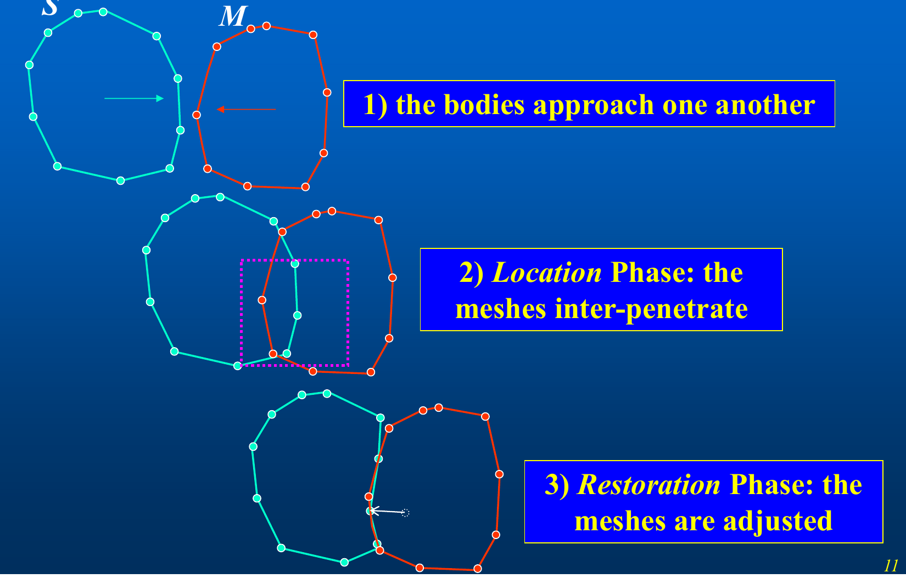
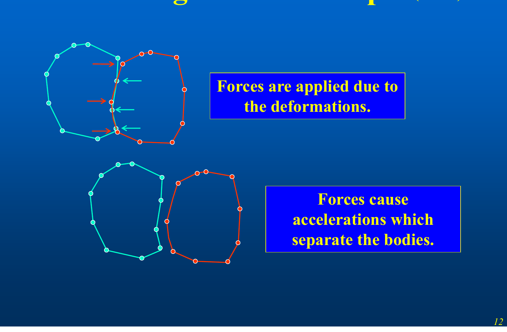
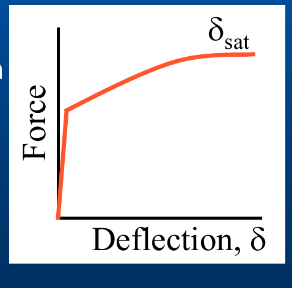
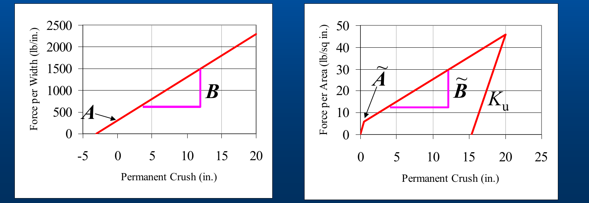
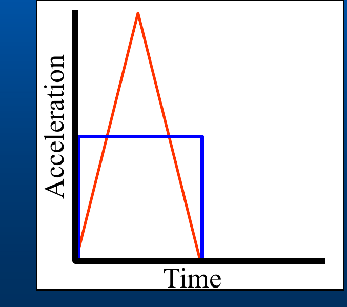

# DyMESH Collision Model

This chapter describes the technical model implemented by DyMESH: the mesh
representation, the contact (Location) and restoration algorithm, the node
force–deflection law, the three-dimensional stiffness, the vertex-displacement
(crush-depth) treatment, restitution, and the coupling to the vehicle equations
of motion. The description follows the *DyMESH Collision Simulation* deck,
updated to match the current version of HVE.

## 1. Mesh representation

Each body is represented by the same **triangular surface mesh** used for its
display: an array of vertices and an array of triangular polygons.

- Each polygon carries its three vertex indices, an earth-fixed outward
  **normal**, an earth-fixed **center**, and its current and original **area**.
- Each vertex carries undamaged and current (damaged) coordinates in both the
  earth-fixed and vehicle-fixed frames, its current deformation vector, its
  accumulated maximum deformation, the force acting on it, and a per-vertex
  **stiffness** set and **saturation crush**.

During a run, one body is designated the **Primary** (P) and the other the
**Secondary** (S). Primary *surfaces* (polygons) are tested against Secondary *nodes*
(vertices): the algorithm finds, for each secondary node, the primary surface it has
penetrated. The roles can be swapped every time step, or multiple times per time
step, so that both bodies accumulate damage.

Because the search over all polygons would be expensive, DyMESH restricts each
test to a **search box** around each secondary vertex, and to precomputed lists of
neighboring surfaces. The neighbor lists are only recomputed every few time
steps, for efficiency. The box size is either computed automatically from the
vehicle extents or set by the user (**Search Option**: Automatic or Set Box
Size).

!!! note "HVE Studio"
    **Search Option** and **Box Size** are in **Event › DyMESH Options**, under
    *Contact Search* (and in the DyMESH section of Event Information › Method
    Options). *Automatic* sizes the box from the mesh's own longest triangle
    edge and ignores the box size. A box that is large for a finely meshed
    vehicle can overflow DyMESH's fixed per-vertex neighbor list, and the run
    then stops before it starts with a message naming the search box;
    *Automatic* avoids that.

!!! warning "Not in HVE Studio"
    HVE lists a third search option, *Search all vertices*. HVE's DyMESH engine
    does not implement it: it rejects the event data and the run stops at
    setup (stop code −5400). HVE Studio compiles the same engine, so the option is
    offered in the DyMESH Options dialog only so that an imported case stating
    it shows what it states, and is marked *(refuses the run)*.

## 2. Contact algorithm

DyMESH uses a contact algorithm similar to that used in explicit, dynamic
finite-element simulation codes. The contact algorithm has **two main
functions**:

1. **Location** — determining mesh inter-penetration (which secondary nodes are
   inside which primary surfaces).
2. **Restoration** — altering the positions of the nodes of the mesh to enforce
   the no-penetration condition.

The sequence over a contact is:

1. The bodies approach one another.
2. **Location phase:** the meshes inter-penetrate; the region of overlap is
   identified.
3. **Restoration phase:** the meshes are adjusted (nodes pushed back to the
   contact surface).
4. Forces are applied due to the deformations; these forces produce
   accelerations that separate the bodies.

*Figure: three-panel contact-algorithm example — (1) bodies approach, (2) Location phase overlap box, (3) Restoration phase adjustment.*

*Figure: force application and separation — deformation forces at overlapping nodes drive the bodies apart.*

### Locating the primary surface for a secondary node

A secondary node is matched to the primary surface it has penetrated. A candidate
contact point is the intersection of a search ray from the secondary node with the
primary triangle; an **inside-polygon test**, using the cross-product method,
confirms the intersection lies within the triangle. The direction of the search
ray can be chosen among several methods — the local average normal, the velocity
direction, the polygon normal, or a specified direction (a vertex-normal method
also exists but is disabled) — and the local search may stop after the first,
best-of-two, or best-of-all candidates. These are exposed on the **Advanced**
tab of the DyMESH Options dialog.

!!! note "HVE Studio"
    These selectors (HVE's Stop Search After, Search Method, Inside-Vehicle
    Test and Inside-Polygon Test) are not offered. HVE passes each to the
    engine, where it is stored in a variable no code reads, so none of them
    changes a result, in HVE's DyMESH source or here. HVE Studio hands the
    engine HVE's own defaults for them.

### Restoration (pushback)

Once a secondary node is found interior to a primary surface, its penetration depth
is the distance from the node to the primary surface along the restoration
direction. The node is restored (pushed back) toward the surface; the amount of
that pushback, accumulated over time, is the node's permanent deformation. To
prevent numerical instabilities, the pushback can be reduced by a limited
amount, and is constrained not to restore across implausible distances.

*(updated: the pushback reduction is only active when DyMESH **Version 4** is
selected. Under Version 3 the reduction is not applied.)*

!!! note "HVE Studio"
    Pushback reduction follows the **DyMESH Version** field in Event › DyMESH
    Options (on only at 4). The *Restoration* section holds one setting,
    **Force contact forces into the XY plane**. HVE's other restoration
    options are not offered, because none changes the restoration in HVE's
    engine either: the pushback direction and "do not restore over a large
    distance" (with its distance) are stored in engine variables that no code
    reads, and "do not restore toward the other / this vehicle's CG" and "do
    not deform a single vertex" are read only by a routine that is commented
    out in its entirety in HVE's DyMESH source. An imported case's values for
    them are not kept.

!!! note "HVE Studio: a wheel is pushed back by its true depth"
    HVE uses one restoration direction for the whole contact pair: the
    area-weighted average of the contacting surfaces' normals. A node is pushed
    along it until it reaches the other surface. Where that direction runs
    *along* the surface a node actually crossed, the push skims the surface
    and books far more crush than the node penetrated. The clearest case is a
    wheel sliding sideways into a curb. The curb's wide top makes the direction
    nearly vertical while the tire crosses the curb's vertical face. A node
    0.57 in through the face was booked 5.1 in of crush, and the face pushed
    the wheel *into* the curb and upward.

    HVE Studio pushes a **wheel** node to the nearest point of the surface it
    is inside, along that surface's normal, whenever the shared direction
    would book more than its true depth (by more than 0.05 in). The wheel mesh
    is convex, so that distance is its penetration. Where the two agree
    nothing changes, and body nodes keep HVE's shared direction, which is
    what stops two crushed bodies locking together. On the curb the face now
    pushes the wheel back out. Running with the environment variable
    `HVE_DYMESH_WHEEL_NEAREST=0` restores HVE's push.

    A wheel contact computed this way depends on the collision timestep: the
    curb-face impulse at a 1 ms step is about 2.4 times its fine-step value.
    For a wheel striking a curb face or another vehicle, use a collision
    timestep in which the wheel closes no more than about 0.05 in per step,
    roughly 0.3 ms at 4 m/s.

!!! note "HVE Studio: a wheel face is pushed no further than the contact is deep"
    The other direction of a wheel contact is a **body** node inside the
    wheel. HVE moves the wheel face that the node's search ray meets, and
    moves it the whole length of the ray. The ray runs along the body's shared
    restoration direction. Where that direction points across the wheel, the
    first face the ray meets is on the wheel's **far** side. On
    CityBlockAccident an Audi node 0.26 in inside the F150's front wheel met a
    face 17.66 in away and moved it 14.6 in in one 3 ms step. The wheel ended
    14.5 in out of shape, scrambled across its own hub.

    HVE Studio checks whether the face the ray met is the wheel's **nearest**
    face to the node. If it is, the ray met it at an angle, and the push along
    the ray is what clears the node, so it is kept. If it is farther than the
    nearest face, the ray crossed the wheel, and the push is cut to the node's
    real depth (its distance to that nearest face). On the same case the
    wheel ends 7.3 in out of shape where HVE's push leaves it 10.8 in, and it
    no longer jumps across its own hub. The run
    status reports **DyMESH wheel push capped at the contact depth**, with the
    wheel and the number of pushes cut. Running with the environment variable
    `HVE_DYMESH_WHEEL_PUSH_UNCAPPED=1` restores HVE's push.

## 3. Node force–deflection law

A central design point is that **any force-deflection relationship can be used**;
the force–deflection behavior is prescribed *a priori* per surface. The standard
$A$ and $B$ crush coefficients prescribe the three-dimensional force-deflection
relationship. **DyMESH Version 3 extends the force-deflection relationship to a
third-order polynomial** by adding $C$ and $D$ coefficients together with a
**saturation deflection** $\delta_\mathrm{sat}$.

The force on a single node is computed as follows. Let $\delta$ be the
node's current total deflection (penetration depth), $A_v$ be the area associated
with the node, and $\delta_0$ be a small **null-band** offset (0.5 in) below
which only the constant term acts. For increasing penetration
($\delta > \delta_\mathrm{max}$) the node force per unit area follows a cubic:

$$
F \;=\; \Big[\, A + B\,(\delta-\delta_0) + C\,(\delta-\delta_0)^2 + D\,(\delta-\delta_0)^3 \,\Big]\, A_v
\qquad (\text{Eq. 1})
$$

where $A$ (constant, lb/in²), $B$ (linear, lb/in³), $C$ (quadratic, lb/in⁴), and
$D$ (cubic, lb/in⁵) are the four per-node stiffnesses. Below the null band the
force is simply $F = A\,A_v$. Once the deflection reaches the node's
**saturation crush** $\delta_\mathrm{sat}$, the force is held at its saturation
value and does not increase further:

$$
F_\mathrm{sat} \;=\; \Big[\, A + B\,(\delta_\mathrm{sat}-\delta_0) + C\,(\delta_\mathrm{sat}-\delta_0)^2 + D\,(\delta_\mathrm{sat}-\delta_0)^3 \,\Big]\, A_v
\qquad (\text{Eq. 2})
$$

*Figure: Force vs. Deflection curve rising then flattening at the saturation deflection $\delta_\mathrm{sat}$.*

The stiffnesses are assigned per body **surface** — front, right, back, left,
top and bottom — so different faces of a vehicle can have different crush
behavior.

## 4. Three-dimensional (per-area) force-deflection

The published crush coefficients ($A$, $B$) are two-dimensional — force per unit
crush **width**. DyMESH needs force per unit crush **area**. The 3-D stiffness
coefficients are obtained by dividing the standard (2-D) coefficients by the
**conversion height** $H$ of the crush region that was used to derive the 2-D
coefficients:

$$
\tilde{A} = \frac{A}{H}, \qquad \tilde{B} = \frac{B}{H}
\qquad (\text{Eq. 3})
$$

Here $A$ has units of force per width (lb/in) and $\tilde{A}$ has units of force
per area (lb/in²); likewise $B$ (lb/in²) becomes $\tilde{B}$ (lb/in³). The
default conversion height is 30 in, matching the **Crush Height For Stiffness**
dialog default.

*Figure: two force-deflection plots — Force per Width (lb/in) vs. Permanent Crush with intercept $A$ and slope $B$; and Force per Area (lb/in²) vs. Permanent Crush with $\tilde{A}$, $\tilde{B}$ and unloading slope $K_u$.*

### 3-D stiffness dialog

The 3-D stiffness dialog lets the user enter $A$, $B$, $C$ and $D$ coefficients
and a **Saturation Crush**, and to "tune" the coefficients using the
**Conversion Height** to arrive at accurate 3-D stiffnesses. The dialog fields
are: $K_v$ (lb/in³, unloading), Constant $A$ (lb/in²), Linear $B$ (lb/in³),
Quadratic $C$ (lb/in⁴), Cubic $D$ (lb/in⁵), Saturation Crush (in), Maximum Crush
(in), and Conversion Height (in, default 30). The user can now define their own
third-order curve fit.

!!! note "HVE Studio"
    HVE Studio has no Vehicle Exterior Stiffness dialog or force-per-area plot.
    The 3-D node stiffnesses are the **3-D Node Stiffness** section of the
    **Crush Stiffness** dialog (Vehicle › Editors › Crush Stiffness...), one
    collapsible block per body zone — Front, Right, Back, Left, Top and
    Undercarriage — each with **Constant**, **Linear**, **Quadratic**,
    **Cubic**, **Conversion Height**, **Saturation Crush** and **Max Crush**
    (the graph's span only: no engine reads it, as in HVE's source).
    There is no $K_v$ field in this section (the four CRASH3 side blocks above
    it carry $A$, $B$ and $K_v$ for the 2-D engines, and DyMESH does not read
    them). The four coefficients and the lengths are shown in the units set in
    Preferences. A zone whose four coefficients are all zero is
    labeled *(no resistance)*: nodes there meet no contact force and the
    bodies pass through each other. The stiffnesses belong to the vehicle and
    are read from HVE vehicle and case files.

### Note on occupant response

The **selection** of stiffness coefficients is important for simulations
involving occupant response: two acceleration pulses (e.g. a tall triangular
pulse and a lower square pulse) can share the same velocity change $\Delta v$ yet
represent very different loading severities for the occupant. Choosing physically
representative stiffness/saturation values therefore matters beyond matching the
gross $\Delta v$.

*Figure: Acceleration vs. Time — a triangular pulse and a rectangular pulse with equal area (equal $\Delta v$).*

## 5. Vertex displacement (crush depth) — sharing crush between bodies

The 1/18 "Crush Depth" update refined how the total penetration is *partitioned*
between the two vehicles so that the **forces on the two bodies are equal and
opposite** (Newton's third law) even when their stiffnesses differ.

Given the primary vehicle stiffness $A_\mathrm{primary}, B_\mathrm{primary}$, the
secondary vehicle stiffness $A_\mathrm{secondary}, B_\mathrm{secondary}$, and the total secondary
vertex displacement $\delta_\mathrm{total}$ (the total penetration — **always
computed using the secondary vehicle**), the force each vehicle *would* carry at the
full penetration is:

$$
F_\mathrm{primary} = A_\mathrm{primary} + B_\mathrm{primary}\,\delta_\mathrm{total}
\qquad (\text{Eq. 4})
$$

$$
F_\mathrm{secondary} = A_\mathrm{secondary} + B_\mathrm{secondary}\,\delta_\mathrm{total}
\qquad (\text{Eq. 5})
$$

To equalize the forces, define the sharing fraction

$$
\theta = \frac{F_\mathrm{primary}}{F_\mathrm{primary} + F_\mathrm{secondary}}
\qquad (\text{Eq. 6})
$$

and assign the secondary vehicle its share of the crush:

$$
\delta_\mathrm{secondary} = \delta_\mathrm{total}\,\theta
\qquad (\text{Eq. 7})
$$

There is no need to compute $\delta_\mathrm{primary}$ separately — the primary's
share is the remainder, $\delta_\mathrm{total}(1-\theta)$. The softer body
receives the larger share of crush, and the contact force is consistent for both
bodies.

*(updated: the primary triangle's effective stiffness used at a contact is the
average of the $A$ and $B$ stiffnesses of its three corner vertices, consistent
with this force-equalization approach.)*

## 6. Restitution (unloading)

After peak penetration the node **unloads** along an unloading branch.
Unloading is governed by a restitution coefficient
$e$: a node only carries force while its current deflection
exceeds $(1-e)\,\delta_\mathrm{max}$, i.e. force goes to zero once the node has
relaxed by the restitution fraction of its maximum deflection:

$$
F = 0 \quad\text{when}\quad \delta \le (1-e)\,\delta_\mathrm{max}
\qquad (\text{Eq. 8})
$$

On the rebound branch the force is evaluated at the **rebound deformation**
$\delta_r = \delta - (1-e)\,\delta_\mathrm{max}$ using the same cubic law as
Eq. 1 (with $\delta_r$ in place of $\delta-\delta_0$), while the stored maximum
deflection $\delta_\mathrm{max}$ is *not* updated. The unloading state of each
node is tracked through a small sequence of states — cannot unload, beginning to
unload, able to unload, now unloading, and finished unloading — governed by
deflection thresholds and by a limit on how much the unloading can grow in a
single time step. A separately stored unloading slope $K_u$ defines the steeper
unloading line (see the $K_u$ line in the force-per-area plot).

DyMESH Version 2 "greatly improved" the restitution model together with the
accelerations and the crush-depth (general damage profile) simulation.

!!! note "HVE Studio: reloading is continuous"
    In HVE a node pushed back in past its sprung-back position $(1-e)\,\delta_\mathrm{max}$
    takes its full threshold force $A \cdot \mathrm{Area}$ at once, and none just
    short of it. HVE Studio reloads it on the same short rise that first loading
    climbs, with damping, so the force is continuous. Two bodies resting against
    each other -- a car on its roof on the ground, or two vehicles wedged together
    after a crash -- otherwise switch that force on and off from one step to the
    next, which adds energy: two cars at rest after a collision could drive each
    other apart at speed. Because reloading also happens during a crash, this
    changes crash results slightly compared with HVE: delta-V by up to about 5%
    on the cases measured, and a contact that HVE's law kept chattering for over a
    second ends in under 0.1 s. Setting the environment variable
    `HVE_DYMESH_RELOAD_VEHICLES=0` restores HVE's law between vehicles.

!!! note "HVE Studio"
    The inter-vehicle restitution DyMESH uses is the **Relaxation Length**. In
    **Event › DyMESH Options** it is set per ordered vehicle pair in the
    *Per-pair override* grid (with **Friction**), and the event-level
    **Friction** and **Relaxation Length** under *Inter-Vehicle Contact
    (fallback)* apply only to a pair that states 0. HVE's own cases fill the
    per-pair values, so on an imported case the fallback values are usually not
    used. HVE's third per-pair value, Restitution Energy, is not offered
    because no engine reads it; an imported case keeps it.

    The **Restitution Model** selector (Unloading slope / Energy / Relaxation
    length) does not reach the contact model in HVE's engine or in HVE Studio: the
    restitution is always taken from the relaxation-length values. Its only
    effect is the row that names it in the printed report.

## 7. Friction

Tangential (frictional) forces at the contact are computed from a material
friction coefficient $\mu$ — the **Inter-vehicle Friction** value for
vehicle-vehicle interactions, and the wheel material's own friction value for
wheels — with a friction null band that suppresses spurious tangential force at
very low relative sliding velocity.

!!! note "HVE Studio"
    The inter-vehicle friction is the per-pair **Friction** in the *Per-pair
    override* grid of **Event › DyMESH Options**, falling back to the
    event-level **Friction** (default 0.55, HVE's own) for a pair that states 0.

## 8. Coupling to the equations of motion

For each interacting pair, DyMESH sums the node forces and moments into a
resultant force and moment on each body's center of gravity: the earth-fixed
node forces are accumulated into a vehicle-fixed summed force and a summed
moment about the CG. These collision forces and moments are then **added
to the vehicle's other external forces** (tires, drag, gravity, suspension) and
the six-degree-of-freedom equations of motion are integrated by the host model
(SIMON) over the collision time step. Because DyMESH is called every collision
time step and the meshes are advanced with the vehicle motion, the collision
force develops continuously through the contact rather than as a single impulse.

!!! note "HVE Studio"
    HVE evaluated DyMESH at two of SIMON's four Runge-Kutta stages and held the
    collision force at the other two. HVE Studio evaluates it at every stage, each
    trial stage from the deformation the step started with, so the force the
    integrator sees is the force at that stage's own position. At the stage that
    commits the step, each vehicle pair is evaluated in both orientations
    (each vehicle as the primary surface once) from the same start-of-step
    state, the two force sums are averaged and each vehicle keeps the crush it
    received as the secondary. The first primary of a pair is the faster vehicle, so
    the vehicle order in the event does not change the answer. The run status
    counts DyMESH's own internal checks, which HVE muted, for example
    `[DyMESH inside test ambiguous (x192)]`: an ambiguous inside-vehicle test,
    a penetrating vertex with no surface found, or a body node pushed past 4 in.
    These are counts of what the contact search could not resolve, not errors
    in the run.

The vehicle orientation used to transform between the vehicle-fixed and
earth-fixed frames is the standard Euler-angle direction-cosine matrix
$A$, built from roll $\phi$, pitch $\theta$, and yaw $\psi$.

---
*Source: DyMESH Collision Simulation (2026 HVE Forum). Updated to match the current version of HVE.*

<!-- NAV -->

---

← Previous: [DyMESH Overview](01-overview.md)  |  [Index](README.md)  |  Next: [DyMESH Version 3](03-version-3.md) →

<!-- /NAV -->
