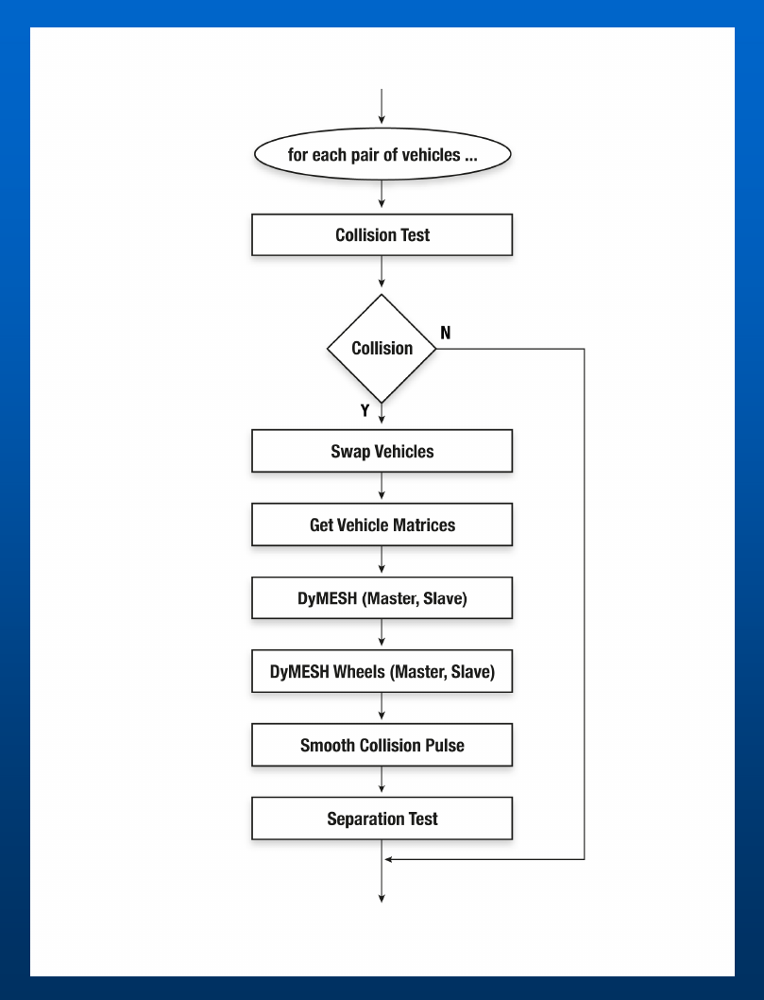
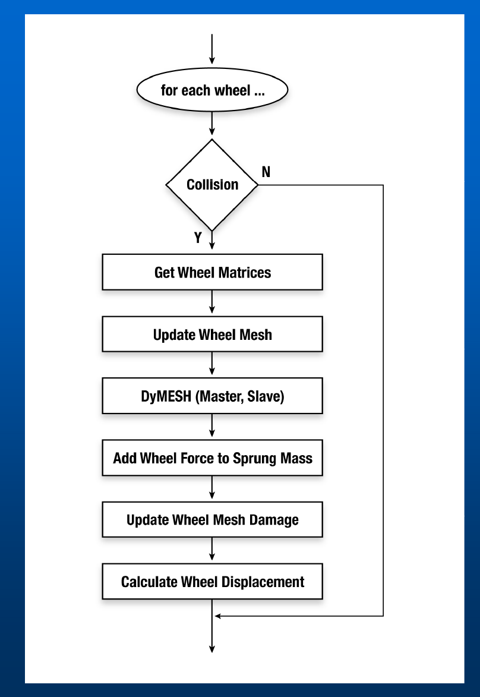
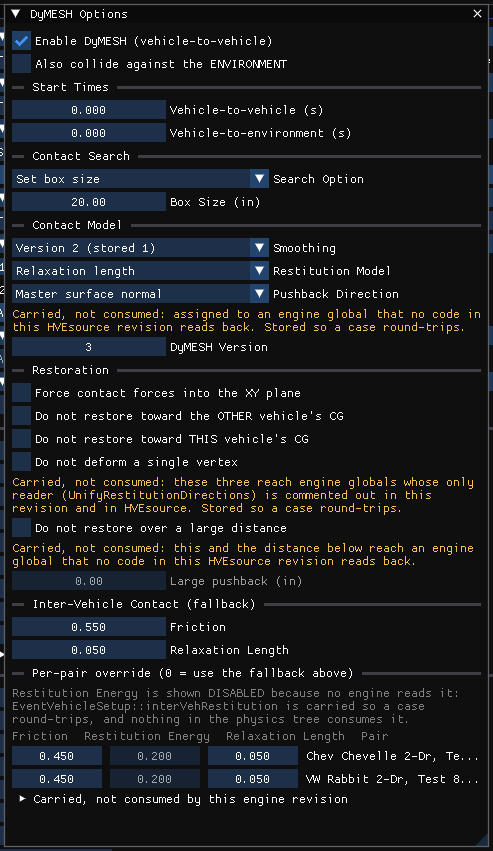
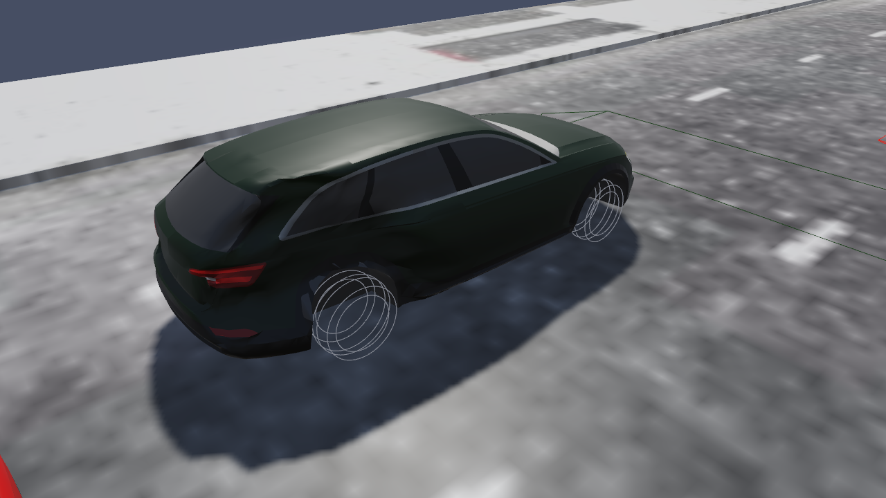
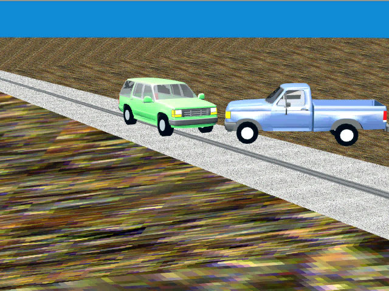
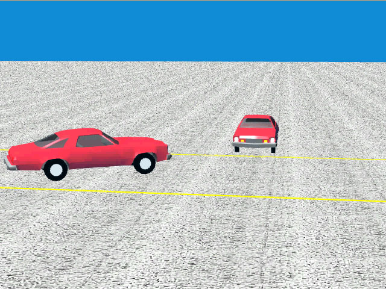
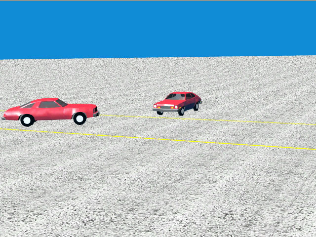

# DyMESH Version 3

DyMESH Version 3 (Engineering Dynamics Company, 2026 HVE Forum) adds a
collision model for the vehicle **wheels** — *DyMESH Wheels* — so that impact
forces and moments developed at the tires/wheels are computed and fed into the
vehicle dynamics. Version 3 also finalizes the user-defined third-order
force-deflection stiffness described in the [Collision Model](02-collision-model.md)
chapter.

## Problem statement

- DyMESH **Version 2** calculated 3-D collision forces and moments **only for
  the sprung mass** (the vehicle body).
- However, **significant collision forces and moments can occur during impact at
  the wheel(s)** — e.g. an angled wheel-to-wheel or wheel-to-body strike.
- **Ignoring these forces affects the collision dynamics** (post-impact heading,
  spin, and trajectory).

## Solution criteria

The wheel collision model had to:

- Calculate forces and moments from the collision at **each individual wheel**.
- Integrate the results **directly into the equations of motion**.
- Be **robust**, accounting for:
  - **Wheel shape** — a round cylinder.
  - **Wheel location / displacement** (the wheel can be moved by the impact).
  - **Wheel steering and camber change.**
  - **Wheel spin** (tangential friction).

## Solution

The wheel model reuses the DyMESH machinery by treating each wheel as its own
DyMESH body:

- **Treat each wheel as an independent DyMESH object.**
- **Create the wheel mesh based on tire size.** A cylindrical wheel mesh is
  built from the tire radius and width, using 80 angular increments. Wheel
  material stiffnesses are set to their own values — $A$ / $B$ of 500 / 100 for
  truck wheels, or 250 / 50 for passenger-car wheels — and a saturation
  deflection tied to the wheel half-width is assigned per vertex.
- **Place transforms in front of and following the DyMESH calculation** to carry
  the wheel's location, steer, camber, and spin into and out of the collision
  computation.
- **The user can select individual wheels for analysis** (for computational
  efficiency — only the wheels expected to be involved need be simulated).

## Flow charts

Version 3 adds a wheel loop nested within the existing sprung-mass collision
loop.

**Sprung Mass loop** — for each pair of vehicles:

1. Collision Test → if no collision, skip.
2. Swap Vehicles (assign Primary / Secondary).
3. Get Vehicle Matrices.
4. **DyMESH (Primary, Secondary)** — the body-to-body collision.
5. **DyMESH Wheels (Primary, Secondary)** — the wheel collisions.
6. Smooth Collision Pulse.
7. Separation Test.

*Figure: Sprung Mass flow chart.*

**Wheel loop** — for each wheel:

1. Collision? → if no, skip.
2. Get Wheel Matrices.
3. Update Wheel Mesh (apply location/steer/camber/spin transform).
4. **DyMESH (Primary, Secondary)** — run the contact algorithm on the wheel mesh.
5. Add Wheel Force to Sprung Mass.
6. Update Wheel Mesh Damage.
7. Calculate Wheel Displacement.

*Figure: Wheels flow chart.*

*(updated: in the current version of HVE these steps are carried out by SIMON,
which updates each wheel mesh, adds the resulting wheel forces to the sprung
mass, updates the wheel-mesh damage, and computes the resulting permanent wheel
displacement.)*

## DyMESH Wheels user interface

The wheel model is driven by three areas of the interface: the **DyMESH
Options**, the per-wheel **Set-up**, and the **Output vs. Time** results.

### DyMESH Options dialog

The DyMESH Options dialog (Options menu) as shown in the deck contains:

- **Use DyMESH** (main switch).
- **Include Environment** — also run DyMESH contact against the environment
  (see [Wheel vs. Environment](05-wheel-environment.md) for the wheel side of
  this feature and the tire-model handoff).
- **Force To x-y Plane** — constrain the collision deformation/force to the
  horizontal plane.
- **Search** — *Automatic* (use the calculated box size) or *Set Box Size* (use
  a user-entered box size, e.g. 20.00 in).
- **Force Smoothing** — *Version 1* or *Version 2*.
- **Timesteps** — *Use DyMESH Time Intervals*, with Vehicle Trajectory (e.g.
  0.0010 s) and Output Time Interval (e.g. 0.0200 s).

!!! note "HVE Studio"
    The dialog is **Event › DyMESH Options**, and its settings belong to the
    active event (they are read-only while that event's results are on screen,
    until Reset). It contains:

    - **Enable DyMESH (vehicle-to-vehicle)** — *Use DyMESH*.
    - **Also collide against the ENVIRONMENT** — *Include Environment*.
    - *Start Times*: **Vehicle-to-vehicle** and **Vehicle-to-environment**, in
      seconds; DyMESH registers no contact of that kind before the time.
    - *Contact Search*: **Search Option** (Automatic box size / Set box size /
      Search all vertices, which refuses the run) and **Box Size**.
    - *Contact Model*: **Smoothing**, **Restitution Model** and **DyMESH
      Version** (1–4; 4 turns pushback reduction on).
    - *Restoration*: **Force contact forces into the XY plane**.
    - *Inter-Vehicle Contact (fallback)* and the *Per-pair override* grid
      (Friction and Relaxation Length for each ordered pair,
      then a *vehicle vs Environment* row for each vehicle: HVE's last slot,
      the vehicle's body against the ground and site).

    **Smoothing** is shown only when a case is not on HVE's *Version 2* (stored
    1), which every new event uses: HVE's labels are one ahead of the stored
    number (*Version 1* is stored 0). The engine detects contact at stored 0
    and 1 only; a case that states 2 (or anything else) would register no
    collision at all, so the solver runs it with 1 and the run status says so.

    HVE's pushback direction, its four restoration checkboxes, the large
    pushback distance, its four search selectors and the struct version are
    not offered: each is handed to the engine and read by no code, in HVE's
    DyMESH source as here, so none changes a result. **Restitution Model** only
    labels the report. **Tow Vehicle / Trailer Contact** is **Contact a vehicle's own
    trailer** in Event Information › Method Options (SIMON Options), off by
    default as in HVE. There is no *Timesteps* group here: the
    **Collision Timestep** is set on the Event Designer's **Run** stage.

*Figure: Event › DyMESH Options in HVE Studio (SimonDyMeshValidSuite3_8, Test 8 / RICSAC 6).*

*(updated: The current DyMESH Options dialog differs from the deck screenshot.
The General area now also carries a **DyMESH Version No** selector — radio
buttons **Version 3** and **Version 4** — a **Tow Vehicle / Trailer Contact**
checkbox, and separate **DyMESH start time** and
**Environment start time** fields. The **Force Smoothing** radio labels have been
renamed to "**Version 1 and 2**" and "**Version 3 and Later**". The stand-alone
**Timesteps** group shown in the deck is no longer present in the current
dialog. An **Advanced** tab exposes the low-level search controls — Stop After
one/two/all vertices, inside-vehicle test (primary normal vs. CG), inside-polygon
test (sub-areas vs. cross product), pushback method, "don't deform a single
vertex", and "don't restore a large distance".)*

### Set-up (Wheels)

Each wheel is configured on the **Damage** tab of the Wheel Data dialog: Axle
No., Side (Left / Right), *Wheel is Damaged*, *Auto Start*, Start Time, Duration
(e.g. 0.1 s), and Peak Lock-up Torque. A **Use DyMESH** section supplies the
wheel force-deflection and moment-deflection parameters:

| Parameter | Example | Meaning |
|-----------|---------|---------|
| Max No-Damage Force | 3000 lb | Force threshold below which the wheel is not permanently displaced |
| Displacement Rate | 300 lb/in | Force per unit wheel displacement (stiffness) |
| Max Force | 30000 lb | Saturation force |
| Max No-Damage Moment | 3000 ft-lb | Moment threshold below which no permanent reorientation |
| Moment Displacement Rate | 300 ft-lb/deg | Moment per unit angular change |
| Max Moment | 30000 ft-lb | Saturation moment |

!!! note "HVE Studio"
    The set-up is the **Wheel Damage** tab of **Event › Wheels**, a table with
    one column per wheel (A1-R, A1-L, A2-R, …) and wheel groups so one edit can
    set several wheels. HVE's fields map as follows: *Wheel is Damaged* →
    **Displaced / damaged**; *Auto Start* → **Start at first contact**; *Start
    Time* → **Damage time (s)**; *Duration* → **Displacement time (s)**; *Peak
    Lock-up Torque* → **Lock-up (fraction of peak brake torque)** (a fraction,
    1.0 = fully locked). The DyMESH rows are **Use DyMESH (wheel contact
    mesh)**, **...also contact the environment**, **Max no-damage force**,
    **Displacement rate (force)**, **Max force**, **Max no-damage moment**,
    **Moment displacement rate** and **Max moment**, in the units set in
    Preferences. The DyMESH rows are enabled once the wheel is marked
    displaced. If a wheel asks for a DyMESH mesh while DyMESH is off for the
    event, the tab says the wheel-mesh block is ignored.

    **Displacement rate (force)** is editable on every wheel, not only on those
    that use a DyMESH mesh, because the engine uses it for every wheel contact
    mesh: in HVE's DyMESH source (and so in HVE Studio) the stiffness of the two
    outer rings of whichever wheel is in contact is re-read each step from the
    first wheel mesh built in the event — the first vehicle's front-right
    wheel. On a DyMESH event the tab states this. HVE's default for the rate is
    derived from vehicle weight.

See also the wheel-data / wheel-displacement inputs documented in the
[Wheel Data dialog reference](../../05-tires-wheels/WheelsDlg1.md).

### Output vs. time

The Key Results output reports, per wheel, the collision impulses and moments in
addition to the usual kinematics and kinetics — e.g. for "Axle 1, Right":
**Fx Imp**, **Fy Imp**, **Fz Imp** (lb) and **Mx Imp**, **My Imp**, **Mz Imp**
(ft-lb), alongside the whole-vehicle (Kinetics) impulses. This lets the user see how much
of the collision load each wheel carried.

!!! note "HVE Studio"
    HVE Studio does not report per-wheel collision impulses. The per-wheel DyMESH
    forces and moments are output channels of each wheel, which Variable
    Selection adds to Key Results or the Output Graph:
    **Wheel
    Impact Fx / Wheel Ctr Fx**, **Wheel Impact Fy / Wheel Ctr Fy**, **Wheel
    Impact Fz / Wheel Ctr Fz**, **Wheel Impact Mx'**, **Wheel Impact My' /
    Steer Axis Mz' Total** and **Wheel Impact Mz'+Sidewall / Steer Axis Mz'
    Patch**. Each name carries both readings because other engines write a
    different quantity to the same slot; on a SIMON event the *Wheel Impact*
    reading applies. These are time histories of force and moment, not
    impulses. After a run, the **Mesh** box of the **DyMESH Wheel** row (**View › Scene
    Display**, Vehicle group) draws each wheel's
    contact mesh, deformed by the run, with crushed vertices in red.

*Figure: View › Scene Display, DyMESH Wheel › Mesh, after a run of the CityBlockAccident T-bone case: the ring-shaped wheel contact meshes are drawn at each wheel of the struck Audi.*

## Wheel displacement capping *(updated)*

*(updated: the current version of HVE adds a refinement not present in the 2026
decks. During each timestep the wheel-mesh damage update tracks the largest
actual movement of any wheel-mesh vertex while in contact — the magnitude of the
damaged-minus-undamaged vertex displacement, referred to below as the maximum
wheel-mesh contact movement for that timestep. The permanent wheel displacement
is then **capped by that physical contact motion**. The displacement derived
from the collision force,*

$$
\delta_{Wheel} = \frac{F_{Total} - F_{Const}}{F_{Linear}}
$$

*where $F_{Total}$ is the collision force on the wheel and $F_{Const}$ and
$F_{Linear}$ are the constant (no-damage) force threshold and the linear
force-per-displacement rate from the wheel's damage data, is limited to no more
than the maximum wheel-mesh contact movement, and the
per-time-step change in the x/y wheel displacement is likewise scaled so it
cannot exceed that movement. This prevents the wheel from being "bent" further
than the collision physically moved it.)*

## Validation

Validation is described as under way, starting from the initial conceptual
design (see the Dial Engineering white-paper presentation at the 2012 HVE Forum),
covering vehicle-to-vehicle collisions and other configurations.

## Examples

The deck shows the wheel model applied to: an **intersection collision**, a
**truck tractor**, a **trailer under-ride**, and (memorably) **monster trucks**.
The main technical deck additionally shows angled collisions — a Ford
pickup vs. Explorer on a graded road, and the RICSAC 1 (20 mph) and RICSAC 2
(32 mph) staged tests — as sample DyMESH validations.

*Figure: Angled collision, Ford pickup vs. Explorer.*

*Figure: RICSAC 1 (20 mph) angled collision.*

*Figure: RICSAC 2 (32 mph) angled collision.*

## Summary

- **DyMESH Wheel Impact is robust.**
- **Clean integration into the existing vehicle dynamics model (SIMON).**
- **More validation is needed.**
- **Initially released as a Beta option, now included in the commercial
  release.**

---
*Source: DyMESH Version 3 (2026 HVE Forum). Updated to match the current version of HVE.*

<!-- NAV -->

---

← Previous: [DyMESH Collision Model](02-collision-model.md)  |  [Index](README.md)  |  Next: [DyMESH — Facts of Life](04-facts-of-life.md) →

<!-- /NAV -->
