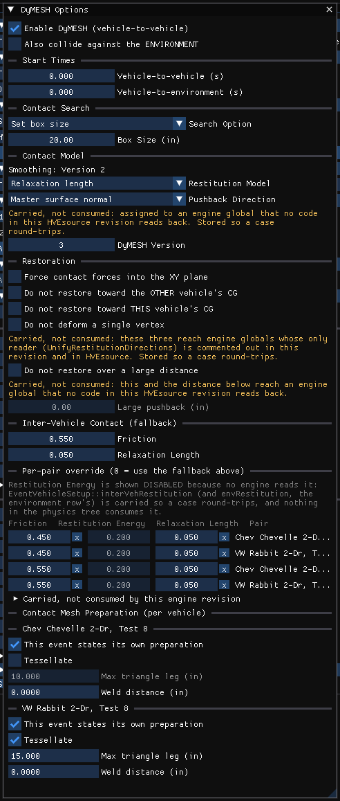

# DyMESH — Facts of Life

Practical guidance, caveats, and limitations for users of DyMESH, drawn from the
EDC *DyMESH — Important Notes* presentation (2026 HVE Forum). These are the
things to keep in mind before, during, and after a DyMESH run.

## 1. You are doing 3-D collision simulation

When using DyMESH, you're doing three-dimensional collision simulation. This is
technically a very difficult task. **Don't expect it to be simple.** Setting up a
credible DyMESH case takes care with geometry, stiffness, and impact
configuration.

## 2. DyMESH will not work on every crash

DyMESH is a powerful general-purpose tool, but **it is not going to work on every
crash.** Some impact configurations, geometries, or data quality problems will
not yield a good simulation. Be prepared to fall back to other methods when a
case is unsuitable.

## 3. Computer horsepower matters

**Computer horsepower means everything to DyMESH.** The contact search and
force computation run every collision time step over the vehicle meshes, so CPU
speed and memory directly determine how quickly (and how finely) a case can be
run.

## 4. Be patient during a run

**Be patient.** HVE is *resting* in between integration time steps while DyMESH
is executing, so quickly punching a bunch of buttons during a run may result in
unexpected behavior. Let the run proceed rather than clicking through the
interface while DyMESH is working.

!!! note "HVE Studio"
    Progress is shown on the Event Designer's **Run** stage. While a run is under way
    the inputs are locked, so a click cannot change the case the solver is
    reading. After the run they are editable again, and an edit marks the
    results out of date until the event is run again.

## 5. No induced damage

**Induced damage is not included.** No damage will be displayed unless one or
more vertices on one vehicle were *actually in contact* with the other vehicle.
DyMESH represents only direct-contact (direct) damage — it does not model the
secondary/induced structural deformation that propagates away from the contact
region. (This is the same limitation noted in the technical overview: "local
behavior of structure not captured in all cases; no induced damage.")

*(updated: this is consistent with how the damage profile is built — a vertex
only enters the damage profile once it has been marked as damaged, which happens
only after it has penetrated a primary surface and been restored.)*

!!! note "HVE Studio: how crush is shared in a side impact"
    Each face of a vehicle (front, sides, back, top, undercarriage) has one stiffness over its whole height and
    length. A real side is not like that: the sill and the base of the B-pillar are far stiffer than the door between
    them. Measured against 162 NHTSA FMVSS 214 side tests, with each struck side's stiffness fitted to its test, the
    closing between the two vehicles, both delta-Vs, the struck car's yaw and the shape of its crush profile come out
    right, but **the crush is shared wrongly**: the struck car keeps about 6 in more crush than the test, and the
    barrier about 5 in less. The barrier's stiff lower bumper element meets the real car's sill and crushes; here it
    meets the soft side and the car crushes instead.

    In practice: when a stiff, low striking structure (a barrier's bumper, a truck's bumper or frame, a car's rails)
    hits a side, expect the struck side's crush to be over-stated. Matching the struck car's measured crush by stiffening
    its side will then put the delta-V and the closing off. Fit to the delta-V or the closing, and read the side crush
    with this in mind. Two vehicles meeting front to front have a related limit: the delta-Vs are good, but how the
    crush divides between the two fronts is not reliably predicted.

## 6. Mesh quality is a factor

The quality of the vehicle mesh directly affects the result:

- **Poorly tessellated meshes do not work well.** The contact algorithm relies
  on reasonably uniform, well-formed triangles.
- **Early EDC meshes do not meet all criteria**, especially on the **bottom** of
  the vehicle.
- **Use the *Tessellation* option** to improve a mesh before running DyMESH.

*(updated: The Tessellation / "Vehicle Mesh Options" controls in the current code
include a *Tessellate* toggle, a *Vertex Weld Distance*, and a *Max Side Length*
— these are the levers referred to here for cleaning up a mesh.)*

!!! note "HVE Studio"
    The controls are **Tessellate**, **Max triangle leg** and **Weld
    distance**. The vehicle's defaults are on the **Collision** tab of
    **Vehicle › Editors › Vehicle Mesh** (section *DyMESH Contact Mesh Preparation*); an
    event's own are in **Event › DyMESH Options**, section *Contact Mesh
    Preparation (per vehicle)*.
    The mesh is subdivided until no triangle leg exceeds the maximum. The
    weld distance is shown grayed: HVE stores it and its physics never reads
    it, and neither does HVE Studio, so the collision mesh keeps the file's
    own vertices.

    As in HVE, preparation is stored **per event per vehicle**. In Event ›
    DyMESH Options, tick **This event states its own preparation** under a
    vehicle to give the active event its own values; otherwise the event uses
    the vehicle's values (*Tessellate (vehicle default)* and the two fields
    under it, on the Vehicle Mesh window's Collision tab). Where both exist the event's values
    are the ones the solver uses. An imported HVE case carries its own per-event
    settings; EDC's DyMESH validation cases ask for a 20 in leg and a 0.2 in
    weld.

    **Advanced Mesh Options**, under each vehicle in the same section, are
    HVE's: **Super-Tessellation** splits every edge that passes within
    **Radius** of the point (**Center X**, **Center Y**), measured from above,
    down to **Max Side Length**. Use it to resolve one region finely, such as the
    corner of a trailer that strikes, without tessellating the whole body. It
    refines a mesh that is tessellated, so **Tessellate** must be on.
    **Culling** limits the contact to a vertical column: a face whose corners
    are all outside the cull **Radius** is not subdivided, and a vertex outside
    it is not a DyMESH contact node. The centers are in the mesh file's frame
    (+X forward, +Y right), as HVE stores them. An imported HVE case brings its
    own values for each event vehicle.

    This is physics, not display: it changes how finely contact is resolved and
    how much area each node carries, so it can change the answer. The *Damage
    Display* section on the Vehicle Mesh window's Display tab (**Smooth crush
    deformation**, **Smoothing passes**) only changes how the crushed mesh is
    drawn.

*Figure: Event › DyMESH Options in HVE Studio, with the event's own Contact Mesh Preparation for each vehicle at the bottom.*

## 7. Generic vehicles must be tessellated

**Generic Vehicles' meshes *must* be tessellated** before use with DyMESH. Their
as-delivered meshes are not suitable for the contact algorithm without
tessellation.

!!! note "HVE Studio"
    A vehicle with no mesh file is collided as its generic body (a shape
    profiled from the vehicle's type and dimensions): HVE's own for a vehicle
    imported from an HVE case, as HVE does, and a modern body otherwise -- for a
    car or SUV you add, a Kiln model resized to the vehicle; it is collided as
    the model is built, in pieces (body, greenhouse, lamps, mirrors), as a real
    vehicle file is (**Generic Body** in the Vehicles panel's 3D Geometry section). When DyMESH is
    on, the run status says how many vehicles collided that way, because the
    crush and PDOF then describe that generic shape rather than the real
    vehicle. A mesh file that is named but fails to load is reported in the
    Vehicle Mesh window (File & Placement tab), and that vehicle is then collided as a generated body as well.

---
*Source: DyMESH Important Notes (2026 HVE Forum). Updated to match the current version of HVE.*

<!-- NAV -->

---

← Previous: [DyMESH Version 3](03-version-3.md)  |  [Index](README.md)  |  Next: [DyMESH Wheel vs. Environment](05-wheel-environment.md) →

<!-- /NAV -->
