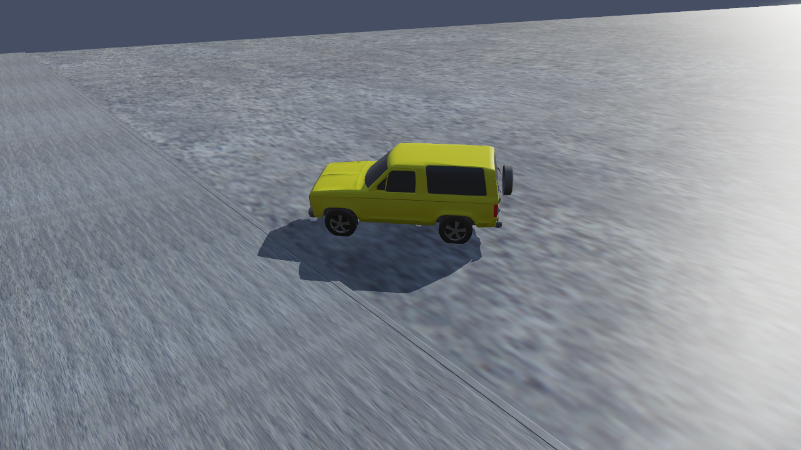

# Chapter 1 — EDVSM Program Description

## Overview

EDVSM (**E**ngineering **D**ynamics Corporation **V**ehicle **S**imulation **M**odel) is a 3-dimensional analysis of the response of a unit vehicle to a driver's inputs (steering, throttle, brakes, gear selection). EDVSM is based on the HVOSM model developed at Calspan [1,2,3]. The original HVOSM model was developed in two versions: The Roadside Design version (RD2) was developed for studying vehicle interactions with the roadside environment, while the Vehicle Dynamics version (VD2) was developed for studying vehicle response to driver inputs. EDVSM was derived from the VD2 version of HVOSM, and includes several extensions and refinements provided by Engineering Dynamics Corporation [4].

EDVSM computes vehicle kinematics (position, velocity and acceleration vs time), from forces defined at the tire-road interface, as well as from aerodynamics. EDVSM is useful for predicting and visualizing a vehicle's response to driver's inputs, as well as to study the effects of various design parameters on vehicle behavior.

The EDVSM vehicle model is *fully* three-dimensional. It includes six degrees of freedom for the sprung mass. It also includes degrees of freedom for both independent and solid axle suspension types. A wheel spin degree of freedom is also included for each wheel, and a steer degree of freedom exists for the steering system. Refer to the [Calculation Method](04-calculation-method.md) chapter of this manual for a detailed description of the simulation model.

*Figure 1-1: An EDVSM event in HVE Studio: the tutorial's Ford Bronco II reaching the curb.*

EDVSM includes detailed models of braking systems to allow the study of vehicle brake system characteristics on vehicle behavior during severe driving maneuvers, such as that which might occur during accident avoidance. EDVSM also has a detailed drivetrain model that includes an engine, transmission and differential. The drivetrain model may be used for detailed studies of a vehicle's response to throttle inputs and gear selection.

## Model Inputs

EDVSM inputs include one vehicle and an optional environment. Event set-up parameters include vehicle initial position and velocity, and various driver control options (steering, braking, throttle and gear selection).

## Model Outputs

EDVSM output reports include Messages, Accident History, Vehicle Data, Program Control Data, Variable Output and Trajectory Simulations. The Variable Output groups include vehicle kinematics, tire forces, radius and longitudinal and lateral slip, wheel position, suspension deflection and forces, engine power, torque and RPM, transmission and differential ratios, and driver steering, throttle, brakes and gear selection inputs.

## Validation

EDVSM was validated first by direct comparison with HVOSM to ensure the basic model was intact after porting the original FORTRAN code to C and making the model HVE-compatible. Additional validation was performed comparing EDVSM results to other models as well as direct comparison with controlled handling maneuvers. Validation results are reported in references 3 and 4.

## Basic Procedure

The procedure for using EDVSM in HVE Studio is the same as for any simulation program:

- In the **Vehicle** editor (F3), add the vehicle to the case (**Add…** in the Vehicles panel opens the vehicle database). Optionally, edit any of its parameters through the **Vehicle** menu.
- Optionally, in the **Environment** editor (F4), load or build a visual and physical environment.
- In the **Event** editor (F5), set up the EDVSM event in the **Event Information** panel:
  - Add one vehicle to the event.
  - Choose **EDVSM** as the **Method**.
  - Position the vehicle (drag it in the viewport, or type the values under *Vehicle Initial Conditions*) and give it an initial velocity.
  - Assign driver controls (**Event › Driver Controls**: Throttle, Brake, Steer and Gear tables).
- Press **Run** on the playback bar under the viewport (or **Output › Run Simulation**).
- Modify the inputs as required to achieve the desired match between the simulation and the actual event. A solved event is locked against editing until you press **Reset**.
- Review the results in the same viewport and through the **Output** menu (HVE Reports, Key Results, Output Graph). If desired, record a video with **File › Record Animation**.

<!-- NAV -->

---

← Previous: [EDVSM — Engineering Dynamics Corporation Vehicle Simulation Model](README.md)  |  [Index](README.md)  |  Next: [Chapter 2 — EDVSM Program Input](02-program-input.md) →

<!-- /NAV -->
