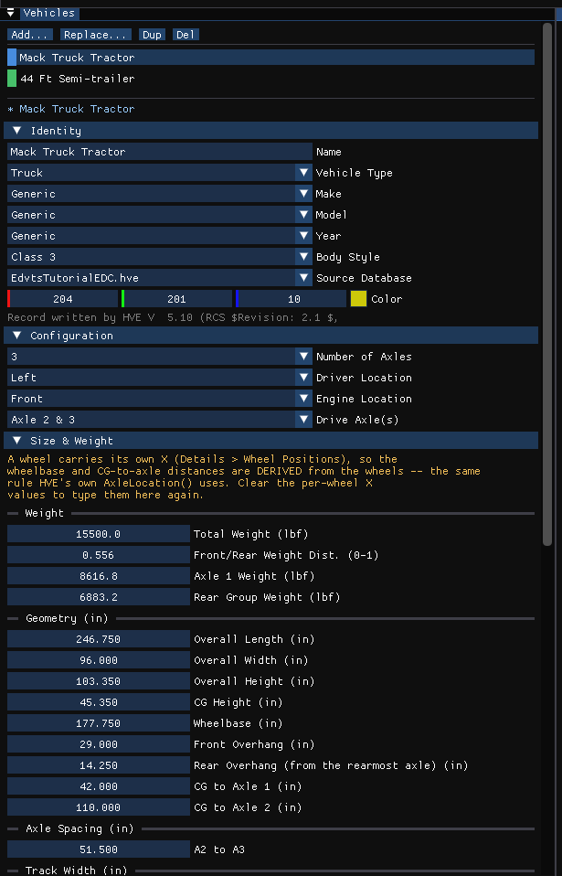
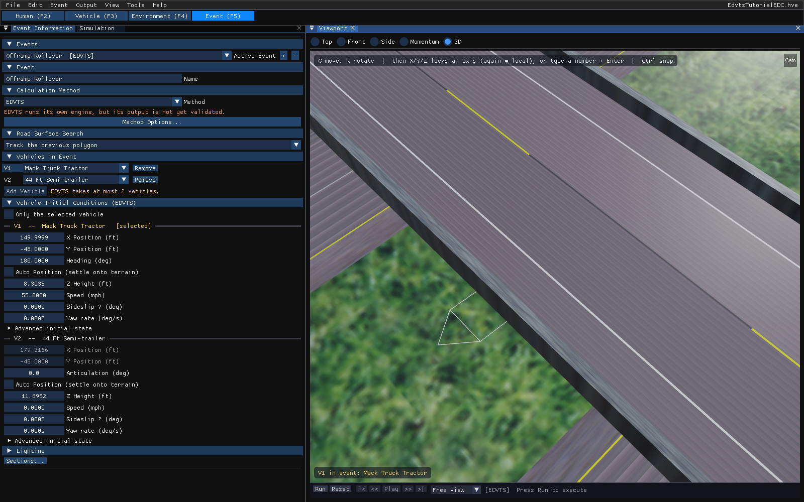

# Chapter 5 — EDVTS Tutorial

This tutorial examines a common use for EDVTS: the simulation analysis of a tractor-trailer off-ramp rollover accident. The purpose of the analysis is to determine if the rollover was the result of excessive speed or an abnormal loading condition (in this case, the payload CG was rather high).

We approach the analysis by first determining the CG location of the payload, then estimating the CG elevation of the combined vehicle and payload. This information is critical, because CG elevation is the primary independent variable we wish to hold constant while trying various speeds to estimate the *maximum* speed at which the offramp can be successfully negotiated. Once this speed is found, we can compare it to the posted off-ramp speed. If the speed is *less* than the posted speed, we conclude the vehicle was improperly loaded or the posted speed was too high (the latter conclusion would require further supporting analysis); otherwise, we can conclude the driver was speeding.

Like all EDVTS events, the procedure involves the following basic steps:

- Create the vehicles
- Create the environment
- Execute the EDVTS event(s)
- Review the EDVTS output reports

This basic procedure is described in detail in this tutorial.

> NOTE: It is assumed that HVE Studio is up and running, and that the user is familiar with its basic features: the editor tabs under the menu bar, the docked panels and the viewport. The purpose of this tutorial is to illustrate those features while setting up and executing an EDVTS event.

!!! note "HVE Studio"
    This chapter has been rewritten for HVE Studio around EDC's own finished tutorial case, `EdvtsTutorialEDC.hve`, which HVE Studio opens directly. One thing in the original walkthrough cannot be repeated from scratch in HVE Studio: the off-ramp site geometry is stored only inside the case file. So the tutorial opens the finished case and goes through each step of the original — what it sets, and where that setting is in HVE Studio — before running the event and reviewing the results. Where the printed walkthrough and the saved case disagree, the case is followed.

## Getting Started

Open the tutorial case:

- Choose **File › Open Case…** and open `EdvtsTutorialEDC.hve` from the `supportfiles\case` folder of your HVE installation. HVE Studio reads HVE's `.hve` case files directly; saving writes HVE Studio's own `.hvex` or `.json` format, never `.hve`.

The original tutorial set a list of user options before starting. In HVE Studio:

- **Units** — **Tools › Preferences** (U.S. or SI). This chapter quotes U.S. units, as the original does.
- **AutoPosition** — a per-vehicle checkbox, **Auto Position (settle onto terrain)**, in each vehicle's initial conditions in the Event editor.
- **Key Results** — **Output › Key Results…** (or **View**).
- **Skidmarks, velocity vectors, rendering options** — **View › Scene Display › Skidmarks**, **View › Scene Display › Vectors**, **View › Scene Display › Rendering**.

## Creating the Vehicles

The tow vehicle is a chrome-yellow Mack truck tractor; the trailer is a 44 foot-long van trailer. In the finished case both are present: choose the **Vehicle (F3)** editor tab, and the **Vehicles** panel lists *Mack Truck Tractor* and *44 Ft Semi-trailer* (Figure 5-1). Click a name to select that vehicle.


*Figure 5-1: The tutorial's vehicles in the HVE Studio Vehicles panel, with the Mack Truck Tractor selected. Its rear axles (CG to Axle 2 = 110 in) already carry the walkthrough's edits.*

To build them yourself, use **Add…** on the **Vehicles** panel; the picker offers HVE's Generic vehicles by type and class. The tractor starts from a Generic *Truck*, Class 3 (short wheelbase, tandem axle), and the trailer from a Generic *Trailer*, Class 4. Rename each in the **Name** field of the panel's **Identity** section.

> NOTE: A 'tractor' is a 'truck' with a fifth wheel; there is no need for a separate 'tractor' vehicle type.

### Editing the Vehicles

The original walkthrough makes the following edits. Each is already in the finished case; this is where to find it in HVE Studio.

- **Color** — the **Color** field in the **Vehicles** panel's **Identity** section.
- **Rear axle positions** — the tractor's third axle moved to x = -161.50 in and its second to x = -110.00 in. Wheel positions are in the panel's **Size & Weight › Wheel Positions (from CG)**.
- **Fifth wheel** — the tractor's rear connection moved to x = -135.75 in, z = -4 in. Connections are edited with **Components › Connections…** in the **Vehicles** panel; the dialog shows the connection's height above ground, which must match the trailer's kingpin to within 0.1 in.
- **Geometry files** — `TKMackTractor.h3d` for the tractor and `TLGeneric44Van.h3d` for the trailer, in the panel's **3D Geometry** section (**Mesh File**: **...** or **Library...**) or on the File & Placement tab of **Vehicle › Editors › Vehicle Mesh…**, then **Load 3D File** there. HVE Studio opens `.h3d` files directly; the geometry is used for display only.

## Creating the Environment

The environment is a freeway off-ramp (*Freeway Offramp, Exit 342*, Denver, Colorado). Choose the **Environment (F4)** editor tab to see it, and **Environment › Environment…** for its location, date, time and physical data.

> NOTE: The off-ramp geometry is stored inside the tutorial case; there is no separate `FreewayOfframp.h3d` file to open. A case you save carries its site in the same way (**File › Embed the environment in the case**, on by default).

*Figures 5-8 and 5-9 of the printed manual (the HVE-2D and HVE environments) are not reproduced.*

## Saving the Case

Choose **File › Save Case As…** to save your working copy as an HVE Studio case (`.hvex`), or **File › Save Case As JSON…** for the text format. HVE Studio does not write `.hve` files, so the original is left unchanged.

## Creating the Event

The event simulates a tractor-trailer leaving the freeway onto the off-ramp, to determine whether the ramp is negotiable at the posted speed. Choose the **Event (F5)** editor tab (Figure 5-2).


*Figure 5-2: The tutorial event in the HVE Studio Event editor. The trailer's position (V2) is grayed because it is derived from the tractor and the hitch; only its Articulation is entered.*

In the **Event Information** panel:

- **Events** — the case's one event, *Offramp Rollover [EDVTS]*.
- **Calculation Method** — **EDVTS**.
- **Vehicles in Event** — V1 *Mack Truck Tractor*, V2 *44 Ft Semi-trailer*.

> NOTE: To create such an event yourself, click **+** beside **Active Event**, choose **EDVTS**, and use **Add Vehicle** for the tractor and then the trailer.

### Initial position and velocity

In **Vehicle Initial Conditions** the tractor (V1) starts at:

- X Position `150.0` ft, Y Position `-48.0` ft, Heading `180.0` deg
- Speed `55.0` mph

and the trailer (V2) at an **Articulation** of `0.0` deg — in line with the tractor. HVE Studio computes the trailer's X and Y from the tractor and the hitch and draws it there.

To move the rig, either type the values, or select the tractor in the viewport and press **G** (move) or **R** (rotate); the trailer follows.

### Driver controls

Choose **Event › Driver Controls…** (Ctrl+D) with the tractor selected in the dialog's **Vehicle** list.

**Table 5-1: Steer table entries for the Mack Truck Tractor** (Steer tab, steering-wheel angle)

| Time (sec) | Steer Angle at Steering Wheel (degrees) |
|---|---|
| 0.00 | 10.0 |
| 2.00 | 10.0 |
| 4.00 | 9.0 |
| 5.50 | 0.0 |
| 6.00 | 180.0 |
| 8.00 | 270.0 |

> NOTE: Note the simplicity of the steer table. The steering angle changes gradually, just like it does when you are really driving! Complex driver tables containing several rows of slightly-changing steer angles are usually a bad sign.

On the **Brake** tab, the **Input Method** is *% of Friction*:

**Table 5-2: Brake table for Mack Truck Tractor**

| Time (sec) | Axle 1 Right | Axle 1 Left | Axle 2 Right | Axle 2 Left | Axle 3 Right | Axle 3 Left |
|---|---|---|---|---|---|---|
| 2.00 | 0.00 | 0.00 | 0.00 | 0.00 | 0.00 | 0.00 |
| 2.10 | 0.01 | 0.01 | 0.15 | 0.15 | 0.15 | 0.15 |
| 5.00 | 0.01 | 0.01 | 0.15 | 0.15 | 0.15 | 0.15 |
| 5.10 | 0.25 | 0.25 | 0.25 | 0.25 | 0.25 | 0.25 |

*(Values are Percent Available Friction, %/100.)*

This table causes the vehicle to begin coasting when the vehicle leaves the freeway at 2 seconds. Moderate braking begins at 5 seconds, just as the vehicle enters the turn.

Choose *44 Ft Semi-trailer* in the dialog's **Vehicle** list for the trailer's brake table, again *% of Friction*:

**Table 5-3: Brake Table for the 44 Ft Semi-trailer**

| Time (sec) | Axle 1 Right | Axle 1 Left | Axle 2 Right | Axle 2 Left |
|---|---|---|---|---|
| 2.00 | 0.00 | 0.00 | 0.00 | 0.00 |
| 2.10 | 0.01 | 0.01 | 0.01 | 0.01 |
| 5.00 | 0.01 | 0.01 | 0.01 | 0.01 |
| 5.10 | 0.25 | 0.25 | 0.25 | 0.25 |

*(Values are Percent Available Friction, %/100.)*

> NOTE: In HVE Studio the Driver Controls dialog offers all four tabs for the trailer; EDVTS uses only its brake table.

### Payload

The trailer carries a 40 000 lb payload whose CG is 30 in above the unloaded trailer CG (z = -30.0 in), with a yaw moment of inertia of 3 360 000 lb-sec²-in.

!!! note "HVE Studio"
    The tutorial case's payload is imported from the `.hve` file and is used by the run; view or edit it with **Event › Payload…** (select the trailer in its **Vehicle** list). EDVTS refuses a payload on the tow vehicle.

### Roll couple distribution

The original tutorial sets the Roll Couple Distribution to `0.2`, a value representative of a heavy truck. In HVE Studio it is the **Roll Couple Dist** row, front axle, of **Vehicle › Editors › Suspension Data…** with the tractor selected. The case already has it: the Vehicle Data report prints *Lateral Load Xfer : 0.20*.

### Simulation controls

The event lasts more than 5 seconds, so its maximum simulation time is 20 seconds: **Duration** on the **Run** stage of the **Event Designer** (**Event › Event Designer...**).

### Key Results

To watch the vertical tire loads while the event runs, open **Output › Key Results…** and click **Select Variables…**. In the **Select Output Variables** dialog, search for the tire Fz' variables and tick them for the tractor's three axles and the trailer's two.

## Executing the Event

- Click **Run** on the playback bar under the viewport (or **Output › Run Simulation…**, Ctrl+R). Allow the event to run until completion.

The EDVTS event terminates at time t = 5.29 seconds, because the roll or pitch angle exceeded 15 degrees. The run status on the playback bar says that the run stopped early and quotes the message.

!!! note "HVE Studio"
    The printed tutorial reports a termination at t = 7.56 s when the trailer's right front wheel lifts. The case EDC ships stops at t = 5.29 s with the roll-or-pitch message instead, and the run HVE saved in that same file does the same: HVE Studio reproduces HVE's saved trajectory for this case. The difference is between the printed walkthrough and the case file, not between the two programs.

## Viewing Results

EDVTS produces the following reports:

- **Accident History** — A table of initial and final positions and velocities
- **Messages** — A list of messages produced by the current run
- **Program Data** — A table containing program control information
- **Trajectory Simulation** — A visualization of the event, displayed at a user-selectable time interval
- **Variable Output** — A table containing time-dependent simulation results
- **Vehicle Data** — A series of tables containing the vehicle data used by EDVTS

In HVE Studio there is no Report Window Information dialog. The reports are on the **Output** menu of the Event editor and the Playback editor (F6) as soon as the event has been run: **Output › HVE Reports…** shows the pages EDVTS builds (one tab each); **Output › Key Results…** and **Output Graph…** show the Variable Output; and the viewport is the Trajectory Simulation.

### Accident History

The Accident History report displays the time and total distance traveled, as well as position and velocity at the start and end of the run. Choose the **ACCIDENT HISTORY** tab of **Output › HVE Reports…**:

```text
                                    ACCIDENT HISTORY

Total Distance Travelled :   417.39
Time :                       5.2900

                    Position                            Velocity
            ------------------------       -----------------------------------
                X        Y      PSI    V-tot    u-vel    v-vel    Yaw Vel
             (ft)     (ft)    (deg)    (mph)    (mph)    (mph)  (deg/sec)
Initial:   152.66   -47.97   180.00    55.00    55.00     0.00       0.00
Final:    -261.24   -91.85   196.44    50.53    50.52    -1.06       5.15
```
*Figure 5-3: Accident History page for EDVTS, Offramp Rollover, as HVE Studio shows it (U.S. units).*

### Messages

EDVTS produces a number of messages, depending on the outcome of the event. For a complete list and explanation of these messages, see [Chapter 6](06-messages.md). Choose the **MESSAGES** tab:

```text
                            MESSAGES

The simulation was terminated because the current roll or pitch
angle exceeded 15 degrees. EDSVS is a quasi-3-D analysis. The
small angle assumption is used.
```
*Figure 5-4: Messages page for EDVTS, Offramp Rollover. "EDSVS" is the wording of EDVTS's own message file.*

### Program Data

The Program Data report contains the EDVTS version number and the simulation controls used by the EDVTS event. Choose the **PROGRAM DATA** tab:

```text
                     GENERAL PROGRAM INFORMATION

HVE Version:
EDVTS Version:
Date of Execution:
Time of Execution:
Dimension Basis:    Total Mass CG


                         SIMULATION CONTROLS
Max Simulation Time :  20.0000
Trajectory Phase dt :   0.0200
Output Interval :       0.1000
Linear Term Vel :         2.00
```
*Figure 5-5: Program Data page for EDVTS, Offramp Rollover. In HVE Studio the version, date and time lines are blank.*

### Vehicle Data

The Vehicle Data report for EDVTS displays vehicle data, tire data and driver control tables for each vehicle in the event. Choose the **VEHICLE DATA** tab and scroll.

### Variable Output

The purpose of our event is to determine the vehicle's propensity for rollover, so let's display the velocities, accelerations and vertical tire forces:

- Choose **Output › Variable Selection…**. The **Select Output Variables** dialog is displayed.
- Search for and tick *V-tot*, *Fwd Acc* and *Lat Acc* in the Kinematics group for the Mack tractor.
- Tick *Fz'* for each of the tractor's tires (axles 1, 2 and 3), and then for the semi-trailer's tires.
- Choose **Output › Key Results…** to see the values at each output time. To plot them, open **Output › Output Graph…** and tick them with its own **Select Variables…** button.

**Output › Export Variables…** writes the selected variables to a file.

### Trajectory Simulation

The trajectory simulation is the Event editor's viewport. To visualize the motion as the tractor-trailer attempts to negotiate the off-ramp:

- Click **|<** to return to the start.
- Click **Play**. The simulation plays at the current playback rate (**Output › Playback Options…**).
- Click **Pause**, and use **<<** and **>>** to step one output interval at a time, or drag the time slider.
- Click **>|** to advance to the end of the run.

> NOTE: There is no reverse-play button in HVE Studio.

### Printing

HVE Studio has no Print command. To keep a report, save it as text from **Output › HVE Reports…** (the file name field and button below the page), or export variables with **Output › Export Variables…**, and print the file from another program. **File › Record Animation…** records the playback as a video.

---

[Previous: Chapter 4 — Calculation Method](04-calculation-method.md) | [Contents](README.md) | [Next: Chapter 6 — Messages](06-messages.md)

<!-- NAV -->

---

← Previous: [Chapter 4 — Calculation Method](04-calculation-method.md)  |  [Index](README.md)  |  Next: [Chapter 6 — Messages](06-messages.md) →

<!-- /NAV -->
