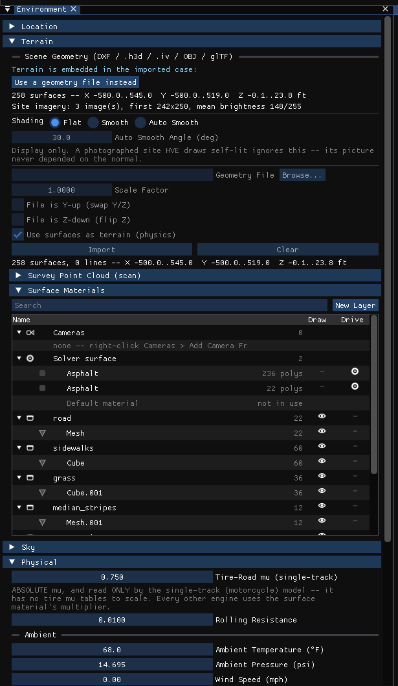
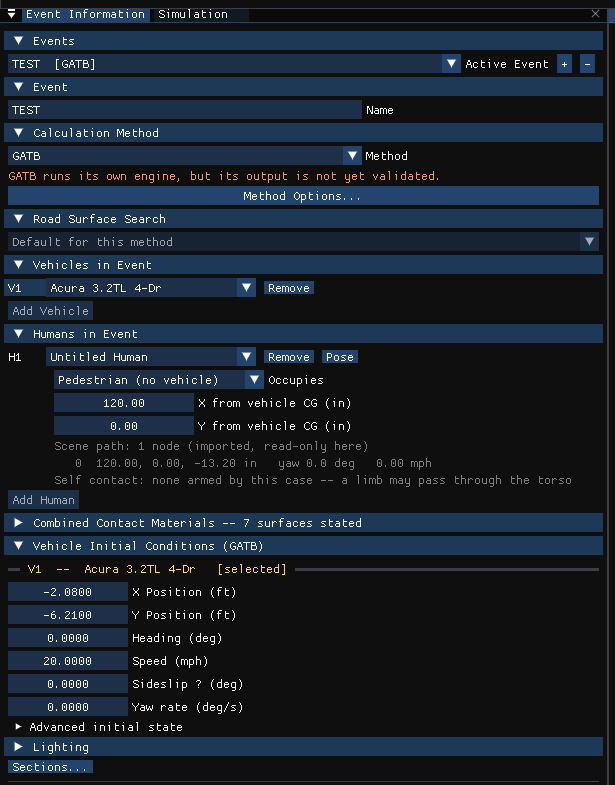

# Chapter 2 — Program Input

This chapter defines the objects (humans, vehicles and environment) and the event set-up parameters (positions, velocities, acceleration pulse, etc.) used by the GATB analysis. In general, the chapter is divided into the following sections:

- **Objects** — The number of humans and vehicles, and the specific human and vehicle parameters actually used by GATB.
- **Events** — The various options available for setting up and executing a GATB event.

!!! note "HVE Studio"
    Where the inputs live in HVE Studio:

    | Input | HVE Studio |
    |---|---|
    | Human body (segments, joints, ellipsoids) | **Human (F2)** editor › **Human › Human Information** (*Humans* panel) and its *Body Segments…* and *Joint Properties…* buttons |
    | Contact surfaces | **Vehicle (F3)** › **Vehicle › Editors › Contact Surfaces** |
    | Belt installed, anchors, attachment segment, slack | **Vehicle › Editors › Belt Restraint** |
    | Airbag, per seat (installed, timing, contact segments, reaction panels, bag geometry, gas, vent, membrane, ATB gas dynamics) | **Vehicle › Editors › Airbags** |
    | Which humans, which vehicle, seat, restraint worn, pose, pedestrian velocity | **Event (F5)** › Event Information › *Humans in Event* (and its **Pose** button) |
    | Vehicle initial position and velocity | Event Information › *Vehicle Initial Conditions*, or **Event › Position / Velocity** |
    | Collision pulse | **Event › Collision Pulse** |
    | Combined contact materials | Event Information › *Combined Contact Materials* |
    | Calculation options | Event Information › *Calculation Method* › **Method Options…** (*GATB Options*) |

## Objects Overview

The objects used by the GATB model are:

- **Humans** — At least 1 human, either an occupant or a pedestrian, may be studied by GATB. Up to 4 humans can be studied in the same GATB run.
- **Vehicles** — 1 vehicle may be studied by GATB.

  > **NOTE:** In HVE Studio an event holds at most four humans. Event Information accepts more than one vehicle for a GATB event; this manual describes the one-vehicle case.
- **Environment** — GATB uses an environment if present, but it is not required.

> **NOTE:** The environment is used in any HVE-compatible reconstruction or simulation model.

The following sections describe how the human, vehicle, and environment provide the required inputs to the GATB calculation models.

## Human

GATB uses humans created using the Human Editor. In HVE, humans are selected from the Human Database by choosing the following attributes:

- **Location** — The user may choose from any available occupant position (i.e., R/F, L/F) or, alternatively, choose Pedestrian.

> **NOTE:** HVE displays the human motion relative to the vehicle.

- **Sex** — The user may choose Male or Female.
- **Age** — The user may choose Adult or from a list of child ages. See Table 2-1 and Table 2-2.
- **Weight Percentile** — The user may choose from a list of available percentiles. See Table 2-2 and Appendix A (GEBOD Data Pages).
- **Height Percentile** — The user may choose from a list of available percentiles. See Table 2-2 and Appendix A (GEBOD Data Pages).

*(updated: As of HVE Version 10, new humans are added to the case using the GEBOD Human Information dialog rather than the classic database-driven dialog described above. In the GEBOD dialog the user selects a **Subject Type** (Child, Female, Male or User-defined) and a **Basis** for the body generation (Age, Weight, Height, or All — i.e. age, weight and height together); the GEBOD body generator then produces the full 15-segment data set for the requested subject. The classic dialog is still shown when editing humans created from the pre-Version 10 human database. See [Human Information Dialog](../../07-humans/HumanInfoDlg.md) for full dialog details.)*

| Child Ages | Standing Height (inches) | Weight (lbs) |
|---|---|---|
| 3 yr. old | 38.94 | 23.08 |

**Table 2-1: List of available HVE human children**

*(updated: the classic human database also includes 6-, 9- and 12-year-old children; the GEBOD Human Information dialog can generate a child of any age from regression data.)*

| Weight %'s | Height %'s |
|---|---|
| 2.5, 50, 97.5 | 2.5, 5.0, 50.0, 95.0, 97.5 |

**Table 2-2: List of available HVE human adults (available weight and height percentiles)**

*(updated: the original table listed only the 2.5 weight percentile; the classic database provides 2.5, 50 and 97.5 weight percentiles, and the GEBOD dialog accepts arbitrary values when the Basis includes Weight and/or Height.)*

!!! note "HVE Studio"
    HVE Studio generates every body with GEBOD, from the *Humans* panel's **Subject Type** (Male, Female), **Age Group** (Child, Teen, Adult, Senior) and **Weight Percentile** and **Height Percentile** (5th, 25th, 50th, 75th or 95th). An adult or senior is generated from the two percentiles together (HVE's *All* basis); a child is generated as a 6-year-old and a teen as a 12-year-old (HVE's *Age* basis). The 2.5th and 97.5th percentiles and the 3- and 9-year-old children of the tables above cannot be chosen, and there is no *User* subject type. A body imported from an HVE case is kept as HVE stored it. The GEBOD tables are built into HVE Studio.

To add a human to the current case in HVE Studio:

- Choose the **Human (F2)** editor and open **Human › Human Information**. The *Humans* panel is displayed (Figure 2-2).
- Click **Add Human**. A new human is added and its body generated with GEBOD.
- Choose its **Location**: the seat it nominally occupies, or *Pedestrian*.

> **NOTE:** If you choose a seat, the human will be a vehicle occupant. If you choose Pedestrian, the human will be a pedestrian. Which vehicle a human rides in, and where, are set per event in Event Information › *Humans in Event*.

- Choose the **Subject Type**, **Age Group**, **Weight Percentile** and **Height Percentile**. Changing any of them regenerates the body; **Regenerate GEBOD Body** does so on demand.
- Edit the **Name**. The name does not affect calculations.

*Figure 2-2: The Humans panel in HVE Studio (Human editor, Human › Human Information).*

The following Human Parameter groups are used by GATB:

- Inertias
- Ellipsoids
- Joints

In HVE Studio the segment inertias, ellipsoids and joint locations are edited in the *Humans* panel's **Body Segments…** dialog (choose the segment, then the *Inertia*, *Ellipsoids* or *Joints* tab), and the joint properties in **Joint Properties…**.

The GATB human is modeled with 15 mass segments connected by 14 joints. Refer to *Chapter 4, Calculation Method*, for important details describing how the GATB human model is derived. See Table 1-1 and the GEBOD Data Pages.

The specific data in each of the above parameter groups that are actually used by GATB are defined in Tables 2-3, 2-4, and 2-5.

### Inertias

The Human Inertial Data used by GATB are shown in Table 2-3. This data is obtained from the GEBOD program [7]. See Tables 2-1, 2-2 and the GEBOD Data Pages for a complete list of humans.

| Parameter | Description |
|---|---|
| Segment Weight | Weight of each of the 15 body segments. |
| Segment Principal Moments of Inertia (X, Y, Z) | Rotational inertias of each segment about its principal axes. |

**Table 2-3: List of Inertial Data used in GATB**

*(updated: the table body was blank in the printed manual; the parameters above are the per-segment inertial data carried by the HVE human — the segment mass together with its three principal rotational inertias — and shown in the GATB Human Data output report.)*

### Ellipsoids

Ellipsoids are used for predicting contact forces between the human and vehicle. Penetration of an ellipsoid into a vehicle contact surface results in the calculation of force on the human.

The Human Ellipsoid Data used by GATB are shown in Table 2-4. HVE allows up to 3 ellipsoids per HVE segment. *(updated: the original manual marked this "Not Implemented Yet"; the current HVE human implements up to 3 contact ellipsoids per segment.)*

> **NOTE:** If principal axes are rotated and you choose to show contact surfaces, you will not be looking at a true picture of the human-vehicle interaction. However, the forces will be correctly calculated according to the inputs being considered.

!!! note "HVE Studio"
    **Which ellipsoid takes part in a contact.** HVE's armed contact pairs name an ellipsoid on each body segment, and GATB uses them as follows — identically in HVE and in HVE Studio:

    - **Segment-to-segment (self) contact:** GATB writes ATB only each segment's **first** ellipsoid ("does not look at additional ellipsoids", in GATB's own source). An armed pair whose body ellipsoid is not the first is not tested at all, and one whose target ellipsoid is not the first is tested against the first. HVE Studio keeps that behavior and says how many such pairs the case has, both under the human in Event Information and in the run status.
    - **Segment-to-vehicle-panel contact:** the ellipsoid index is carried and not used; every pair is tested with the segment's contact geometry as ATB builds it.

| Parameter | Description |
|---|---|
| Ellipsoid Name | Up to 30 characters, used to identify the ellipsoid. |
| Ellipsoid Center Coordinates | Segment-fixed x, y, z coordinates of the ellipsoid center. |
| Ellipsoid Semiaxes | Semi-axis lengths of the ellipsoid along its principal axes. |
| Ellipsoid Principal Axes | Yaw, pitch and roll orientation of the ellipsoid principal axes relative to the segment axes. |

**Table 2-4: List of Ellipsoid Data used in GATB**

*(updated: the printed table listed only the Ellipsoid Name row; the center coordinates, semiaxes and principal-axis rows above are the ellipsoid data actually carried by the HVE human — the ellipsoid name, its center coordinates, its three semi-axis lengths, its principal-axis orientation and its contact material — and echoed in the GATB Human Data report.)*

### Joints

Joints are used to connect together each of the 15 segments. The Human Joint Data used by GATB are shown in Table 2-5.

| Parameter | Description |
|---|---|
| Joint k Location | Distance from segment CG to joint along the segment-fixed k axis. |
| Joint yaw, pitch, and roll stop angles | Articulation yaw, pitch, and roll angles at which joint stop properties are applied. |
| Stop elasticity — i, j, k axes | Elasticity of the joint stops for yaw, pitch, and roll rotations. Applies to both (+) and (−) directions. |
| Linear Elastic Coefficient | Elastic properties of the joint in the normal range of motion (i.e., between the joint stops). |

**Table 2-5: Human Joint Parameters used in GATB**

*(Cross-reference: the full set of joint properties available in HVE — joint type, stop angles and elasticities in both directions, energy dissipation, linear/quadratic/cubic elastic coefficients, damping, and injury tolerance angles — is described in [Human Joint Properties Dialog](../../07-humans/HumJntPropDlg.md). Each segment may carry up to 4 joints.)*

## Vehicle

GATB uses 1 vehicle created using the Vehicle Editor. Vehicles are selected from the Vehicle Database by choosing the following attributes:

- **Type** — GATB supports the following vehicle types: *Passenger Car, Pickup, Sport-Utility, Van, Truck, Trailer, Dolly, Fixed Barrier,* and *Movable Barrier.*
- **Make** — GATB supports all available vehicle makes.
- **Model** — GATB supports all available vehicle models, within the limits defined by number of axles and drive axles.
- **Year** — GATB supports all available vehicle years.
- **Body Style** — GATB supports all available vehicle body styles.

Each vehicle also has the following additional user-editable parameters:

- **Driver Location** — The driver location is used by GATB to determine if the airbag is a driver-type or a passenger-type airbag.
- **Engine Location** — The engine location is not used by GATB.
- **Number of Axles** — GATB supports 2- and 3-axled vehicles.
- **Drive Axle(s)** — The drive axle attribute is not used by GATB.

To add a vehicle to the current case in HVE Studio:

- Choose the **Vehicle (F3)** editor.
- In the *Vehicles* panel, click **Add…**. The *Add Vehicle* dialog is displayed: search the loaded vehicle databases, or pick one of HVE's generic vehicles by type and class.
- Add the vehicle. Its attributes, including *Driver Location*, are edited in the Vehicles panel's *Identity* and *Configuration* sections.

The following Vehicle Parameter groups are used by GATB:

- Move CG
- Contact Surfaces
- Belt Restraints
- Airbag Restraints

The specific data used in each of the above parameter groups are defined in Tables 2-6 through 2-8.

### Sprung Mass

Remember, GATB is not a *vehicle* simulator! The motion of the vehicle is determined by a user-supplied collision (acceleration) pulse, along with initial vehicle position and velocity. Therefore, the vehicle data required by GATB is limited to that which is required to establish interaction forces between the human and vehicle.

### Inertias

Inertial parameters are not used by GATB. The vehicle's motion is supplied by assigning an initial velocity and a collision pulse (see Event Editor later in chapter).

### Move CG

Move CG is not directly used by GATB. Its current value does not show up in the results. However, the Move CG fields may be used to quickly move the vehicle's center of gravity; the x, y, z coordinates for the contact surfaces, belt anchor points and airbag location are updated to reflect the new location.

!!! note "HVE Studio"
    **Event › Move CG** is offered only for EDSMAC and EDSMAC4 events in HVE Studio.

### Geometry File

The geometry file plays no role in the GATB calculations. However, there are some smart things that may be done for occupant simulation. Remembering that an occupant is inside the vehicle, and may be difficult to see, the following two suggestions will help greatly:

- Choose NoBody.h3d as the geometry file. As its name implies, NoBody.h3d is a null geometry file (it has all the required data structures, but no surface polygons), or
- Edit the vehicle's geometry file and remove the roof and roof supports.

> **NOTE:** Remember to save the file with a new name, such as PCFordTaurus4DrSNoRoof.xxx, to avoid losing the original geometry file!

!!! tip "New in HVE Studio"
    **View › Scene Display › Humans Through Bodywork** draws the occupant through the vehicle body, so a cut-down geometry file is not needed just to see inside. The geometry file is chosen in **Vehicle › Editors › Vehicle Mesh**.

### Contact Surfaces

Vehicle contact surfaces are the surfaces that interact with human ellipsoids to produce forces on the human. Up to 25 contact surfaces are allowed by GATB, the properties for which are shown in Table 2-6.

| Parameter | Description |
|---|---|
| Contact Surface Name | Up to 30 characters, used to identify the surface. |
| Contact Surface Location | Interior or Exterior; provides the default status that determines whether a contact surface is allowed or ignored during force calculations. |
| Contact Surface x, y, z corner coordinates | Vehicle-fixed x, y, z coordinates for three consecutive corners of the current contact surface, supplied in a counter-clockwise order. The positive side of the surface is specified by the right-hand rule. |
| Contact Surface Quadratic Stiffness | Second-order stiffness of the ellipsoid vs. contact surface pair. |
| Contact Surface Cubic Stiffness | Third-order stiffness of the ellipsoid vs. contact surface pair. |
| Contact Surface Damping Constant | Velocity-dependent damping properties between the ellipsoid and contact surface. |

**Table 2-6: HVE contact surface information used in GATB**

!!! note "HVE Studio"
    Contact surfaces are edited in **Vehicle › Editors › Contact Surfaces**: by center, size and yaw/pitch/roll angles, or with *Edit corner points instead* by the three corner points; the dialog shows each surface's normal and can **Flip** it, and the panels are drawn in the 3-D view while it is open. *Side* (Interior/Exterior) is stored with the surface. The dialog also offers **Derive from Mesh**, **Seed Standard Interior**, a **Pedestrian preset**, interior templates and **Save/Load Interior…**.

    The stiffness GATB actually uses for a human against a surface is the event's **combined** material (Event Information › *Combined Contact Materials*), which a case imported from HVE states per surface; a surface with none stated uses the surface's own material.

*Figure 2-3: Contact Surfaces dialog in HVE Studio, with the Acura's exterior panels from HVE's `GATB-PedImpact` case (GROUND, Front, Front2, Windshield, Roof, RearWindow, Trunk). The GROUND panel selected here has no area of its own — GATB uses only its name (see [3-D Surface Geometry](#3-d-surface-geometry)).*

### Belt Restraints

Belt restraints are an extremely important aspect of GATB's functionality. The ability to study the effect of restraint system usage (or non-usage) is an important one.

A belt restraint system may be supplied for up to nine seat positions. Although HVE assigns default positions for each belt system, these are arbitrary and may be replaced by user-entered information. Belt Parameters used by GATB are shown in Table 2-7.

> **NOTE:** At this point, you are saying the vehicle has a belt installed at a specific location. Whether or not the belt is used is event-dependent! See Event Set-up, Restraints later in this chapter for more information.

| Parameter | Description |
|---|---|
| Seat Position | Seat position within vehicle (R/F, L/F, etc.). |
| Belt Section | Torso or lap. |
| Belt Anchor Point x, y, z Coordinates | Vehicle-fixed x, y, z coordinates for one end of the belt (the other end of the belt is attached to a human segment). |
| Belt Linear Stretch Rate | Linear stretch rate of the belt material. |
| Belt Quadratic Stretch Rate | Second-order stretch rate of the belt material. |

**Table 2-7: HVE belt restraint data used in GATB**

!!! note "HVE Studio"
    **The belt's force law does not reach GATB, in HVE or in HVE Studio.** GATB writes ATB its own fixed eight-point webbing stress/strain table and harness friction constants, so the belt's stretch rates, damping and breaking strength do not change a GATB run. The geometry does: the vehicle anchors, the attachment points on the body and the slack. In HVE Studio belts are edited in **Vehicle › Editors › Belt Restraint**, whose *Properties* section is labeled "EDHIS reads these. GATB does not". The torso belt attaches to the chest and the lap belt to the pelvis.

*(Note: each belt system has separate left and right lap and torso sections; the human's belt injury tolerances are likewise carried as separate left lap, left torso, right lap and right torso values.)*

### Airbag Restraints

Like belt restraints, airbag restraints are also an extremely important aspect of GATB's functionality.

An airbag restraint system may be supplied for up to nine seat positions. Like belt restraints, default positions for each airbag may be replaced by user-entered information. Airbag Parameters used by GATB are shown in Table 2-8.

> **NOTE:** At this point, you are saying the vehicle has an airbag installed at a specific location. Whether or not the airbag deploys is event-dependent! See Event Set-up, Restraints later in this chapter for more information.

| Parameter | Description |
|---|---|
| Seat Position for Current Airbag | Seat position within vehicle (R/F, L/F, etc.). |
| Bag Anchor Point x, y, z Coordinates | Vehicle-fixed x, y, z coordinates of the airbag. |
| Initial Bag Radius | Initial radius of airbag. |
| Passenger Bag Length | If a passenger seat position (i.e., no steering column), the airbag length. |
| Initial Bag Pressure | Initial pressure inside of the airbag. |
| Bag Membrane Thickness | Thickness of the airbag material. |
| Bag Full Inflation Volume | Volume of the airbag at full inflation. |
| Bag Vent Discharge Coefficient | Thermodynamic discharge coefficient of vent. |
| Bag Vent Area | Area of the vent. |
| Force Convergence Criterion | Allowable difference between force on airbag and force on human. |

**Table 2-8: Airbag restraint data used in GATB**

!!! note "HVE Studio"
    The whole bag is edited in one dialog, **Vehicle › Editors › Airbags** (also **Event › Restraints › Airbags**), one bag per **Seat**, as HVE stores it: **Device Installed**; the **Position** from the vehicle CG; **Begin Fill Time** (default **0.001 s**) and **Fill Duration** (default 0.05 s); the **Contact Segments (GATB)** -- any of the occupant's fifteen segments, at most ten per bag (ATB's limit: the rest gray out once ten are ticked, and a case stating more is refused for GATB in words); the **Reaction Panel** the bag deploys from and up to three **confining panels**, with the deployment **Offset on the Reaction Panel** in that panel's frame; the bag geometry, gas properties, vent, steering column and membrane; and an **ATB Gas Dynamics (GATB)** section (supply gas temperature and volume, sonic discharge coefficient and throat area, gas constant, bag mass, panel spring rate and friction, mass multiplier, bag yaw and roll), whose defaults reproduce the values GATB used to hardcode. The dialog says which of the seat's fields reach which engine: Begin Fill Time, the Contact Segments and the reaction panels reach GATB; Position and Fill Duration are read by EDHIS, not by GATB. A vehicle with no contact surfaces cannot support a bag, and GATB refuses the run.

    The bag deploys only in an event where the occupant at that seat wears the **Airbag** -- its own switch, with or without belts (see Restraints).

*(Note: the printed manual labeled the vent-area row "Bag Penetration for Force"; the description — area of the vent — identifies it as the bag vent area.)*

### Inter-vehicle Connections

Inter-vehicle connections are not used by GATB.

### Drag Forces

Drag forces are not used by GATB.

### Unsprung Mass

Unsprung Mass parameters (Wheel Location, Tire, Suspension and Brakes) are not used by GATB.

> **NOTE:** Wheel location and tire size are used to visualize the vehicle, but play no role in GATB simulation calculations.

### Exterior

The Vehicle Exterior Data (Exterior Dimensions, Stiffness) are not used by GATB.

### Steering System Data

Steering System Data are not used by GATB.

### Brake System Data

Brake System Data are not used by GATB.

## Environment

GATB uses the environment created by the Environment Editor. The environment is created by defining the following groups of attributes:

- Visual Data
- Physical Data

### Visual Data

The following visual parameters may be edited:

- **Environment Location** — A database containing the name (City/State/Country), Latitude and Longitude and GMT for the selected location.
- **Time and Date** — The local standard time and date for the event.
- **Angle of X Axis** — The angle of the earth-fixed X axis relative to true north.

The visual data are not used by the event; they are provided for studies related to visibility at the time of an event (e.g., avoidability of an accident).

> **NOTE:** The visual data (Location, Time, Date and Angle of Earth-fixed X axis) affect the lighting of the event! Depending on your view (Camera Position) the scene may be shaded and difficult to see. If the time is after sundown, the view will be dark.

### Physical Data

The Physical Data groups are:

- Wind Speed and Direction
- Atmospheric Temperature and Pressure
- Gravity Constant
- 3-D Surface Geometry

In HVE Studio the environment is edited in the **Environment (F4)** editor with **Environment › Environment…**. A case always has exactly one environment:

- In the *Location* section, enter the site name, *Date*, *Time*, *Latitude* and *Longitude*.
- In the *Terrain* section, load the scene geometry.
- In the *Physical* section, edit the gravity constant and the atmosphere.
- The bearing of the earth-fixed X axis from true north (HVE's *Angle of X Axis*) is the *North* setting of the sky in **View › Shader Editor**, shown there as the offset from east (HVE's angle minus 90).

*Figure 2-6: The Environment dialog in HVE Studio.*

Visual parameters are not used by GATB. The specific physical environment data used by GATB are described below.

### Angle of X Axis

The angle of the X axis is used to position the earth-fixed coordinate system on the surface of the earth.

> **NOTE:** The angle is specified relative to true north. If you are using a compass to determine direction at the scene of an accident, you should provide a correction factor before entering this angle.

> **NOTE:** The angle of the X axis affects how you visualize a GATB event, but does not affect any calculations.

### Wind Speed and Direction

Wind Speed and Direction are not used by GATB.

### Atmospheric Temperature and Pressure

Atmospheric Temperature and Pressure are not used by GATB.

### Gravity Constant

The gravity constant converts mass to force. An object's mass and rotational inertias are properties that are the same throughout the universe; however the weight of an object is dependent on the local gravitational constant.

### 3-D Surface Geometry

The 3-D Surface Geometry is not used by GATB.

> **NOTE:** If a contact panel named GROUND is defined, the program builds a flat contact panel 200 ft × 200 ft, centered at the vehicle x, y position and at z = 0.

!!! note "HVE Studio"
    The same in HVE Studio: a surface named exactly `GROUND` is replaced by that 200 ft square, and the corners entered for it are not used.

## Event

GATB uses the Event Editor to create, set up and execute an event. Each of these topics is described below.

### Creating a GATB Event

A GATB event is created in the Event Information panel of the **Event (F5)** editor. To create a GATB event in HVE Studio:

- Choose the **Event (F5)** editor. The Event Information panel is displayed (**Event › Event Information** opens it if it is closed).
- Click **+** beside *Active Event* to add an event, and enter its **Name**.
- Under *Calculation Method*, choose **GATB** from the *Method* list.
- Under *Vehicles in Event*, choose the vehicle.
- Under *Humans in Event*, click **Add Human** for each human (at least one).

> **NOTE:** If a method cannot run with the objects chosen, the panel says why beside the list.

*Figure 2-7: Event Information panel for HVE's `GATB-PedImpact` case in HVE Studio: a GATB pedestrian placed from the vehicle's CG.*

### Setting Up a GATB Event

GATB uses the following *event set-up* options:

- Initial Position/Velocity
- Collision Pulse
- Contacts
- Restraints
- Calculation Options

!!! note "HVE Studio"
    In HVE Studio: vehicle position and velocity are under Event Information › *Vehicle Initial Conditions* (or **Event › Position / Velocity**); each human's vehicle, seat X/Y and **Restraints (this event)** under *Humans in Event*, with its orientation and velocity in the **Pose** dialog; the collision pulse in **Event › Collision Pulse**; the calculation options under **Method Options…**. **Driver Controls**, **Damage Profiles**, **Payload**, **Wheels** and **Accelerometers** on the Event menu are grayed for a GATB event; **Contacts** and **Restraints** are available.

The specific Event Set-up data used by GATB are defined in Table 2-9.

| Parameter | Description |
|---|---|
| Initial Position / Velocity | Vehicle and human initial conditions. |
| Vehicle Collision Pulse | Time-dependent table of the vehicle forward, lateral, and vertical components of linear acceleration, and the yaw, pitch, and roll angular accelerations. |
| Contacts | A table of allowable interactions between human ellipsoids and vehicle contact surfaces. |
| Belt Restraints In-Use Switch | Determines whether the selected belt restraint system (torso or lap) is in use. |
| Segment Attachment | The name of the segment to which the belt ends are attached. |
| Attachment Coordinates | The segment-fixed i, j, k coordinates for the belt attachment point. |
| Belt Slack | Initial slack in the belt. |

**Table 2-9: List of Event Data**

### Position/Velocity

Like all simulations, GATB requires initial positions and velocities to be supplied by the user.

The vehicle is positioned relative to the earth-fixed coordinate system by supplying the X, Y, Z coordinates of its CG, and roll ($\Phi$), pitch ($\Theta$) and yaw ($\Psi$) angles about vehicle x, y, and z axes, respectively. The vehicle velocities are supplied in the form of a total velocity, sideslip angle and vertical velocity.

> **NOTE:** The vehicle-fixed u (forward) and v (side) velocity components are calculated using the total velocity and sideslip angle.

Human positions and velocities are assigned relative to the vehicle-fixed coordinate system.

!!! note "HVE Studio"
    **Human position.** In Event Information › *Humans in Event*, **Occupies** chooses the vehicle (or *Pedestrian (no vehicle)*) and the two fields below it give the pelvis X and Y. For an occupant they are *Seat X/Y from CG*; for a GATB **pedestrian** they are *X/Y from vehicle CG* — GATB measures a pedestrian from the first vehicle's CG and converts it to the scene itself (EDHIS, by contrast, places a pedestrian in scene coordinates). A third field gives Z (SAE, + down). All three are measured from a vehicle CG for a GATB event, so they are in the vehicle-dimension unit (in, or m in metric); a scene position (an EDHIS or EDGEN pedestrian) is in the site unit (ft, or m). A human can also be dragged across the ground in the 3-D view.

    **Orientation.** Click **Pose** beside the human: the *Body Pose* dialog edits this event's pose — roll, pitch and yaw for each of the 15 segments, each relative to its parent segment — once *Pose this body* is ticked. *Reset to default posture* returns a seated occupant to upper legs pitched 90° forward, and a pedestrian to standing.

    **Restraint type and pose are per event (since v3.0.132)**, as HVE stores them: the same human can be posed and belted differently in each event.

    **Initial velocity.** The *Body Pose* dialog's *Initial velocity (segment frame, u/v/w)* reaches GATB. For an occupant it is relative to the vehicle and normally zero; for a pedestrian it is the walking speed, in the body's own frame. GATB reads the main segment's (pelvis's) velocity only.

> **NOTE:** The same is true for output reports: all the kinematic data displayed in Variable Output is reported relative to the vehicle for humans.

The position of a human is defined by the center of gravity of its pelvis segment (this is called the *main segment*). Thus, the positions and velocities are actually those assigned for the pelvis. (However, human positions may be further defined for each additional segment (i.e., *Head, Left Upper Leg*, and so forth) by $\Phi$, $\Theta$, $\Psi$ articulations (supplied in that order) at the joints. Angular velocities may be supplied as well.)

GATB is a 15-mass, 14-joint model. Articulation angular positions and velocities may be entered by clicking on the neck segment (to set the initial conditions for the C7-T1, or Neck, joint), and by clicking on the Right and Left Upper Leg segments (to set the initial conditions for the Hip joint). These joints are modeled by GATB and their motion will be affected by subsequent human-vehicle interaction. Any of the other segment positions may be supplied as well. Position/Velocity Data used by GATB are shown in Table 2-10.

| Parameter | Description |
|---|---|
| Vehicle Initial Position | The earth-fixed x, y, z coordinates and the roll, pitch, and yaw orientations of the vehicle at the start of the run. |
| Vehicle Initial Velocity | The forward, lateral, and vertical linear velocities, and the roll, pitch, and yaw angular velocities of the vehicle at the start of the run. |

**Table 2-10: Position and velocity data used in GATB**

*(Note: the second row was mislabeled "Vehicle Initial Position" in the printed manual; its description identifies it as the initial velocity.)*

### Driver Controls

The Driver Controls Data are not used by GATB.

### Damage Profile

The Damage Profile Data are not used by GATB.

### Payload

The Payload Data are not used by GATB.

### Collision Pulse

The collision pulse provides the vehicle acceleration vs. time history for the event. The data are provided in the form of a table. The current value of forward, side and vertical linear accelerations, and roll, pitch and yaw angular accelerations is obtained from this table using linear interpolation. Once obtained, the accelerations are integrated during each time step to determine vehicle velocity and position.

> **NOTE:** HVE allows you to supply a collision pulse directly from a previously run EDSMAC event, or any physics program that produces a collision pulse, as well as from a directory of user-saved collision pulses. See References 5 and 6 for additional information.

> **NOTE:** There are also options available to define the vehicle motion using a velocity-time data file or a position-time data file.

!!! warning "HVE Studio: GATB does not interpolate the table linearly"
    The paragraph above is HVE's, and for GATB it is not what the engine does. GATB writes the rows as Cards C.5 with `LFIT = 3`, and ATB fits an interpolating **cubic spline** through them and drives the vehicle with the fit. A spline through sparse rows rings between them, and past the last row ATB **extrapolates** the last piece of the fit rather than holding the last value. A table that stops before the end of the run, or that has a long gap after a sharp change, is therefore applied as something it never says. Measured examples:

    - a 10 g, 2 ms half-sine that ends at 0.1 s, in a 0.5 s run, is applied as −2952 g at 0.5 s;
    - five rows are applied as +75 g where the table says 0.

    HVE does exactly the same, so HVE Studio does not change it; it says it instead. The **Collision Pulse** dialog states where the fit leaves the table and offers **Resample onto ATB's grid**. The run status begins *COLLISION PULSE NOT AS STATED*, naming the instant, the value and how far it leaves the vehicle off the table's speed. A table with a row at every instant ATB tabulates (2 ms for runs up to 1 s) is applied exactly as stated.

!!! note "HVE Studio"
    **Event › Collision Pulse** edits the pulse of one vehicle in the active event. GATB accepts a **Position**, **Velocity** or **Acceleration** table (*Pulse type*); the table is shown in the units of that type (acceleration in g and deg/s²). A pulse can be typed (**Add row**), imported from a text file of seven numbers a line (time, x, y, z, roll, pitch, yaw) with **Import file…**, or taken from another event of the case that runs the same vehicle (**Take pulse from this event** — forward, lateral and yaw acceleration from that run; vertical, roll and pitch zero). The dialog also has *Start time*, *Threshold (g)* (which reaches no engine, in HVE or in HVE Studio) and the six *Scale factors*. HVE's binary `.AccPulse` files cannot be imported. With no pulse stated the run still completes, the vehicle following its own initial motion, and the run status says so.

> **NOTE:** Because of the significant difference in the mass of a human compared to a vehicle, a collision pulse is not normally required for a pedestrian impact simulation.

### Contacts

The Contacts dialog allows the user to selectively remove specific human ellipsoid vs vehicle contact surface interactions for consideration by the event. This practice is useful because every interaction requires computational overhead. Removing unnecessary calculations reduces calculation time.

By default, the Contacts dialog assumes interaction between every human ellipsoid and vehicle contact surface. When an ellipsoid name is selected from the ellipsoids list box, all the vehicle contact surface names will be highlighted in the Contacts list box. Click on any highlighted contact surface to remove it from consideration.

> **NOTE:** Actually, GATB does some pre-screening: If the current human is an occupant, only interior contact surfaces will be highlighted; if the current human is a pedestrian, only exterior surfaces will be highlighted.

!!! note "HVE Studio"
    **Event › Contacts...** (Ctrl+T) opens the **Human Contacts** dialog for a GATB event, in two parts.

    **Human vs Vehicle.** An occupant against the vehicle it rides (a pedestrian: the event's first vehicle). One row per human segment (one per ellipsoid where a segment has more than one), one column per vehicle contact surface; a ticked box is an armed pair, and GATB reads every segment.

    - **Every occupant has its own list**, as in HVE (one block per human and vehicle). With more than one occupant in the event a **Human** selector chooses whose list the grid shows, and GATB arms each list for its own occupant only. An occupant with no list of its own has nothing to strike; the dialog says so and offers **Create This Human's List** (every ellipsoid against every surface of the vehicle it rides, with that vehicle's combined materials), and the run status says how many occupants have none.

    - A case opened from an HVE `.hve` file carries **HVE's own list**, and the grid shows it. Entries stating the same pair more than once are kept as stated, because GATB arms each entry as its own contact; un-ticking removes every entry for the pair.
    - A case built in HVE Studio has **no stored list**; the dialog says so and shows the default the run generates — every ellipsoid of the pelvis, abdomen, chest, neck, head and upper legs against every contact surface, with no interior/exterior pre-screening and no self contact. The first click stores that default with the click applied.
    - **Arm All** stores every ellipsoid of every segment against every surface (HVE's starting selection), **Pelvis Only** just the pelvis against each surface, and **Use Run-Time Default** forgets the stored list. The last armed pair cannot be removed (an empty list means "use the default", and with no panel armed GATB refuses the run).
    - If more than 250 pairs are armed, only the first 250 reach the engine; the dialog and the run status say so.
    - Further contact blocks HVE stores for a human against **another** vehicle's panels are listed **read-only**, each with the occupant it belongs to; GATB counts them against that occupant's own vehicle exactly as HVE's GATB does. A block naming no occupant of the event is armed on nobody, and the run says so.

    **Human vs Same Human (self contact).** Per human in the event, a 15 × 15 grid: row = base segment, column = target segment (ATB's segment-to-segment contact, directional as HVE stores it). A self-contact pair carries a combined material; HVE combines the two ellipsoids' own materials, which HVE Studio's body model does not carry, so a newly ticked pair copies the first stored pair's material and a human with no stored pair cannot have one added (the dialog says so). **Clear All** removes them all — a limb may then pass through the torso. Under the human, Event Information also says how many self-contact pairs are armed.

### Combined Contact Materials

!!! note "HVE Studio"
    The per-surface combined material — stiffness, damping, friction, maximum force and deflection, unloading slope, maximum penetration and edge constant — that GATB turns into ATB's force-deflection functions is edited in Event Information › **Combined Contact Materials**. A case imported from HVE states these per surface; a surface with none stated uses the surface's own material with an edge constant of 0.5.

    GATB needs a **Max Force** above 0 that the force law reaches: it works out each contact's energy absorption by solving the law for that force. A Max Force of 0, which EDHIS reads as unlimited, stops a GATB run with a message naming this panel, unless the surface's force law is all zero (a surface that pushes on nothing). An unloading slope of 0 runs with no energy restored and no permanent set.

### Restraints

The Restraints dialog determines if a belt or airbag restraint system is in use for the current event.

!!! note "HVE Studio"
    **Event › Restraints** opens the vehicle's Airbags and Belt Restraint dialogs (the same as **Vehicle › Editors › Airbags** and **Vehicle › Editors › Belt Restraint**). What each occupant wears in the event is three independent switches, as in HVE -- **Torso Belt**, **Lap Belt** and **Airbag** -- beside the human in Event Information › *Humans in Event* (*Restraints (this event)*; also under *Worn in the Active Event* in **Vehicle › Editors › Belt Restraint** for the active event) — each belt only where the vehicle has it installed at the occupant's seat, and the airbag with or without belts. The attachment points and slack are part of the belt in **Vehicle › Editors › Belt Restraint**; the airbag's Begin Fill Time (default 0.001 s) and Fill Duration (default 0.05 s, read by EDHIS) are in **Vehicle › Editors › Airbags**.

> **NOTE:** If the current vehicle does not have a restraint system installed at the position specified for the current human, no restraints will be available for selection. If necessary, use the Vehicle Editor to install a restraint system at the desired seat position.

For belt restraint systems, Torso and Lap belt sections may be supplied individually. The following in-use parameters are required for each belt section:

- **Attached To** — The name of the human segment (Pelvis, Abdomen, Chest…) to which the belt is attached.
- **Attachment Coordinates** — The segment-fixed coordinates of the anchor point for the left and right belt sections.
- **Belt Slack** — The initial slack in the belt for the left and right belt sections.

> **NOTE:** Negative slack may be supplied to model belt pre-loading.

For airbag restraint systems, the following in-use parameters may be supplied:

- **Deployment Time** — The simulation time at which the bag begins to inflate.
- **Fill Duration** — The time interval during which airbag filling occurs.

### Simulation Controls

GATB uses the current simulation control parameters in the Simulation Controls dialog (in HVE, Options Menu › Simulation Controls; in HVE Studio, the **Simulation** panel). The Simulation parameters used by GATB are shown in Table 2-11.

| Parameter | Description |
|---|---|
| Human Collision Integration Time Step | Not adjustable — set to 0.0005 sec. |

**Table 2-11: Simulation control data used in GATB**

!!! note "HVE Studio"
    **The ATB integration step is fixed at 0.002 sec.** GATB's source sets ATB's time step to 0.002 sec itself and does not read the Human Collision Integration Time Step — in HVE's source exactly as in HVE Studio — so a different step entered for an imported case leaves a GATB run unchanged. (The 0.0005 in the table above is one of ATB's other step-control fields; see [Chapter 4](04-calculation-method.md#integration-timestep).) In HVE Studio the run's *Duration* and *Output Timestep* are set in the **Simulation** panel.

### Calculation Options

There are several calculation options available in GATB. Each of these options allows for special situations where the default data may not sufficiently model the event being analyzed.

!!! note "HVE Studio"
    In HVE Studio these options are in the *GATB Options* dialog: Event Information › *Calculation Method* › **Method Options…**. It has *Use external ATB input file* (grayed), *Use pulse file* with the *Pulse File* name and *Type of Pulse* (Position, Velocity, Acceleration), and *Belt Contacts* (All, Some or No belts slide on segments).

**Use External File** — This option is used when the user wants to make detailed changes to the existing input file (gatb.ain) and have this input file used again without regenerating all the data. This is useful when very specific data in the input file needs to be changed, but the GATB implementation does not allow the user a dialog to enter it. It is also useful when running someone else's .ain file. Use this option with extreme care; there is no error checking on the input values outside of the ATB model and unexpected results may cause computational errors that are not handled by HVE. Before making any changes to a .ain file or using this option, the user must be very familiar with ATB and all the options available in the base version of ATB.

!!! warning "Not in HVE Studio"
    *Use external ATB input file* is shown grayed, with the reason. HVE Studio feeds ATB from the assembled data in memory rather than from a `gatb.ain` file, so there is no path by which an external input file could reach the solver. Ticking it would leave the answer unchanged; a case that has it set is run as though it were not, and the run says so.

**Use Pulse File** — This option is available to allow users to utilize an external pulse file. This allows someone to produce a pulse file using a non-HVE program and then to use it in the GATB run. The basic format of the pulse file is: Time, X, Y, Z, Yaw, Pitch, Roll for position-based pulse in seconds, inches, and degrees; Time, V-x, V-y, V-z, Roll velocity, Pitch velocity, Yaw velocity for velocity-based pulse in seconds, in/sec, deg/sec; Time, A-x, A-y, A-z, Roll acceleration, Pitch acceleration, Yaw acceleration in seconds, g's, and deg/sec².

> **NOTE:** The input data is in a different order for position-based pulse than for velocity-based or acceleration-based pulse file.

**Belt Contacts** — This option allows the user to determine how the restraint contact points are moved during the simulation. GATB automatically generates additional contact points based on the 2 points entered by the user for each segment. These points consist of a point on the centerline of the segments, for the pelvis and torso, and a point on the top of the shoulder for the torso belt. These points can all move along the surface of the segments but stay in the same place along the belt webbing (option 1 — All Slide), or the user-entered points can move along the surface while the additional points generated can stay in the same place on the segment, but move along the belt webbing (option 2 — Some Slide), or all the points used, both those entered and those generated, can stay at the same place on the segment but move along the webbing (option 3 — None Slide).

> **NOTE:** If the belt points are allowed to move on the surface of the segment some of the points may be "dropped" from the belt as they "slide" off the segment. Setting the option to None Slide prevents this, but may not model the belt interaction as accurately.

### Executing An Event

To execute a GATB event in HVE Studio, use the playback bar under the viewport (or **Output › Run Simulation**, Ctrl+R):

- **Run** — Execute the active event. Grayed once the event is solved; press Reset to run it again.
- **Reset** — Clear the results so the event can be edited and run again.
- **|<** — Jump to the start.
- **<<** — Step back one output step.
- **Play / Pause** — Play the results forwards, or pause.
- **>>** — Step forward one output step.
- **>|** — Jump to the end.

While a run is in progress the bar offers **Pause**/**Resume** and **Cancel**.

> **NOTE:** A solved event's inputs are read-only until you press **Reset**, so the results on screen always describe the inputs shown.

> **NOTE:** Use the **View** menu for display options such as Key Results, Vectors, Occupant Equipment and Humans Through Bodywork.

<!-- NAV -->

---

← Previous: [Chapter 1 — Program Description](01-program-description.md)  |  [Index](README.md)  |  Next: [Chapter 3 — Program Output](03-program-output.md) →

<!-- /NAV -->
