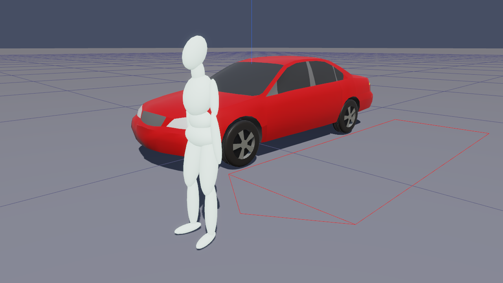

# Chapter 3 — Program Output

This chapter defines the outputs available from a GATB event. In HVE Studio the reports produced by GATB are on the Event editor's **Output** menu once the event has been run.

## Overview

GATB produces three types of output reports:

- **Alpha-Numeric Reports** — Reports containing text and numeric information, such as vehicle dimensional parameters.
- **Variable Output Tables** — Reports containing tabular simulation results as a function of time.
- **Trajectory Simulations** — Viewers containing dynamic, 3-D visual simulations.

!!! note "HVE Studio"
    In HVE Studio the three kinds of output are reached as follows:

    | Output | HVE Studio |
    |---|---|
    | Alpha-numeric reports | **Output › HVE Reports** — GATB's own report pages, one tab each |
    | Variable output | **Output › Key Results** and **Output › Output Graph**, for the vehicle's and the occupants' variables (chosen in **Output › Variable Selection**) — see [Variable Output Table](#variable-output-table) |
    | Trajectory simulation | the 3-D viewport, with the playback bar |

    There is no printing from HVE Studio. **Save This Page** and **Save All Pages** in the HVE Reports window write the report text to a file.

To view the GATB reports in HVE Studio:

- Run the GATB event (see [Chapter 2, Executing An Event](02-program-input.md#executing-an-event)).
- Choose **Output › HVE Reports**. The *HVE Reports* window shows the pages GATB built during the run, one tab per report (Accident History, Human Data, Injury Data, Messages, Program Data, Results, Vehicle Data).
- Click a tab to read that report. To keep it, enter a file name and click **Save This Page**, or **Save All Pages**.

If the run was refused or aborted, the window says that no pages were built.

## Alpha-Numeric Reports

GATB produces the following alpha-numeric reports:

- **Accident History** — A table of initial and final positions and velocities.
- **Human Data** — A series of tables containing the human data used by GATB.
- **Injury Data** — A table containing the HIC and CSI for each human.
- **Messages** — A list of messages produced by the current run.
- **Program Data** — A table containing program control information for the current run.
- **Results** — Tables containing human segment and joint data printed at approximately ten timesteps.
- **Vehicle Data** — A series of tables containing the vehicle data used by GATB.

An example of each of these numeric output reports from GATB is shown on the following pages.

### Accident History

The Accident History Report displays a table of initial and final positions and velocities for the human and vehicle.

> **NOTE:** This GATB page is the ACCIDENT HISTORY tab of **Output › HVE Reports**; there is no separate HVE Studio accident history.

### Human Data

The Human Data Report includes the following information:

- **Segment Properties** — Inertial properties and joint locations for the Head, Torso, and Leg segments.
- **Joint Properties** — Elastic, damping, and stop angles for the Neck and Hip joints.
- **Ellipsoid Properties** — Name, Segment, center coordinates, and semi-axis lengths for each human ellipsoid.

The report echoes the ATB "Crash Victim" input cards (Cards B.1–B.3): for each of the 15 segments it lists the weight, principal moments of inertia, contact ellipsoid semiaxes and center offsets, and principal-axis yaw/pitch/roll; for each of the 14 joints it lists the joint pin locations in both connected segments and the joint axis orientations.

### Injury Data

The Injury Data Report includes the HIC (Head Injury Criterion), HSI (Head Severity Index) and CSI (Chest Severity Index) results for each human: the HIC value with its time duration and average head resultant acceleration, the HSI value with the maximum head resultant acceleration and its time, and the CSI value with the maximum chest resultant acceleration and its time.

!!! note "HVE Studio"
    The run status (the Event Designer's **Run** stage) also reports the occupant's peak head and torso accelerations.

### Message

For a complete listing of messages issued by GATB, see [Chapter 6, Messages](06-messages.md).

!!! note "HVE Studio"
    A run that stops early is also reported in the run status, with the ATB stop code and the step at which it stopped; peaks from a run whose track stops early are flagged as not comparable with a full run.

### Program Data

The Program Data Report includes the following information:

- **Simulation Controls** — Integration parameters used for the current event.
- **Collision Pulse** — The acceleration vs. time history for the current event.
- **Contacts** — A list of all human ellipsoid vs. vehicle contact surface interactions that were ignored for the current event.

The report also lists the GATB program version, unit system, gravity vector, integration parameters (NDINT, NSTEPS, DT, H0, HMAX, HMIN), the NPRT print-control array, the working file names (gatb.ain input file, gatb.aou standard output, .sal structured output for VIEW, and tape 8 output), and a table of elapsed CPU time by subroutine.

!!! note "HVE Studio"
    In HVE Studio ATB's input is assembled in memory, so no `gatb.ain` is read; the report's file names are those ATB would use. ATB's work files are written to a temporary folder and removed after the run.

### Results

The Results Data Report includes tables containing human segment linear and angular positions, velocities, and accelerations, along with joint forces and torques. These tables are produced every 5 to 10 printout time intervals (i.e., output time interval = 0.002 sec; a table is produced every 10 to 20 msec, depending on maximum termination time selected). The Results page is the one to read when establishing initial equilibrium ([Chapter 5](05-tutorial.md#establishing-initial-equilibrium)).

### Vehicle Data

The Vehicle Data Report includes the following information:

- **Contact Surface Properties** — Name, elastic and damping properties, penetration limit, edge constant, maximum force, unloading slope, and relative initial position of the human with respect to the contact surface.
- **Contact Surface Location** — Name and corner coordinates for each contact surface.
- **Belt Restraints** — If in use, this section displays the name, location, and mechanical properties for each installed belt segment. In addition, this section also displays the human attachment point and initial belt slack.
- **Airbag Restraints** — If in use, this section displays the location, mechanical, and thermodynamic properties of the airbag, as well as its deployment time and fill duration.

## Variable Output Table

GATB produces a Variable Output table containing the time-based simulation results. The Variable Output groups produced by GATB are as follows:

### Human Output Groups

| Parameter | Description |
|---|---|
| Human Kinematic Data (for Hip, Head, and Leg segments) | x, y, z coordinates; $\phi$, $\theta$, $\psi$ angles; total velocity, fwd, side, vert components; $\dot\phi$, $\dot\theta$, $\dot\psi$ angular velocities; total acceleration, fwd, side, vert components; $\ddot\phi$, $\ddot\theta$, $\ddot\psi$ angular accelerations (see note below). |
| Joint Data (for Neck and Hip joints) | $\phi$, $\theta$, $\psi$ joint articulation angles; $\phi$, $\theta$, $\psi$ joint elastic moments. |

**Table 3-2: Human Variable Output Data**

> **NOTE:** For humans, the human segment kinematics are defined relative to the vehicle-fixed coordinate system.

- **Human Kinematics** — Position, velocity, acceleration, and kinetic energy for each human segment.
- **Joints** — Articulation angles and torques for the Neck and Hip joints.
- **Contacts** — Contact force, deflection, and x, y contact coordinate for each human ellipsoid vs. vehicle contact impingement.
- **Belts** — Belt tension and stretch for each belt segment.
- **Airbag** — Airbag pressure, radius, contact force, and deflection.

### Vehicle Output Groups

| Parameter | Description |
|---|---|
| Vehicle Kinematic Data | x, y, z coordinates; $\phi$, $\theta$, $\psi$ orientation; total linear velocity, u, v, w components; sideslip, course angles; p, q, r angular velocity; total linear acceleration, fwd, side, vert components; $\dot u$, $\dot v$, $\dot w$ linear components; $\dot p$, $\dot q$, $\dot r$ angular components. |
| Wheel Data | x, y, z location of each wheel. |

**Table 3-3: Vehicle Variable Output Data**

- **Vehicle Kinematics** — Position, velocity, and acceleration for the vehicle.
- **Wheel** — The position of each wheel (required only to visualize the wheels during an event; not used in the calculations).
- **Contacts** — Contact force, deflection, and x, y contact coordinate for each human ellipsoid vs. vehicle contact impingement.
- **Belts** — Belt tension and stretch for each belt segment.
- **Airbag** — Airbag pressure, radius, contact force, and deflection.

> **NOTE:** The Contacts, Belts, and Airbag results for Human and Vehicle output groups are identical (Newton's 3rd law at work!)

A detailed listing of each Variable Output parameter produced by GATB is found in Tables 3-2 and 3-3.

!!! note "HVE Studio"
    The **human** output groups — Human Kinematics, Joints, Contacts, Belts and Airbag — are offered as variables. In **Output › Variable Selection** they appear as the **Human** groups (one per body segment, one per joint, the contacts per interaction, belts and airbag) with one check-box column per human (**H1**, **H2**, ... with each human's name), and from there they can be tabulated in **Output › Key Results**, graphed in **Output › Output Graph** and written by **Output › Export Variables** — see [Selecting Variables](../../11-reports-output/VarSelDlg.md#occupant-variables). Names and units are HVE's own, and positions are relative to the vehicle, as GATB publishes them.

    - The contact variables are the contact force of each interaction, summed over its pairs and as its largest single pair (HVE lists every pair separately).
    - The belt variables are GATB's belt tension at the occupant's seat; GATB writes no stretch or attachment point there, so those read **--**. Any variable the run did not compute reads **--**.
    - The GATB report pages are in **Output › HVE Reports** (including the Results and Injury Data pages), the occupant peaks are in the run status, and every segment moves in the 3-D viewport.

## Trajectory Simulations

GATB produces a trajectory simulation of the current event. The trajectory simulation is a 3-D visualization of the data displayed in the Variable Output table (see previous section). In HVE Studio it plays in the viewport after the run, every human segment drawn as GATB moved it.

*Figure 3-8: A GATB event in the HVE Studio viewport (HVE's `GATB-PedImpact` case at t = 0).*

### Displaying a Trajectory Simulation

The Trajectory Simulation is controlled using the playback bar under the viewport:

- **Reset** — Clears the results (and unlocks the event's inputs for editing).
- **|<** — Jump to the start of the simulation.
- **<<** — Step back one output step.
- **Play / Pause** — Play the simulation forwards, or pause it.
- **>>** — Step forward one output step.
- **>|** — Jump to the end of the simulation.

> **NOTE:** **Output › Playback Options** sets the playback speed and frame step, **File › Record Animation** records a movie, and **Tools › Cameras** defines cameras, including ones that ride with a vehicle. **View › Scene Display › Humans Through Bodywork** draws the occupants through the vehicle body.

<!-- NAV -->

---

← Previous: [Chapter 2 — Program Input](02-program-input.md)  |  [Index](README.md)  |  Next: [Chapter 4 — Calculation Method](04-calculation-method.md) →

<!-- /NAV -->
