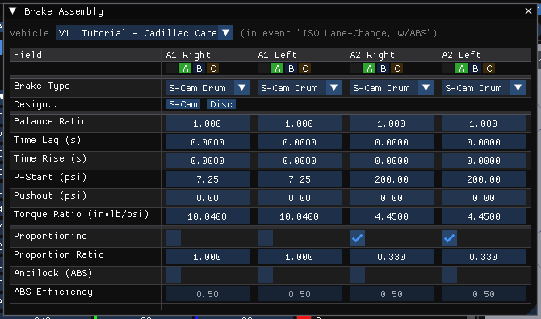
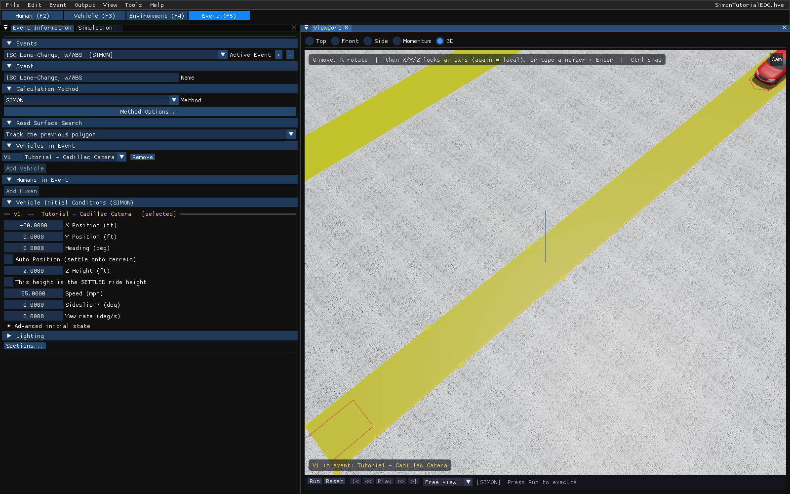
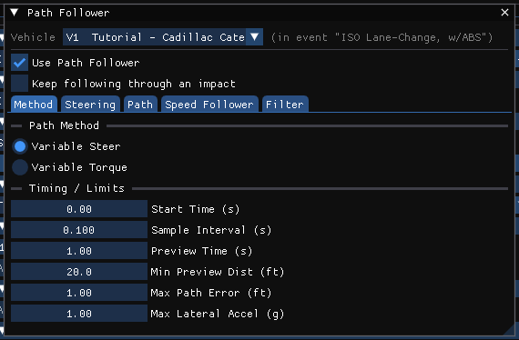
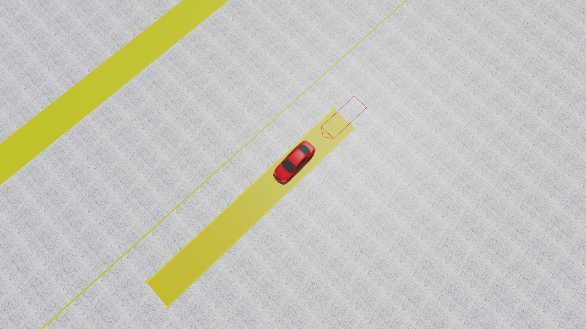
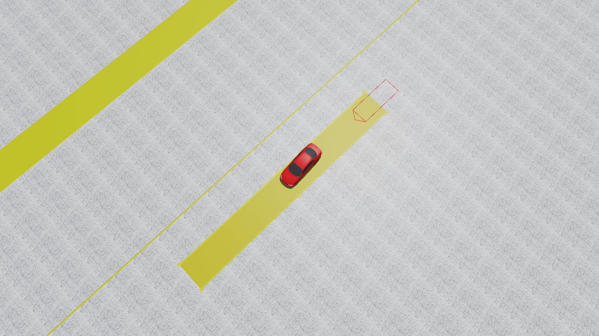
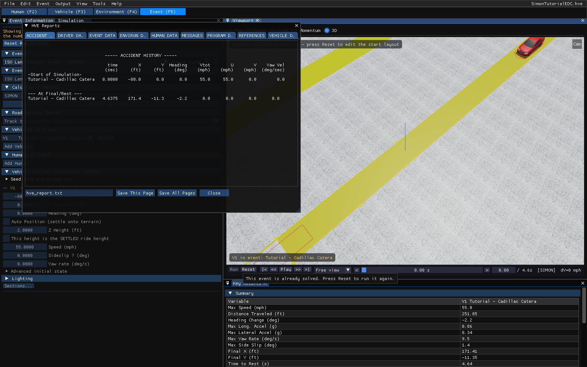

# Chapter 5 — SIMON Tutorial

## Description

The SIMON Tutorial investigates the effects of an ABS braking system on a combined braking and steering maneuver. The example uses an ISO 3888 lane-change maneuver to illustrate how ABS brake systems improve vehicle controllability during severe (limit) maneuvers.

Like all SIMON events, the procedures used in the tutorial involve the following basic steps:

- Creating the vehicle(s)
- Creating the environment
- Executing the SIMON event(s)
- Reviewing the SIMON output reports

!!! note "HVE Studio"
    This chapter walks through the tutorial in HVE Studio using EDC's own finished tutorial case, `SimonTutorialEDC.hve`, which HVE Studio opens directly. The case holds the vehicle, the ISO 3888 lane-change site (carried inside the case file) and both events. Each section below says where the input is in HVE Studio and what the case contains, so you can check it — or enter it yourself in a new case. The figures are HVE Studio captures of that case; the numbers quoted are HVE Studio's results, which agree with the results HVE saved in the same file to within 0.05 m.

> **NOTE:** It is assumed that you are familiar with HVE Studio's editors (the **Human**, **Vehicle**, **Environment** and **Event** tabs under the menu bar), its docked panels and the 3-D viewport.

## Getting Started

Before you start, set the display so that what you see matches this chapter:

- **Tools › Preferences...**: set **Units** to **Imperial (ft/in, mph, lb, lbf)** (the values below are in US units).
- **View** menu: show **Key Results**; in **View › Scene Display**, turn on **Skidmarks** (*Paths & Overlays*) and leave the **Velocity** vector (*Vectors*) off.
- **Output › Playback Options...**: choose a playback speed you are comfortable with.

> **NOTE:** These options affect only the display. The vehicle's initial position is set by the event's initial conditions; with **Auto Position** checked it is settled onto the terrain.

Our goal is to use SIMON to simulate an ISO 3888 lane-change maneuver with and without anti-lock braking (ABS).

To open the tutorial case, choose **File › Open Case...** and open `SimonTutorialEDC.hve` (in HVE's `supportfiles/case` directory). The case opens in the Event editor, on its first event.

## Creating the Vehicle

The vehicle is a 2001 Cadillac Catera 4-Dr Sedan, with ABS at each wheel.

In the tutorial case the vehicle is already present. To see it, choose the **Vehicle (F3)** editor (Figure 5-1). The *Vehicles* panel lists **Tutorial - Cadillac Catera**; its *Information* section shows Type = Passenger Car, Make = Cadillac, Model = Catera, Year = 1997–2001, Body Style = 4-Door and Drive Axle(s) = Axle 2.

To add the same vehicle to a new case instead:

1. In the **Vehicle (F3)** editor, click **Add...** in the *Vehicles* panel. The vehicle database search is displayed.
2. Search for **Catera** and pick the 1997–2001 Cadillac Catera 4-Door from EDC's database.
3. In the *Information* section, check that **Drive Axle(s)** is **Axle 2**.

*Figure 5-1: The 2001 Cadillac Catera used in the ISO 3888 lane-change maneuver, in HVE Studio's Vehicle editor.*

## Editing the Vehicle

The one vehicle feature this tutorial is about is the ABS system. In HVE Studio antilock is fitted per wheel, or for the whole vehicle with **ABS Installed** in **Vehicle › Editors › Brakes › ABS / Brake Design... › ABS System...**; SIMON regulates every wheel when either is set:

1. Choose **Vehicle › Editors › Brakes › Brake Assembly...**. The *Brake Assembly* dialog is displayed, one column per wheel (Figure 5-2).
2. The **Antilock (ABS)** row has a checkbox for each wheel. Wheels in the same brake group change together.

*Figure 5-2: The Brake Assembly dialog. The Antilock (ABS) row fits ABS per wheel; the ABS controller itself is set up in Vehicle › Editors › Brakes › ABS / Brake Design... › ABS System....*

> **NOTE:** In the tutorial case as EDC saved it, the vehicle's own ABS checkboxes are **off** — the last state of the vehicle after the second event was run. HVE's saved results show ABS active in the first event, so HVE Studio turns ABS on for that event when it opens the case and says so on the console and in the event's **Wheels › Brake** tab (see below). This is why HVE Studio's per-event antilock setting exists: in HVE, running the same vehicle with and without ABS means editing the vehicle between the two runs.

## Creating the Environment

The environment is the ISO 3888 lane-change course. In HVE it is the geometry file `IsoLaneChangeb.h3d`; in the tutorial case it is carried inside the case file, and HVE Studio loads it from there.

To see it, choose the **Environment (F4)** editor and open **Environment › Environment...** (Figure 5-3). The **Location** section holds the site, date and time; the **Terrain** section the scene geometry; and the **Physical** section the atmosphere and gravity.

*Figure 5-3: The environment for the ISO 3888 lane-change maneuver.*

> **NOTE:** Latitude, longitude, date, time and the direction of north are used only to position the sun.

### Saving the Case

HVE Studio does not write `.hve` files. To keep your own copy, choose **File › Save Case As...** (a binary `.hvex` case) or **File › Save Case As JSON...**. After a run, saving also stores the results beside the case, and they are restored when you open it again.

## Creating the Events

The tutorial includes two ISO 3888 lane-change events. They are identical, with one exception: the first event uses ABS, while the second has ABS disabled.

### ISO Lane-Change with ABS

Choose the **Event (F5)** editor. The *Event Information* panel shows the active event, **ISO Lane-Change, w/ABS [SIMON]** (Figure 5-4):

- **Calculation Method**: **SIMON**.
- **Vehicles in Event**: V1 = Tutorial - Cadillac Catera.
- **Vehicle Initial Conditions (SIMON)**: X Position = −80.0 ft, Y Position = 0.0 ft, Heading = 0.0 deg, Speed = 55 mph.

To create such an event yourself: click **+** beside **Active Event**, choose **SIMON** as the **Method**, click **Add Vehicle** and pick the Catera, type the name in **Name**, and enter the initial conditions above.

*Figure 5-4: The Event editor with the first SIMON event. The vehicle's initial position and velocity are in the Vehicle Initial Conditions (SIMON) section.*

#### Steering Input

Because the ISO lane-change maneuver has a pre-defined path, the tutorial uses the HVE Driver Model [4]. By defining the same driver model and path for both events, the experiment has only one variable (with and without ABS).

Open **Event › Path Follower...** (Figure 5-5):

1. **Use Path Follower** is checked.
2. On the **Method** tab, **Driver Comfort Level (g)** is 1.00.
3. On the **Path** tab, the path is the table in Table 5-1. The vehicle's initial position is the first point; the others are the HVE case's Begin Perception, Begin Braking and Impact positions.

**Table 5-1 Position and heading angle for each target position.**

| Path Position | X-coord (ft) | Y-coord (ft) | Heading (deg) |
|---|---|---|---|
| Initial | −80.0 | 0.0 | 0.0 |
| 2 | 50.0 | 0.0 | 0.0 |
| 3 | 148.0 | −11.5 | 0.0 |
| 4 | 325.0 | −11.5 | 0.0 |

*Figure 5-5: The Path Follower dialog for the Cadillac in the first event (Method tab). The target points are on the Path tab.*

> **NOTE:** In HVE Studio the path follower's target points are entered on the Path tab (or by clicking **Add positions by clicking the 3-D viewport**) rather than as named path positions in the Position/Velocity dialog.

#### Brake Input

The brake input is a large pedal force (120 lb) applied at the start of the steering maneuver. Open **Event › Driver Controls...** and choose the **Brake** tab. **Input Method** is **At Driver**, and the table is Table 5-2.

**Table 5-2 Brake Table.**

| Time (sec) | Pedal Force (lb) |
|---|---|
| 1.5 | 0.0 |
| 1.6 | 120.0 |

Because the ABS system modulates the brake pressure at a relatively high frequency, the output interval is 0.01 seconds rather than 0.10, so that the output captures the wheel brake pressure modulation. In HVE Studio this is the **Output Timestep (s)** in the *Simulation* panel (the tab beside Event Information); the case also states a **Trajectory Timestep** of 0.0025 s and a **Duration** of 5 s.

> **NOTE:** The smaller output interval increases the size of the results, not the integration effort.

Now execute the event: click **Run** on the playback bar under the viewport.

The vehicle negotiates the lane change, even with a heavy brake application, and comes to rest about 4.6 seconds into the run at X = 171.4 ft, Y = −11.3 ft — in the second lane — with a heading change of −2.2 degrees. Figure 5-6 shows the vehicle at rest. Click **Play** to watch the maneuver.

*Figure 5-6: ISO Lane-Change, w/ABS, at rest.*

### ISO Lane-Change without ABS

The second event repeats the test with ABS disabled. In the tutorial case it already exists: choose **ISO Lane-Change, w/o ABS [SIMON]** in the **Active Event** list.

!!! note "HVE Studio"
    HVE disables ABS by editing the vehicle's brake system and then copying the first event (Edit › Copy). HVE Studio has no event copy command, and does not need the vehicle edit: open **Event › Wheels...**, choose the **Brake** tab, and set **Antilock brakes** for the event. In the tutorial case the first event reads *Force ON for this event* (recovered from HVE's saved run) and the second *Use the vehicle's setting*, which is off. To build the second event yourself, click **+** beside **Active Event** and enter the same initial conditions, path follower and brake table as the first.

*(HVE's Figure 5-7, its Copy Event dialog, has no HVE Studio equivalent and is not reproduced.)*

Click **Run** to execute the event with ABS disabled.

In the tutorial case as EDC saved it, the vehicle without ABS also reaches the second lane, but travels further: it comes to rest about 4.9 seconds into the run at X = 182.2 ft, Y = −10.5 ft, about 11 ft beyond the ABS-equipped vehicle, with a heading change of −3.8 degrees (Figure 5-8). This is also what HVE's own saved run of this case shows; the printed HVE manual describes a vehicle that skids straight through the cones, which this saved case does not reproduce.

*Figure 5-8: ISO Lane-Change, w/o ABS, at rest.*

## Viewing Results

Now that we have produced our SIMON simulations of an ISO 3888 lane-change maneuver with and without ABS, let's take a detailed look at the results. In HVE Studio the results of the active event are reviewed in the Event editor itself, from the **Output** menu and in the viewport.

SIMON produces the following reports:

- **Messages** — A list of messages produced by the current run
- **Accident History** — A table of initial and final positions and velocities
- **Driver Data** — A table of the driver controls used for the current run
- **Environment Data** — A list of the visual and physical environment parameters used by SIMON
- **Event Data** — A table of event-related SIMON options used in the current run
- **Vehicle Data** — A series of tables containing the vehicle data used by SIMON, including tire blow-out information
- **Program Data** — A table containing program control information
- **Variable Output** — A table containing user-selectable, time-dependent simulation results
- **Trajectory Simulation** — A 3-D visualization of the event
- **Damage Profiles** — A 3-D visualization of the vehicle damage

> **NOTE:** Damage is produced only by SIMON events using the DyMESH collision algorithm. The events in this tutorial produce no damage.

> **NOTE:** The procedures below use the ISO Lane-Change, w/ABS event. Choose the other event in **Active Event** to see its results; each event keeps its own run.

### Report Windows

The engine's report pages are shown in **Output › HVE Reports...** (Figure 5-9), one tab per page, named as the engine names it: ACCIDENT HISTORY, DRIVER DATA, EVENT DATA, ENVIRON DATA, HUMAN DATA, MESSAGES, PROGRAM DATA, REFERENCES and VEHICLE DATA for this event (a long name is shortened on its tab). Each page is the text SIMON itself builds, in the units set in Preferences. **Save This Page** and **Save All Pages** write them to a text file.

*Figure 5-9: HVE Reports for SIMON, ISO Lane-Change, w/ABS, with the Key Results panel docked under the viewport.*

### Messages

SIMON produces a number of messages, depending on the outcome of the event. For a complete listing and explanation of the messages, refer to Chapter 6. They are on the **MESSAGES** tab of HVE Reports, when the run produced any; the run's status line in the *Simulation* panel also names the first one.

### Accident History

The Accident History report displays the time and total distance traveled, as well as the position and velocity at the start and end of the run. It is the **ACCIDENT HISTORY** tab of **Output › HVE Reports...**.

### Driver Data

The Driver Data report displays the parameters used by the HVE Driver Model and the Braking and Throttle (open-loop) driver tables (HVE Reports, **DRIVER DATA** tab).

### Environment Data

The Environment Data report displays the physical and visual parameters describing the environment (HVE Reports, **ENVIRON DATA** tab).

### Event Data

The Event Data report displays the event-related parameters (payload, accelerometer, wheel displacement, brake and tire blow-out) (HVE Reports, **EVENT DATA** tab).

### Vehicle Data

The Vehicle Data report for SIMON contains all the vehicle data groups (Sprung Mass, Suspensions, Tires, Brakes, etc.) (HVE Reports, **VEHICLE DATA** tab). The page is long; scroll to see it all.

### Program Data

The Program Data report includes the simulation control parameters and other run-time information (HVE Reports, **PROGRAM DATA** tab).

### Variable Output

The time-dependent results are shown in **Output › Key Results** (a summary, and in its *Variable Output* section each selected variable at every output step, with the row at the current playback time highlighted; it docks under the viewport) and plotted in **Output › Output Graph**.

#### Variable Selection

The purpose of our SIMON study is to simulate the effects of the ABS brake system on a lane-change maneuver during heavy braking. To see the brake pressures:

1. Click **Select Variables...** in the *Key Results* panel (or choose **Output › Variable Selection...**). The variable picker is displayed, with the variables grouped as in Chapter 3 (Kinematics, Kinetics, Driver, Drivetrain, Connection, a Wheel and a Tire group per wheel, and the accelerometers).
2. Add **Brake System Pressure** from the **Driver** group, and **Brake Pressure** from the **Wheel A1-R** (right front) and **Wheel A2-R** (right rear) groups.
3. Close the picker. The selected results are added to the table.

#### Graphing Results

Open **Output › Output Graph...** and use its **Select Variables...** button to choose the same three pressures. They are plotted against time. **Export CSV...** writes the plotted data for use in other applications (e.g., Excel); **Output › Export Variables...** exports any selection.

> **NOTE:** The 12 brake-temperature channels of this case are not computed (HVE Studio does not collect the brake thermal properties they need); they show as "--" and the run status says so.

### Trajectory Simulation

The trajectory simulation is the Event editor's viewport. After the run, use the playback bar under it:

1. Click **Play**. The simulation plays at the speed set in **Output › Playback Options...**.
2. Click **Pause**. The simulation stops.
3. Click **<<** or **>>** to step backward or forward.
4. Click **|<**. The simulation returns to the start.
5. Click **>|**. The simulation advances to the end of the run.

Use the view cube in the viewport's top-right corner (click a face for that view, drag it to orbit), and the camera list on the playback bar, to change the view.

### Printing

HVE Studio does not print. Save a report page from **HVE Reports**, the Accident History included, as text (**Save This Page** / **Save All Pages**) or HTML (**Save Page as HTML** / **Save All Pages as HTML**; **Export Run Report (HTML)** adds HVE Studio's own printable run summary), or export the variables (**Export CSV...**, **Output › Export Variables...**), and print the file from another program or a browser. To capture the viewport, use **File › Record Animation...**.

<!-- NAV -->

---

← Previous: [Chapter 4 — Calculation Method](04-calculation-method.md)  |  [Index](README.md)  |  Next: [Chapter 6 — Messages](06-messages.md) →

<!-- /NAV -->
