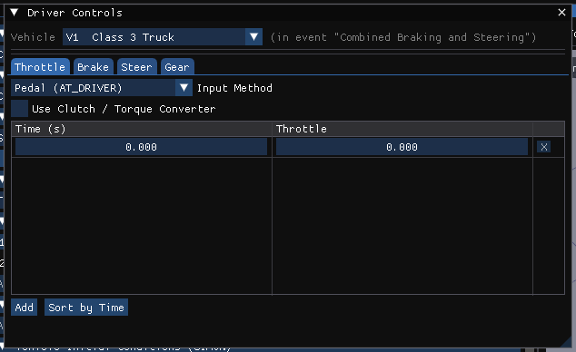

# Driver Controls

The **Driver Controls** dialog holds the time tables that describe how the
driver attempted to control the vehicle: steering, braking, throttle and gear
selection. Open it from **Event › Driver Controls...** in the Event editor
(F5). It is enabled for the simulation methods and for EDCRASH.

The vehicle header at the top picks which of the active event's vehicles to
edit; it offers only vehicles in the event. As in HVE, driver controls are
stored **per event per vehicle**, and the dialog says which event's tables are
being edited. The tables are locked while that event's results are on screen.

The tabs depend on the method:

- **EDCRASH** — a single **Wheel Data** tab. See
  [Driver Controls Wheel Data](DriverControls2.md).
- **Every other method** — **Throttle**, **Brake**, **Steer** and **Gear**
  tabs ([Throttle](DriverControls4.md), [Brake](DriverControls3.md),
  [Gear](DriverControls5.md); Steer is below), plus a **Lean** tab for a
  motorcycle or a vehicle that already has a prescribed lean.
- For a method that does not read driver tables (EDGEN, EDHIS, GATB) a note at
  the top says so.
- For SINGLETRACK the Throttle and Gear tabs are labelled *(not read)*.

!!! note "HVE Studio"
    The HVE Driver (path follower) is a separate dialog in HVE Studio,
    **Event › Path Follower...** — see
    [Driver Controls Path Follower](DriverControls7.md).

### Editing a table

Each row is a **Time (s)** and a value. Double-click or Ctrl+click a cell to
type a value; drag to change it. **Add** appends a row half a second after the
last; **X** at the end of a row deletes that row (the last remaining row cannot
be deleted); **Sort by Time** puts the rows in time order. A per-wheel table
(one column per wheel, headed *A1-R*, *A1-L*, ...) has its own **Add** and
**Discard per-wheel table** buttons. Side **R** is the right wheel.

!!! warning "Not in HVE Studio"
    HVE's **Copy Cell** and **Copy Row** buttons.

## Steer

Applies steer angles that attempt to steer the vehicle.

**Steering-wheel table** — *Time (s) → Angle (deg)*: steering-wheel angle, +right
(clockwise) / −left, from −540 to +540 degrees. The engine divides it by each
axle's steering gear ratio to get the nominal road-wheel angle. This is HVE's
*At Steering Wheel* table.

**At the tires** — when the case carries an HVE *At Axle* table (one column per
wheel), it is shown above the steering-wheel table with a note that it
**overrides** it. These are road-wheel angles: the steering gear ratio and
Ackermann geometry are bypassed, and a non-steerable axle's entries are ignored
by the engines. **Discard per-wheel table** returns to the steering-wheel table.

!!! warning "Not in HVE Studio"
    - A new *At Axle* (at the tires) steer table cannot be created in the
      dialog; it comes from an imported HVE case.
    - The **Use Ackermann Steering** check box.

!!! note "HVE Studio"
    For a **SINGLETRACK** (motorcycle) event the steer table is not a steering
    angle: depending on the event's Method Options it is the **steer torque**
    at the bars (N·m) or the **commanded lean** (deg). The tab says which.

## Lean

!!! tip "New in HVE Studio"
    **Prescribe the lean angle** drives SIMON's roll degree of freedom from a
    *Time (s) → Lean (deg)* table (+ = leaning right) instead of solving it, for
    a motorcycle simulated in SIMON. It is stored with the vehicle, not the
    event, and read by SIMON only. Leaning does not steer the vehicle — supply
    the path as well — and nothing in it computes balance.

## Lights

!!! note "HVE Studio"
    HVE's **Lights** page is a window of its own, **Event › Lights...**,
    enabled for SIMON and EDSMAC4, the methods that switch a vehicle's lamps.
    For each lamp the vehicle's body file defines it sets **Is Active** and the
    activation — **Use Driver Controls** or a **User-Entered** table of **Turn
    On (sec)** / **Turn Off (sec)** times — with **On/Off Cycle Time (sec)**
    and **Min Steer Angle (deg)** where they apply. The lamps themselves are
    defined in **Vehicle › Editors › Vehicle Lights...**.

<!-- NAV -->

---

← Previous: [Contacts Dialog Box](ContactsDlg.md)  |  [Index](README.md)  |  Next: [Driver Controls Path Follower Method](DriverControls1.md) →

<!-- /NAV -->
