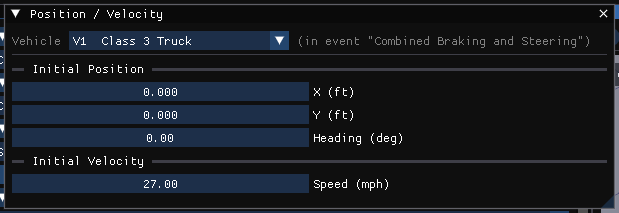

# Position/Velocity Dialog Box

HVE's Position/Velocity dialog assigned positions and velocities to each human
and vehicle at up to eight named path locations. In HVE Studio that information is
split between a small **Position / Velocity** dialog for the starting state, the
initial-conditions section of the [Event Information](EventInfo.md) panel, and
the EDCRASH scene positions in the same panel.

## The Position / Velocity dialog

Open it from **Event › Position / Velocity...**. It is enabled for every method
except EDCRASH and READDATAFILE.

The vehicle header at the top picks which of the event's vehicles to edit. The
dialog edits the same values as the event's **Vehicle Initial Conditions**
section, so a change in either place shows in both:

- **Initial Position** — **X**, **Y** (units set in Preferences) and
  **Heading (deg)**.
- **Initial Velocity** — **Speed** (units set in Preferences).

Everything else about the starting state — Z height, sideslip, yaw rate, roll,
pitch and their rates, Auto Position — is entered in the
[Event Information](EventInfo.md#vehicle-initial-conditions) panel. Vehicles can
also be placed with the viewport gizmo (G move, R rotate).

!!! note "HVE Studio"
    The starting velocity is entered as a **Speed** plus a **Sideslip β** angle
    (Event Information), not as Total / U / V components. There is no
    *Velocity is Assigned* check box and no **Apply** button: edits take effect
    immediately.

## Path locations

HVE's Path Location list is kept for **EDCRASH**, as the **Scene positions**
list in each vehicle's block of the [Event Information](EventInfo.md) panel
(*Vehicle Impact Setup*). Each position that is set is drawn as a ghost
vehicle in the viewport (View › Scene Display › Scene Ghosts). What EDCRASH does with each:

- **Initial** and **Begin Perception** — documentation only; they do not change
  a result.
- **Begin Braking** — EDCRASH back-calculates the speed at Begin Braking from
  this position and the pre-impact drag (Driver Controls › Wheel Data,
  *Total Lock-up*).
- **Impact** and **Final/Rest** — the scene the impact speeds are solved from.
  Both are needed for every vehicle; without them the run is a damage-only
  reconstruction. They are edited in the *Impact* and *Rest* fields of the
  same block (tick **Scene positions known**), with the sideslip at impact and
  the velocity at rest.
- **Separation** — the position where the vehicles separated. Unset, EDCRASH
  assumes they separated where they met.
- **Point On Curve** — makes the post-impact path a curve through this point
  instead of a straight chord (see the *Curved Path* options in
  [Calculation Options for EDCRASH](../10-calculation-options/CalcOptEDCRASHDlg.md)).
- **End of Rotation** — ends the spinout at this position and treats the rest of
  the path to rest as a separate rollout.

Each listed position has an **X**, **Y** and **Heading (deg)**; HVE's Z, roll
and pitch fields are not offered for these positions, nor a velocity except the
velocity at rest.

!!! warning "Not in HVE Studio"
    - Path locations for the simulation methods (everything but EDCRASH) other
      than the initial one. (EDSMAC4 also reads a measured rest position,
      entered under *Measured rest position* in Event Information.) Other
      positions read from an imported HVE case are shown as ghosts but do not
      drive a simulation.
    - Editing a **human's** positions and velocities, except for EDGEN: on an
      EDGEN event the human's eight named positions (position, orientation,
      sideslip and speed) are edited in Event Information, *Humans in Event*.

<!-- NAV -->

---

← Previous: [Inter-Vehicle Connections Dialog](IntrVehConnsDlg.md)  |  [Index](README.md)  |  Next: [Simulation Controls Dialog Box](SimuCtrlDlg.md) →

<!-- /NAV -->
