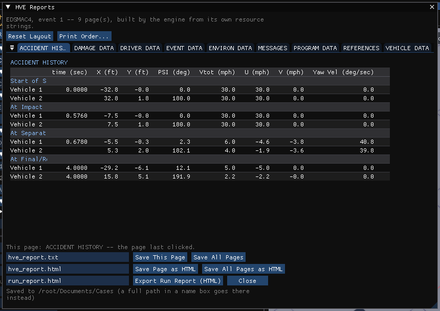
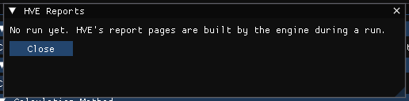

# Common Reports Dialog Box

HVE's Common Reports window displayed the numeric (text) output reports of an
event in Playback mode. In HVE Studio the equivalent is the **HVE Reports** window:
**Output › HVE Reports...** in the Event editor (F5).

The pages are the ones **the engine itself builds** during a run, from HVE's own
report resources — the same reports HVE lists: Program Data, Event Data,
Vehicle Data, Human Data, Environment Data, Driver Data, Results, Accident
History, Damage Data, Injury Data, Messages, References and the like. Which
pages exist depends on the calculation method that ran. The numbers are in the
US or SI units set in Preferences, as HVE prints them in its own unit setting.

## The pages

- A line at the top names the engine, the event and the number of pages, for
  example *SIMON, event 1 -- 9 page(s), built by the engine from its own
  resource strings*.
- **Each page is its own window.** When the window first opens, the pages are
  docked inside it as one row of **tabs**, in print order (below). A tab is
  named from the page, for example *VEHICLE DATA*; if the engine sends the same
  page twice, the second is marked *(2)*. Click a tab to show its page.
- Each page is laid out for reading: the engine's own tables are drawn as
  tables, with headings, the units in the row labels and the numbers
  right-aligned. Text that is not a table — for example the ATB printout of
  GATB — is shown as the engine laid it out. A page scrolls vertically and
  horizontally. If a page holds a record the window cannot read, a note at its
  end says that what is shown is everything before that record.

*HVE Reports after an EDSMAC4 run: the pages as tabs, Accident History showing.*

## Arranging the pages

The pages can be arranged inside the window, or taken out of it, by dragging
their tabs:

- **Side by side** — drag a page's tab onto the left or right side of another
  page. Both pages show at once, next to each other.
- **Stacked** — drag the tab onto the top or bottom edge of another page. The
  two show one above the other.
- **Floating** — drag the tab out of the HVE Reports window. The page becomes a
  window of its own that can be moved anywhere, for example to a second
  monitor.
- **Reset Layout** puts every page back as one row of tabs in the window, in
  print order. Its tooltip repeats how to drag a page.

Report pages dock only with each other, inside HVE Reports; they cannot be
docked into the main window's panels, and other panels cannot be docked among
them. The arrangement is kept from one session to the next, and a page keeps
its place from one run to the next, by its name. Closing HVE Reports closes
every page, floating ones included, and reopening it brings the arrangement
back. Collapsing the window hides the pages docked in it; a floating page
stays up.

The window opens on the page it last showed. The engine's Accident History
is its **ACCIDENT HISTORY** page — see [Accident History](AcciHistDlg.md).

## This page

With more than one page on screen, **This page** says which page **Save This
Page** and **Save Page as HTML** will write: the page last clicked (or
brought forward). The line reads, for example, *This page: VEHICLE DATA -- the
page last clicked.* Click inside a page to make it this page.

## Print Order

**Print Order...** opens a list of the run's pages that sets the order in which
**Save All Pages** and **Save All Pages as HTML** write them, and which pages
they leave out.

- The **tick** beside a page writes it; untick it to leave the page out. A page
  left out is greyed.
- The **up** and **down** arrows move a page one place; a page can also be
  dragged up or down the list.
- **Engine Order, Every Page** goes back to the order the engine built the
  pages in, with every page written.
- **Close** closes the list.

The print order is kept **for each engine** — each calculation method builds
its own set of pages — and is saved with the preferences, so it applies to
every case run with that method until it is changed. A page that the saved
order has never seen (a page another case produced for the first time) goes
after the ordered pages, in the engine's own order. Where the pages sit on
screen does not change the print order: a page beside another on screen is not
next to it on paper.

When pages are left out, the window says so beside **Print Order...**, for
example
*Save All writes 7 of 9 page(s).* If every page is left out, the two **Save
All** buttons are greyed.

## Saving the pages

The bottom of the window holds three file-name fields, each followed by its
buttons:

- The first field (default `hve_report.txt`) is for text. **Save This Page**
  writes this page. **Save All Pages** writes every page in print order, each
  under a line naming it (for example `==== RPT_VEHICLE_DATA ====`), the pages
  left out omitted. A text file is the page as the engine laid it out, in
  spaces, so open it in a fixed-width font to print it.
- The second field (default `hve_report.html`) is for HTML. **Save Page as
  HTML** writes this page, even one left out of the print order. **Save All
  Pages as HTML** writes every page in print order, the pages left out
  omitted, with a list of contents. Each page is laid out as tables, as in
  the window. Open the file in a browser to print it, or print it to PDF.
- The third field (default `run_report.html`) is for **Export Run Report
  (HTML)**, which writes HVE Studio's own printable summary of the run (inputs,
  key results and a plan view of the trajectories). It is not one of the
  engine's pages.

A file name without a folder is saved **beside the case file** (in the folder
HVE Studio was started from, for a case that has never been saved); a full path
in a name field saves there instead. Before anything is saved, the last line of
the window names the folder; after a save it gives the full path of the file
written and its size, or says the file could not be opened for writing.

**Close** closes the window and every page with it.

When there are no pages the window says why:

*HVE Reports before a run.*

- *No run yet* — run the event first.
- *ran and built no pages* — what a refused or aborted run looks like; read the
  run status in the Simulation panel.
- SINGLETRACK (HVE Studio's motorcycle model) is not an HVE engine and has no
  report pages.
- If an engine's report resource file is missing, the window names the folder
  it looked in.

!!! note "HVE Studio"
    HVE Studio's own views of the same results are the **Key Results**
    and **Output Graph** windows (Output menu), and the
    [Results HUD](../new-features/11-results-hud.md) over the viewport. The HVE
    Reports pages are what the engine printed; the others are what HVE Studio
    computed from the run.

!!! tip "New in HVE Studio"
    In HVE each report was a window of its own in the Playback editor. HVE Studio
    keeps every page of a run in one window, with the side-by-side, stacked and
    floating arrangements, the print order and the HTML output described
    above.

!!! note "HVE Studio"
    HVE's graphic reports (Site Drawing, Damage Profiles, Momentum Diagrams) are
    not shown in this window — see [Common Scene Report](CommSceDlg.md). The
    *Event Notes* entered with **Event › Notes** are kept with the case but are
    not a report page.

<!-- NAV -->

---

← Previous: [Collision Pulse](ColPulse.md)  |  [Index](README.md)  |  Next: [Common Scene Report Dialog](CommSceDlg.md) →

<!-- /NAV -->
