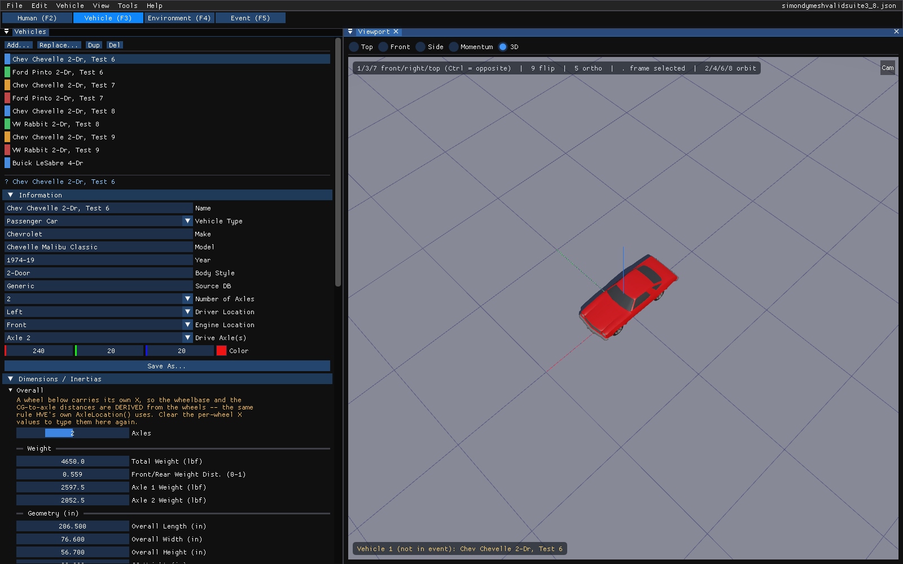
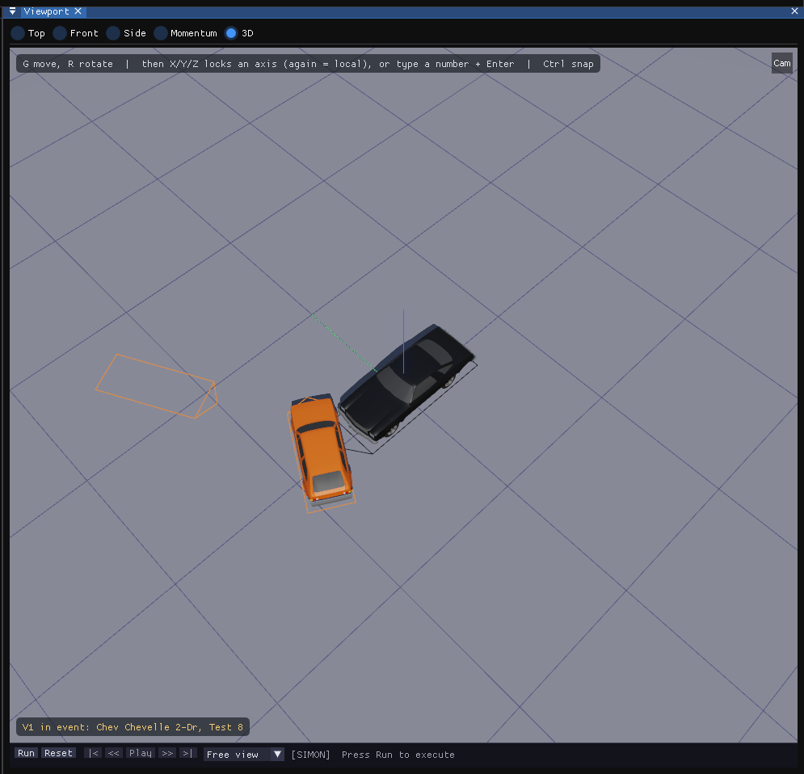

# Using HVE — High-Level Overview

*The HVE Studio edition of the HVE User's Manual (HVE Version 5, Seventh Edition,
January 2006), "USING HVE — High-level Overview" (pages Overview-1 through
Overview-10).*

## Assumptions

HVE was developed for use by engineers and scientists who need a powerful
simulation tool to study vehicle and occupant dynamics. HVE was also developed
for motor vehicle safety researchers and crash reconstructionists who need to
analyze motor vehicle dynamics, including collisions, and show or explain to
others how accidents occur by analyzing and visualizing the sequence of events
surrounding the accident. HVE Studio serves the same users with the same physics
programs and a new user interface (see
[What is HVE Studio?](../../getting-started/01-what-is-hve-studio.md)).

An individual using HVE Studio should possess the following background and
experience:

- basic knowledge about computer systems (using a file system and a windowed
  desktop)
- technical knowledge in the area of engineering mechanics (the laws of
  motion) and mathematics (coordinate systems, algebra and trigonometry)
- knowledge about vehicles and how they work (general terminology)
- knowledge about human anatomy (general terminology)
- accident reconstruction experience (gathering and interpreting accident site
  evidence and drawing conclusions about accident causation)

Prior to using HVE Studio, it is assumed the researcher has obtained all the
required human, vehicle and environment data, either by direct inspection or by
indirect means (built-in databases, literature searches, published data or, in
some cases, witness information).

## How To Use This Manual

This is a User's Manual. It explains how to use the program. It does not
directly teach the subject of human and vehicle dynamics, or explain how to
reconstruct motor vehicle crashes. Further, this manual does not attempt to
explain how specific reconstruction and simulation models work. For these
details, consult the manual for the particular reconstruction or simulation
model (see the [program manuals](../../programs/README.md)).

!!! note "HVE Studio"
    This manual set is the HVE manual set, adapted. Where HVE Studio differs from
    HVE, the page says so in a box like this one; **Not in HVE Studio** boxes mark
    HVE features HVE Studio does not have, and **New in HVE Studio** boxes mark
    features HVE does not have.

Every new user should read the following:

| Topic | Reference |
| --- | --- |
| Getting started with HVE Studio | [What is HVE Studio?](../../getting-started/01-what-is-hve-studio.md), [Installing and running](../../getting-started/02-installing-and-running.md), [Interface tour](../../getting-started/03-interface-tour.md) |
| High-level Overview | (this section) |
| What Is HVE | [Chapter 1](01-what-is-hve.md) |
| How To Use HVE | [Chapter 2](02-how-to-use-hve.md) |
| Menus | [Section Two: Menu Reference](../02-menu-reference/README.md) |
| Human Editor | [Humans](../../07-humans/README.md) |
| Vehicle Editor | [Vehicles](../../02-vehicles/README.md) |
| Environment Editor | [Environment](../../08-environment/README.md) |
| Event Editor | [Events & Driver Controls](../../09-events-driver-controls/README.md) |
| Results and playback | [Reports & Output](../../11-reports-output/README.md) |
| Tutorial | [Tutorial](../11-appendices/32-tutorial.md) |
| What is different | [Differences from HVE](../../getting-started/05-differences-from-hve.md) |

This information will allow you to begin right away. You will also need
specific information from time to time; use the other chapters in this manual as
a reference.

## Step-by-step Procedure

The following procedure outlines the basic steps for using HVE Studio:

| Step | Where in HVE Studio | Reference |
| --- | --- | --- |
| Open an HVE case, or start a new one | File › Open Case... / New Case | [File Menu](../02-menu-reference/03-files-menu.md) |
| Select and edit humans | Human editor (F2), Occupants panel | Ch. 8, 9 |
| Select and edit vehicles | Vehicle editor (F3), Vehicles panel and Vehicle menu | Ch. 10, 11 |
| Create and edit the environment | Environment editor (F4), Environment panel | Ch. 12, 13 |
| Create events (humans, vehicles, calculation method) | Event editor (F5), Event Information | Ch. 15 |
| Set up events (positions and velocities, driver controls, damage, payload, collision pulse, mesh, wheels, accelerometers, restraints) | Event editor, Event menu | Ch. 16; [Event Menu](../02-menu-reference/04a-setup-menu.md) |
| Execute events | **Run** on the playback bar, or Output › Run Simulation... | [Chapter 2](02-how-to-use-hve.md#executing-events) |
| Review results and play them back | the viewport and playback bar; Output menu | Ch. 17; [Output Menu](../02-menu-reference/04d-output-menu.md) |
| Combine several events into one sequence | the Playback (F6) editor | Ch. 18 |
| Export for rendering | File › Export Scene for Blender, Blender Live Link | [File Menu](../02-menu-reference/03-files-menu.md) |
| Save your work | File › Save Case (Ctrl+S) | [Case files](02b-how-to-use-hve.md#creating-case-files) |

!!! note "HVE Studio"
    HVE's step "Create a Videotape" (later, a video file with File › Video
    Creator) is **File › Record Animation** in HVE Studio: it records the
    playback to a video file (Motion-JPEG AVI), optionally with the Results HUD
    burned in. See [Video and Playback Sequences](../../new-features/07-video-and-playback-sequences.md).
    For a rendered animation, export the scene to Blender and render it there.

## Conventions

The following typographical conventions are used in this manual:

- **Bold** — names of menus, menu items, buttons, panels and fields, as they
  appear on screen.
- **Menu › Item** — a menu path. *File › Save Case* means: open the File menu
  and choose Save Case.
- **Select** — to click on an item. The item is highlighted; no action follows
  until another action is chosen.
- **Choose** — to click on an item that performs an action.
- *Italicized words* — emphasis, or a term being introduced.
- `Filename` — monospace is used for file names, file extensions and text you
  type.
- **Ctrl+S**, **F5** — keys and key combinations.
- **[1.1, 1.2]** — numbers in brackets designate references found in
  [Appendix VI](../11-appendices/appendix-06-references.md). The first number is
  the material category, the second the reference number.

Values are shown in the units chosen in **Tools › Preferences** (Metric or
Imperial). The manual quotes HVE's own units where the physics is described in
them.

## Problem Determination

Before deciding a result is wrong, or that the program has a fault:

- **Review the manual** — most usage questions are covered, and every
  difference from HVE is marked.
- **Read what the program says** — HVE Studio reports problems with the open case
  in the panel concerned (for example, geometry that could not be found, a
  calculation method the event's vehicles cannot use, or an input the engine
  will refuse). Hover over a control for its tooltip, and turn on **View › Show
  Guidance Text** for the longer explanations. A message about a problem with
  the case is shown whatever that switch is set to.
- **Check the Simulation panel** — after a run, its status line says how the run
  ended; an engine's own error message appears there.
- **Read the Audit Log** — **Tools › Audit Log** keeps a time-stamped record of
  what was opened, saved, run and changed.
- **Duplicate the problem** — retrace your steps and note exactly how the
  problem occurs.
- **Create a least bombable case** — EDC's in-house term: strip out every
  detail that does not matter to the problem before you begin testing.

!!! note "HVE Studio"
    HVE Studio's Help menu has no Tech Support item. Questions and
    problem reports about the preview go to EDC. With a problem report, send
    the case file, the steps that produce the problem, the version shown in
    **Help › About HVE Studio...**, and on Windows the program's log,
    `hve-next.log` (and `hve-next.crash.txt`, if there is one; see
    [Installing and Running](../../getting-started/02-installing-and-running.md#log-and-crash-files)).

## Window Basics

HVE Studio runs in one window. It does not use separate editor windows or modal
dialogs the way HVE did.

*The HVE Studio window in the Vehicle editor: the menu bar, the editor tabs, the
Vehicles panel docked on the left and the 3-D viewport on the right.*

### Components

- **Menu Bar** — **File, Edit, View, Tools, Help**, plus the menu of the
  current editor: **Occupant** (Human editor), **Vehicle**, **Environment**,
  **Event** and **Output** (Event editor), or **Playback** (Playback editor).
  The open case's name is at the right, with `*` when it has unsaved changes.
  See the [Menu Reference](../02-menu-reference/README.md).

*The menu bar and the editor tabs.*

- **Editor tabs** — **Human (F2)**, **Vehicle (F3)**, **Environment (F4)**,
  **Event (F5)** and **Playback (F6)**, under the menu bar. They replace HVE's mode buttons and Mode
  menu. Each editor shows its own panels.
- **Panels** — the editors' contents (Vehicles, Occupants, Environment, Event
  Information, Simulation, Key Results, and so on) are panels docked around the
  viewport. Drag a panel's tab to dock it elsewhere or float it; close it with
  its **×** and re-open it from the menus. With **View › Panels Outside the Main
  Window** (after a restart) a panel can be dragged out of the main window onto
  another monitor.
- **Dialogs** — the windows opened from the menus float over the panels. Most
  take effect as you edit them: there is usually no **OK** or **Cancel**. Undo a
  change with **Edit › Undo** (Ctrl+Z).
- **Viewport** — the 3-D view, used in every editor. The view cube in its
  top-right corner sets a preset view (click a face for that view, orthographic;
  drag the cube to orbit), and the buttons under it zoom, pan, look through the
  scene camera and switch between perspective and orthographic. A line of hints across
  the top lists the keys that apply. In the Event editor the **playback bar**
  under the viewport carries **Run**, **Reset**, the playback buttons, the camera
  list and the run status.

*The viewport in the Event editor, with the playback bar along its bottom edge.*

### Mouse

In the viewport:

| Action | Does |
|---|---|
| Click (left button, without moving) | Select a vehicle, a ghost or waypoint, or (Environment editor) a surface |
| Left drag on empty space | Orbit the view |
| Left drag on the selected object | Move it, or drag one of its gizmo handles (Event editor) |
| Right drag | Pan the view |
| Right click (without moving) | The viewport menu: **Camera Properties...**, **Reset Camera** |
| Wheel | Zoom |
| Middle drag; Shift+middle drag; Ctrl+middle drag | Orbit; pan; zoom (Blender's bindings — the middle button never moves an object) |
| Double-click | Reset the view |

Elsewhere, hovering over a control shows its tooltip. A numeric field can be
dragged left or right to change its value; double-click it (or Ctrl+click it) to
type a value.

### Keyboard

| Keys | Do |
|---|---|
| F2, F3, F4, F5 | Human, Vehicle, Environment, Event editor |
| Ctrl+N, Ctrl+O, Ctrl+S | New, open, save case |
| Ctrl+Z; Ctrl+Y or Ctrl+Shift+Z | Undo; redo |
| G, R, then X / Y / Z, a number, Enter; Ctrl to snap | Move or rotate the selected vehicle (Event editor) |
| Esc | Clear the selection; cancel a move; cancel a run in progress |
| Delete or X | Delete the selected path waypoint |
| 1, 3, 7 (with Ctrl: the opposite view), 9, 5, 4/6/8/2, . | Front, right, top views; opposite side; perspective/orthographic; orbit in 15° steps; frame the selection |
| C, Shift+C | Next / previous saved camera |
| H, Shift+H, Alt+H | Hide the selected vehicle; hide the other vehicles; show all vehicles (Event and Playback editors, view only, not saved) |
| Tab | Edit Mode (Vehicle editor: select parts of the body; Environment editor: select faces of the site) |

Keys act in the viewport only when you are not typing in a field.

!!! warning "Not in HVE Studio"
    HVE's viewer thumb wheels, its Pick and Manipulate modes, and its separate
    mouse pointer tools (Figure 3 of the HVE manual) do not exist; the mouse and
    keys above replace them.

<!-- NAV -->

---

← Previous: [HVE User's Manual — Section One: Overview](README.md)  |  [Index](README.md)  |  Next: [Chapter 1 — What Is HVE?](01-what-is-hve.md) →

<!-- /NAV -->
