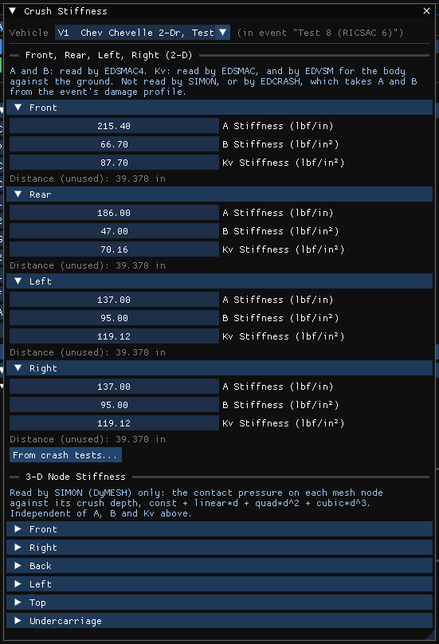
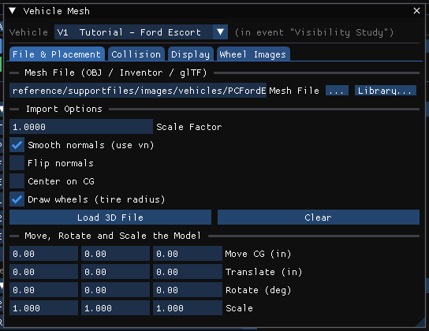
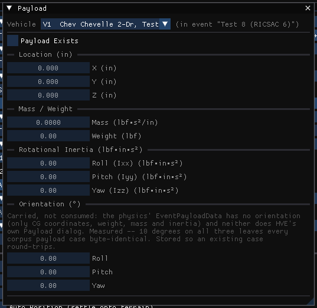
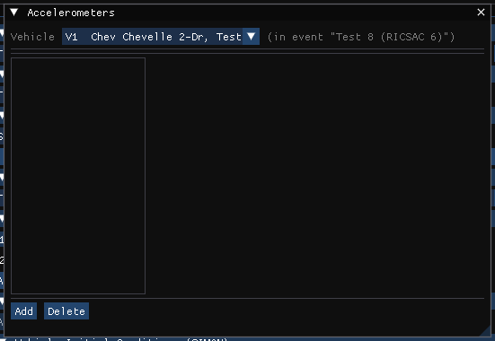
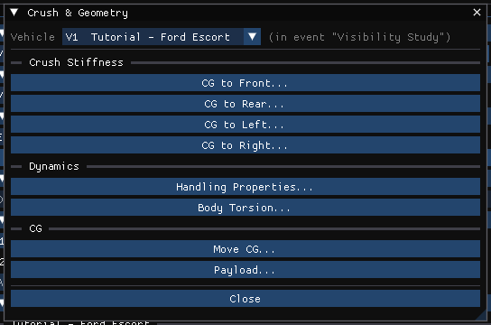

# Chapter 4: Event Menu (Part B — Damage Profiles through Notes)

*HVE User's Manual — Section Two: Menu Reference, HVE Studio edition. Replaces
HVE's Chapter 4, Set-up Menu, Part B. Which items are available for which
calculation method is tabulated in [Part A](04a-setup-menu.md#which-items-apply-to-which-method).*

Each item below edits the selected vehicle of the active event unless it says
otherwise. As in Part A, the fields are locked while the event's results are on
screen; press **Reset** to edit.

| HVE Set-up item | HVE Studio |
|---|---|
| Damage Profiles (Vehicle Damage) | Event › **Damage Profiles...**, which opens Event Information › **Vehicle Impact Setup** (CDC, PDOF, crush) — EDCRASH; the vehicle's crush stiffness is Vehicle › **Editors › Crush Stiffness...** |
| Collision Pulse | Event › **Collision Pulse...** |
| Vehicle Mesh | Event › **Vehicle Mesh...** (also Vehicle › Editors › Vehicle Mesh..., and **Vehicle Mesh...** in the Vehicles panel's 3D Geometry section) |
| — (Options › DyMESH in HVE) | Event › **DyMESH Options...** |
| Payload | Event › **Payload...** |
| Wheels | Event › **Wheels...** |
| Accelerometers | Event › **Accelerometers...** |
| Contacts | Event › **Contacts...** (EDSMAC4, EDHIS, GATB) — see [CONTACTS](#contacts) |
| Restraints › Airbags, Belts | Event › **Restraints...** › Airbags..., Belt Restraint... |
| Signals | Not in HVE Studio — see [SIGNALS](#signals) |
| Driver Controls › Lights page | Event › **Lights...** (SIMON, EDSMAC4) — see [LIGHTS](#lights) |
| Notes | Event › **Notes** |

---

## DAMAGE PROFILES (VEHICLE DAMAGE)

**Menu Option:** Event › Damage Profiles... (Ctrl+M; EDCRASH)

**Purpose:** Enter the measured damage of the selected vehicle.

**Description:** In HVE Studio the damage *measurements* and the vehicle's
*stiffness* are in two places:

- The **measured damage** — impact speed, **CDC**, **PDOF** (or *Auto-calculate
  PDOF from the other vehicle*), the EES or damage-profile **basis**, the A and
  B stiffness EDCRASH uses, and **Measured Crush**: damage width, damage offset,
  the crush depths and per-zone A and B stiffness — is entered per vehicle in
  Event Information's **Vehicle Impact Setup** section. **Event › Damage
  Profiles...** opens that section.
- **Vehicle › Editors › Crush Stiffness...** (Vehicle editor) holds the vehicle's own crush
  **stiffness** for the simulations — Front, Rear, Left and Right, each with its
  A, B and Kv stiffness — and the **3-D Node Stiffness** used by DyMESH
  (constant, linear, quadratic and cubic terms per zone, conversion height,
  saturation and maximum crush).

The CDC must be a valid seven-character code. EDCRASH needs at least two crush
depths to form a crush profile; with fewer, its Delta-V stays zero.

*The Crush Stiffness dialog (captured under its earlier title, Damage
Profiles).*

!!! note "HVE Studio"
    HVE's *Use Newton's 3rd Law* option corresponds to **Auto-calculate PDOF
    (from the other vehicle)** in Vehicle Impact Setup.

See the dialog reference: [Damage Data](../../11-reports-output/DamageData.md) and
[Stiffness Coefficients](../../02-vehicles/StiffCoeffDlg.md).

---

## COLLISION PULSE

**Menu Option:** Event › Collision Pulse... (EDCRASH, SIMON, EDHIS, GATB)

**Purpose:** Assign the collision pulse that drives an occupant simulation.

**Description:** An occupant run is driven by the vehicle's motion. The dialog
shows where the pulse came from (entered or imported here, or generated from
another event's run), and offers:

- **Pulse source** — choose another event of the case that runs this vehicle and
  **Take pulse from this event**: the forward and lateral acceleration and the
  yaw come from that run (HVE's *Pulse Data Source*)
- **Pulse type** — how the table is interpreted (HVE's *Pulse Type*); **Clear
  pulse** removes it
- **Start time** and **Threshold (g)**, and for the impulse pulse type the
  **Impulse centre X, Y, Z**, which only that type reads (HVE's *Collision
  Pulse Options*). The threshold reaches no engine, in HVE or in HVE Studio.
- **Scale factors** — a factor for each column (HVE's *Collision Pulse
  Factors*)

The dialog says which method reads which part: for example, SIMON reads only the
impulse table.

*The Collision Pulse dialog for an EDCRASH vehicle.*

**Opening and saving collision pulse files.** Below the options, the pulse
table (time, then forward, lateral and vertical acceleration and roll, pitch and
yaw acceleration) can be edited row by row (**Add row**), and **Import file...**
and **Export file...** read and write it as a text file of seven numbers per
line, time first. Lines that do not carry seven numbers are skipped, and the
dialog says how many.

See the dialog reference: [Collision Pulse](../../11-reports-output/ColPulse.md),
[Collision Pulse Factors](../../11-reports-output/ColPulFact.md) and
[Collision Pulse Options](../../11-reports-output/ColPulOptDlg.md).

---

## VEHICLE MESH

**Menu Option:** Event › Vehicle Mesh...

**Purpose:** Assign and prepare the selected vehicle's 3-D body mesh.

**Description:** The Vehicle Mesh window has four tabs:

- **File & Placement** — the mesh file (OBJ, glTF, Open Inventor, `.h3d` or a
  point-cloud scan) with **...** and **Library...**, its import options,
  **Load 3D File** and **Clear** with the load status, and moving, rotating and
  scaling the model to the vehicle (Move CG, Translate, Rotate, Scale).
- **Collision** — what DyMESH collides (a triangle budget, a closed outer
  shell, which parts collide), the scan tools for a point-cloud body, and the
  vehicle's default **DyMESH Contact Mesh Preparation** — HVE's tessellate,
  maximum side length and vertex weld distance. An event can state its own,
  in **Event › DyMESH Options** (below).
- **Display** — opacity, round shell, a second **display mesh** drawn instead
  of the collided one, shading and how damage is displayed.
- **Wheel Images** — the picture on each wheel's face.

The same window is on the Vehicle menu, and **Vehicle Mesh...** in the
Vehicles panel's **3D Geometry** section opens it; see
[Geometry File](../04-vehicle-editor/11a-sprung-mass.md#geometry-file).

*The Vehicle Mesh window.*

!!! note "HVE Studio"
    HVE's *Inter-vehicle Options* correspond to the **DyMESH Options** dialog's
    *Inter-Vehicle Contact (fallback)* section (friction and relaxation length)
    and its per-pair override.

---

## DYMESH OPTIONS

**Menu Option:** Event › DyMESH Options... · *HVE: Options › DyMESH*

**Purpose:** Set the DyMESH contact options for the active event.

**Description:** Sections for **Start Times**, **Contact Search**, **Contact
Model**, **Restoration**, **Inter-Vehicle Contact (fallback)**, a
**Per-pair override** and, at the end, **Contact Mesh Preparation (per
vehicle)**: for each vehicle in the active event, **This event states its own
preparation** and, when it is ticked, that event's **Tessellate**, maximum
triangle leg and weld distance, which outrank the vehicle's defaults (Vehicle
Mesh › Collision). They are read by SIMON's DyMESH, and by EDSMAC4 when it
initialises its rho vectors from the vehicle mesh. Options that the engine
carries but does not read are labelled as such in the dialog, with the
reason.

*The DyMESH Options dialog.*

See [Chapter 6](06-options-menu.md#dymesh) for the mapping from HVE's DyMESH
Options dialog.

---

## PAYLOAD

**Menu Option:** Event › Payload... (SIMON, EDSMAC4, EDSVS, EDVDS, EDVTS)

**Purpose:** Add a load to the selected vehicle for this event.

**Description:** Tick **Payload Exists**, then enter the load's **Mass /
Weight**, its CG, and its rotational inertia (Roll Ixx, Pitch Iyy, Yaw Izz)
about its own CG. As in HVE the payload is stored per event per
vehicle: another event can load the same vehicle differently.

*The Payload dialog.*

See the dialog reference: [Payload](../../02-vehicles/PayLoadDlg.md).

---

## WHEELS

**Menu Option:** Event › Wheels... (methods with driver controls)

**Purpose:** Per-wheel event conditions.

**Description:** The Wheels dialog has four pages, each a table with one column
per wheel:

- **Tire Blowout** — HVE's *Tire Blow-out Option*
- **Wheel Damage** — HVE's *Wheel Damage Option*
- **Brake** — HVE's *Wheel Brakes Option*: initial pad/lining and rotor/drum
  temperatures, initial stroke, brake failure (start, duration, extent), and
  an antilock override for this event. The page notes which values only SIMON
  reads
- **Terrain Model** — HVE's *Tire-Terrain Option* (point contact, radial spring,
  sidewall, soft soil)

The dialog notes which methods do not read a page (for example, a method that
does not model tire blowout or wheel damage).

*The Wheels dialog.*

See the dialog reference: [Wheels](../../05-tires-wheels/WheelsDlg.md).

---

## ACCELEROMETERS

**Menu Option:** Event › Accelerometers... (SIMON, EDSMAC4, EDVDS, EDVSM) ·
also Vehicle › Editors › Accelerometers...

**Purpose:** Place accelerometers on the selected vehicle.

**Description:** Each device has an in-use switch and a location on the vehicle.
**View › Scene Display › Accelerometer Path** draws each installed device's path after a run.

*The Accelerometers dialog.*

See the dialog reference: [Accelerometers](../../06-safety-systems/AcclMtrsDlg.md).

---

## CONTACTS

**Menu Option:** Event › Contacts... (Ctrl+T; EDSMAC4, EDHIS and GATB events)

**Purpose:** For an EDHIS or GATB event, choose which human ellipsoids may
interact with which vehicle contact surfaces (and, for GATB, which body
segments with which). For an EDSMAC4 event, list the contact surfaces assigned
for the event.

**Description:** For an occupant or pedestrian event the **Occupant Contacts**
dialog names the human and the vehicle and shows a grid of the human's
segments (rows) against the vehicle's contact surfaces (columns); a ticked box
is an armed pair. An imported HVE case shows HVE's own list. An event with no
stored list shows the default the run generates — every ellipsoid of the
pelvis, abdomen, chest, neck, head and upper legs against every surface — and
says so; the first click stores it. **Arm All**, **Pelvis Only** and **Use
Run-Time Default** set the whole list at once, and the last armed pair cannot
be removed. For GATB a second grid arms body segments against each other
(self contact). Contact blocks an imported case states against a vehicle the
event does not select are listed read-only under **Other contact blocks**, each
as the human, the vehicle and its number of armed pairs. Vehicle contact surfaces themselves
are edited in the Vehicle editor (Vehicle › Editors › Contact Surfaces...).

!!! note "HVE Studio"
    HVE's combined material properties and material files are not part of
    this dialog: the per-surface combined materials are in Event Information ›
    **Combined Contact Materials**, and `.matl` files are not read.

---

## RESTRAINTS

**Menu Option:** Event › Restraints... › Airbags..., Belt Restraint...
(EDHIS, GATB) · also on the Vehicle menu

**Purpose:** Set up the airbags and belts of the selected vehicle for the
occupants.

**Description:** The Airbags and Belt Restraint System dialogs.
While either is open, the restraint equipment is drawn in the viewport; **View ›
Scene Display ›
Occupant Equipment** draws it at any time.

*The Belt Restraint System dialog.*

!!! note "HVE Studio"
    The Event menu's Restraints submenu is offered for the occupant methods,
    EDHIS and GATB. The same dialogs are on the Vehicle menu (Vehicle ›
    Editors › Airbags..., Belt Restraint...).

See the dialog reference: [Airbag](../../06-safety-systems/AirBagSysDlg.md) and
[Belt Restraint System](../../06-safety-systems/BeltResSysDlg.md).

---

## SIGNALS

**HVE menu option:** Set-up › Signals

!!! warning "Not in HVE Studio"
    HVE's traffic signal timing (cycle, green and yellow time) is not in
    HVE Studio: no engine reads it, so the Event menu has no Signals item.

---

## LIGHTS

**Menu Option:** Event › Lights... (SIMON, EDSMAC4)

**Purpose:** Choose which of the selected vehicle's lamps the run switches on,
and when.

**Description:** One setup per lamp the vehicle's body file tags. Tick **Is
Active**, then choose the **Activation**: **Use Driver Controls** (brake, backup
and signal lamps) or **User-Entered**, a table of **Turn On** and **Turn Off**
times (**Add Row**, **Remove Last Row**). Signal and flasher lamps also take an
on/off cycle time. An event with nothing edited uses HVE's defaults: brake and
backup lamps follow the driver controls, and every other lamp is off. The lamps
themselves are defined in the Vehicle editor (Vehicle › Editors › Vehicle Lights...).

!!! note "HVE Studio"
    In HVE this was the Lights page of the Driver Controls dialog.

---

## NOTES

**Menu Option:** Event › Notes

**Purpose:** Keep notes with the active event.

**Description:** A text box for the active event's notes, saved with the case.
Notes can be edited while results are on screen: they are documentation and do
not affect the run.

---

## IMPACT PLANE / BARRIER

**Menu Option:** Event › Impact Plane / Barrier... (shown for EDCRASH, greyed)

!!! warning "Not in HVE Studio"
    Not implemented. Model a barrier as a **Fixed Barrier** vehicle (vehicle type
    in the Vehicles panel's Identity section).

---

## CRUSH PROFILE

**Menu Option:** Event › Crush Profile... (EDCRASH, EDSMAC, EDSMAC4)

**Purpose:** The selected vehicle's crush stiffness and related data.

**Description:** Opens the **Crush & Geometry** hub for the selected vehicle,
whose buttons open the related dialogs: under **Crush Stiffness**, **CG to
Front...**, **CG to Rear...**, **CG to Left...** and **CG to Right...** (the
stiffness of each side); under **Dynamics**, **Handling Properties...** and
**Body Torsion...**; under **CG**, **Move CG...** and **Payload...**.

*The Crush & Geometry hub.*

---

## HANDLING PARAMETERS

**Menu Option:** Event › Handling Parameters... (EDSMAC, EDSMAC4)

**Purpose:** The simplified handling properties used by the 2-D models.

**Description:** The Handling Properties dialog: Total Understeer, Roll
Gradient, Roll Couple Distribution and Weight Distribution (front).

!!! note "HVE Studio"
    HVE's Wheel Sensitivity and Static Weight Front / Rear are not offered: no
    engine reads them.

---

## MOVE CG

**Menu Option:** Event › Move CG... (EDSMAC, EDSMAC4)

**Purpose:** Shift the selected vehicle's CG.

**Description:** Enter ΔX, ΔY and ΔZ and press **Apply**. The CG moves relative
to the body; the wheels, equipment and occupants stay put, and every distance
measured from the CG follows. CG Height is read-only and shows the result.

See the dialog reference: [Move CG](../../02-vehicles/MoveCGDlg.md).

<!-- NAV -->

---

← Previous: [Chapter 4: Event Menu (Part A)](04a-setup-menu.md)  |  [Index](README.md)  |  Next: [Chapter 4C: Vehicle, Environment and Occupant Menus](04c-vehicle-environment-occupant-menus.md) →

<!-- /NAV -->
