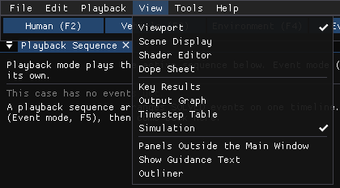
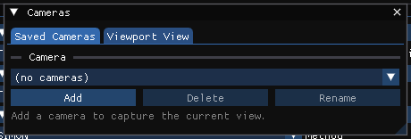

# Chapter 5: View Menu

*HVE User's Manual — Section Two: Menu Reference, HVE Studio edition. Replaces
HVE's Chapter 5, View Menu, and takes over most of the display switches of HVE's
Options menu (see [Chapter 6](06-options-menu.md)).*

The View menu is on the menu bar in every editor. It shows and hides panels, and
holds two settings that are not about the scene. What the viewport draws is chosen
in the **Scene Display** panel, which **View › Scene Display** opens; its switches
change what is drawn, never a result.

*The View menu.*

HVE's View menu items map as follows:

| HVE item | HVE Studio |
|---|---|
| Toolbar | Not in HVE Studio — see [TOOLBAR](#toolbar) |
| Status Bar | Not in HVE Studio — see [STATUS BAR](#status-bar) |
| Set Camera | **Tools › Cameras...**, or right-click the viewport › **Camera Properties...** — see [SET CAMERA](#set-camera) |
| Overlays | **View › Outliner** for site layers; **Environment › Aerial Image...** for a scanned image — see [OVERLAYS](#overlays) |

---

## PANELS

| Item | Shows or hides |
|---|---|
| **Viewport** | The 3-D viewport |
| **Scene Display** | The panel holding every switch that changes what the scene draws — see [SCENE DISPLAY](#scene-display) |
| **Shader Editor** | The node-material editor for vehicles, road surfaces and the world (display only) |
| **Dope Sheet** | Every keyframed material and camera value on one time axis |
| **Key Results** | The Key Results panel (Event and Playback editors) |
| **Results HUD** | The Results HUD window: boxes of solved numbers drawn over the viewport and into recorded videos, saved with the case (every editor) — see [Results HUD](../../new-features/11-results-hud.md) |
| **Output Graph** | The Output Graph panel (Event and Playback editors) |
| **Simulation** | The Simulation panel: simulation controls, Run / Reset and the last result (Event editor) |
| **Outliner** | The site's layers and surfaces — see [OUTLINER](#outliner) |

Key Results and Output Graph are drawn only in the Event and Playback
editors, and Simulation only in the Event editor; elsewhere their items are
greyed. Panels dock: drag a panel's tab to move it to another dock position
or to float it.

!!! tip "New in HVE Studio"
    The Shader Editor, Dope Sheet and Results HUD are new in HVE Studio. They
    change only what the scene shows, never a result.

---

## SCENE DISPLAY

**View › Scene Display** opens the panel that holds every switch changing what
the scene draws, so they can be left on screen beside the Viewport. It is in
every editor, docks like any other panel, and remembers whether it was open.
These switches are only in this panel, not on the View menu.

Its groups are **Vehicles Shown** (see [VEHICLES SHOWN](#vehicles-shown)),
**Paths & Overlays** (the paths, Axes, the CG markers, Lamp Gizmos, North
Arrow, Skidmarks, occupant equipment, the two Through Bodywork switches and
Path thickness), **Vehicle**
(Vehicle Extents, See-Through Body and the DyMESH overlay table), **Vectors**
(with the arrow scales), **Scene Ghosts**, **Light & Shadow** (Scene Lighting,
**Lamps**, the shadow coverage, Site Shadows, Contact Shadows, Ambient
Occlusion), **Sky & Reflections** (Default Sky, Sky Reflections, Distance Haze,
Wet Ground, Ground Reflections) and **Rendering**. Click a group's header to fold it away. A greyed switch says why
when you point at it.

The sections below describe each group.

---

## VEHICLES SHOWN

The first group of the Scene Display panel lists the case's vehicles, each with a
checkbox. Untick a vehicle to take it out of the 3-D view of the Event and
Playback editors, for example to see one vehicle's damage where the other stands.
**Show all** puts every vehicle back. A hidden vehicle's ghosts and tire marks are
hidden with it.

The same set of hidden vehicles is changed from several places:

- in the 3-D view, **H** hides the selected vehicle, **Shift+H** hides every other
  vehicle, and **Alt+H** shows them all;
- the **Shown** checkbox on each row of the Event editor's Vehicles in Event list;
- the **Shown in the view:** checkboxes in the Playback Sequence window;
- the eye beside each vehicle in the Outliner's **Vehicles** group (Ctrl-click an
  eye to show only that vehicle).

While any vehicle is hidden, an amber note at the top left of the view names the
hidden vehicles, with a **Show all** button.

Hiding a vehicle is a view setting only: the case, its results and the run are
unchanged, nothing is saved, and opening another case shows every vehicle again.
The Vehicle editor always draws the vehicle it edits. Panels, **Outliner**, **Panels Outside
the Main Window** and **Show Guidance Text** stay on the View menu, because they
do not change the scene.

---

## PATHS AND MARKS

In the Scene Display panel's **Paths & Overlays** group. These draw what a solved
run leaves behind, and the case's axes.

| Item | Draws |
|---|---|
| **Accelerometer Path** | One path per installed accelerometer, at the device's own position (HVE: Show Accelerometer Paths) |
| **Tire Contact Patch Paths** | Where each tire actually touched the ground, one path per wheel (HVE: Show Tracks) |
| **Axes** | The case's axes at the origin, and each vehicle's own axes at its CG (X red, Y green, Z blue, drawn up). On by default |
| **Sprung CG** | Each vehicle's sprung-mass CG, the point every "CG to ..." distance is measured from. On by default, independent of Axes |
| **Total CG** | Each vehicle's total-mass CG (sprung and unsprung masses together), labelled with its offset from the sprung CG. On by default |
| **CG Weights** | Adds to each CG label the weight it carries: the sprung weight at the Sprung CG, the total weight at the Total CG, in the units set in Preferences. Off by default |
| **Lamp Gizmos** | Each vehicle lamp drawn as a ring, a line along its aim and, for a spot, its cone; click one to select it, drag it to move it; Shift-click adds or removes a lamp, and dragging one of several selected moves them all. Off by default |
| **North Arrow** | A compass in the corner of the viewport pointing to the case's north, which is set in the Shader Editor's Sun & Sky panel or read from an imported `.hve` |
| **Skidmarks** | The contact-patch path, only where the tire was marking. SIMON grades the mark's opacity; EDSMAC4, EDVSM, EDSVS and EDVDS report a tire as skidding or not, so their marks are all-or-nothing (HVE: Show Skidmarks) |
| **CG Path** | Each vehicle's CG path up to the current playback time, in its paint colour (HVE: Show CG Paths) |
| **Path thickness (m)** | A slider: the thickness of the CG and accelerometer paths; 0 draws hairlines. Skidmarks are drawn at the width of the tire |

---

## OCCUPANTS AND VEHICLES

The occupant switches are in **Paths & Overlays**; Vehicle Extents, See-Through
Body and the DyMESH overlay table are in **Vehicle**.

| Item | Does |
|---|---|
| **Occupant Equipment** | Draws the active vehicle's contact surfaces, airbags, belt anchors and webbing, in the Event editor as well as the Vehicle editor, without opening their dialogs (HVE: Show Contacts, Show Belt Anchors) |
| **Occupant Equipment Through Bodywork** | Draws that equipment over the vehicle instead of hidden inside it. Turn it off to judge what is in front of what |
| **Humans Through Bodywork** | Draws the occupant figure over the vehicle, so a seated occupant can be seen from outside. A human that draws nothing with this on has no body yet: generate one in the Human editor |
| **Vehicle Extents** | A translucent box at the CG-to-front, CG-to-rear, width and height the engine is given, to compare with the drawn body |
| **See-Through Body** | Draws every vehicle body translucent (at most 30%), in every editor, so the axles, wheels, CGs, occupants and DyMESH overlays inside it can be seen. The vehicles' own opacity is unchanged |
| **DyMESH overlay** | A table with two rows, **DyMESH Body** and **DyMESH Wheel**, and two columns, **Mesh** and **Nodes**. The **DyMESH Wheel** row is greyed until a SIMON event with DyMESH and at least one wheel's DyMESH contact on has been run; point at a row's **(?)** to see why it is greyed |

The DyMESH overlay table:

| Row | Mesh | Nodes |
|---|---|---|
| **DyMESH Body** | The body DyMESH collides, drawn as a wireframe over the vehicle. After a run it is deformed by the run's crush at the playback time; an edge with a crushed node is red | The body's nodes (its mesh vertices, where the contact forces act); a node the run crushed is red |
| **DyMESH Wheel** | The DyMESH contact body built for each wheel whose DyMESH contact is on, drawn deformed by the run; a displaced vertex is red | Every vertex of that wheel mesh as a small cross, red where the run displaced it, and a label naming the wheel's contact model and the event's tire law |

---

## WINDOW

| Item | Does |
|---|---|
| **Panels Outside the Main Window** | Lets a panel dragged out of the main window become a window of its own (for example, the Shader Editor on a second monitor). Takes effect the next time HVE Studio starts. Not available in the browser build |
| **Show Guidance Text** | Shows the longer explanatory notes in the dialogs. Off by default. A message about a problem with the open case is always shown, whatever this is set to |

---

## SHADOW COVERAGE

**Menu Option:** View › Scene Display › Light & Shadow › Vehicles (sharp) · Whole scene

**Description:** **Vehicles (sharp)** fits the shadow to the vehicles, so their
shadows are as sharp as possible but site geometry outside that region casts
none. **Whole scene** lets everything cast a shadow, with softer edges. The panel
shows the current shadow resolution in centimetres per texel.

---

## VECTORS

**Menu Option:** View › Scene Display › Vectors

The Vectors group is a table with one row per vector. All are off by default.
Each row has a **Show** checkbox (draw the arrows), a **Value** checkbox (print
each arrow's value at its end, in the units set in Tools › Preferences), **Dec**
(decimal places, 0 to 4), the arrow scale (**1 m =** or **1 ft =**, how much one
length unit of arrow stands for) and, where the row has its own scale, a
**Fit** button that sets the scale so the run's largest value draws about 5 m
long.

| Vector | Draws |
|---|---|
| **Velocity** | Each vehicle's velocity, from its forward and lateral velocity rotated into the earth frame — not along the heading, so a sideslip shows (HVE: Show Velocity Vectors) |
| **Acceleration** | The CG's acceleration in the ground plane (the engine's forward and lateral acceleration, turned into earth by the heading), in g |
| **Collision force** | While the vehicles are in contact only, an arrow that turns and grows with the engine's collision force sample by sample. It runs along the force on the vehicle, its tail on the side the force came from (HVE's PDOF convention). Where it acts is chosen by the two checkboxes below the table |
| **Collision moments** | The engine's collision moment about the CG while in contact, as arcs: roll Mx (orange), pitch My (yellow), yaw Mz (magenta). Shares the collision force scale |
| **Tire Fx', Fy'** | Each tire's Fx' (red, longitudinal) and Fy' (green, lateral) at the contact patch |
| **Tire Fz'** | The normal load, drawn up from the patch on the same scale as Fx' and Fy' |
| **Tire Fz' (nodes)** | For a DyMESH wheel with tread springs (Tire Contact Model 4), the force of each loaded tread node, drawn from where it meets the surface on the tire scale. Their sum is the wheel's Tire Fz' on a flat road. Nothing is drawn for a wheel running point contact |

Below the table:

| Item | Does |
|---|---|
| **Default scales** | Puts every arrow scale back to its default |
| **Collision load at the CG** | Draws the collision force into the CG, and the collision moment about the CG as three arcs: roll Mx (orange), pitch My (yellow), yaw Mz (magenta). Each arc turns the way the moment turns the vehicle. The engine's own numbers, nothing derived |
| **Collision load at impact (line of action)** | Draws the same load as one force on its line of action: the line along which a single force has the engine's moment about the CG. The arrow ends where that line meets the vehicle's declared extents, so the moment shows as how far it passes beside the CG; roll and pitch put it above or below the CG. Any part of the moment along the force, a twist no single force can carry, is a small arc around the arrow |
| **Draw Vectors Through Bodywork** | Draws the arrows over the vehicles instead of hidden by them |

The two collision-load checkboxes are independent: either, both (each drawing
is shown) or neither can be on.

Each type of arrow has one fixed scale, shown in the viewport's legend and set
in the table, so lengths compare between vehicles and between runs. A moment arc of radius R is as long as the collision-force arrow for the
force that moment would be at R. The arcs' radius is the vehicle's half width.

---

## RENDERING

**Menu Option:** View › Scene Display › Rendering › Ground Plane · Phong · Flat · Wireframe · Light Sources On

**Description:** **Ground Plane** (on by default) draws the flat plane and grid
where there is no imported site; an imported site is drawn either way. The
**Ground** checkbox on the viewport's toolbar is the same switch. It is display
only: no engine reads it.

The viewport's toolbar also carries the Scene Display switches that matter in
the editor on screen, each the same switch as its Scene Display row (greyed,
with the reason, where its row is): in the Vehicle editor **Extents**,
**Axes**, **Sprung CG**, **Total CG** and **Lamp gizmos**; in the Environment
editor **Axes**, **North arrow**, the scene light and the lamps; in the Event
editor the extents, **CG path**, **Skid marks**, **Axes**, the velocity vector
and occupant equipment; in Playback the CG path, skid marks, the velocity and
PDOF vectors and the lamps; in the Human editor **Axes** and occupant
equipment. The row wraps when the viewport is narrow. **Phong** (smooth shading, the default), **Flat** (one normal
per face, showing the real tessellation) and **Wireframe** (edges only, depth
tested — what HVE calls Hidden Line). **Light Sources On** turns the sun's
contribution off and on; with it off, the ambient light is raised so the scene
stays readable. Wireframe is not available in the browser build.

See [Chapter 6](06-options-menu.md#render) for the mapping from HVE's Rendering
Options dialog.

---

## OUTLINER

**Menu Option:** View › Outliner

**Description:** The site's layers with their surfaces under them. Each surface
has a **draw** switch (show it in the viewport) and a **drive** switch (give it to
the engine as road); drag a surface onto a layer to move it. Click a row to
select a surface; **Ctrl**-click adds to the selection, **Shift**-click extends
it, and a click on a layer's row selects every surface in the layer. The
Environment panel's **Selected Surface** section edits the selected surface's
material and placement, and its **Open Outliner** button opens this panel.

A loaded point cloud has a row of its own: its file name, its point count and an
eye that shows or hides it. It has no drive switch, because a point cloud is a
picture, never a surface.

In the Environment editor the Outliner also has a **Lights** group, one row per
light of the site. Click one to select it; in the 3-D view **G** moves it and
**R** turns its aim.

In the Vehicle editor it also lists the selected vehicle's **Vehicle Lights** and
**Vehicle Cameras** (cameras mounted on it); right-click Vehicle Cameras for
**Add Driver's-Eye Camera**.

Outside the Environment editor the Outliner also has a **Vehicles** group, one row per vehicle. Click a name to
select the vehicle; the eye shows or hides it in the 3-D view, and Ctrl-click an
eye to show only that vehicle. This is the view-only setting described under
[VEHICLES SHOWN](#vehicles-shown).

---

## SCENE GHOSTS

**Menu Option:** View › Scene Display › Scene Ghosts › None · Outline · Translucent vehicle · Both

**Description:** How each vehicle is drawn at its measured scene positions
(Initial, Begin Perception, Begin Braking, Impact, Separation, Point On Curve, End
of Rotation, Rest) — HVE's *targets* (Options › Show Targets). The positions are
entered in Event Information (see [Chapter 4](04a-setup-menu.md#target-positions)).

---

## TOOLBAR

!!! warning "Not in HVE Studio"
    HVE Studio has no toolbar. Its commands are on the menus; the editors are the
    tabs under the menu bar, and Run, Reset and the playback buttons are on the
    playback bar under the viewport.

---

## STATUS BAR

!!! warning "Not in HVE Studio"
    There is no status bar. The case name (with `*` when modified) is at the
    right of the menu bar; the run status is in the Simulation panel and on the
    playback bar; hovering over most controls shows a tooltip; and **Tools ›
    Audit Log** keeps a record of what was done.

---

## SET CAMERA

**HVE menu option:** View › Set Camera · **HVE Studio:** Tools › Cameras...;
right-click the viewport › Camera Properties...

**Description:** The **Cameras** dialog keeps the case's named cameras. Its
**Saved Cameras** page adds, deletes and renames them; its **Viewport View** page
sets the view through the current camera — **View From** and **Look At** (each
attached to the earth or to an object, so a camera can ride with a vehicle), roll,
and the **Lens**. **Save as New** keeps the current view as a named camera. The
camera list on the playback bar switches between *Free view* and the saved
cameras; **C** and **Shift+C** step through them.

*The Cameras dialog.*

The view cube in the top-right corner of the 3-D view sets a preset view: click
a face for that view, orthographic, or drag the cube to orbit. The buttons under
it are **Zoom** (drag up or down), **Pan** (drag), **Camera** (look through the
scene camera, click again for the free view; right-click for Camera Properties)
and **Perspective/Orthographic**. The number keys (or keypad) also set standard
views: **1** front (Ctrl+1 rear), **3** right (Ctrl+3 left), **7** top (Ctrl+7
bottom), **9** the opposite side, **5** perspective/orthographic, **4**/**6**
and **8**/**2** orbit in 15° steps, and **.** frames the selection. Double-click the viewport,
or right-click › **Reset Camera**, to reset the view.

See the dialog reference: [Camera Set-up](../../01-user-interface/CameraSetDlg.md).

---

## OVERLAYS

**HVE menu option:** View › Overlays

**Description:** HVE's overlays were user-named sets of 3-D Editor objects that
could be shown or hidden. In HVE Studio:

- the site's **layers** are shown and hidden in **View › Outliner** (each
  surface's draw switch);
- a **scanned image** of the site is laid over the ground with **Environment ›
  Aerial Image...**.

!!! warning "Not in HVE Studio"
    Named overlay sets of 3-D Editor objects, and a scanned image registered to
    a camera position and focal length, are not available.

<!-- NAV -->

---

← Previous: [Chapter 4D: Output Menu](04d-output-menu.md)  |  [Index](README.md)  |  Next: [Chapter 6: Where HVE's Options Menu Went](06-options-menu.md) →

<!-- /NAV -->
