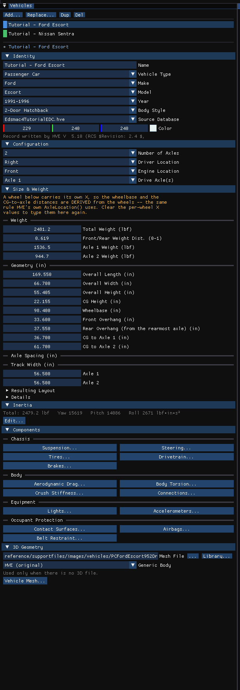
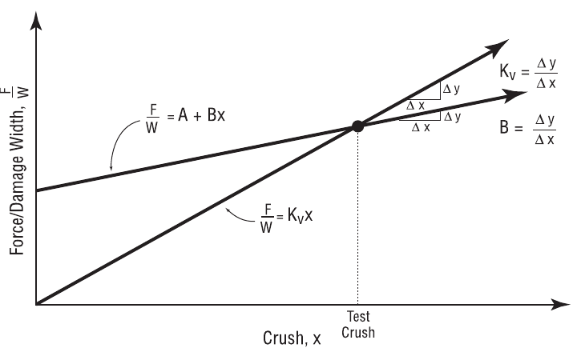

# Chapter 11 — Vehicle Model Definition (Part B: Exterior)

*Adapted for HVE Studio from the HVE User's Manual (Version 5, Seventh
Edition, Jan 2006), Chapter 11.*

This part covers the vehicle exterior: the exterior dimensions (CG to
Front, Right Side, Back, Left Side, Top and Bottom) and the exterior
structural stiffness coefficients. In HVE these properties are edited by
clicking on the exterior spheres displayed on the vehicle in the Vehicle
Viewer.

!!! note "HVE Studio"
    HVE Studio has no exterior spheres. The dimensions are edited in the
    **Size & Weight** section of the Vehicles panel, and the
    stiffness coefficients with **Vehicle › Editors › Crush Stiffness...** (see below).

## Vehicle Exterior Dimensions

The vehicle's exterior dimensions are defined by its overall length and
overall width. In HVE they are edited with the Vehicle Dimensions dialogs
(CG to Front, Right Side, Back, Left Side, Top, Bottom).

In HVE Studio they are edited in the Vehicles panel's **Size & Weight**
section (Figure 11-19), which is HVE's Vehicle Wizard: Overall Length,
Overall Width, Overall Height, CG Height, Wheelbase, Front Overhang, Rear
Overhang (from the rearmost axle), and CG to Axle 1 / Axle 2. Right after
**CG Height**, six fields give the CG to front, back, right, left, top and
bottom distances the solver receives: **CG to Front**, **CG to Rear**, **CG to
Right**, **CG to Left**, **CG to Top** and **CG to Bottom**. When a loaded 3-D
model does not reach the declared front and rear extents, a warning says so
directly under the **Wheel Positions** table.

When the **Wheelbase** does not match where the axles are (CG to Axle 1 /
Axle 2; on a vehicle with three or more axles, to the tandem centre), the
section says so with both numbers. **Use the axle positions** sets the
wheelbase to the figure the axle positions give; to go the other way, type the
CG-to-axle distances you want, since the engines place the wheels from them.

*Figure 11-19: The Vehicles panel. Its Size & Weight section edits the overall dimensions and, under Geometry, the CG-to-exterior distances (CG to Front ... CG to Bottom).*

!!! note "HVE Studio"
    - Each CG-to-exterior distance is computed from the vehicle's stored
      dimensions, so typing one writes the dimension behind it: **CG to Front** sets
      the front overhang (front extent = CG to Axle 1 + front overhang),
      **CG to Rear** the rear overhang (rear extent = CG to Axle 2 + the rear
      axle group + rear overhang), **CG to Right** and **CG to Left** are the
      stored CG-to-side distances (the engines receive their mean on both
      sides), and **CG to Top** sets the Overall Height (top = overall height
      − CG height). **CG to Bottom** is shown grayed: it equals the CG Height,
      since the extents run to the ground. When the wheels carry their own X
      positions (**Wheel Positions**), CG to Front and CG to Rear are grayed
      along with the overhangs and the wheelbase. Edits apply as you type, and
      Edit › Undo reverses them.
    - The dimensions are measured from the sprung-mass CG. The **Inertia /
      Mass** dialog (Vehicles panel › Inertia › **Edit…**) shows the CG to
      axle distances and CG height on both the total and the sprung basis.
      HVE Studio has no Vehicle Dimensions Basis preference.

The Exterior Dimension parameters are described below.

- **CG to Front** — Assigns the distance from the CG to the front of the
  current vehicle.
- **CG to Right Side** — Assigns the distance from the CG to the right side
  of the current vehicle.
- **CG to Back** — Assigns the distance from the CG to the back of the
  current vehicle (the value will be negative, indicating it is behind the
  CG).
- **CG to Left Side** — Assigns the distance from the CG to the left side
  of the current vehicle (in the SAE coordinate system the value will be
  negative, indicating it is to the left of the CG).
- **CG to Top** — Assigns the distance from the CG to the top of the
  current vehicle (the value will be negative, indicating the roof is above
  the CG).
- **CG to Bottom** — Assigns the distance from the CG to the bottom side of
  the current vehicle.

**Table 11-10: Vehicle Exterior Dimension Parameters**

| Parameter | Unit Name | Description |
| --- | --- | --- |
| CG to Front/Back/Side/Top/Bottom | UtVehDispLength | Vehicle-fixed distance from the CG to the front, right side, back, left side, top or bottom |

See also the HVE reference pages:
[CG to Front](../../02-vehicles/CGsToAll.md),
[CG to Back](../../02-vehicles/CGsToAll1.md),
[CG to Top](../../02-vehicles/CGsToAll2.md),
[CG to Left Side](../../02-vehicles/CGsToAll3.md),
[CG to Right Side](../../02-vehicles/CGsToAll4.md),
[CG to Bottom](../../02-vehicles/CGsToAll5.md).

## Vehicle Exterior Stiffness Coefficients

The vehicle's structural properties are defined by its stiffness
coefficients. The user may choose to edit these coefficients for the front,
back or sides of the vehicle.

!!! note "HVE Studio"
    The stiffness coefficients are vehicle data, edited in the Vehicle editor
    with **Vehicle › Editors › Crush Stiffness...** (and in the Vehicle
    Designer's **Stiffness** stage). It is one table with a column per face —
    **Front**, **Rear**, **Top**, **Bottom**, **Left** and **Right** — whose
    **2-D** rows are **A**, **B** and **Kv** (Top and Bottom show "--") and
    whose **3-D** rows are HVE's 3-D node stiffness: **Constant**, **Linear**,
    **Quadratic** and **Cubic**, **Conversion Height**, **Saturation Crush**
    and **Max Crush (not read)**; the 3-D columns are DyMESH's Front, Back,
    Top, Undercarriage, Left and Right zones. A graph above the table plots the
    selected column (click its header), per unit width (2-D) or per unit area
    (3-D). It says which engine reads each part: A and B are read by EDSMAC4,
    Kv by EDSMAC (and by EDVSM for the body against the ground), and the 3-D
    node stiffness by SIMON (DyMESH); EDCRASH takes its A and B from the
    event's damage profile (Event Information › Vehicle Impact Setup).
    **From crash tests...** computes CRASH3 A and B from staged barrier tests.

    There is no stiffness for the top and bottom in the A/B/Kv form, as in
    HVE. Coefficients are shown in the units set in Preferences (A in lb/in
    and B in lb/in² in US units).

To display or edit the current vehicle's A, B and Kv stiffness
coefficients, perform the following steps:

1. In the Vehicle editor (F3), select the vehicle.
2. Choose **Vehicle › Editors › Crush Stiffness...**. The Crush Stiffness dialog is
   displayed.
3. View and/or edit the stiffness properties in each face's column. Changes
   apply as they are made.

The Exterior Stiffness parameters are described below.

- **'A' Stiffness Coefficient** — Assigns the force per unit of damage
  width required to initiate permanent crush (see Figures 11-20 and 11-21).
- **'B' Stiffness Coefficient** — Assigns the linear spring rate (force vs
  deflection constant) per unit of damage width required to produce
  permanent crush (see Figures 11-20 and 11-21).
- **'Kv' Stiffness Coefficient** — Assigns the linear spring rate (force vs
  deflection constant) per unit of damage width required to produce
  permanent crush. This value differs from the B constant in that it
  assumes the force vs deflection graph goes through zero (i.e., A = 0).

*Figure 11-21: Force vs Deflection characteristics of a vehicle, and their relationship to the A, B and Kv stiffness coefficients (see also references 2.8–2.14, 4.20, 4.29).*

**Table 11-11: Vehicle Exterior Stiffness Coefficients Parameters**

| Parameter | Unit Name | Description |
| --- | --- | --- |
| A Stiffness | UtVehAStiff | Vehicle 'A' stiffness coefficient |
| B Stiffness | UtVehBStiff | Vehicle 'B' stiffness coefficient |
| Kv Stiffness | UtVehKStiff | Vehicle 'Kv' stiffness coefficient |

See also the HVE reference pages:
[Stiffness Coefficients dialog (2-D)](../../02-vehicles/StiffCoeffDlg.md),
[A Stiffness](../../02-vehicles/AStiffDlg.md),
[B Stiffness](../../02-vehicles/BStiffDlg.md).

<!-- NAV -->

---

← Previous: [Chapter 11 — Vehicle Model Definition (Part A: Sprung Mass)](11a-sprung-mass.md)  |  [Index](README.md)  |  Next: [Chapter 11 — Vehicle Model Definition (Part C: Suspension)](11c-suspension.md) →

<!-- /NAV -->
