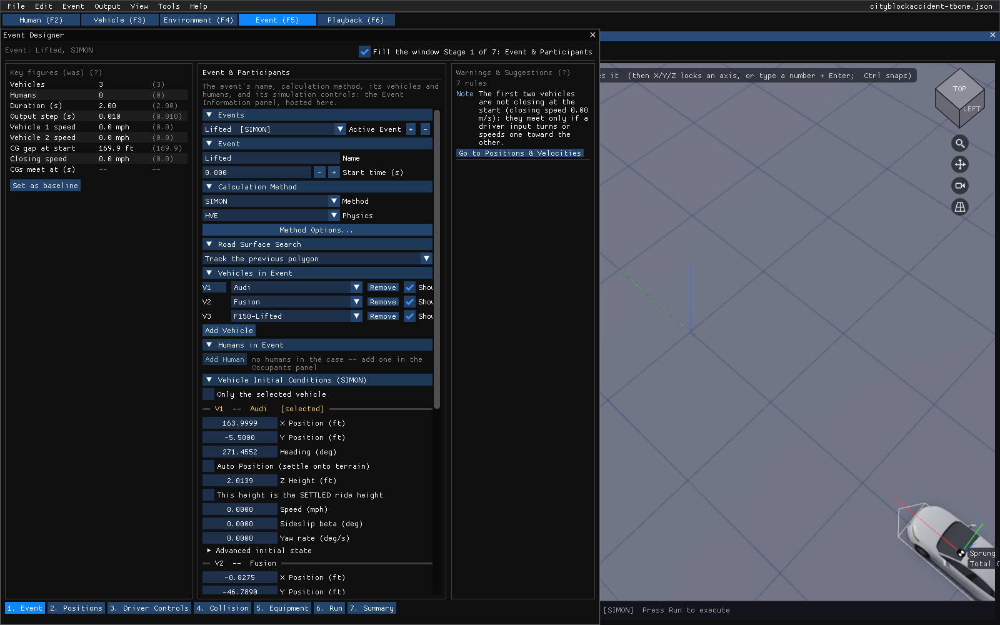

# Chapter 16a — Event Designer

The Event Designer is the Vehicle Designer's frame turned on the event: a stage
bar along the bottom, a **Key figures** strip on the left that remembers what
each number was, the event's own dialogs hosted on the stage that asks their
question, and a **Warnings & Suggestions** panel on the right whose rows name the
fix and the stage that owns it. It is the Event editor's panel: switching to the
Event editor (F5) opens it where the Event Information panel used to open, and
**Event › Event Designer...** (the first item) opens it too. **Event › Event
Information...** still opens that panel.

Like the other designers it is an ordinary docked window, on the left with the 3-D
view beside it, where the vehicles stand: drag its tab to move it, float it, or dock
it anywhere, and the arrangement is kept. Docked narrow, the **Key figures** and
**Warnings & Suggestions** fold into the top of the stage. A dialog on a stage is the same
dialog the Event menu opens, drawn in the stage instead of its own window, so a
field has one editor and nothing is reachable in one and not the other.

*Figure 16a-1: The Event Designer on its Event stage, with Event Information
hosted and the 3-D view beside it.*

## The stages

1. **Event**: the **Event Information** panel: the events, the active event's
   name and start time, the calculation method and its options, the vehicles and
   humans in the event, and their initial conditions. Beside it,
   **Start from documents** (Case Intake) and **Start from a sentence** (Quick
   Case) build the event from the case documents or a typed sentence.
2. **Positions**: **Position / Velocity** for the vehicle chosen in its own
   **Vehicle** picker, which is the same selection as the 3-D view's.
3. **Driver Controls**: **Driver Controls** (throttle, brake, steer and gear
   against time) for the chosen vehicle, and **From the EDR** (EDR Import): the
   vehicle's event data recorder record, and for SIMON a driver solved so the run
   follows the recorded speed. The solve keeps running while another stage or tab
   is shown.
4. **Collision**: a tab for each dialog the calculation method reads, as the
   Event menu greys the rest: **Collision Pulse**, **DyMESH Options** and
   **Contacts** (EDSMAC4's vehicle contacts, or EDHIS and GATB's occupant
   contacts). Only EDCRASH reads a crush profile: for it, **Damage Profiles
   (Event stage)** opens Event Information's Vehicle Impact Setup on the Event
   stage, and **Crush from Scan** (Crush Profile from Scan) measures the crush
   depths off a scan. The vehicle's mesh and crush stiffness are edited in the
   Vehicle Designer.
5. **Equipment**: the same for what each vehicle carries and does: **Payload**,
   **Path Follower**, **Lights**, **Wheels**, **Accelerometers** (SIMON, EDSMAC4,
   EDVDS and EDVSM), and for EDSMAC and EDSMAC4 **Handling Parameters** and
   **Move CG**. Accelerometers belong to the vehicle: the tab edits the same
   devices as the Vehicle Designer's Exterior & Body stage, so one placed in
   either is in every event the vehicle runs in. Airbags and belts are edited in
   the Vehicle Designer's Occupant Protection stage.
6. **Run**: **Run this event** starts the active event on the current physics,
   exactly as the Simulation panel's **Run** does, with **Cancel** while it runs.
   A solved event is locked until **Reset Run to Edit** in Event Information, and
   the stage says so. Fix warnings do not stop a run; the stage counts them.
7. **Summary**: the event's spec sheet with its was column, **Set as baseline**
   (kept for this case across sessions) and **Copy spec sheet**, the warnings,
   **Provenance** (where each value an automatic tool set came from) and the
   event's **Notes**.

The automatic tools on these stages are the same windows the **Automatic Tools**
menu opens, and like the menu they are not offered on a sealed case.

Every item of the Event menu has a place on a stage. The one exception is
**Impact Plane / Barrier...**, which this port does not implement (model a
barrier as a Fixed Barrier vehicle). Each tab is the dialog the Event menu
opens, drawn in the stage, for the vehicle chosen in its own **Vehicle** picker.

## Key figures

The vehicles and humans in the active event; its duration and output step (--
when the event leaves them to the Simulation panel); the first and second
vehicles' start speeds; the distance between their CGs at the start; their
closing speed (positive when the gap shrinks); and when their CGs would meet at
those speeds.

## Warnings & Suggestions

| Grade | Stage | Rule |
|---|---|---|
| Fix | Event | The case has no event. |
| Fix | Event | The active event has no vehicle and no human. |
| Fix | Positions | Two of the event's vehicles start with their CGs closer than 1.5 m, so their bodies overlap at t = 0 (not EDCRASH, which states impact positions). |
| Consider | Event | SIMON, EDSMAC or EDSMAC4: at their start speeds the first two vehicles touch (CG gap less 5 m for the two bodies) after the run has ended. |
| Note | Positions | SIMON, EDSMAC or EDSMAC4: the first two vehicles' gap is not shrinking at the start, so they meet only if a driver input turns one toward the other. |
| Consider | Event | SIMON, EDSMAC or EDSMAC4 with two vehicles: the output step is over 0.02 s, a few samples through an impact at most. |
| Note | Driver Controls | SIMON: every vehicle starts at rest with no throttle, so the stopped-vehicle rule ends the run at 0.1 s. |

A rule that lacks its input stays silent, and the count beside the panel's
title lists what is checked on hover.
