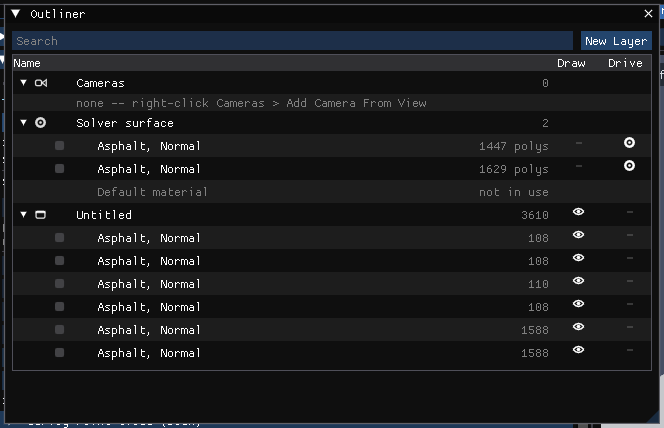
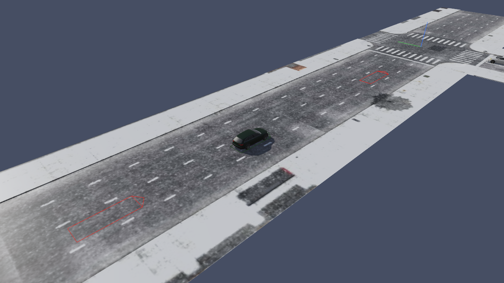

# Chapter 19 — Using the 3-D Viewport

In HVE, the 3-D Editor is the tool for creating and editing the 3-D objects used to visualize humans, vehicles and environments, and for giving environment surfaces their physical properties (surface type and friction factor). This chapter describes where each of those jobs is done in HVE Studio.

!!! note "HVE Studio"
    HVE Studio has no separate 3-D Editor. Its **Viewport** panel (**View › Viewport**) is the one 3-D view for all five editor modes (Human F2, Vehicle F3, Environment F4, Event F5, Playback F6). Environment geometry is imported rather than modelled; surface properties, layers and materials are edited on the imported surfaces. The sections below follow the order of HVE's chapter.

## Description

The HVE Studio equivalents of the 3-D Editor's components are:

- **Viewport** — the 3-D view, with a view cube for the preset views (see [Viewers](#viewers)).
- The Environment panel's **Selected Surface** section and the **Shader Editor's Surface node** — the per-surface attributes HVE edits in the Object Attributes tool (see [Object Attributes Tool](#object-attributes-tool)).
- **Outliner** — the scene's layers (HVE's overlays) with their surfaces (see [Overlay Name](#overlay-name)).
- **Shader Editor** — materials and textures (see [Materials Editor](#materials-editor)).

*Figure 19-1 — HVE Studio in the Event editor: the Event Information panel (left) and the Viewport (right), with the playback bar beneath the view. The line across the top of the view lists the G/R keyboard operators.*

## Viewers

HVE's 3-D Editor shows four viewers (Perspective, X-Y, Y-Z and X-Z). The HVE Studio Viewport shows one 3-D view at a time. The **view cube** in its top-right corner turns with the camera: click a face (Top, Bottom, Front, Back, Left or Right) and the view goes there in orthographic projection, which is the rendered equivalent of HVE's plan, front and side orthographic viewers; drag the cube to orbit. The column of buttons under the cube is:

- **Zoom** — drag up or down to zoom.
- **Pan** — drag to pan.
- **Camera** — look through the scene camera; click again to go back to the free view. Right-click it for **Camera Properties**. With no saved camera it opens Camera Properties.
- **Perspective/Orthographic** — switch the projection, as key **5** does.
- **Lock Camera to View** (the padlock) — what moving the view does while you
  look through a camera. **Off** (the default, open padlock): orbiting,
  panning or zooming leaves the camera's view and carries on from where the
  camera was, and the camera stays where it is, so it cannot be moved by
  accident. **On** (closed padlock): the view moves the camera, as a *Current*
  working copy that **Tools › Cameras** saves as a new camera or over the one it
  came from.

The camera can also be set to a top, front, rear, left, right or bottom view with the number keys, and switched to orthographic projection with **5** (below).

!!! note "HVE Studio"
    HVE Studio has no separate 2-D views and does not draw a momentum diagram. For a plan, click the view cube's Top face (or press **7**, then **5** for orthographic). Each impact's Delta-V and PDOF are on **HVE Reports** › **Damage Data**; an EDCRASH reconstruction's impact speed, Delta-V, PDOF and separation speed are in **Output › Key Results...**.

### Navigating the 3-D view

The mouse controls follow Blender's conventions:

| Action | Result |
|---|---|
| Left-button drag on empty space | Orbit the camera about its target |
| Right-button drag | Pan |
| Mouse wheel | Zoom in and out |
| Middle-button drag | Orbit |
| Shift + middle-button drag | Pan |
| Ctrl + middle-button drag | Zoom |
| Left double-click | Reset the camera to the default perspective view |
| Right click (without dragging) | Menu: **Camera Properties…** and **Reset Camera** |
| **Camera** button (under the view cube) | Looks through the scene camera, or back to the free view; right-click for **Camera Properties** |

With the mouse pointer over the view, the number keys (top row or numeric keypad) move the camera:

| Key | View |
|---|---|
| 1 / Ctrl+1 | Front / Rear |
| 3 / Ctrl+3 | Right / Left |
| 7 / Ctrl+7 | Top / Bottom |
| 9 | The opposite side of the current view |
| 5 | Toggle perspective and orthographic projection |
| 4 / 6 | Orbit left / right in 15° steps |
| 8 / 2 | Orbit up / down in 15° steps |
| . (period) | Frame the selected vehicle |
| C / Shift+C | Look through the next / previous saved camera (the list includes the free view) |
| I | Insert a camera key on the camera being looked through (see [Chapter 21](21-manipulators.md#cameras)) |
| Esc | Clear the environment surface selection; in the Environment editor's Edit Mode, leave Edit Mode |
| Tab | Toggle **Edit Mode**: in the Vehicle editor, pick parts of the vehicle mesh to give them materials; in the Environment editor, pick single faces of the site to give them materials or move them (see [Chapter 12](../05-environment-editor/12-creating-editing-environments.md#edit-mode-faces-of-the-site)) |

!!! note "HVE Studio"
    The numeric keys are not read while a G or R operation is in progress (they enter a typed distance or angle instead), nor while a text field has the keyboard.

The camera itself — orbit or free (Euler) control, presets, target point, projection, focal length or field of view — is set on the **Viewport View** tab of **Tools › Cameras…**. Saved, named and keyframed cameras are on the **Saved Cameras** tab (see [Chapter 21](21-manipulators.md#cameras)).

## 3-D Editor Dialog

HVE's 3-D Editor dialog combines the Current Object tool, the Object Attributes tool and the Group tool.

!!! warning "Not in HVE Studio"
    There is no 3-D Editor dialog. Object creation is replaced by geometry import and the Surface Generator ([Chapter 20](20-object-tools.md)); object attributes by the **Selected Surface** section and the Shader Editor (below); the Group tool has no equivalent (see [Group Tool](#group-tool)).

## Current Object Tool

HVE creates surfaces, cones, boxes, spheres, cylinders, text, lights and signals with its object tools.

!!! warning "Not in HVE Studio"
    HVE Studio does not create or edit environment geometry. A site is imported from a DXF, `.h3d`, `.iv`, OBJ or glTF file (**Environment › Environment… › Terrain › Scene Geometry**), or comes with an HVE `.hve` case. Roads, friction zones and other surfaces are drawn over the site with the **Surface Generator** (Environment panel). See [Chapter 20](20-object-tools.md).

## Object Dialog

In HVE, each object tool has an Object Dialog with the object's size and position.

!!! warning "Not in HVE Studio"
    Imported surfaces have no Object Dialog. A selected surface is moved, turned and scaled with **G**, **R** and **S** or its **Placement** fields (*Selected Surface*); see [Chapter 21](21-manipulators.md).

## Object Attributes Tool

Every HVE environment object has an Object Type, an Overlay Name and a Friction Factor. In HVE Studio these belong to each **surface** of the imported site — each named surface (material) of the geometry file, or each object of a site read from an HVE case.

To select a surface, perform one of the following:

- In the **Environment** editor, click the surface in the 3-D view. (Selection happens when the button is released without the mouse having moved, so an orbit drag does not select anything.) Clicking empty sky clears the selection, as does Esc.
- Pick its row in the **Outliner** (**View › Outliner**). **Ctrl**-click adds a row to the selection, **Shift**-click extends it, and a click on a layer's row selects every surface in the layer. **Shift**-click in the 3-D view also adds a surface.

The selected surface is highlighted in the view. The Environment panel's **Selected Surface** section (**Environment › Environment…**, **Terrain**) shows *Selected: name — type, friction* with an **Edit in Shader Editor** button and a **Deselect** button.

The physical attributes are edited in the Shader Editor's **Surface** node, headed *PHYSICS — these change the result*:

- **Surface Type** — Road, Friction Zone, Curb, Water or Other. The type reaches the solver: the road search stops early on a curb or friction-zone hit, where a road hit keeps searching.
- **Condition preset** — Dry (1.00), Wet (0.70), Snow (0.30) or Ice (0.15); sets the Friction Multiplier.
- **Friction Multiplier** — HVE's Friction Factor: a multiplier on each tire's own friction.
- The surface's force-deflection properties (Force Constant, Linear, Quadratic and Cubic Stiffness, Damping Rate, Unloading Stiffness), its soil properties (Bekker Constant, Kphi, Kc, Moisture %, Clay %), and a material-library picker that fills them in.

The surface's look (color, roughness, metallic) is its material's, edited in the Shader Editor; it reaches no engine. A surface whose base color was overridden in an earlier version says so, with **Clear Override**.

### Object Name

HVE names an object after the tool that made it. In HVE Studio a surface's name is the one in the geometry file (or HVE's object name in a `.hve` case); a surface with no name is listed as *(unnamed)*.

### Object Type

The available types are **Road**, **Friction Zone**, **Curb**, **Water** and **Other**, as in HVE. HVE's Human and Vehicle object types do not apply to environment surfaces in HVE Studio.

> **NOTE:** An object type of Road or Friction Zone must be selected if the surface is part of the physical environment with which a human or vehicle may interact.

Whether a surface takes part in the physics at all is also controlled by its **Drive** switch in the Outliner (below), and, for an imported geometry file, by **Use surfaces as terrain (physics)** under Scene Geometry.

### Overlay Name

HVE assigns each object to a named overlay and turns overlays on and off in the Overlays dialog. In HVE Studio an overlay is a **layer** in the **Outliner** (**View › Outliner**), which lists the site's layers with their surfaces under them, as Blender's Outliner lists collections:

- **Draw** column (the eye) — draw or hide the layer or surface. Ctrl-click an eye shows only that one among its siblings (again to show all); Shift-click a layer's eye switches the layer and every surface in it. Click-dragging down the column sets every switch the pointer passes.
- **Drive** column (surfaces only) — whether the solver drives on the surface. Clearing both Draw and Drive removes a surface from the scene. A surface of type **Other** is scenery and is never driven on: setting a surface to Other switches Drive off, and its Drive switch cannot be turned back on until its type is changed.
- Click, Ctrl-click and Shift-click rows to select, add to and extend the selection; the active row is the one the 3-D view highlights. A click on a layer's row (not its arrow) selects every surface in the layer. Several selected surfaces move, turn and scale together with **G**, **R** and **S** in the 3-D view ([Chapter 21](21-manipulators.md#hve-manipulators)).
- A loaded point cloud has a row of its own: its file name, its point count and an eye that shows or hides it. It has no Drive switch: a point cloud is a picture, never a surface. Its settings and placement are in the Environment panel.
- Each surface drawn with the **Surface Generator** (Environment panel) is a row of the layer it is on, or of **Generated surfaces** when it is on none, marked with a diamond in its color and its type. Its eye draws it (display only) and its Drive wheel applies it to the run. Drag it onto a layer, or right-click it for **Move to Layer** (or **No Layer**), **Hide**/**Show** and **Applied**/**Not Applied**. Renaming a layer carries its generated surfaces along; deleting it leaves them on no layer.
- Drag surfaces onto a layer to move them to it. **New Layer** creates a layer; a layer you created can be renamed or deleted from its right-click menu.
- Right-click a layer for **Show Only This Layer**, **Show All Layers**, **Select Surfaces**, **Make All Drivable** and **Make None Drivable**.
- With the pointer over the tree, **H** hides the selection and **Alt+H** shows everything.
- A **Search** field filters the tree, and a **Cameras** group lists the case's saved cameras. Right-click the **Cameras** group for **Add Camera From View** (a new camera framed as the viewport is now), **Free View (stop looking through)**, **Show All** and **Hide All**.
- In the Environment editor a **Lights** group lists the site's own lights (the Lights section of Sky & Lights), with *(off)* beside one that is switched off. Click a light — its row here, its name in the Lights section, or its star in the 3-D view (the selected star is drawn orange and larger) — to select it. **G** then moves it and **R** turns its aim about the vertical; **R** then **X** or **Y** tilts the beam instead (moving the cursor up raises it; a typed value is degrees up, and Ctrl snaps to 5°), with the same typed values and Ctrl snapping as a surface; **S** does nothing to a light. Selecting a surface deselects the light, and the other way round.
- In the Vehicle editor, two groups follow for the **selected** vehicle. **Vehicle Lights** lists its lamps — its own Vehicle Lights entries, or, when it lists none, the lamps the 3-D view draws it with — with *(off)* beside one switched off; click one to select it, as a click on its marker does (the Vehicle Lights list and the Shader Editor's Light panel follow). **Vehicle Cameras** lists the cameras mounted on it (a camera whose **View From** is this vehicle): they ride the vehicle through playback. Click one to select it for the Cameras dialog and double-click to look through it (again to stop). Right-click the group for **Add Driver's-Eye Camera**: a camera on the vehicle's left seat, 0.25 m under its roof, looking 30 m straight ahead, which the Cameras dialog then edits like any other (Mount, Aim Point, lens). A vehicle that is in no event is drawn at the origin heading forward, and its cameras ride it there.
- A **Vehicles** group lists the case's vehicles (not in the Environment editor, whose Outliner lists the site's own objects). Click a name to select the vehicle. Its eye shows or hides the vehicle in the Event and Playback 3-D view, and Ctrl-click an eye to show only that vehicle. A hidden vehicle's ghosts and tire marks are hidden with it. This is a view setting only: nothing is saved and no result changes (see [Chapter 5, Vehicles Shown](../02-menu-reference/05-view-menu.md#vehicles-shown)). In the 3-D view, **H** hides the selected vehicle, **Shift+H** the others and **Alt+H** shows all.

*Figure 19-2 — The Outliner: layers (HVE's overlays) with their surfaces, Draw (eye) and Drive switches.*

!!! note "HVE Studio"
    A layer has no Drive switch, because an HVE overlay is a visibility switch only: the drivable polygons of a `.hve` site belong to its physics element, which is on no overlay. Groups in the Outliner may include *Solver surface* (drivable polygons on no layer), *Not on a layer* (drawn triangles the site puts on no layer), *Generated surfaces* (Surface Generator surfaces on no layer) and *Unused*.

### Friction Factor

HVE's Friction Factor is the **Friction Multiplier** of the selected surface (see [Object Attributes Tool](#object-attributes-tool)). Use it, as in HVE, for regions with frictional properties different from the base surface — gravel shoulders, oil, and so on. A drivable polygon with no surface material of its own uses the site's *default surface material*, which is edited with the **Default material** button of the same Selected Surface section.

> **NOTE:** For more information about how the friction attribute is used, see Environment Model Definition.

## Materials Editor

HVE's Material Color editor sets ambient, diffuse, specular, emissive, shininess and transparency for the selected object.

!!! note "HVE Studio"
    Appearance is edited in the **Shader Editor** (**View › Shader Editor**), a node material editor modelled on Blender's. A material is a graph of nodes ending in a Material Output; a new surface material is *Object Color → Principled BSDF → Material Output*, which draws the object exactly as it looked without one. Materials apply to vehicles (whole vehicle or each named part of its mesh), to road surfaces and to the world (sky). **Materials are display only — nothing in the Shader Editor reaches an engine**; the *HVE Simulation* node can read friction, speed and time so that a material can visualize them.

### Texture Editor

HVE's Texture Editor maps an image onto an object's faces.

!!! note "HVE Studio"
    Use an **Image Texture** node in the Shader Editor. A vehicle body or road surface whose geometry file carries texture coordinates keeps them; an image material is carried into the glTF export and the Blender live link ([Chapter 27](../09-video-output/27-video-interface.md)). There is no texture list or Accept button; there is no `EnvTextures` folder to copy images into.

## Group Tool

HVE's Group tool combines objects into a group, splits groups, and saves and loads groups in the Highway Furnishings Library.

!!! warning "Not in HVE Studio"
    HVE Studio has no grouping of scene objects and no Highway Furnishings Library. Model furnishings in a geometry editor and import the site.

## Viewing Options

!!! tip "New in HVE Studio"
    **View › Scene Display** controls what the 3-D view draws. All are view preferences, not case data:

    - **Rendering** — **Phong** (smooth), **Flat** (one normal per face) or **Wireframe** shading, and **Light Sources On** (off, the sun stops contributing and the ambient light is raised so shape stays readable).
    - **Light & Shadow** — **Scene Lighting**, **Lamps** (the vehicles' lamps and the site's lights after dark), the shadow coverage (**Vehicles (sharp)** or **Whole scene**), **Site Shadows**, **Contact Shadows** and **Ambient Occlusion**.
    - **Sky & Reflections** — **Default Sky**, **Sky Reflections**, **Distance Haze**, **Wet Ground** and **Ground Reflections**. **Anti-Aliasing (FXAA)** is under Rendering.
    - **Vectors** — a table of **Velocity**, **Acceleration**, **Collision force** (drawn only while the vehicles are in contact, its tail on the side the force came from), **Collision moments**, **Tire Fx', Fy'** (red Fx', green Fy'), **Tire Fz'** and **Tire Fz' (nodes)**, each with its own Show and Value switches and scale; below it **Collision load at the CG** and **Collision load at impact (line of action)** (two independent switches) and **Draw Vectors Through Bodywork**. Each type of arrow has one fixed scale, so lengths compare between vehicles and between runs.
    - **Scene Ghosts** — how a vehicle is marked at each measured scene position (Initial, Begin Perception, Begin Braking, Impact, Separation, Point On Curve, End of Rotation, Rest): **None**, **Outline**, **Translucent vehicle** or **Both** (HVE's targets).
    - Paths and markers — **CG Path**, **Accelerometer Path**, **Tire Contact Patch Paths**, **Skidmarks**, **Axes** (the origin's and each vehicle's own, at its CG), **North Arrow**, **Vehicle Extents**, **See-Through Body**, **Occupant Equipment** and **Humans Through Bodywork**.
    - **DyMESH overlay** — a table with rows **DyMESH Body** and **DyMESH Wheel** and columns **Mesh** and **Nodes**. The Body row draws the body DyMESH collides as a wireframe deformed by the run, crushed edges in red; Nodes draws its vertices. The Wheel row draws each DyMESH wheel's contact mesh, and Wheel Nodes labels each wheel with its contact model and tire law.
    - **Vehicles Shown** — a checkbox per vehicle, and **Show all**, to take vehicles out of the Event and Playback view.

*Figure 19-3 — The 3-D view of a site read from an HVE case, with scene ghosts in outline style marking measured scene positions.*

Lighting comes from the sun and sky set in **Environment › Environment… › Sky**. **Vehicle › Editors › Vehicle Lights…** keeps a list of lights with each vehicle (type, intensity, direction, position, colour); the 3-D view uses them as the vehicle's lamps, which light the scene once the sky darkens. No engine reads them.

---
*Converted and updated from the legacy HVE User's Manual (Seventh Edition, Jan 2006), Chapter 19; adapted for HVE Studio.*

<!-- NAV -->

---

← Previous: [Section Eight: 3-D Editor](README.md)  |  [Index](README.md)  |  Next: [Chapter 20 — 3-D Editor Object Tools](20-object-tools.md) →

<!-- /NAV -->
