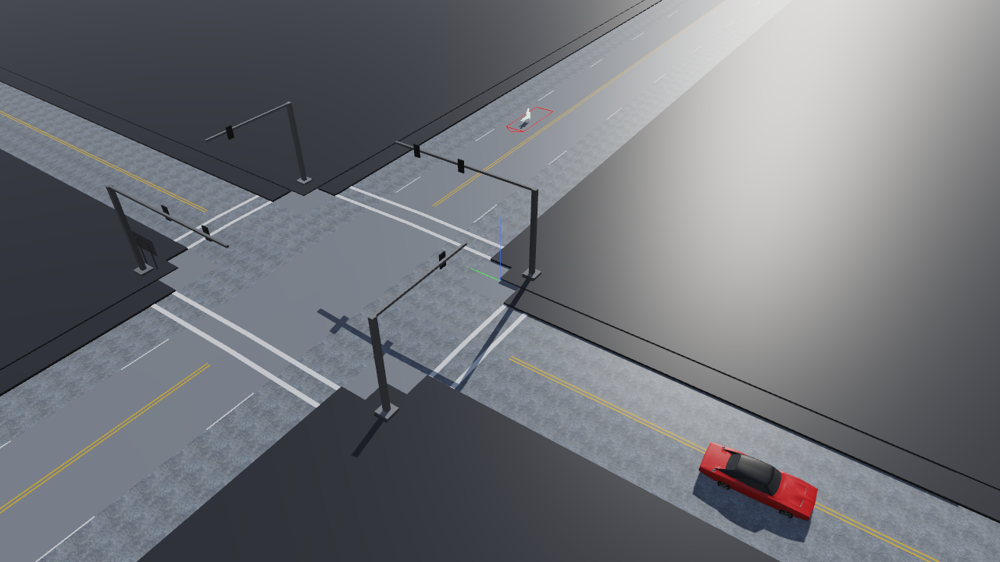
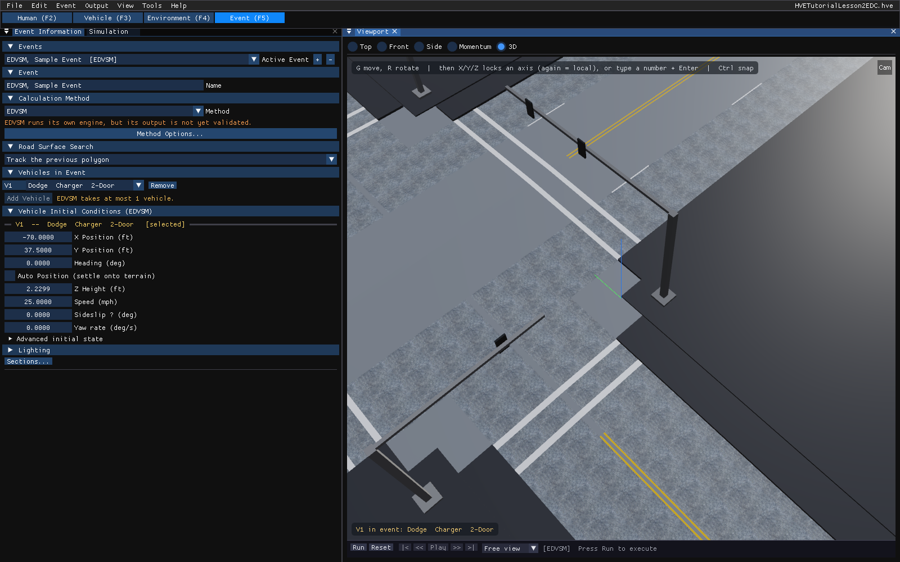
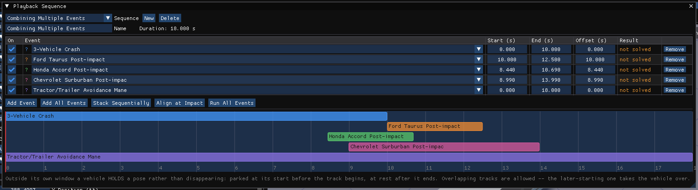

# Chapter 32 — HVE Tutorial

*Updated Markdown edition of the HVE User's Manual (HVE Version 5, Seventh Edition, January 2006), Tutorial section, pages 32-1 through 32-60, adapted for HVE Studio.*

This section of the HVE User's Manual contains a tutorial illustrating HVE's features. For any new user, this section is very important. The tutorial describes the use of the basic components, but even more important, the tutorial provides a basic framework for using the program. Users will soon realize they perform the same basic operations each time, so understanding these basic operations is fundamental to its use.

!!! note "HVE Studio"
    This edition follows HVE's four lessons with HVE Studio's own menus, panels and controls. The tutorial cases HVE ships — `HVETutorialLesson2EDC.hve`, `HVETutorialLesson3EDC.hve` and `HVETutorialLesson4EDC.hve` — open directly in HVE Studio with **File › Open Case…**, so each lesson can be checked against the finished case. Lesson 4 (Creating a Video) records with **File › Record Animation…** in place of HVE's video interface.

## Overview

This chapter presents a series of basic tutorials that demonstrate various techniques and capabilities, through high-level, task-oriented procedures using a step-by-step approach. The tutorial does not provide detailed explanations; it refers to specific chapters for them.

> **NOTE:** In addition to this tutorial, every EDC physics model has a Program Manual that includes a comprehensive tutorial specific to that physics model.

The Tutorial is divided into four individual lessons:

- **Lesson 1 — Navigating in HVE Studio** — How to move quickly within the program to perform fundamental tasks.
- **Lesson 2 — Running a Simulation Model** — How to set up and execute a single event.
- **Lesson 3 — Combining Multiple Events** — How to merge several events into one properly timed sequence.
- **Lesson 4 — Creating a Video** — In HVE Studio: setting up cameras and exporting the sequence to Blender, where the movie is rendered.

## Lesson 1 — Navigating in HVE Studio

Lesson 1 is a lesson in fundamentals: starting the program, the menu bar, the editors, panels and dialogs, the 3-D view, and shutting down.

### Starting HVE Studio

Start HVE Studio as you would any other program (see [Installing and running HVE Studio](../../getting-started/02-installing-and-running.md)). The main window opens with the menu bar, the editor tabs beneath it, and the panels of the current editor docked around the **Viewport**.

*Figure 32-1 — HVE Studio in the Event editor: menu bar, editor tabs, the Event Information panel and the Viewport with its playback bar.*

### Learning About the Menu Bar

The menu bar holds **File**, **Edit**, the menus of the current editor (**Vehicle**, **Environment**, **Event**, **Output**, **Playback**, **Human** — which of them appear depends on the editor), **View**, **Tools** and **Help**:

- **File** — New, Open and Save cases (Ctrl+N, Ctrl+O, Ctrl+S), Open Recent, Save Case As JSON, Embed vehicle meshes in the case, Embed the environment in the case, Publish Bundle, the Blender export and live link, and Exit.
- **Edit** — Undo History (Ctrl+Z undoes and Ctrl+Y redoes; undoing an input of a run whose results are on screen asks to clear those results first).
- **Vehicle**, **Environment**, **Event**, **Human** — the dialogs for setting up vehicles, the environment, events and humans (HVE's Set-up menu and Object Info dialogs).
- **Output** — Key Results, Output Graph, Variable Selection, reports, Playback Options and Run Simulation (HVE's Playback Editor).
- **Playback** — Playback Sequence, Playback Options and Run All Events, in the Playback editor.
- **View** — the panels (Viewport, Shader Editor, Dope Sheet, Key Results, Output Graph, Simulation, Outliner) and what the 3-D view draws.
- **Tools** — Quick Case, Vehicle Package, Case Intake, Provenance, EDR Import, Monte Carlo Analysis, Motorcycle Analysis, Preferences, Style Editor, Cameras, Audit Log and Limits Editor (HVE's Options menu).
- **Help** — License, About.

The title of the current case file is shown at the right end of the menu bar.

!!! note "HVE Studio"
    There is no Active Objects list on the menu bar and no Event Controller there. Each editor's panel lists its objects (for example, the **Vehicles** panel in the Vehicle editor), every vehicle dialog has a vehicle selector at its top, and the **playback bar** under the Viewport replaces the Event Controller (see Lesson 2).

### Viewers

HVE shows 3-D objects in separate viewer windows with thumbwheels and a zoom slider.

!!! note "HVE Studio"
    There is one 3-D view, the **Viewport**, shared by all editors. It has no thumbwheels: the camera is moved with the mouse and keys described under [Using 3-D Viewers](#using-3-d-viewers), and set precisely in **Tools › Cameras…**.

### HVE Mode Selector

HVE's Mode Selector has five buttons: Human, Vehicle, Environment, Event and Playback Editor.

!!! note "HVE Studio"
    The editor tabs under the menu bar are **Human (F2)**, **Vehicle (F3)**, **Environment (F4)**, **Event (F5)** and **Playback (F6)**. A solved event plays back in the Event editor's Viewport, and the output reports, graphs and tables are on the **Output** menu; the Playback editor combines several solved events (Lesson 3).

### Managing Dialogs and Viewers

!!! note "HVE Studio"
    Panels and dialogs **dock**: drag a window's tab or title bar onto another panel to dock it there, or away to float it. With **View › Panels Outside the Main Window** turned on, a panel dragged outside the main window becomes a desktop window of its own (not in the browser build). Close a panel with its **×** and reopen it from the **View** menu. Minimizing to an icon, as in HVE, is not needed: a closed or hidden panel costs nothing, and the 3-D view is the only view that is rendered.

    Practice: open `EdhisTutorialEDC.hve` (**File › Open Case…**), select the **Event (F5)** tab, open **Output › Key Results…** and **Output › Output Graph…**, and dock and undock them.

### Choosing an Editor

HVE Studio has five editors:

- **Human (F2)** — Selecting and editing humans
- **Vehicle (F3)** — Selecting and editing vehicles
- **Environment (F4)** — The environment: location, terrain, sky, physical properties
- **Event (F5)** — Setting up, executing and playing back reconstruction and simulation events, with the reports on the **Output** menu
- **Playback (F6)** — Combining several solved events on one timeline and playing them back together

Using the tutorial case, select each tab in turn. The Human editor shows the case's humans, the Vehicle editor the current vehicle with its **Vehicles** list, the Environment editor the site, and the Event editor the current event in **Event Information**. The Vehicles panel's **Identity** and **Configuration** sections show a vehicle's basic attributes (Name, Vehicle Type, Make, Model, Year, Body Style, Number of Axles, Driver Location, Engine Location, Drive Axle(s)); **Environment › Environment…** holds the location and sun, the terrain, the sky, and the physical properties (ambient temperature and pressure, wind, gravity, standing water).

### Using Dialogs

!!! note "HVE Studio"
    Every HVE Studio dialog is modeless, and a value takes effect as soon as it is entered — there is no OK, Apply or `<Enter>` step. Drag a numeric field left or right to change it, or double-click (or Ctrl+click) it to type a value. Units follow **Tools › Preferences…**. While a run's results are on screen, the inputs they were computed from are read-only, with a banner saying so; press **Reset** on the playback bar to edit them.

The most important example is **Event › Position / Velocity…**, the Event Editor's Position/Velocity dialog.

### Using 3-D Viewers

!!! note "HVE Studio"
    In the Viewport (3D view):

    - **Orbit** — left-drag on empty space, or middle-drag. The scene orbits about the camera's target point.
    - **Pan** — right-drag, or Shift + middle-drag.
    - **Zoom (dolly)** — the mouse wheel, or Ctrl + middle-drag. The wheel moves the camera toward or away from its target; the lens is changed in **Tools › Cameras…**.
    - **Preset views** — 1, 3 and 7 (Ctrl for the opposite side) for front, right and top; 5 toggles orthographic.
    - **Reset** — double-click.

    The panel can be made as large as you like by dragging its edges or the splitters between docked panels. See [Chapter 19](../08-3d-editor/19-using-3d-editor.md#navigating-the-3-d-view).

### Shutting Down HVE Studio

When you are finished, save your work (**File › Save Case**) and choose **File › Exit**. If the case has changed since it was last saved, HVE Studio asks whether to save it first.

## Lesson 2 — Running a Simulation Model

Lesson 2 is a high-level overview describing how to execute a single event. In this tutorial we execute an EDVSM simulation of a Dodge Charger turning left. The finished case is `HVETutorialLesson2EDC.hve`; open it at any point to compare.

### Selecting Humans

1. Select the **Human (F2)** tab.
2. Press **Add Human**. A human is added and its fields are shown.
3. Enter **Name** `Fred`, and choose **Location** (front left seat), **Subject Type** (male), **Age Group** (adult), **Weight Percentile** 50 and **Height Percentile** 50.

Fred is displayed in the Viewport, seated, because we assigned him as an occupant.

### Selecting Vehicles

1. Select the **Vehicle (F3)** tab.
2. In the **Vehicles** panel, press **Add…**. The vehicle database picker lists the vehicles in the HVE databases HVE Studio has found (see [Appendix I](appendix-01-installation.md#hve-file-system)).
3. Choose the 1968–1970 Dodge Charger 2-Door from `Tutorial.db` (part of an HVE installation's databases) and add it.

The Charger is displayed in the Viewport.

### Selecting Environments

1. Select the **Environment (F4)** tab and choose **Environment › Environment…**.
2. In the **Terrain** section, under **Scene Geometry**, press **Browse…** and choose `4x2_Intersection.h3d` from the HVE installation's environment geometry.
3. Tick **Use surfaces as terrain (physics)** and press **Import**.

The intersection is displayed in the Viewport.

*Figure 32-24 — The Lesson 2 case in the 3-D view: the intersection with its signal poles, and the Dodge Charger.*

### Event Editor

Using the Event editor involves three steps: **creating** the event (its vehicles, humans and calculation method), **setting it up** (positions, velocities, driver controls and options) and **executing** it.

To create the event:

1. Select the **Event (F5)** tab. In **Event Information**, press **+** beside the event list to add an event.
2. Under **Vehicles in Event**, press **Add Vehicle** and choose the Dodge Charger.
3. Under **Calculation Method**, choose **EDVSM**.
4. Change the event's **Name** to `Sample Event`.

To set up the event:

1. In the **Vehicle Initial Conditions** section of Event Information (or **Event › Position / Velocity…**), enter **X Position** −70.0 ft, **Y Position** 37.5 ft and **Speed** 25.0 mph. The Charger moves to its starting position in the Viewport. (It can also be placed with the gizmo: [Chapter 21](../08-3d-editor/21-manipulators.md).)
2. Choose **Event › Driver Controls…**, select the **Steer** tab and enter the steer table:

   **Table 32-1 — Steer Table entries for the Dodge Charger's left turn**

   | Time (sec) | Steering Wheel Angle (deg) |
   | --- | --- |
   | 0.00 | 0.0 |
   | 0.50 | 0.0 |
   | 1.00 | −150.0 |
   | 3.50 | −150.0 |
   | 4.00 | 0.0 |

*Figure 32-27 — The Lesson 2 event in Event Information: EDVSM, the Dodge Charger at X −70.0 ft, Y 37.5 ft and 25.0 mph, with the playback bar under the Viewport.*

> **NOTE:** Only the set-up options the chosen calculation method uses are offered on the **Event** menu.

Execute the event with the **playback bar** under the Viewport: **Run** solves the event; **Reset** discards the results so the inputs can be edited again; the transport buttons go to the start, step back, **Play**, step forward and go to the end, and the slider moves through the run. **Output › Run Simulation…** also runs the event, and the **Simulation** panel shows its progress, its status, and its **Duration** and timesteps.

> **NOTE:** Inputs are locked while results are on screen. To change the event after a run, press **Reset**, edit, and **Run** again.

Press **Run**. The Charger moves according to the vehicle model, the terrain, the initial position and velocity, and the steering input, until the simulation's duration (5.0 seconds) is reached. Press **Play** to replay it; replaying does not re-run the physics.

**Key Results.** Numeric results for the current playback time are shown in the **Key Results** panel (**Output › Key Results…**). To add tire forces, choose **Output › Variable Selection…**, select the Fx', Fy' and Fz' channels of the right front tire, and play the event again.

> **NOTE:** Like all events, this EDVSM event produces several output reports (Accident History, Messages, Vehicle Data and others). They are pages of **Output › HVE Reports…**. Read the run status in the **Simulation** panel too: it says how the run ended and lists anything HVE Studio assumed ([Appendix II](appendix-02-messages.md#run-status-and-disclosures)).

## Lesson 3 — Combining Multiple Events

Most crashes involve a sequence of events (e.g., loss of control, collision, occupant ejection). Each event can use the calculation model best suited to it, and the events are then combined and timed with respect to each other into one sequence.

Open the prepared case: **File › Open Case…**, `HVETutorialLesson3EDC.hve`. Select the **Event (F5)** tab. The case has five events:

- **Event 1** — EDSMAC4, 3-Vehicle Crash (Ford Taurus, Honda Accord, Chevrolet Suburban)
- **Event 2** — EDVSM, Ford Taurus Post-impact
- **Event 3** — EDVSM, Honda Accord Post-impact
- **Event 4** — EDVSM, Chevrolet Suburban Post-impact
- **Event 5** — EDVDS, Tractor/Trailer Avoidance

Review each event: choose it in the event list at the top of Event Information, press **Run**, then **Play**, and watch it from different perspectives.

> **NOTE:** The post-impact events begin at separation, not at the start of the entire sequence.

### Displaying Multiple Trajectory Simulations

HVE adds a Trajectory Simulation window per event in the Playback Editor.

!!! note "HVE Studio"
    HVE Studio shows one event at a time in the Viewport, or a **playback sequence** of several (below). There are no separate Trajectory Simulation windows.

### Editing the Time Sequence

Three of the five events must start later in the sequence. Because they begin at separation following the 3-vehicle collision, their times are in the Accident History report of the first event: select Event 1, choose **Output › HVE Reports…** and click its **ACCIDENT HISTORY** tab. From the report:

- **Event 2** — EDVSM, Ford Taurus Post-impact: separation begins at 8.99 seconds; however, the vehicle still has residual velocity at the end of the simulation time (10.00 seconds), so the final position is used for the start of this event. *(This vehicle is involved in two impacts; the end of the second impact, with the Chevrolet Suburban, is chosen for the separation conditions.)*
- **Event 3** — EDVSM, Honda Accord Post-impact: separation occurs at 8.44 seconds.
- **Event 4** — EDVSM, Chevrolet Suburban Post-impact: the event's start must be delayed until separation at 8.99 seconds.

### Combining the Multiple Events

1. Click the **Playback (F6)** tab; its **Playback Sequence** panel opens.
2. Press **New** to create a sequence, and enter its **Name**: `Combining Multiple Events`.
3. Press **Add All Events**. Each event becomes a row (a track) with **On**, **Event**, **Start (s)**, **End (s)** and **Offset (s)**.
4. Enter the **Offset** — HVE's Tdelay — for each post-impact event: 10.0000 s for the Ford Taurus, 8.4400 s for the Honda Accord and 8.9900 s for the Chevrolet Suburban. (Tracks can also be slid along the timeline below the table; Ctrl snaps.)
5. Press **Run All Events** to solve every event the sequence uses. The **Result** column changes from *not solved* as each event is run.
6. With the sequence selected in the **Sequence** list, press **Play** on the playback bar. The Viewport shows the entire sequence properly timed; the motion of the three colliding vehicles is computed first by EDSMAC4, then by EDVSM after their impact.

*Figure 32-41 — The Playback Sequence panel (Playback editor, F6) for the Lesson 3 case with the three post-impact offsets entered, before Run All Events.*

> **NOTE:** Outside its own track, a vehicle holds its pose: parked at its start before the track begins and at rest after it ends. Where two tracks overlap, the later-starting one takes the vehicle over. **Stack Sequentially** lays the tracks end to end, and **Align at Impact** lines up their impact instants, for comparing reconstructions.

**Audit Trail.** HVE's Audit Trail table, listing which event controls each object's motion, has no direct counterpart; the sequence's table shows which event each track plays. (**Tools › Audit Log…** in HVE Studio is a log of the session's actions.)

Finally, save the case: **File › Save Case As…** and enter the file name `HveTutorialLesson4`. HVE Studio saves it as an `.hvex` (or **Save Case As JSON…** for `.json`); it does not write `.hve` files.

## Lesson 4 — Creating a Video

The final task often includes creating a video of the crash sequence. Because it is visual, a video presentation is often the best means of describing and explaining how a crash occurred.

!!! note "HVE Studio"
    HVE Studio has no Video Setup dialog, Source and Destination lists or videotape output ([Section Nine](../09-video-output/README.md)), so steps "Route to Video Recorder", "Replay in Real Time" and "Route to Videotape" of HVE's lesson have no counterpart. The sequence is set up with cameras and recorded to an AVI file with **File › Record Animation…** (below), or exported to **Blender** and rendered there.

If you just finished Lesson 3, proceed directly in the **Playback (F6)** editor. Otherwise open the prepared case `HVETutorialLesson4EDC.hve` and combine its events in the **Playback (F6)** editor as in Lesson 3: an HVE case opens without a playback sequence, and the Event editor plays one event at a time.

### Changing the View

The view of the crash scene from a general perspective shows all the collision action, but not what each driver saw. Viewing the sequence as seen by each driver makes it obvious how the crash occurred and which driver made the first mistake. To attach a camera to a vehicle:

1. Choose **Tools › Cameras…** and, on the **Saved Cameras** tab, press **Add**.
2. Set **View From** to the Honda Accord, and **Aim** to *Rides with the vehicle*.
3. Under **Onboard Mount**, enter a location above and behind the driver's head: **Mount X fwd** −13.0 ft, **Mount Y right** −1.5 ft, **Mount Z up** 5.0 ft.

    > **NOTE:** HVE Studio's camera fields measure Z **up**. HVE's Set Camera dialog measured it down, so HVE's z = −5.0 ft is entered here as 5.0 ft.

4. Set **Look At** to the Chevrolet Suburban, and the **Aim Point** to 0, 0, 0 (the Suburban's CG) — or press **Aim at the vehicle**.
5. Press **Activate**. The scene is viewed from the Honda driver's perspective.
6. Press **Play** on the playback bar. The Viewport displays the sequence as seen by the driver of the Honda.

Repeat with a new camera for each driver; switch between the saved cameras with the camera list on the playback bar, or with **C**.

> **NOTE:** Dragging in the view while looking through a camera re-frames it; the camera is then shown as *Current*, and **Overwrite** keeps the new framing.

### Recording the Sequence

1. Choose the Honda driver's camera on the playback bar.
2. Choose **File › Record Animation…**. Set **Output File** to `HveTutorialLesson4.avi` (with a full path, or it is written to the folder HVE Studio was started from), **Width** 1280, **Height** 720, **FPS** 30. Leave **Camera** at *The view you are looking through* — the Honda driver's camera chosen in step 1 — or choose that camera there instead, and leave **End of run** ticked. Press **Record**. The Viewport steps through the sequence while the progress bar fills.
3. Choose **File › Play Video…**, load `HveTutorialLesson4.avi`, and press **Play** — or open the file in any media player.

### Exporting the Sequence to Blender

For a rendered movie, take the sequence to Blender instead:

1. Choose **File › Export Scene for Blender › glTF Binary (.glb)** and save the file as `HveTutorialLesson4.glb`.
2. In Blender, choose **File › Import › glTF 2.0** and open the file. The vehicles, their motion, the environment and the saved cameras are imported.
3. Choose one of the cameras, set the frame rate (30 or 25 frames per second), resolution and output format in Blender, and render the animation.

See [Chapter 27](../09-video-output/27-video-interface.md#exporting-to-blender), which also describes the live link — the better choice if you will re-run the case.

### Ending the Tutorial

This concludes the tutorial. In Lesson 4 we set up driver's-eye cameras and exported the sequence for rendering as a movie.

<!-- NAV -->

---

← Previous: [Back Matter: Tutorial, Appendices and Index](README.md)  |  [Index](README.md)  |  Next: [Appendix I — Installation & Setup](appendix-01-installation.md) →

<!-- /NAV -->
