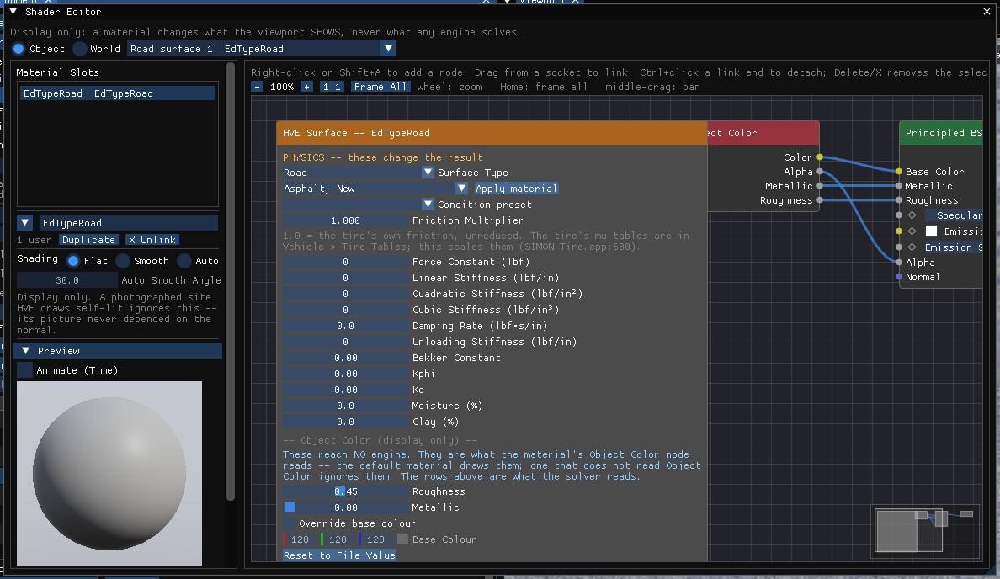
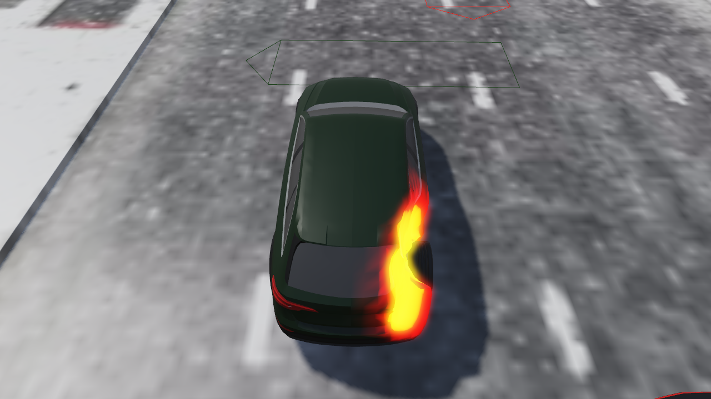

# Materials and the Shader Editor

!!! tip "New in HVE Studio"
    HVE draws every object in the colour its file or its paint gives it. HVE Studio
    lets you give vehicles, vehicle parts, road surfaces, human figures, the
    default ground plane and the sky a **node material**, edited the way
    Blender's material editor works.

## What it is for

A material changes how something **looks** in the 3-D viewport: paint that
catches the light, tinted glass, lamps that glow, a road that reads as worn
asphalt, a sky with haze. It is also a way to **see a result**: a material can
read the run's time, a vehicle's speed, a road surface's friction or the crush
depth at each point of a body, and colour the object by it.

!!! warning "Display only"
    No material reaches any engine. The Shader Editor says so across the top of
    its window: *a material changes what the viewport SHOWS, never what any
    engine solves.* Editing or assigning a material never invalidates a solved
    run. The one exception on these pages is the **HVE Surface** node (below),
    which is a view of a road surface's physics and is labelled as such.

## Opening the Shader Editor

Choose **View › Shader Editor**. It is available in every editor mode. Like
every panel it docks, and it can float outside the main window when **View ›
Panels Outside the Main Window** is on.

The window has three parts:

- **The header.** **Object** or **World**, and, in Object mode, a list naming
  what is selected.
- **The left column.** The selected object's **Material Slots**, the row of
  buttons that acts on the active slot, the object's shading controls, a
  **Preview**, the material's **Keyframes** and its compile status. For the
  World it also holds **Sun & Sky** (see [Sun, Sky and World](02-sun-sky-and-world.md)).
- **The canvas.** The material's nodes and the links between them.

The left column and the slot list can be dragged wider or narrower by their
edges.

## Choosing what to edit

The editor works the way Blender's material tab does: one object, its slots,
and the material in the active slot. There is no list of every material in the
case.

**Object** edits the selected object's material. Select the object in either
of two ways — the two are the same selection:

- **Click it in the viewport.** A vehicle in the Vehicle or Event editor, a
  body in the Human or Event editor, a road surface in the Environment editor.
- **Pick it from the list beside Object/World.** The list groups *Vehicles*,
  *Humans* (when a body can be selected in the current editor), *Road
  surfaces* and, when no environment is loaded, *Ground (no environment
  loaded)*. Picking a road surface switches to the Environment editor, as a
  click on the ground does.

**World** edits the sky behind everything and the light it casts.

With nothing selected the column says how to select something. A case opens
with a vehicle active, but that does not count as a selection for the Shader
Editor until you click it.

## Material slots

| Selected | Slots |
| --- | --- |
| A vehicle whose mesh names its parts | **(whole)**, then one slot per part: `BODY`, `GLASS`, `CHROME`, `LIGHT_RED_HI`, `TRIM`, ... — the names come from the mesh file (an OBJ's `usemtl` names, a glTF's material names, an Inventor file's material names), plus any parts made from faces in Edit Mode |
| A vehicle whose mesh names no parts (an OBJ without `usemtl`, the generic body) | **(whole)** only, until parts are made from its faces in Edit Mode |
| A human | **(whole)**, then the fifteen body segments, `Pelvis` to `Lt Lower Arm` |
| A road surface | one slot, named after the surface |
| The ground plane | one slot |

Each row shows what the slot wears. A part with no material of its own shows
in brackets what it draws in instead: the whole vehicle's material, or
**(file colour)** — the colour the mesh file gives it. A body segment with no
material shows **(segment colour)**, the colour set in Human › Body Segments.

**One material per part (N)** (for a human, **One material per segment (N)**)
appears under the slots when some parts have no material of their own. It
gives each of them a material that is a copy of what it wears now, so nothing
on screen changes until you edit one.

### Materials made when a vehicle or a site is read in

- **Vehicles.** When a vehicle is read in — a case opened, a vehicle added or
  its mesh changed — each named part gets a material of its own, named
  `<PART> - <vehicle name>`. Each starts as exactly what the part already
  looked like, so the picture does not change. Opening a case does not mark it
  modified. Once a vehicle has part materials no more are made, so a part
  material you delete stays deleted.
- **Road surfaces.** When a site is read in, every surface gets a default
  material named after it (`Asphalt`, `Grass`, ...), unless the case already
  carries surface materials, which is how a saved case reopens with its own. A
  site with more than 64 surfaces gets none automatically, and the empty slot
  says why.
- **Humans.** Nothing is made automatically; use **+ New** or **One material
  per segment**.

!!! note "A part material starts as that part's own look"
    The materials made on read-in draw each part in **its own** file colour.
    So linking `LIGHT_RED_HI - ...` onto the GLASS slot changes nothing visible
    until that material is edited — unlike Blender, where an imported lamp
    material carries its red. To give a part a colour of its own, press
    **+ New** on its slot and edit the new material.

## The row under the slots

These buttons act on the **active** slot (the highlighted row):

| Control | Does |
| --- | --- |
| **▼** (browse) | Links any material of the right kind into the slot. Each is listed with the number of slots that wear it. The last entry, **Purge unused (N)**, deletes every material no slot wears. |
| Name field | Renames the material, for every slot that wears it. |
| **N users** | Shown when more than one slot wears the material, so an edit changes all of them. Click to give this slot a copy of its own. With one user it reads **1 user**. |
| **Duplicate** | Gives the slot a copy of its material. |
| **X Unlink** | Takes the material off the slot. The material stays in the case until purged, if nothing else wears it. |
| **+ New** | Shown on an empty slot. Makes a new material for it. |

A new **surface** material is *Object Color → Principled BSDF → Material
Output*. It draws the object exactly as it looked with no material: the paint,
vertex colours, texture, metallic and roughness pass straight through the
**Object Color** node. A new **world** is *Sky Texture → Background → World
Output*, the viewport's own sky, which lights the scene exactly as no world
does.

**A vehicle part's finish is part of its material.** When a vehicle is read
in, each named part gets a material carrying what the part is made of as values
on its Principled BSDF: the paint is lacquered (**Coat Weight** 0.5, **Coat
Roughness** 0.06), glass and lenses are smooth, chrome is polished metal, and
trim and tyres are rough. To change a finish, edit those values in the Shader
Editor. The Principled BSDF's **Coat** inputs (Weight, Roughness, IOR, Tint)
are Blender's: a clear glossy layer over the base, reflecting the sky. A part
with no material at all is drawn with the same finish.

When an assignment cannot be applied — the vehicle was renamed, a surface no
longer exists, a mesh has no part of that name — it is not silently moved to
whatever now sits in that place. The column lists it under **Not applied**,
with the reason.

## Working with nodes

| To | Do |
| --- | --- |
| Add a node | Right-click the canvas, or **Shift+A**: the Add menu, by category |
| Link two sockets | Drag from one socket to the other |
| Detach a link | **Ctrl**+click a link end |
| Delete the selection | **Delete** or **X** |
| Zoom | Mouse wheel (about the cursor, 25%–250%), or **−**, **+**, **1:1** above the canvas |
| Fit the whole graph | **Frame All**, or **Home** |
| Pan | Middle-drag |

**Values.** Every number is one kind of field, as in Blender: drag to change
it, double-click or **Ctrl**+click to type it. A factor (Fac, Metallic,
Roughness, Alpha, a colour channel) is limited to 0–1 and shows a fill for
where it sits. A **Strength** shows the same fill but has no limit; you can
type any value, including a negative one. Colours are entered as you see them
and converted for lighting. The small diamond in front of a value keys it
(see [Keyframes and the Dope Sheet](04-keyframes-and-dope-sheet.md)).

**Links.** Socket types convert as Blender's do: a number feeds a colour or a
vector input, a colour feeds a number input by its brightness, a colour or a
number feeding a shader input becomes an emission, and a shader output only
goes into a shader input. A link that would make a loop is refused, with the
reason.

**Output options.**

- *Material Output* has a blend mode: **Opaque**, **Alpha Blend** (drawn
  see-through) or **Alpha Clip** (hard cut-out below 0.5 alpha). A material
  that is transparent behind an Opaque output — a Transparent BSDF, or a
  Principled BSDF whose own Alpha is below 1 — is drawn blended anyway, as
  Blender's Eevee shows it; the editor notes it. Use Alpha Clip for hard
  cut-outs.
- *World Output* chooses whether the world is drawn as the **background** or
  used for **lighting only**.

### The nodes

| Category | Nodes |
| --- | --- |
| Output | Material Output, World Output |
| Shader | Principled BSDF, Emission, Background (world), Transparent BSDF, Mix Shader, Add Shader |
| Input | **Object Color** (the object's own look — no Blender equivalent), Texture Coordinate, Geometry, Light Path (world), Value, RGB, Fresnel, Layer Weight |
| Texture | Image Texture, Environment Texture (world; equirectangular, `.hdr` supported), Sky Texture (world), Noise, Voronoi, Checker, Gradient, Wave, Brick |
| Color | Mix Color (ten blend modes), Color Ramp (2–4 stops, linear or constant), Invert Color, Hue/Saturation/Value, Brightness/Contrast, Gamma |
| Vector | Mapping, Bump, Normal Map, Vector Math, Separate/Combine XYZ |
| Converter | Math, Map Range, Clamp, RGB to BW, Separate/Combine Color |
| HVE | **HVE Simulation** — reads the run (below) |

**Object Color** outputs what the object looks like with no material: its
colour (paint, file colour, texture or surface colour), alpha, metallic and
roughness. It is what makes a new material change nothing, and the usual
starting point for tinting or darkening an object rather than replacing its
look.

**Image Texture** reads an image file (pick it with **...** on the node). An
8-bit image is decoded as sRGB unless the node is set to **Non-Color** (use
that for normal and roughness maps); an `.hdr` image is read as linear. A
missing image draws magenta and the editor names the file. Image paths are
found as given, then relative to the case's own folder.

### The HVE Simulation node

Read-only views of the run, for colouring an object by a result:

| Output | Value |
| --- | --- |
| **Time** | The playback time, in seconds |
| **Speed** | The vehicle's horizontal ground speed, in m/s (0 for anything that is not a vehicle, and for the first 50 ms) |
| **Friction** | The road surface's own friction (0 off a surface) |
| **Object Index**, **Random** | A per-object number, and a per-object random value, for variation between objects |
| **Crush** | How far the run's crush moved each point of a vehicle body from the undamaged mesh, in **metres**; 0 where it did not, and on anything that is not a crushed vehicle |

Nothing flows the other way: the node reads the run and writes nothing to it.

#### A crush heat map

1. Solve an event with crush (for example a DyMESH collision).
2. Select the struck vehicle and its **(whole)** slot (or its BODY slot), and
   press **+ New** if the slot is empty. The new material is *Object Color →
   Principled BSDF → Material Output*.
3. Add an **HVE Simulation** node, a **Map Range** node and a **Color Ramp**
   node. Link **Crush → Map Range Value**, **Map Range Result → Color Ramp
   Fac**, and **Color Ramp Color → Principled BSDF Emission Color**.
4. Set Map Range's **From Max** to the depth that should read fully hot (0.25 m
   in the figure), choose a three-stop ramp (black, red, yellow), and set the
   Principled BSDF's **Emission Strength** (4 in the figure).
5. Scrub the playback bar. The heat follows the crush as it forms; at t = 0,
   before the impact, the body draws exactly as it would with Crush unlinked.

The Crush value is not sent to Blender (it reads 0 there) and is not baked
into a glTF export.

## The preview

**Preview** at the foot of the left column shows the material on a sphere, in
front of the world the case uses. It shows the playback time, so a keyed value
reads as it will draw; tick **Animate (Time)** to let the preview run its own
clock instead. Fold the section away when the column needs the room. Below it,
the editor reports whether the material compiles, how many value slots and
images it uses, anything the viewport could not apply, and the generated
shader code (**Generated GLSL**). A material that fails to compile draws its
objects as though they had no material, and the reason is shown.

## Vehicle parts: Edit Mode

To give a part its own material by clicking on it:

1. In the **Vehicle** editor, choose **Vehicle › Edit Mode (materials per
   part)**, or press **Tab** with the mouse over the viewport.
2. Click a part of the vehicle — the body, the glass, a lamp lens. It is
   outlined, and a panel at the viewport's corner names the part and what it
   wears.
3. Choose a material from the panel's **Material** list (each with its user
   count), press **+ New** for a material for this part alone, or press **Edit
   in Shader Editor**.
4. Press **Tab** again to leave Edit Mode.

The part clicked is also the Shader Editor's active slot, and clicking a slot
in the Shader Editor highlights its part in the viewport. **(none -- wear the
vehicle's)** in the panel's list removes the part's own material. A mesh that
names no parts says so: it has only the whole-vehicle slot, until parts are made
from its faces (Edit Mode's **Faces** switch and **Make Part**). Parts
themselves are display only too, except that a part unticked under **Collides**
on the Vehicle Mesh window's Collision tab is left out of what DyMESH collides, which changes the
run.

!!! note "HVE Studio"
    The unit a material is assigned to is the **part**, as named by the mesh
    file's own materials. To give some faces a material of their own, switch
    the panel to **Faces**, select them (they are tinted as well as outlined),
    and press **Make Part**, or **Add to Part** to put them in a part the
    vehicle already has. **H** hides the selected faces while you edit,
    **Shift+H** hides the rest, and **Alt+H** shows them all again. See
    [Creating and Editing Vehicles](../hve-users/04-vehicle-editor/10-creating-editing-vehicles.md).
    A mesh's own modelled wheels are not offered.

Faces the file left unnamed, and a mesh that names no parts, wear the
whole-vehicle material. An opaque vehicle with a see-through part (glass on a
painted body) still hides what is behind its opaque parts.

## Road surfaces

Each road surface of a loaded site has a material slot. To open it:

- in the **Environment** editor, click the surface in the viewport and open the
  Shader Editor; or
- select the surface in the viewport or **View › Outliner**, and in
  **Environment › Environment...**, *Selected Surface*, press **Edit in Shader
  Editor**; or
- pick it from the Shader Editor's object list.

On a site that stores its road twice (a drivable copy and a drawn copy), the
surface selected by a click is the one that **drew the pixel**, because that is
the one a material paints.

### Faces of a surface: the Environment Edit Mode

Press **Tab** in the Environment editor to select single **faces** of the site
instead of whole surfaces, so that some faces of a surface can wear a material
of their own. Click a face (Shift adds or removes it). **A** selects every face
of its surface, **L** grows the selection across flat edges, **B** drags a box
and **Alt+A** clears. Selected faces are tinted orange as well as outlined;
the tint is light, so the surface's own material still shows.

**G**, **R** and **S** move, turn and scale the selected faces, as they do a
surface: X / Y / Z lock an axis, a typed number is exact, Ctrl snaps, and a
click or Enter keeps the move while Esc or a right-click puts it back. The
faces part from the faces around them; the move is kept in the case and
undone with Ctrl+Z, and **Put All Faces Back** (Environment panel, *Site
Placement*) removes every face move. Where the site is a single mesh (an
imported DXF, OBJ or similar), the ground the solver drives on moves with the
faces. A site taken from an HVE case stores its road twice, so only its
scenery's faces can move; the road's say so instead.

**H** hides the selected faces, **Shift+H** hides every other face, and
**Alt+H** shows them all again. A hidden face cannot be clicked or selected,
which is how a face under another is reached. Hiding lasts only while Edit
Mode is on, is not saved, and changes nothing the simulation sees. Press
**Tab** or **Esc** to leave.

### The HVE Surface node

A road surface's material shows an extra node with an orange title bar,
**HVE Surface — <surface name>**. It carries the surface's **type and
physics** — Surface Type, Friction Multiplier, the force and damping rows and
the soil terms — under the heading **PHYSICS -- these change the result**. The
surface's look is the material's own: the node no longer carries display copies
of roughness, metallic or a base color. A surface whose base color was
overridden in an earlier version says so, with **Clear Override**.

- It is a **view of the surface, not part of the material.** Its physics rows
  edit the surface itself, exactly as the Environment panel did. A material
  worn by three surfaces shows each one **its own** friction.
- It has no sockets, cannot be linked or deleted, and only its position on the
  canvas is remembered (for the session). To use friction in a graph, use the
  **HVE Simulation** node's Friction output.
- A surface whose slot is empty still shows its physics rows, under the
  canvas's "no material" note.
- Like every physics input, the rows are locked while results are on screen.

The Environment panel's own per-surface editor is now a single line (the
surface's type and friction) and the **Edit in Shader Editor** button. The
**Default** material, which belongs to no surface, is still edited in the
Environment panel.

The surface's **Shading** controls (Flat / Smooth / Auto Smooth) also appear
under its slot; see [Shading Vehicles and Sites](03-shading-vehicles-and-sites.md).

## Humans

A body is a material target with its fifteen segments as its parts.

1. Select the body: in the **Human** editor click the figure (a click picks a
   segment), or in the **Event** editor click a body in the scene.
2. The Shader Editor lists **(whole)** and the fifteen segments. The slot
   clicked in the editor is the segment picked in the Human editor, both ways.
3. **+ New** on a segment starts from that segment's own colour, so it draws as
   before — now lit by the sun the way the vehicles beside it are.

A segment's own material wins; otherwise the figure's whole material; otherwise
the segment's colour from Human › Body Segments. A body with no materials draws
exactly as it always has, in its segment colours.

## The ground plane

With **no environment loaded**, the viewport draws a ground plane under the
vehicles, and the object list offers **Ground plane** under *Ground (no
environment loaded)*. It takes a surface material. Its texture coordinates are
world X and Z in metres, so a checker or a noise stays fixed to the ground as
the camera moves. A case with a site draws no ground plane, so the entry is not
offered there; a material already assigned to it is kept. The ground plane is
not exported to glTF or sent to Blender.

## Saving

Materials, assignments and keyframes are saved with the case, in both the
`.hvex` and the `.json` format. A node type that a newer build of HVE Studio added
is kept, untouched, when the case is opened by an older one.

## Outside HVE Studio

- **Blender Live Link** sends each material as a node graph; Blender gets a real
  node tree (see [Exporting to Blender and glTF](06-exporting-to-blender-and-gltf.md)).
- **glTF export** can only carry a fixed material model, so each material is
  *baked*: constant values and image textures travel, and everything that
  cannot (procedural textures, a world material, keyframes) is listed in the
  export's status.
