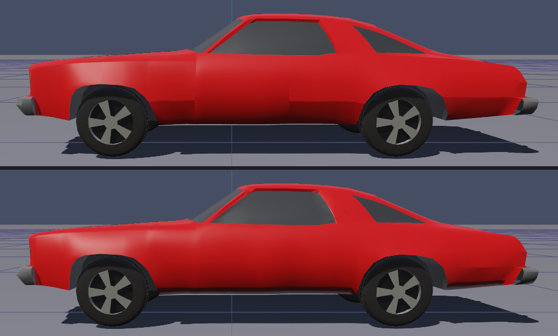

# Shading Vehicles and Sites

!!! tip "New in HVE Studio"
    HVE Studio can re-shade a vehicle body or a site the way Blender's **Shade
    Flat**, **Shade Smooth** and **Shade Auto Smooth** do: it recomputes how
    light falls across the surface without moving a single vertex.

!!! warning "Display only"
    No engine reads a surface normal. Shading changes the picture and nothing
    else: the geometry, the contact mesh, the crush and every result are
    untouched.

## Why it matters

A mesh file says, for every corner of every triangle, which way the surface
faces there (its *normal*). Lighting is computed from those directions. Two
things commonly go wrong with HVE vehicle and site files:

- **Creases between body panels.** Many vehicle files model each body panel
  separately and give each its own normals. Where two panels meet, the two
  sets of normals disagree, and a dark or bright seam shows along the join —
  at t = 0, before any crash.
- **Faceted roads.** A graded road or a terrain surface made of large triangles
  shows every triangle as a flat facet in raking light.

Auto Smooth fixes both while keeping the edges that should be sharp.

## Vehicle shading

Where:

- **Vehicle › Editors › Vehicle Mesh...** (Vehicle editor) or **Event › Vehicle Mesh...**
  (Event editor), section **Shading**; or
- the **Shader Editor**, with the vehicle selected — the **Shading** controls
  under its material slots. The two are the same control.

| Setting | Effect |
| --- | --- |
| **As Loaded** | The file's own normals (or the loader's, when the mesh is loaded with smooth normals). This is how every case drew before the option existed, and the default. A file whose panels carry their own normals can show a crease where they meet. |
| **Flat** | One normal per triangle: every facet shows. |
| **Smooth** | Normals averaged across every edge. Removes the seams, but also rounds off edges that should be sharp, such as the wheel arches. |
| **Auto Smooth** | Smooth across edges whose faces meet within **Auto Smooth Angle (deg)**; sharper edges stay creased. Faces are joined by **position**, so separately modelled body panels smooth into each other. |

**Auto Smooth Angle (deg)** is available only with Auto Smooth selected. Its
default is **60°**, not Blender's 30°: HVE vehicle bodies are low-polygon, and
at 30° thin door triangles stay faceted, while 60° clears the panel seams and
still keeps the wheel arches sharp.

In the figure, the top body (As Loaded) shows the seams where the fender, door
and quarter panel meet; Auto Smooth (bottom) joins them while the wheel arches
and the roof line stay sharp.

To remove panel creases from a vehicle:

1. Select the vehicle and open **Vehicle › Editors › Vehicle Mesh...** (or select it in
   the Shader Editor).
2. Under **Shading**, choose **Auto Smooth**.
3. If thin panels still look faceted, raise the angle; if an edge you want
   sharp has gone soft, lower it.

Details:

- The body and each wheel the mesh models are shaded separately — a modelled
  wheel is never smoothed into the body.
- After a run, the shading is re-applied over the **crushed** body.
- The change is applied live; the mesh is not reloaded.
- Vehicle shading is **not** carried by the glTF export or the Blender Live
  Link, which read the mesh file afresh. In Blender, use Blender's own
  **Shade Auto Smooth**.

## Site shading

Where:

- **Environment › Environment...**, *Terrain* section, under *Scene Geometry*:
  **Shading**; or
- the **Shader Editor**, with a road surface selected — under its slot. The two
  are the same control, and it applies to the whole drawn site.

| Setting | Effect |
| --- | --- |
| **Flat** | One normal per face, as the file gives it. The default. |
| **Smooth** | The normals of every face meeting at a point are averaged, so a graded road stops showing its triangles. |
| **Auto Smooth** | Averaged only between faces within **Auto Smooth Angle (deg)**, so kerbs and building edges stay sharp. |

The site's Auto Smooth angle defaults to **30°** (Blender's own default).

!!! note "Photographed sites"
    A photographed site that HVE draws self-lit — the surface shows the photo
    without lighting — ignores this setting, because its picture never depended
    on the normal.
