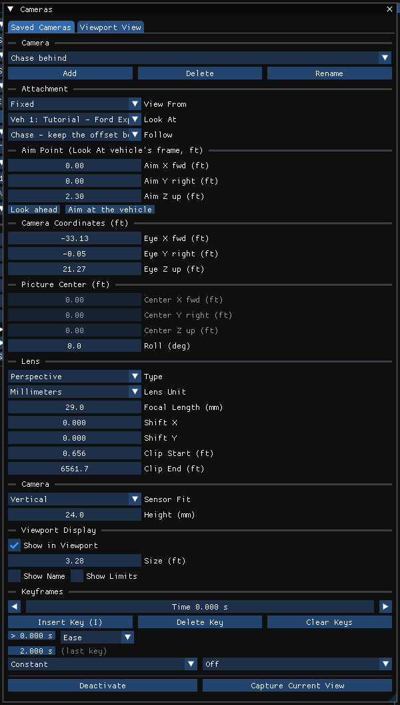

# Cameras

!!! tip "New in HVE Studio"
    HVE saves named camera views, which can ride on a vehicle and be aimed at
    one. HVE Studio keeps up to 16 named cameras in the case, each of which can
    stand still, follow or chase a vehicle, or ride on one, and adds what HVE
    does not have: cameras animated with keyframes, set up the way a Blender
    camera is — the same lens, sensor and display settings — and carried to
    Blender and glTF.

!!! warning "Display only"
    No engine reads a camera. Adding, moving or keying one never invalidates a
    solved run.

## The Cameras dialog

Open **Tools › Cameras...**. The dialog has two tabs:

- **Saved Cameras** — the cameras stored in the case (this page).
- **Viewport View** — the controls for the live view itself: Orbit or Free,
  the view presets (Top, Front, Rear, Left, Right, Persp), the projection and
  **Reset Camera**. See [Camera Setup](../01-user-interface/CameraSetDlg.md).

### Making and choosing cameras

| Control | Does |
| --- | --- |
| Camera list | Chooses which saved camera the dialog edits. The camera being looked through is marked *(active)*. |
| **Add** | A new camera, framed as the viewport is now |
| **Delete**, **Rename** | Act on the selected camera |
| **Activate** / **Deactivate** | Look through the selected camera (it drives the viewport), or stop |
| **Capture Current View** | Copy the viewport's current framing into the selected camera |

**Looking through a camera.** Only the **active** camera drives the viewport.
Press **Activate** in the dialog, pick the camera in the viewport bar's camera
list, or press **C** (next camera) or **Shift+C** (previous) when no text field
is being edited. In the Dope Sheet, double-click a camera's header.

**Re-framing a saved camera.** While you look through a camera, orbiting,
panning, dollying or zooming the viewport does **not** silently rewrite it. The
dialog shows the working view as **Current — re-framed from "name", not
saved**, with three buttons: **Save as New**, **Overwrite "name"**, **Revert**.

## Attachment: what the camera follows

| Field | Meaning |
| --- | --- |
| **View From** | **Fixed**, or a vehicle the camera is mounted **on** (an onboard camera) |
| **Look At** | **Fixed**, or a vehicle the camera aims **at** |

With **Look At** set to a vehicle (and View From Fixed), the **Follow** list
chooses what happens to the camera's offset from that vehicle as it moves:

| Follow | Effect |
| --- | --- |
| **Fixed - do not move the camera** | The camera stays put and turns to watch, like a camera on a tripod; the vehicle drives through the shot |
| **Follow - keep the offset in world axes** | The camera travels with the vehicle but keeps its compass direction from it — a tracking or panning shot. After a right turn you are watching the vehicle's left side. |
| **Chase - keep the offset behind the vehicle** | The offset turns with the vehicle's heading, so behind stays behind through a turn — a riding-along shot. Its angle is stored from the vehicle's heading, so it also stays behind when the start heading is edited, and a camera switched on part-way through a run, the exported camera and the view all agree |

With **View From** set to a vehicle, the list is **Aim** instead:

| Aim | Effect |
| --- | --- |
| **Rides with the vehicle** | The camera looks at its **Aim Point**, in the vehicle's own frame, so it turns, pitches and rolls with the vehicle, and the picture banks with it — the view from a camera bolted to the car |
| **Rides with the vehicle, level horizon** | The same, turning with the vehicle's heading only: the mount and aim stay level and the horizon stays horizontal through a pitch or a roll |
| **Stays on a fixed world point** | The camera rides the vehicle but keeps looking at a fixed point in the scene |

Below these:

- **Onboard Mount** (View From cameras) — **Mount X fwd**, **Mount Y right**,
  **Mount Z down**: where the camera sits, measured from the vehicle's CG in the
  vehicle's own frame (SAE: z down, so a mount above the CG is negative). On an onboard camera the mouse wheel dollies by editing
  these rows.
- **Aim Point** — **Aim X fwd / Y right / Z down**: where the camera looks,
  offset from the CG of the Look At vehicle (or of its own vehicle, for an
  onboard camera). **Look ahead** sets 30 m ahead at about eye height; **Aim at
  the vehicle** sets the CG, 0.7 m up.
- **Camera Coordinates** (the eye) and **Picture Center** (the point looked
  at), and **Roll (deg)**. These are greyed where an attachment sets them.

Lengths are shown in the units set in Preferences. Before a run, an attached
camera tracks the vehicles' **start** positions, so it can be aimed before
anything is solved; after a run it follows the motion.

## Lens, Camera and Viewport Display

These are Blender's camera settings, under Blender's names, and the 3-D view
honours them while you look through the camera:

| Section | Field | Meaning |
| --- | --- | --- |
| Lens | **Type** | Perspective or Orthographic |
| | **Lens Unit** | Millimeters (focal length) or Field of View |
| | **Focal Length (mm)** / **Field of View (deg)** | Taken along the sensor's axis, as Blender takes them |
| | **Orthographic Scale** | How much of the scene the frame spans, across its longer side (orthographic only) |
| | **Shift X**, **Shift Y** | Moves the frame sideways or up without turning the camera, as a fraction of its longer side — a view camera's shift |
| | **Clip Start**, **Clip End** | The nearest and farthest distances drawn |
| Camera | **Sensor Fit** | Auto, Horizontal or Vertical |
| | **Size / Width / Height (mm)** | The sensor size the focal length is measured against. Vertical 24 mm is the 35 mm-equivalent HVE Studio has always used; Blender's default is Auto, 36 mm |
| Viewport Display | **Show in Viewport**, **Size**, **Show Name**, **Show Limits** | How the camera is drawn in the 3-D view (Show Limits draws the clip range) |

Depth of field and panoramic lenses are not offered: nothing in HVE Studio renders
them.

## Keyframed cameras

A saved camera can be animated over playback time.

1. **Activate** the camera (look through it).
2. Set the playback time, frame the view — orbit, pan, dolly, zoom, roll — and
   press **I** (when no text field is being edited), or **Insert Key (I)** in the dialog's
   **Keyframes** section.
3. Move the playback time, re-frame, and press **I** again. Repeat.

The **Keyframes** section also has the playback **Time** with ◀ ▶ to jump
between this camera's keys, **Delete Key** (at the current time), **Clear
Keys**, and one row per key time with its interpolation (and easing) to the
next key, plus the camera's extrapolation and cycles. These are the same
choices as for materials — see
[Keyframes and the Dope Sheet](04-keyframes-and-dope-sheet.md). The keys also
appear in the Dope Sheet, where they can be moved and edited.

**What a key records** depends on how the camera is attached, so no key fights
the attachment:

| Camera | Keys |
| --- | --- |
| Not attached, or Look At with Follow set to Fixed | the Picture Center (look-at point) and the orbit (azimuth, polar angle, distance) |
| Look At a vehicle, Follow or Chase | the Aim Point and the orbit |
| View From a vehicle | the Mount, and the Aim Point (or the Picture Center when the aim stays on a fixed world point) |

Every camera also keys its field of view and roll; the orthographic scale when
orthographic; the shift when it is not zero; and every channel already keyed.
Angles are keyed the short way round, so a pan past 180° does not spin the long
way.

- **A keyed camera is still attached.** A keyed Chase camera still turns with
  its car; the keys animate its offset.
- **Re-framing without keying is temporary.** If you re-frame an animated camera
  and do not press I, the change lasts until the playback time moves, then the
  camera returns to its curve — as in Blender.
- **The dialog's fields show the camera at the playback time**, and editing a
  keyed field keys it there.

## In Blender and glTF

- **glTF export** writes every saved camera as a glTF camera. A camera that
  rides a vehicle, or is keyed, is animated per frame; its lens is a single
  value, so a keyed lens is exported at t = 0, and lens **shift** cannot be
  carried at all — the export status says so, camera by camera.
- **Blender Live Link** creates real Blender camera objects in an *HVE Cameras*
  collection, with the lens (focal length, orthographic scale, shift) and the
  motion keyed per frame. The camera HVE Studio looks through becomes Blender's
  scene camera.

See [Exporting to Blender and glTF](06-exporting-to-blender-and-gltf.md).
