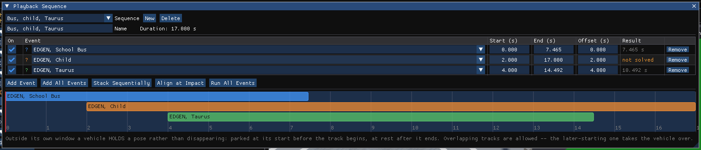

# Video and Playback Sequences

This chapter covers two things HVE did in its Playback editor: combining
several events on one timeline (HVE's *Video Creator*), and writing a video
file. HVE Studio has a Playback editor too: the **Playback (F6)** tab.

## An event's start time

Every event starts at 0 s. To show it on a different clock -- for example
**−5** so that an impact five seconds in reads near 0 -- enter a **Start
time (s)** in the Event editor, under the event's name. It changes only how
times are SHOWN: the Key Results table and its CSV, the graph's time axis,
Export Variables' Time column, the playback bar and its time entry, and the
Results HUD's Time row while that event plays. The run itself is unchanged.
A case read from HVE starts at 0.

## Playback sequences

!!! tip "New in HVE Studio"
    In HVE the timing of each event lived on the event itself, was reset when
    the Video Creator closed, and only one arrangement could exist. In HVE Studio
    a **playback sequence** belongs to the case: up to eight named sequences
    can be kept, each arranging the same events differently, and they are saved
    with the case.

A playback sequence plays several **solved** events on one timeline, each with
its own start offset and trim: event A plays, then event B; or both at once;
or two reconstructions of the same crash aligned at their impact instants for
comparison.

### Making a sequence

1. Click the **Playback (F6)** tab. Its **Playback Sequence** panel opens with
   the other editors' panels (**Playback › Playback Sequence...** reopens it).
2. Press **New**. The new sequence takes every event in the case, laid end to
   end, and becomes the active sequence. (Its default name is *Sequence N*;
   change it in **Name**.)
   If any event has a **Start time** (Event editor, under its name), the
   tracks are instead placed by those clocks: an event that starts at −5 s
   lands 5 s before one that starts at 0, so a pre-impact event and its
   impact event play one after the other. The timeline itself always begins
   at 0, so the earliest event starts there. **Add Event** and **Add All
   Events** place a new track the same way.
3. Press **Run All Events** to solve every event the sequence uses, one after
   another. The window is busy until they finish; an event that has no result
   yet shows **not solved** in the *Result* column and contributes nothing.
4. Arrange the tracks (below), and play with the playback bar as usual.

### The track table

One row per track:

| Column | Meaning |
| --- | --- |
| **On** | Include this track. A track switched off is ignored, and does not count toward the duration. |
| **Event** | Which event the track plays (with a colour key matching the timeline strip) |
| **Start (s)** | Where the track starts on the sequence timeline |
| **End (s)** | Where it ends on the sequence timeline |
| **Offset (s)** | Where the event's own t = 0 sits on the sequence timeline |
| **Result** | The event's solved duration, or **not solved** |
| **Remove** | Drop the track |

Start and End are entered in **sequence** time, but stored as a trim of the
event's own time, so changing **Offset** slides the whole track without
changing which part of the event it plays. An End at the event's own end keeps
following the event: if the event is re-solved longer, the track grows with it.

The **Duration** beside the name is the latest track end among the tracks
switched on.

### The timeline strip

Under the table, each track is a coloured bar on the sequence timeline, with
the playback position marked in red.

- **Drag a bar** to slide that event in time (hold **Ctrl** to snap). One drag
  is one undo step.
- **Click elsewhere** in the strip to scrub.

### Arranging buttons

| Button | Does |
| --- | --- |
| **Add Event** | A new track (for the first event; change it in the Event column) |
| **Add All Events** | A track for every event not already in the sequence |
| **Stack Sequentially** | Lays every track that is switched on end to end, in table order |
| **Align at Impact** | Slides every track so its impact instant falls at the same sequence time — for comparing reconstructions. Tracks with no known impact time stay put. |
| **Run All Events** | Solves every event the sequence uses, one at a time |

The **Sequence** list at the top chooses the active sequence; **Delete**
removes it. There is no *single-event* entry: playing one event on its own is
what the **Event** editor does, whatever sequence is chosen.

### Which timeline is playing

The editor decides, and nothing else does:

| Editor | The viewport, the playback bar, Record Animation, glTF and the Blender link play |
| --- | --- |
| **Event (F5)** | the active event, on its own |
| **Playback (F6)** | the active playback sequence |

In the Playback editor:

- A **header** at the top of the viewport names the sequence and the time, and
  lists every track with its state at that time: **PLAYING** (marked `>`, with
  the event's own time), *waiting*, *done*, *off*, or **UNSOLVED** — an event
  with no result, which places nobody until **Run All Events** solves it.
- The **playback bar** reads *[sequence: name]*. Its left-hand button is
  **Run All**; there is no **Reset**, which throws away the active event's run
  and belongs to the Event editor.
- The vehicles are the sequence's: a vehicle no track places, or whose event is
  unsolved, is not drawn. Wheels steer and spin with the event holding the
  vehicle.
- **Occupants, trails and the velocity, collision and tire-force vectors are
  drawn only in the Event editor.** Each belongs to one event's run; on a
  sequence's clock they would show one event's data at another event's time.
  The header says so.

### How vehicles behave on a sequence

- **Outside its own track a vehicle holds a pose**, rather than disappearing:
  parked at its start position before its track begins, at rest after it ends.
  This is how HVE sequenced events too.
- **Overlapping tracks are allowed.** Where two tracks that use the same vehicle
  overlap, the later-starting one takes the vehicle over; when a track nested
  inside another ends, the enclosing one resumes. These are HVE's own rules.
- A vehicle is the same vehicle in every event (HVE Studio's case has one vehicle
  list shared by all events), so no name matching is involved.
- **Damage carries forward on screen.** A vehicle entering a later event is
  drawn already crushed from the earlier one, and crush still forms
  progressively during each event.

!!! warning "Display only — each event is still solved on its own"
    A sequence is an arrangement for playback. It is not an input to any
    engine. Each event solves from its own initial conditions and an
    **undamaged** vehicle; no event's rest position, speed or damage is fed into
    the next one's solve.

- The playback step is the finest output interval of the tracks switched on,
  so every step lands on a recorded frame of every event.
- A [glTF export](06-exporting-to-blender-and-gltf.md) or the Blender live link
  made from the Playback editor carries the whole sequence; made from the Event
  editor, the active event.

!!! note "HVE Studio"
    Saving the case saves the results of every solved event beside it, so a
    reopened case plays its sequences without **Run All Events**. An event
    edited after it was solved comes back unsolved; press **Run All Events** to
    solve it again (see [Saved results](../getting-started/04-cases-and-files.md#saved-results-hver)).

## Recording a video

**File › Record Animation...** writes what the playback bar plays to a video
file: the solved event from the Event editor, the active playback sequence from
the Playback editor. It records the **3-D scene**
between a start and an end time you choose (the whole playback unless you
change them), through the camera you choose: the view you are looking through
(the free view as you have framed it, or the saved camera chosen on the
playback bar), or any saved camera (see **Tools › Cameras...**), including an
attached or keyframed one. The case's [Results HUD](11-results-hud.md) boxes
can be drawn into every frame.

1. Run the event (or, for a sequence, press **Run All** in the Playback editor).
2. Choose **File › Record Animation...**. The **Record Animation (AVI)** window
   opens.
3. Set the **Output File**, or choose it with **...**. It starts as
   `output.avi` in the open case's folder (in `Documents\HVE Studio` when no case is open),
   never in the program's install folder, which an uninstall removes.
4. Under **Video Settings**, pick a **Size** from the list (HD, Full HD, QHD,
   4K UHD, square, portrait, 4:3, VGA) or set the frame **Width** and **Height**
   (64 to 4096 pixels, rounded to even numbers; default 1280 × 720), the **FPS** (1 to
   1000; default 30) and the **JPEG Quality** (1 to 100; default 85).

   Tick **Slow motion** to take frames from the run faster than the video
   plays them, as a high-speed camera does. The **Capture rate (frames per s
   of the run)** (1 to 10000; default 1000) is how many frames are taken per
   second of the run; the **FPS** is how fast the video plays. Captured at 1000
   and played at 100, one second of the crash lasts ten seconds of video, and
   the window says so. A capture rate below the FPS speeds the video up
   instead. With **Slow motion** off, frames are taken at the FPS and the video
   plays in real time.
5. Under **Camera and Time**, choose the **Camera** — *The view you are looking
   through* (the default) or a saved camera by name — and the **Start (s)** and
   **End (s)** times. **Now** beside each takes the playback bar's current
   time; **End of run** (ticked by default) records to the end whatever the
   run's length, and greys the End field. Recording through a saved camera
   does not change your own view: it is put back when the recording ends.
6. Under **Rendering**, choose the **Renderer**. **Viewport (fast)** records the
   3-D view's own picture. **Ray traced** traces every frame with the built-in
   path tracer (see below) at the **Samples** given (default 64), which takes
   seconds a frame instead of milliseconds; **Denoise** (on by default) lets far
   fewer samples give a clean frame. **Trace on the GPU** (on by default) traces
   each frame on the graphics card where it can, many times faster; the window
   pauses for each frame while the card traces it. On the processor (the box
   cleared, or a graphics card that cannot trace) the app stays usable while
   frames are traced, and **Cancel** answers at once. Tick **Motion blur** to make each
   frame the average of several instants (**Steps**, default 8) across the
   **Shutter** (default 0.50 of a frame): 0.5 of a frame is a film camera's
   look, where a spinning wheel blurs and an impact smears.
7. Tick **Burn in key results (Results HUD)** to draw the case's Results HUD
   boxes into every frame. Ticking it switches every box on for the movie (and
   in the viewport), and adds a *Key results* box — Time, then Speed for
   each vehicle — if the case has none; unticking it takes every
   box out of the movie. Choose the rows, style and placement in **View ›
   Results HUD** (see [Results HUD](11-results-hud.md#in-a-recorded-movie)).
   Under motion blur the HUD is drawn once over the blurred frame, so it stays
   sharp.
8. Check the line under the switch, which gives the part of the playback
   recorded and the number of frames — for example *Recording 0.000 s to
   4.500 s of 4.50 s -> 136 frames at 30 fps.* With slow motion it also says
   how much slower (or faster) than real time the video plays and how long it
   will last.
9. Press **Record**. The viewport steps through the playback a frame at a time
   while a progress bar (*frame n / N*) fills; **Cancel** stops and leaves no
   file. When the recording finishes, the window reports the frames written,
   the length, the size and the file, and the playback returns to the time it
   was at before.

If the output file already exists, **Record** first asks whether to overwrite
it (**Overwrite** / **Keep**). Closing the window during a recording cancels
it.

!!! warning "Frames faster than the run's output are drawn, not computed"
    The engine saves the vehicles' state once per output interval. When the
    capture rate (the FPS, or the **Capture rate** under slow motion) is
    faster than that, the window warns in orange and says how many of every
    so many frames fall between saved states. Those frames are in-betweens:
    the vehicles move in a straight line between two saved poses, and crush
    and occupant bodies change only at saved states. For real detail, lower
    the event's output interval (for example to 0.001 s for 1000 frames a
    second of the run) and run it again.

!!! note "HVE Studio"
    The file is a **Motion-JPEG AVI**: each frame is a JPEG picture, in an
    ordinary AVI file. VLC, Windows Media Player, ffmpeg and common video
    editors open it without extra software. HVE used Windows' own video
    library and offered its compressors; HVE Studio writes this one format on
    every platform. A video longer or larger than an AVI file can hold (about
    1 GB) stops with a message — lower the size, frame rate or quality.

!!! note "HVE Studio"
    The 3-D scene is recorded, with the Results HUD when it is burned in.
    Panels, dialogs and the playback bar are not in the video, and HVE's
    *Include UI Overlay* option is not offered. Record is unavailable, with the
    reason shown in the window, until there is a solved event to play, while a
    simulation is running, and when the start time is after the end time. A
    recording stops, and writes no file, if the run is reset or solved again
    while it is being recorded. The window's settings last for the session;
    they are not saved with the case.

### Playing a video

**File › Play Video...** opens a *Video Playback* window. Type or browse to a
file (**...**) and press **Load**. The picture is shown at the file's own frame
rate with **Play**/**Pause**, single-frame steps (**<** and **>**), **|<** and
**>|** for the first and last frame, a frame slider, a speed control and
**Loop**. After a recording, **Show in Play Video** in the Record Animation
window opens the file just written.

!!! note "HVE Studio"
    Play Video plays Motion-JPEG AVI files — what Record Animation writes, and
    the same format written by other programs. Other compressions
    (H.264 and so on) are not decoded; open those in a media player.

### A ray-traced picture

**File › Render Image (Ray Traced)...** traces the 3-D view as it is now: its
camera, the playback instant, the case's sun and sky, the vehicles' lamps as
the run switched them, and every site light that is on (Environment panel ›
Lights). You get soft shadows from a sun disc of real size,
reflections, and light bounced off the road. Pick a **Size** from the list
(HD, Full HD, QHD, 4K UHD, square, portrait, 4:3, or the 3-D view's shape at
this width) or set the **Width** and **Height**, then the **Samples** (64–256
for a clean picture) and the **Bounces**, and press **Render**. A size of
another shape than the view shows all of the view and more at the sides (or
above and below); it is never stretched. The picture sharpens pass by pass; **Stop**
at any point and **Save PNG**. **Denoise**, on by default, smooths the remaining
noise out of the lighting while keeping paint, photographs and shadow edges
sharp, so 16–32 samples already give a clean picture. **Trace on the GPU**, on
by default, traces on the graphics card (see below); the status line beside
the sample count says what traced the picture.
**Results HUD** (on by default) burns the HUD boxes marked **Burn into movies
and renders**, of the view on screen (Event or Playback), over the picture and
into the saved PNG, as a recorded movie carries them; it is greyed when no such
box exists.

The tracer runs on the graphics card when **Trace on the GPU** is ticked and
the card can: the same tracer, the same scene and the same picture as on the
processor, many times faster. It needs only what the 3-D view already uses
(OpenGL 3.3, or WebGL2 in the browser) plus 32-bit float render targets, so it
works on Windows, macOS, Linux and in the browser alike. Where the card cannot
— no float render targets, or a scene or picture too large for its memory —
the render runs on the processor, on every core the machine has, and the
window says why in a note; very large scene textures are reduced to fit the
card, and the window says that too. A finer picture costs time in proportion
to its pixels and samples either way.

`--render-traced` (below) uses the graphics card when it can, and prints which
traced the picture.

A still can also be made without opening the app:
`HVEStudio --render-traced case.hvex picture.png 128 1920` traces the case at the
end of its run through its active camera (add a time after the width for
another instant, and `--no-denoise` for the raw samples).

| Control | Default | Range |
| --- | --- | --- |
| **Width** × **Height** (pixels) | 1920 × 1080 | 64–7680 each |
| **Samples** | 128 | 1–16384 |
| **Bounces** | 6 | 0–32 |

The settings are locked while a render runs. The file box beside **Save PNG**
starts as `render.png` in the open case's folder (in `Documents\HVE Studio` when no case is
open), and the status line names the file. Closing the
window stops a render in progress.

!!! note "HVE Studio"
    HVE has no built-in ray tracer. This one reads its scene from the same
    description the glTF export writes and lights it the way the viewport
    does. A traced picture and the viewport's picture of the same instant
    therefore show the same scene and materials, lit two ways. Glass is a thin
    pane (no refraction), and procedural node textures travel as the constant
    the glTF bake gives them.

### Rendering a video in Blender

For full control of a rendering — your own lighting and materials, Cycles,
a longer or larger video — export the scene to Blender:

1. The [Blender Live Link](06-exporting-to-blender-and-gltf.md#the-blender-live-link)
   if you will iterate, or a [glTF export](06-exporting-to-blender-and-gltf.md#exporting-gltf)
   for a one-off. Both carry the motion, the humans, the cameras (keyed) and,
   through the live link, the materials and sky.
2. In Blender, choose the camera, set the output format (for example FFmpeg
   video) and render the animation.
