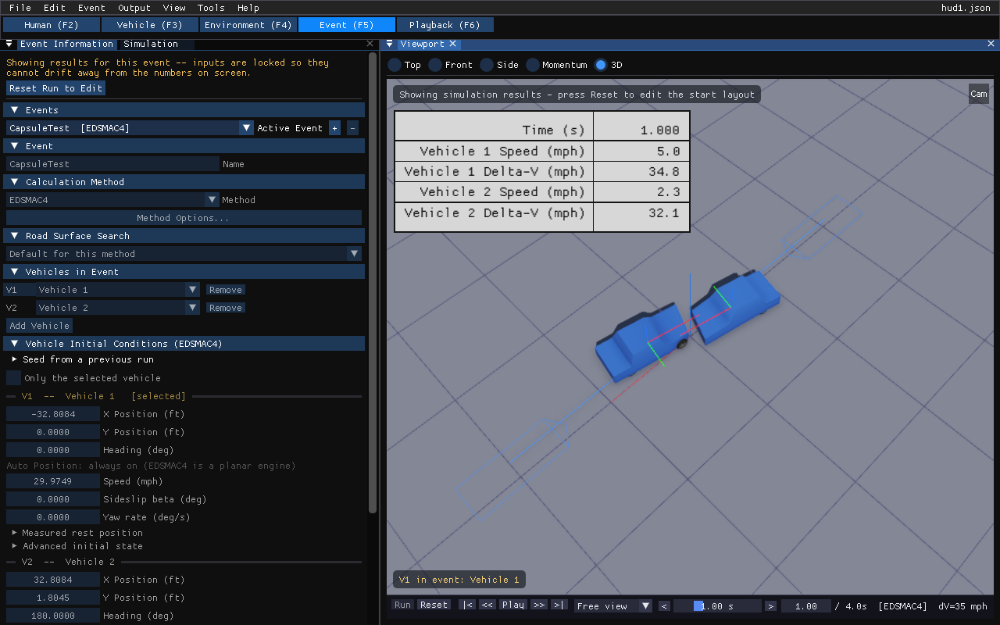
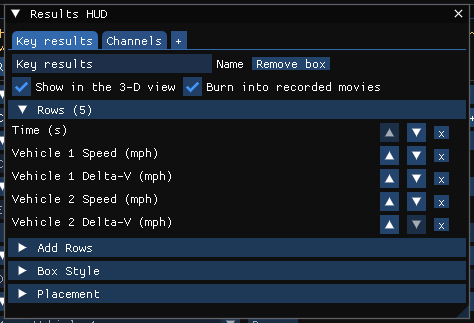

# Results HUD

!!! tip "New in HVE Studio"
    The Results HUD draws boxes of solved numbers over the 3-D viewport while a
    run plays back: the time, and for any vehicle its speed or any output
    channel. The same boxes can be burned into a movie recorded
    with **File › Record Animation...**, so the video carries the numbers. A
    case can hold any number of boxes, each with its own rows, style and place
    on the screen, and they are saved with the case.

    In HVE, numbers were read from report and variable-output windows beside
    the playback, and DamageStudio could annotate its own viewer with selected
    key results. The Results HUD does this for the playback viewport and for
    every output channel.

!!! warning "Display only"
    No engine reads a Results HUD box. Adding, editing or removing one never
    changes a result and never discards a solved run, and the window can be
    used while results are on screen.

## Where the boxes appear

The boxes are drawn over the 3-D viewport once there is a solved run to read:
in the **Event (F5)** editor for the active event, and in the **Playback (F6)**
editor for the active playback sequence. The Vehicle editor, which shows one
vehicle on its own, does not draw them. Each box shows the values at the
playback bar's current time and updates as the run plays or as you drag the
time slider.

Each box is a table in the style of an HVE text report: a label column and a
value column, on a plate with a frame. A label carries its unit, and numbers
are right-aligned against the right edge of the box. The value column keeps
its width as the numbers change, so a box does not change size while the run
plays.

*The default box, Key results, over an EDSMAC4 event one second into the run.*

## The Results HUD window

Choose **View › Results HUD**. The window is available in every editor and
docks like any other panel. It edits every box of the open case.

The Event view and Playback have **different HUDs**: each box is shown in the
**Event** view (over the Event editor's run), in **Playback** (while a playback
sequence plays), or in both. The same editor is a tab in each place that owns
one, listing only that view's boxes, and a box added there belongs to that
view:

- the **Results HUD** tab of the Event Designer's **Results** stage, beside Key Results and the Output Graph (Event view);
- the **Results HUD** tab of the **Playback Sequence** panel (Playback).

A box from a case saved before this is in both views, as every box was.

*The Results HUD window with two boxes, Key results open.*

If the case has no box yet, the window says *This case has no HUD box* and
offers **Add a box (Time, then each vehicle's Speed)**. That box is
named *Key results* and has a **Time** row followed by a **Speed** row for
each vehicle of the active event (every vehicle of the case if there is no
event).

The window has a row of box tabs at the top, the box's name and switches under
them, and four sections: **Rows**, **Add Rows**, **Box Style** and
**Placement**. Everything below the tabs applies to the box whose tab is
selected.

### Box tabs and the + menu

Each box has a tab, named with the box's name. Click a tab to edit that box.
The **+** at the right end of the tabs adds a box:

| Item | Adds |
| --- | --- |
| **Copy of this box** | A copy of the selected box, rows and style included, named *name copy* and placed a tenth of the frame height below it, so it does not cover the original |
| **Time and Speed** | A new box with the same rows as the first box above: Time, then Speed for each vehicle of the active event |
| **Blank** | An empty box named *HUD n*, with no rows |

Under the tabs:

| Control | Does |
| --- | --- |
| **Name** | The box's name, shown on its tab. It is not drawn on screen. |
| **Remove box** | Deletes the box |
| **Shown in** | **Event and Playback**, **Event** or **Playback**: the view the box is drawn in |
| **Show in the 3-D view** | Draws the box over the viewport (on for a new box) |
| **Burn into movies and renders** | Draws the box into every frame recorded with **File › Record Animation...** and over a picture made with **File › Render Image (Ray Traced)...** (its **Results HUD** box, on by default) -- on for a new box. A box is burned in only while **Show in the 3-D view** is also on, and only in its own view. |

### Rows

The **Rows** section (its heading gives the number of rows) lists the box's
rows from top to bottom, each by the label it shows. Beside each row:

- the up and down arrows move the row one place;
- **x** removes it.

Click a row to open its details (click it again to close them):

| Control | Does |
| --- | --- |
| **Label** | Replaces the row's label. Leave it blank for the default, which is shown greyed in the field (for example *Ford Taurus Speed*). The unit is always added after the label, in the unit system set in Preferences. |
| **Decimals** | The number of decimal places, from **default** to 6. The default is 3 for Time, 1 for Speed, Heading and Delta-V, and 2 for an output channel. |
| **Own colour** | Draws this row in its own colour instead of the box's text colour; the colour swatch beside it sets the colour |

A row is one of five kinds:

| Row | Shows | Unit |
| --- | --- | --- |
| **Time** | The playback time, plus the box's **Time offset** (see [Box Style](#box-style)). Playing one event, the time is on that event's clock: its **Start time** (Event editor) is added | s |
| **Speed** | The vehicle's speed | mph or km/h |
| **Heading** | The vehicle's heading, between −180 and 180 degrees | deg |
| **Delta-V** | Only in a box saved before 2026-10-20, which still shows it: the vehicle's collision Delta-V, as it develops through the impact (below). It is no longer offered: one number per vehicle is not always the Delta-V an analyst would report; **HVE Reports** › **Damage Data** gives each impact's. | mph or km/h |
| An output channel | The value of that channel for the vehicle, the same value the Output Graph and Key Results show | the channel's own display unit |

The default label of a vehicle row starts with the vehicle's name: *Ford Taurus
Speed*, *Ford Taurus Long Vel (u)*. A per-wheel or per-tire channel has the
same name on every wheel, so its label adds the wheel group as well, for
example *Ford Taurus Tire A1-R: Tire Fx'*.

An output-channel row remembers its channel by name, so it finds the channel
again after the event is run again. If the event's program does not produce
that channel, the row reads `--`.

### What Delta-V means here

The **Delta-V** row is the vehicle's **collision Delta-V**: the same number
**Key Results** and the run report print for the impact, shown as it develops
while the event plays.

| When | The row shows |
| --- | --- |
| Before the collision | 0 |
| During the collision | \| **v**(t) − **v**before \| |
| From the end of the collision on | \| **v**after − **v**before \| — the reported Delta-V |
| The run found no collision for the vehicle | `--` |

**v**before and **v**after are the vehicle's velocities just
before and just after the collision, in earth-fixed axes, at the same instants
the report measures them; **v**(t) is built from the *Long Vel (u)* and *Lat Vel
(v)* channels turned through the heading. It is a vector difference, not a
difference in speed, so a rebound counts in full.

Braking, steering or a yaw **before** the impact is not part of it, and nor is
the vehicle slowing to rest **after** separation: from the end of the collision
on, the row holds the reported value. Only the primary impact is measured, as in
the report.

In a playback sequence, Delta-V is the collision of the event that places the
vehicle at that moment (see [In a playback sequence](#in-a-playback-sequence)).

### What "--" means

A value of `--` means the run has no value for that row at that time. The HUD
never shows a number the run did not produce. It happens when:

- the vehicle is not in the run on screen (the row names a vehicle of the case
  that the event does not use);
- the event's program does not produce the channel the row names;
- the channel has no valid number at that time;
- in a playback sequence, no track places the vehicle at that moment, or the
  track's event has not been solved.

### Add Rows

**Add Rows** has the **Time** checkbox, which adds or removes the Time row,
and **Choose Variables...**, which opens **Select Output Variables** — the
same picker Key Results and the Output Graph use, with its presets, filter,
Vehicle / Wheel / Tire scope and a column per vehicle — on this box. A tick
there adds that vehicle's row for that variable to the bottom of the box; an
untick removes it. Output channels are listed once the event has been run;
before that the section says so. Occupant variables have no HUD row.

### Box Style

| Control | Does |
| --- | --- |
| **Text size (%)** | 50 to 300. At 100% the text is 18 pixels high on a 720-line frame, and the same fraction of the height of any other frame, so a box keeps its proportion in a small viewport and in a 1080-line movie. |
| **Fixed width** | Off (the default): the box is as wide as its text. On: the box is a set fraction of the frame's width, given by **Width (fraction of frame)** (0.05 to 1.00), and **Divider position** (0.10 to 0.95) places the line between labels and values as a fraction of that width. A label too long for its column keeps its start, which is the vehicle's name, and is cut at the divider. |
| **Background** | Draws the plate behind the text |
| **Frame** | Draws a frame around the box |
| **Column divider** | Draws a line between the label and value columns |
| **Row lines** | Draws a line between rows (off by default) |
| **Text**, **Background**, **Frame** | The three colours, each with its opacity. The column divider and row lines are drawn in the frame colour. |
| **Light box** | Dark text on a light grey plate with a dark frame: the look of a new box |
| **Dark box** | Light text on a dark, partly transparent plate with a grey frame |
| **Time offset (s)** | Added to the **Time** row only. Enter minus the impact time, for example, to read time from impact. |
| **Zero at impact** | Sets the time offset so that **Time** reads 0 at the first contact of the run on screen, and negative before it. In a playback sequence it is the first contact the sequence plays, on the sequence's timeline. Greyed when there is no collision. |
| **Show event name** | In a playback sequence, each row's label names the event its numbers come from (see [In a playback sequence](#in-a-playback-sequence)). On by default. |

### Placement

| Control | Does |
| --- | --- |
| **Anchor** | The corner or edge the box is placed against: **Top left**, **Top center**, **Top right**, **Bottom left**, **Bottom center** or **Bottom right** |
| **Offset X**, **Offset Y** | Move the box from its anchor, as a fraction of the frame's width (X, positive to the right) and height (Y, positive **up**), from −1 to 1 |
| **Reset offset** | Puts both offsets back to 0 |

Because the offsets are fractions of the frame, a box stays in the same place
relative to the picture when the viewport is resized or a movie is recorded at
another size. Several boxes can share a corner; give one an offset to move it
clear of the other.

In the viewport, a box anchored at the top is drawn below the viewport's own
banner line rather than over it. A recorded movie has no banner, so there the
same box sits at the top edge of the frame.

## In a playback sequence

In the Playback (F6) editor the HUD follows the sequence. **Time** is the
sequence time. A vehicle's numbers come from the event that places the vehicle
at that moment, at that event's own time. With the box's **Show event name**
ticked (the default), the row's label names the event in brackets — *Ford
Taurus Speed [Lane change] (mph)* — because two events' numbers for one vehicle
are different numbers; untick it to leave the event name out. When a later track takes the
vehicle over, its rows switch to that event. Delta-V is the collision Delta-V
of the event placing the vehicle.

## In a recorded movie

**File › Record Animation...** draws the boxes into every frame of the movie
when its **Burn in key results (Results HUD)** switch is ticked. That switch
acts on every box of the case at once:

- **Ticking it** turns on **Burn into movies and renders** and **Show in the 3-D
  view** for every box. If the case has no box, it first adds the *Key results*
  box (Time, then Speed and Delta-V for each vehicle of the active event).
- **Unticking it** turns **Burn into movies and renders** off for every box. The
  boxes stay in the viewport.
- It shows as ticked when at least one box with rows is both shown and burned
  in.

To burn in some boxes and not others, leave the switch alone and set **Burn
into recorded movies** box by box in the Results HUD window.

A burned-in box is drawn at the movie's own frame size, at the frame's time,
with the same rows, style and placement as in the viewport (see
[Placement](#placement) for the one difference at the top edge). With
**Motion blur**, the HUD is drawn once over the blurred frame, so it stays
sharp; with the **Ray traced** renderer it is drawn over the traced frame. See
[Recording a video](07-video-and-playback-sequences.md#recording-a-video).

!!! note "HVE Studio"
    Panels, dialogs, the playback bar and the viewport's banner are not
    recorded. The Results HUD is, because it is drawn into the movie's own
    frames rather than over the window.

## Saved with the case

The boxes are part of the case, because their rows name the case's own
vehicles. **File › Save Case** stores them in both the `.hvex` and the `.json`
format, and they come back when the case is opened. They are left out of the
fingerprint HVE Studio uses to decide whether a solved result still matches its
inputs, so editing a box never discards a run (see
[Cases and Files](../getting-started/04-cases-and-files.md#saved-results-hver)).

!!! note "HVE Studio"
    Earlier preview builds of HVE Studio had a single HUD whose settings were
    kept in the preferences rather than in the case. Those settings are not
    carried over: set up the boxes again in each case.
