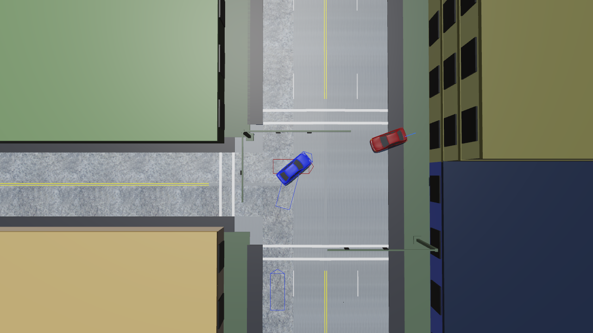
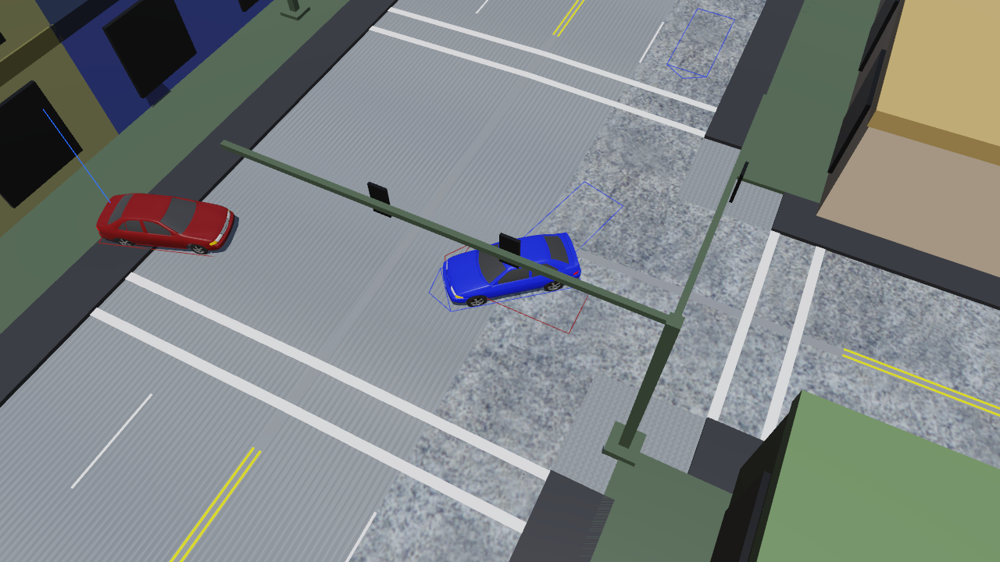
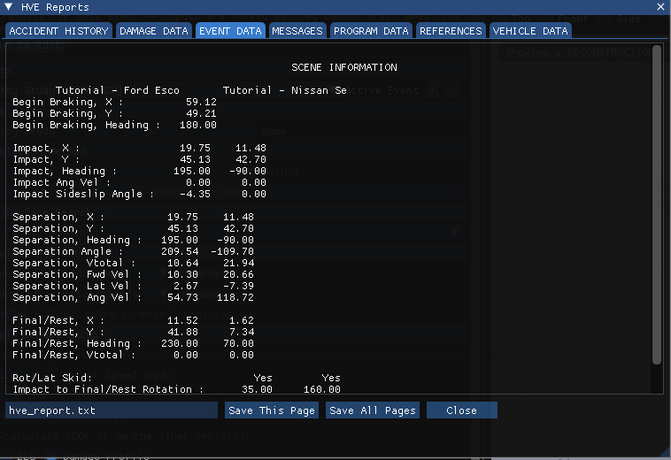
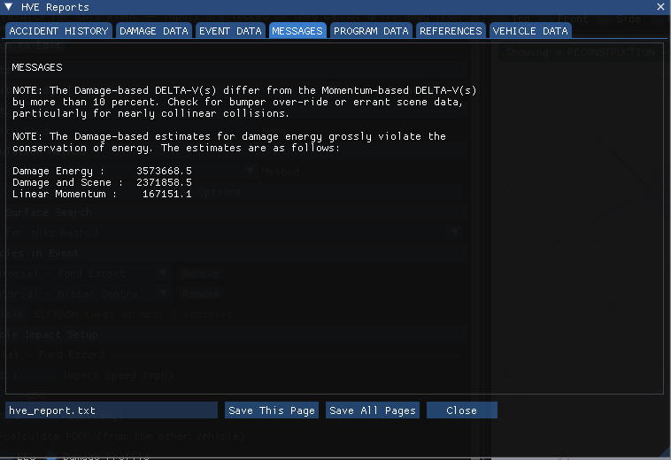

# Chapter 5 — EDCRASH Tutorial

This tutorial illustrates a very common use of EDCRASH, that is, to estimate the vehicle impact velocities from accident scene and vehicle damage measurements. This tutorial is continued in the EDSMAC(4) Tutorial, wherein the initial vehicle velocities are used to simulate the crash. You may wish to review that tutorial after finishing this one.

Like all EDCRASH events, the procedure involves the following basic steps:

- Create the vehicle(s)
- Create the environment
- Execute the EDCRASH event
- Review the EDCRASH output reports

This basic procedure is described in detail in this tutorial.

> **NOTE:** It is assumed that HVE Studio is up and running, and that the user is familiar with its basic features, such as the editor tabs, panels and the viewport. The purpose of this tutorial is to illustrate those features while setting up and executing an EDCRASH event.

!!! note "HVE Studio"
    This tutorial uses the case HVE's own EDCRASH tutorial produces,
    **EdcrashTutorialEDC.hve**, which is installed with HVE in its
    `supportFiles\case` folder. The vehicles in it come from HVE's tutorial
    vehicle database, which is not part of HVE Studio, so instead of building
    the case from an empty one you **open that case** and follow its inputs
    step by step: each section says where the input is in HVE Studio and what
    value the tutorial uses. To practise entering them, add a second
    EDCRASH event to the same case (Creating the Event, below) and enter
    the values there. The results quoted are HVE Studio's; they match those
    printed in HVE's tutorial.

## Getting Started

As in other tutorials, before we get started, let's set the user options so we're all starting on the same page.

1. Choose **File › Open Case...** and open **EdcrashTutorialEDC.hve**.
2. Choose **Tools › Preferences...** and set **Units** to **Metric (m, km/h, kg, N)**.

   > **NOTE:** As we'll see when we look at the environment, our EDCRASH Tutorial studies a crash that took place in Australia; thus we use metric units.

3. On the **View** menu, make sure **Key Results** is shown, and in **View › Scene Display** set **Scene Ghosts** to **Outline** so that every scene position is drawn.

EDCRASH is a planar analysis, so HVE's AutoPosition option does not apply. The remaining options are at their defaults. We're now ready to proceed with the tutorial.

## Creating the Vehicles

The case contains two vehicles: a 1996 Ford Escort 2-Door Hatchback, drawn in blue, and a dark red 1995 Nissan Sentra 4-Door Sedan. Choose the **Vehicle** editor tab (F3) to see them. The **Vehicles** panel lists both; click one to make it the current vehicle.

> **NOTE:** To build such a case yourself, click **Add...** in the Vehicles panel and choose a vehicle from the loaded databases (or one of HVE's generic vehicles). HVE's *Tutorial.db* is not part of HVE Studio.

*Figure 5-1: The Ford Escort in HVE Studio's Vehicle editor.*

### Editing the Vehicles

In HVE's tutorial the vehicles' colour and weight are edited, and the Nissan's right-side stiffness is changed. In the opened case all of this is already done; here is where each value lives in HVE Studio.

**Colour.** Each vehicle's colour is the **Color** field (red, green and blue values and a colour swatch) in the **Identity** section of the Vehicles panel.

**Weight.** The Escort's measured total weight is 11032 N and the Nissan's 11282 N. Open **Size & Weight** in the Vehicles panel; the **Total Weight** field is under **Weight**. The case already carries these values (2480.1 lbf and 2536.3 lbf in Imperial units).

> **NOTE:** HVE's Inertias dialog has an *Auto Update Inertia When Weight Changes* option. Check the yaw inertia in the same section after changing a weight; only the yaw inertia is used by the 3-DOF EDCRASH calculations.

**Stiffness.** An SAE moving barrier crash test (SAE J972) revealed the A and B stiffness coefficients for the side of the Nissan were 245 N/cm and 50 N/cm², respectively. In HVE these are entered on the vehicle's right-side surface. In HVE Studio, EDCRASH takes its stiffness from the event's damage profile instead (see [Chapter 2](02-program-input.md#exterior)), so we enter them with the Nissan's damage profile below.

## Saving the Case

Now that we've opened the case, let's save it as an HVE Studio case file:

1. Choose **File › Save Case As...**.
2. Enter the file name *EdcrashTutorial* and save. HVE Studio saves `.hvex` files; **File › Save Case As JSON...** saves the same case as a `.json` text file.

   > **NOTE:** HVE Studio reads HVE's `.hve` files but does not write them.

> **NOTE:** Saving the file occasionally is a highly recommended practice.

## Creating the Environment

The case carries its environment, the intersection from HVE's tutorial site *EdcrashEdsmacTutorial.h3d*. Choose the **Environment** editor tab (F4) to see it, and **Environment › Environment...** to see its settings:

- Location *Sydney, NSW, Australia* (latitude 33°53′ S, longitude 151°10′ E), site name *Blind Intersection*.
- Date and time of the incident, 7/23/99 at 1330.
- The angle from true north to the earth-fixed X axis, −10 degrees — in HVE Studio the **North** setting of the sun and sky (**Edit the sun and sky...**).

> **NOTE:** The latitude, longitude, date, time and angle from true north are used to position the sun in the scene. This is, of course, important because the sun is the primary light source for the scene.

To load a different site into a case of your own, use **Scene Geometry › Browse...** and **Import** in the same dialog.

## Creating the Event

As mentioned at the outset, this EDCRASH tutorial describes a common application of EDCRASH, that is, to determine pre-impact vehicle velocities. This can be accomplished only when scene data (vehicle positions at impact and rest) are known. Fortunately, we have that data, owing to a splendid at-scene investigation. In addition, vehicle damage profiles are available from vehicle inspections.

Choose the **Event** editor tab (F5). The case's event, *Visibility Study*, is the active event in the **Event Information** panel. To create such an event yourself:

1. Under **Events**, click **+**.
2. Under **Calculation Method**, choose **EDCRASH**.
3. Under **Vehicles in Event**, click **Add Vehicle** and add the Ford Escort and the Nissan Sentra.
4. Under **Event**, enter the name *Visibility Study*.

Event set-up for EDCRASH involves the following three steps:

- **Position the Vehicles** — The minimum required vehicle positions are Impact and Rest. Vehicle positions at Begin Braking, Separation, Point-on-curve (POC) and End-of-rotation (EOR) are optional positions that may be assigned for each vehicle.

  > **NOTE:** If Impact and Rest positions are not assigned for both vehicles, impact speeds cannot be computed — it is physically impossible!

- **Assign Wheel Data** — Wheel data (% Wheel Lock-up, Steer Angle and Pre-impact Wheel Lock-up) are required whenever scene data are supplied.
- **Assign Damage Profiles** — Vehicle damage profiles (damage Width, Depth and Offset) are optional for oblique collisions, but required for collinear collisions, where the momentum analysis is too sensitive to the scene data to be reliable.

  > **NOTE:** Even though damage profiles are not required for oblique collisions, they provide an excellent confirming analysis.

All three are entered in the **Vehicle Impact Setup** section of the Event Information panel and in **Event › Driver Controls...**.

*Figure 5-2: Vehicle Impact Setup for the two vehicles of the Visibility Study event (Imperial units).*

### Positioning the Ford Escort

The Escort skidded for a short distance before impact. Its positions are entered under its name in Vehicle Impact Setup:

1. Open **Scene positions** and tick **Begin Braking**. Enter X = 18.0 m, Y = 15.0 m and a heading of 180 degrees.
2. Tick **Scene positions known (impact + rest)**. Enter the impact position, **Impact X** = 6.0 m, **Impact Y** = 13.75 m, **Impact heading** = 195.0 degrees.
3. Enter the rest position, **Rest X** = 3.5 m, **Rest Y** = 12.75 m, **Rest heading** = 230 degrees.

   > **NOTE:** The impact position can also be dragged in the viewport (select the vehicle, then G to move or R to rotate). Typing the coordinates is usually easier.

4. Enter the Escort's sideslip angle at impact, **Impact sideslip** = −4.35 degrees. (It is under **Impact heading**; Key Results shows it as *Impact Side Slip*.)

> **NOTE:** In HVE and in HVE Studio, +230 degrees is not the same as −130 degrees because the relative magnitude between two angles implies the rotation direction! For example, if the impact heading angle is 180 degrees and the rest heading angle is 230 degrees, the change in heading angle between impact and rest is +50 degrees clockwise; if the rest heading angle is −130 degrees, the change in heading angle is −310 degrees and the direction of rotation is counter-clockwise.

> **NOTE:** You do not enter an impact speed. The *Impact Speed* field shown in Vehicle Impact Setup is not an EDCRASH input; it is EDCRASH's role to calculate impact speed!

*Figure 5-3: The scene from above after the run. Each vehicle is drawn at rest, and its other scene positions are outlined (View › Scene Display › Scene Ghosts).*

### Driver Controls for the Ford Escort

Next, let's enter the driver controls for the Ford Escort:

1. Choose **Event › Driver Controls...**. For an EDCRASH event the Driver Controls dialog shows a single **Wheel Data** tab.
2. Choose *Tutorial - Ford Escort* in the **Vehicle** list at the top.

*Figure 5-4: Wheel Data for the Ford Escort.*

According to our vehicle inspection, both front wheels were locked after impact by damage, while the rear wheels were free turning. Let's enter the appropriate values, first for the front wheels:

1. Enter 1.0 in **Axle 1 - Right Lock-up** and in the **Left Lock-up** below it.

Now the rear wheels:

1. Enter 0.01 ($0.01/\mu_{slide}$) in **Axle 2 - Right Lock-up** and in its **Left Lock-up**.

**Table 5-1: Typical Wheel Lock-up Values [20]**

| Wheel Condition | Typical Range |
|---|---|
| No Damage, Free-rolling | $0.01/\mu_{slide}$ to $0.02/\mu_{slide}$ |
| No Damage, Drive Wheel | $0.10/\mu_{slide}$ to $0.15/\mu_{slide}$ |
| Damage | 0.0 to 1.0 |

> **NOTE:** For undamaged wheels, be sure to divide by the slide coefficient of friction, $\mu_{slide}$, before entering the value for each wheel.

Next, let's enter the Percent Lock-up during pre-impact braking. Because the tires left skidmarks, we'll assume 100 percent braking:

1. Enter 1.0 in **Total Lock-up** under **Pre-Impact**.

   > **NOTE:** The note under this field says it is used, because the Begin Braking position is set; the Accident History reports the speed at the start of braking.

Finally, noting the vehicle rotated and skidded after impact, let's select that EDCRASH option:

1. Tick **Rot / Lat Skidding**.

> **NOTE:** With **Auto-set Rot/Lat Skidding** on in the EDCRASH Options (the default), EDCRASH decides this flag itself from the spinout path.

The wheel data have now been assigned for the Ford Escort. The dialog applies each entry as you make it; close it when you are done.

### Damage Profile for the Ford Escort

Let's conclude event set-up for the Escort by supplying a damage profile, under its name in Vehicle Impact Setup:

1. Enter **11FDEW3** in the **CDC** field and −30 in **PDOF (deg)**.

Because we actually measured the damage profile during our vehicle inspection, let's enter the measured width, depth and offset. We measured seven crush depths, so we have six crush zones:

1. Open **Measured Crush (drives Delta-V)** and set **# crush depths** to 7.
2. Enter the seven crush depths in **C1** to **C7**, beginning on the left end of the damage profile, according to Table 5-2. In Metric units the depths are entered in metres.
3. Enter **Damage width** 1.6942 m (169.42 cm) and **Damage offset** 0.

**Table 5-2: Crush depths for the front of the Ford Escort 2-Dr Hatchback**

| Crush Depth No. | Crush Depth (cm) |
|---|---|
| 1 | 75.0 |
| 2 | 60.0 |
| 3 | 50.0 |
| 4 | 45.0 |
| 5 | 40.0 |
| 6 | 40.0 |
| 7 | 45.0 |

> **NOTE:** Front and rear crush depths are entered left-to-right.

The case carries the Escort's front stiffness in **Per-zone A/B**: A = 294.43 lbf/in and B = 102.88 lbf/in² in every zone (about 51,560 N/m and 709,300 N/m² in Metric units).

*Figure 5-5: The Ford Escort's damage profile in Vehicle Impact Setup (Imperial units).*

> **NOTE:** HVE's Damage Profile dialog shows the default profile for the CDC and the barrier results (force, energy) while you type. HVE Studio does not; the damage energy and peak force appear in Key Results and in the Damage Data report after the run.

Event set-up for the Ford Escort is now complete.

### Setting Up the Nissan Sentra

Let's set up the Nissan Sentra, under its name in Vehicle Impact Setup. We'll start by assigning its impact and rest positions:

1. Tick **Scene positions known (impact + rest)**.
2. Enter the impact position, **Impact X** = 3.5 m, **Impact Y** = 13.0 m, **Impact heading** = −90 degrees.
3. Enter the rest position, **Rest X** = 0.5 m, **Rest Y** = 2.25 m, **Rest heading** = 70 degrees.

   > **NOTE:** In HVE and in HVE Studio, +70 degrees is not the same as −290 degrees because the relative magnitude between two angles implies the rotation direction!

The Nissan's positions are now established. Let's enter the driver controls. In this case, there are no driver inputs, per se. However, after impact the vehicle coasts to rest, so we need to enter rolling resistances. In **Event › Driver Controls...**, choose *Tutorial - Nissan Sentra* in the **Vehicle** list.

According to our vehicle inspection, all the wheels were free turning (i.e., not locked by damage). Let's enter the appropriate values, first for the front wheels:

1. Enter 0.20 ($0.15/\mu_{slide}$) in **Axle 1 - Right Lock-up** and its **Left Lock-up**.

Now the rear wheels:

1. Enter 0.01 ($0.01/\mu_{slide}$) in **Axle 2 - Right Lock-up** and its **Left Lock-up**.

   > **NOTE:** The Nissan is a front wheel drive vehicle, hence the larger front wheel lock-up values; see Table 5-1.

Finally, noting the vehicle rotated and skidded after impact, let's select that EDCRASH option:

1. Tick **Rot / Lat Skidding**.

The wheel data have now been assigned for the Nissan Sentra.

### Damage Profile for the Nissan Sentra

Let's conclude event set-up for the Nissan Sentra by supplying a damage profile:

1. Enter **02RPEW3** in the **CDC** field.
2. Open **Measured Crush (drives Delta-V)**, set **# crush depths** to 5, and enter **Damage width** 2.20 m and **Damage offset** −0.40 m.
3. Enter the five crush depths along the right side in **C1** to **C5**, according to Table 5-3.

**Table 5-3: Crush depths for the right side of the Nissan Sentra 4-Dr**

| Crush Depth No. | Crush Depth (cm) |
|---|---|
| 1 | 20.0 |
| 2 | 30.0 |
| 3 | 50.0 |
| 4 | 45.0 |
| 5 | 10.0 |

> **NOTE:** Side crush depths are entered rear-to-front.

Now the stiffness. Open **Per-zone A/B (4 zones)** and enter the side stiffness from the barrier test, A = 245 N/cm and B = 50 N/cm², in every zone. In Metric units the fields are in N/m and N/m², so enter A = 24,500 and B = 500,000 (in Imperial units, 139.90 lbf/in and 72.52 lbf/in²). Entering zone 1 and clicking **All same as zone 1** fills the rest.

With this uniform stiffness (and the CDC's default PDOF of 60 degrees), HVE's tutorial reports a peak force of 506,798 Newtons on the Nissan against 783,139 Newtons on the Ford Escort. According to Newton's 3rd Law, the forces on both vehicles should be equal.

> **NOTE:** It is quite common for the initially computed forces to be different when side impact is involved because a vehicle's side stiffness varies according to where it was impacted; the wheels are much stiffer than other locations.

The best way to solve this problem is to adjust the stiffness coefficients to equalize the forces. If the damage profile has uniform stiffness, we can quickly estimate the amount of the adjustment from the current ratio of the calculated collision forces. But the side of the Nissan does not have a uniform stiffness, and a large portion of the impact force was applied at the right rear wheel. Therefore, we cannot directly use that method. Let's adjust the stiffness by increasing the A and B coefficients for zone 1, the zone that includes the right rear wheel, using trial and error.

> **NOTE:** The A and B stiffness coefficients are related; when adjusting the stiffness coefficients, always multiply A and B by the same factor!

In HVE Studio each trial is a run: enter the zone 1 values, press **Run**, read **Impact Force** for both vehicles in **Key Results**, then press **Reset** before the next change. HVE's tutorial tries factors of 2 and 5 before settling on 4:

1. Enter zone 1 **A** = 98,000 N/m (980 N/cm, 245 × 4) and **B** = 2,000,000 N/m² (200 N/cm², 50 × 4). In Imperial units these are 559.59 lbf/in and 290.08 lbf/in².

This is what the opened case carries.

### Checking the PDOFs

It is always a good idea to make sure that the entered impact positions and PDOFs conform to Newton's 3rd Law. According to Newton's 3rd Law, the vehicles' PDOFs must be equal and opposite. When we apply this constraint to our data, we find the following condition must be satisfied:

$$PDOF_1 + \psi_1 = PDOF_2 + \psi_2 \pm 180$$

where $\psi$ = heading angle. Solving for $PDOF_2$, we have:

$$PDOF_2 = PDOF_1 + \psi_1 - \psi_2 \pm 180 = -30 + 195 - (-90) \pm 180 = 75\ \text{deg}$$

But we assigned a CDC of 02RPEW3, which has a default PDOF of 60 degrees. Our calculation above shows that to satisfy Newton's 3rd Law, we must change the PDOF to 75 degrees:

1. Enter 75 in the Nissan's **PDOF (deg)** field.

   > **NOTE:** If you tick **Auto-calculate PDOF (from the other vehicle)** for the Nissan, EDCRASH will make this calculation for you automatically! Tick it for one vehicle only.

Due to the effect of the energy magnification factor, the change to the PDOF changes the peak force calculated for the Nissan Sentra. With the PDOF at 75 degrees the peak force is 709,760 N for the Nissan Sentra. By comparing this force with the peak force on the Ford Escort, 783,139 N, we find the difference is acceptable, so we are finished setting up the event.

### Executing the Event

Now we're ready to execute the event:

1. Press **Run** on the playback bar under the viewport.

Unlike simulation calculations, which are repetitive, reconstruction calculations are executed only once, and thus happen very quickly. The results appear at once in **Key Results**, and the event's inputs are locked until you press **Reset**.

> **NOTE:** HVE Studio then plays a path for each vehicle drawn through its scene positions at the speeds EDCRASH solved, labelled "Showing the reconstruction". It is a picture of the reconstruction, not a simulation.

We have now completed the event.

*Figure 5-6: EDCRASH Tutorial event after execution. The vehicles are at rest; their other scene positions are outlined.*

For this case HVE Studio's Key Results are:

| | Ford Escort | Nissan Sentra |
|---|---|---|
| Impact speed | 27.5 km/h (17.1 mph) | 36.5 km/h (22.7 mph) |
| Speed at Begin Braking | 54.4 km/h (33.8 mph) | — |
| Delta-V (momentum) | 12.6 km/h (7.84 mph) | 12.3 km/h (7.67 mph) |
| PDOF (momentum) | −30.4° | 74.6° |
| Peak (impact) force | 783,140 N | 709,760 N |

## Viewing Results

Now that we have produced our EDCRASH results, let's take a detailed look at them. In HVE Studio the reports are on the **Output** menu of the Event editor.

EDCRASH produces the following reports:

- **Accident History** — A table of user-entered positions and their respective (calculated) velocities
- **Damage Data** — A table of damage profile coordinates, CDC, PDOF and Delta-V for each vehicle
- **Damage Profiles** — A plan view of the vehicles showing their damage profiles (damage width, depth and midpoint offset)
- **Event Data** — A table of scene data (positions, orientations and velocities)
- **Messages** — A list of messages produced by the current run
- **Momentum Diagrams (Scene and Damage)** — A vector diagram showing the pre-impact and post-impact momentum vectors for each vehicle. The scene-based diagram uses impact velocity calculated from the momentum-based delta-V; the damage-based diagram uses the impact velocity calculated from the damage-based delta-V.
- **Program Data** — A table containing program control information
- **Site Drawing** — A static perspective view of the accident site showing the vehicles at their user-entered positions
- **Vehicle Data** — A series of tables containing the vehicle data used by EDCRASH

!!! warning "Not in HVE Studio"
    The three graphic reports — Damage Profiles, Momentum Diagrams and Site
    Drawing — are not produced. Figure 5-3 shows the scene positions, which
    is what the Site Drawing is used to check.

### Report Windows

The alpha-numeric reports are in one window:

1. Choose **Output › HVE Reports...**. The **HVE Reports** window shows a tab for each report EDCRASH built for the *Visibility Study* event: Accident History, Damage Data, Event Data, Messages, Program Data, References and Vehicle Data.
2. Click a tab to display that report.

The reports are in HVE's units (mph, inches, and so on) whatever the Preferences are set to; Key Results follows the Preferences. The reports produced for the *Visibility Study* event are described below.

### Accident History

The EDCRASH Accident History report is the primary output from EDCRASH. This report summarizes the key results for each vehicle, including impact velocity, delta-V for each available calculation method (Damage and Linear Momentum), separation velocity and relative velocity at impact.

*Figure 5-7: Accident History Report for the Visibility Study event.*

### Damage Data

The Damage Data report provides the user-entered damage profile and other event-related damage data for the current EDCRASH event.

*Figure 5-8: Damage Data Report for the Visibility Study event.*

### Damage Profiles

The Damage Profiles report provides a visual representation of the user-entered damage profile and PDOF for the current EDCRASH event. It is not produced by HVE Studio; the profile's numbers are in the Damage Data report.

### Event Data

The EDCRASH Event Data report includes all the scene data used for the current EDCRASH event. This scene data also provides the total amount and direction of rotation (clockwise vs counter-clockwise).

*Figure 5-9: Event Data Report for the Visibility Study event.*

### Messages

The Messages report produced by EDCRASH is one of its most important reports. While simulation programs typically produce very few messages, a reconstruction program has the opportunity to evaluate the consistency of the user-entered scene and damage measurements. Careful review of these messages may show inconsistencies; correcting these inconsistencies may lead to improved results.

*Figure 5-10: Messages Report for the Visibility Study event.*

### Momentum Diagrams

The Momentum Diagram reports are not produced by HVE Studio.

### Program Data

The EDCRASH Program Data report lists the physics program, in this case EDCRASH, and physics program version number. It also contains parameters used when the Trajectory Simulation option is selected and consistency checks within EDCRASH.

*Figure 5-11: Program Data Report for the Visibility Study event.*

### Site Drawing

The Site Drawing is a static display of the event with the vehicles at their user-entered path positions (Begin Braking, Impact, Point-on-curve, End-of-rotation and Rest). It is not produced by HVE Studio; the viewport's scene ghosts show the same positions (Figure 5-3).

### Vehicle Data

The Vehicle Data report provides the physical data used by EDCRASH, including dimensions, inertias, tire properties, wheel lock-ups and stiffness coefficients.

*Figure 5-12: Vehicle Data Report for the Visibility Study event.*

> **NOTE:** The Vehicle Data and several other reports contain more information than fits into the default window size. Use the scroll bar or resize the window to view the entire report.

### Printing

HVE Studio does not print. To keep a report:

1. In the HVE Reports window, click the report's tab.
2. Enter a file name in the field at the bottom (default `hve_report.txt`) and click **Save This Page**, or click **Save All Pages** to write every page to that one file. It is saved beside the case file unless the name includes a folder; the line under the buttons shows where.

The file is plain text and can be printed from any text editor. The table in the **Trajectory** section of the Key Results panel can be exported with **Export CSV...** or copied with **Copy CSV**.

---

*Previous: [Chapter 4 — Calculation Method](04-calculation-method.md) · Next: [Chapter 6 — Messages](06-messages.md)*

<!-- NAV -->

---

← Previous: [Chapter 4 — Calculation Method](04-calculation-method.md)  |  [Index](README.md)  |  Next: [Chapter 6 — Messages](06-messages.md) →

<!-- /NAV -->
